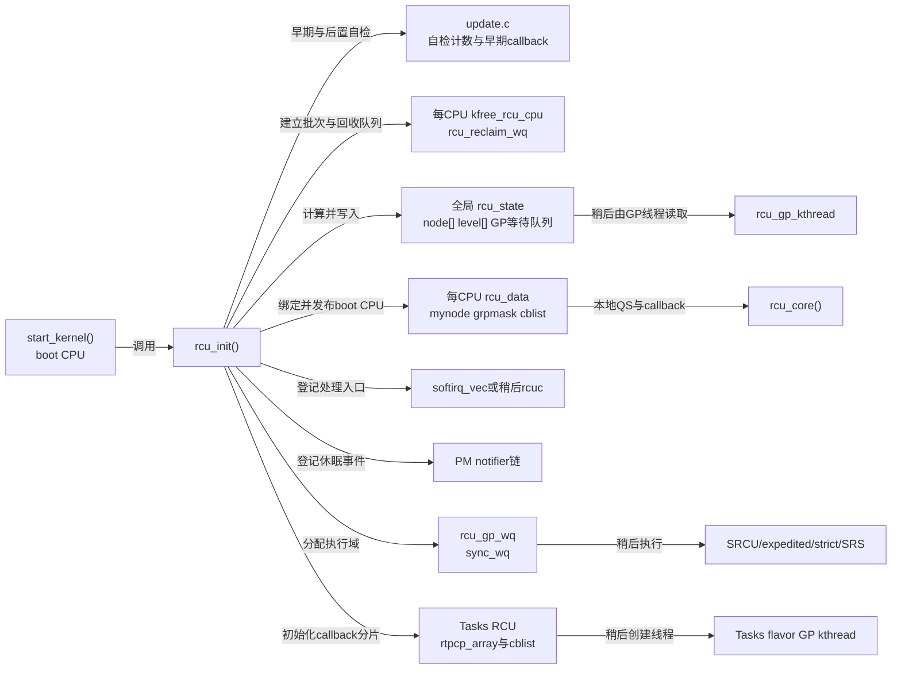
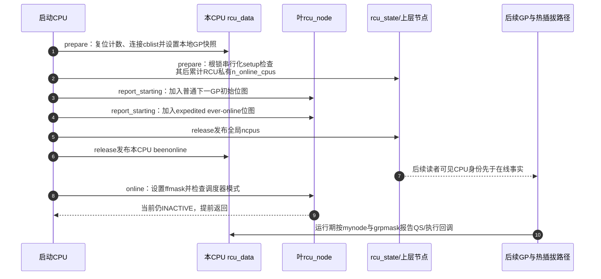

# 第12章\_Linux\_6.12\_Tree\_RCU\_rcu\_init启动初始化源码实现

## 12.1\_从start\_kernel里的一个调用固定本章任务

**讲解层次：实现层。** 前面已经建立 GP、回调及 SRCU 的运行周期；本章反过来追问，在这些执行者尚不存在时，启动代码怎样先建立可用状态。读-复制-更新（Read-Copy Update，RCU）是一类把读侧临时访问与更新后的延迟回收分开的同步机制。Tree RCU 是 Linux 普通 RCU 的一种实现家族专名；`Tree` 不是缩写，它表示该实现用分层 `rcu_node` 树汇聚许多中央处理器（Central Processing Unit，CPU）的完成证据。`rcu_init` 则是内核源码函数标识符，不存在需要展开的英文全称；本章讨论的是它在启动阶段怎样把静态初值变成可供后续 RCU 路径使用的基础设施。

下面的启动片段还会先用到四个简称：NOCB 是 no-callbacks 回调卸载策略；代码注释里的 GP/CB 分别是宽限期（grace period）与回调（callback）；HPC 是高性能计算（high-performance computing）。`CONFIG_RCU_NOCB_CPU` 是编译期启用 NOCB 基础设施的 Kconfig 布尔配置；`rcu_nocbs=` 与 `nohz_full=` 都是内核启动参数，前者直接选择回调卸载 CPU，后者选择 full-dynticks CPU 并把这些 CPU 纳入回调卸载集合；代码注释中的 `NO_HZ_FULL` 指的正是这种 full-dynticks 模式。

读者实际遇到它的位置不是 `kernel/rcu/` 目录的孤立函数，而是 [`init/main.c`](../../linux/init/main.c) 中的：

```c
workqueue_init_early();     /* 先建立工作队列的早期基础设施和系统工作队列；此时 worker 线程尚未开始执行工作。 */

rcu_init();                 /* 初始化普通 Tree RCU：建立分层树、启动 CPU 状态、回调承载物和后续异步处理入口。 */

trace_init();               /* 初始化内核跟踪事件基础设施；从这里之后，常规 trace event 才可使用。 */
context_tracking_init();    /* 初始化用户态、空闲态与内核态的上下文跟踪，为 RCU 识别扩展静止状态提供依据。 */
early_irq_init();           /* 初始化通用中断描述符以及中断子系统的早期管理结构。 */
init_IRQ();                 /* 执行体系结构相关的中断初始化，接通中断控制器与架构中断入口。 */
tick_init();                /* 初始化时钟滴答广播框架；具体时钟事件设备会在后续路径中注册。 */

/*
 * 初始化 Tree RCU 的 NOCB callback-offload 拓扑：
 * 识别需要避免本地执行 RCU 回调的 CPU（如 rcu_nocbs/nohz_full CPU），
 * 将其 per-CPU callback list 切换为 offloaded 模式，并建立 NOCB
 * GP/CB kthread 分组。
 *
 * 注意：NOCB 不改变 Tree RCU 的宽限期检测算法，
 * 只改变这些 CPU 的 RCU callback 推进/执行上下文，
 * 主要用于 NO_HZ_FULL、CPU isolation、HPC 和实时低抖动场景；
 * CONFIG_RCU_NOCB_CPU 未启用或最终 offload mask 为空时，不建立上述布局。
 */
rcu_init_nohz();

init_timers();              /* 初始化普通内核定时器的每 CPU 基座，并登记定时器软件中断处理函数。 */
srcu_init();                /* 完成可睡眠 RCU 的全局启动，使早期积压请求可转入正常延迟工作路径。 */
hrtimers_init();            /* 初始化高精度定时器的每 CPU 基座，并登记高精度定时器软件中断处理函数。 */
softirq_init();             /* 初始化 tasklet 队列并登记 tasklet 软件中断；RCU 软件中断入口已由 rcu_init() 登记。 */
```

只看这一个调用仍无法回答：

1. 链接到 `rcu_init()` 的究竟是 Tree RCU 还是 Tiny RCU，是否存在运行时类型分派；
2. 为什么函数能在中断、完整 workqueue、普通 GP 内核线程和第二颗 CPU 都未就绪时运行；
3. 它除了建 `rcu_node` 树，还初始化了哪些测试、延迟释放、softirq、休眠通知、每 CPU 状态、workqueue、回调过载阈值和 Tasks RCU 队列；
4. 哪些名字带有“init”，却明确不属于这个函数；
5. 任意一行被提前、删除或改成“失败后继续”会破坏哪条后续不变量。

本章在 Linux 6.12.20 固定源码上保留 I0～I13 的总事务。[配置、参数与树形容量](P17_Linux_6.12_RCU配置选择参数与树形容量源码实现.md#17.1_先决定编译什么再决定初始化多大)独立展开构建与容量选择；[早期请求与执行模式交接](P18_Linux_6.12_RCU早期请求与执行模式交接源码实现.md#18.1_没有执行者时登记的请求由谁接管)展开自检、释放队列、Tasks 分片和后半程。读完以后，读者应能从 `start_kernel()` 手工展开 `rcu_init()`，对每个直接动作说出 **写入地址、写入者、后续读取者、配置退化和启动时序约束**，并能判断一个初始化修改需要同步检查哪些后续消费者。

## 12.2\_术语入口与源码身份

本章会反复使用以下名称。它们属于不同类型，不能都当成“RCU 类型”：

`CONFIG_PREEMPT_RT` 是 Kconfig 配置符号；它表示目标内核是否启用实时抢占模型，并在本章相关分支中影响 RCU core 由 softirq 还是 `rcuc` 线程承载。这里只追踪该配置对 `rcu_init()` 事务的影响，不把实时抢占子系统本身并入本章。

| 名称 | 类型与朴素含义 | 当前职责 | 不能误解成 |
| --- | --- | --- | --- |
| 宽限期（Grace Period，GP） | 逻辑等待边界 | 证明边界以前的旧读侧访问已经结束 | <span style="color:gray;">~~固定时长、线程或 workqueue~~</span> |
| 静止状态（Quiescent State，QS） | CPU 或任务越过旧访问边界的证据 | 后续由每 CPU状态向节点树汇聚 | <span style="color:gray;">~~“CPU 没有任务”或休眠时间~~</span> |
| callback | GP 完成后才获得执行资格的延迟函数 | 承接对象释放、唤醒或其他延迟动作 | <span style="color:gray;">~~GP 本身~~</span> |
| boot CPU | 启动时唯一 online 的 CPU | 执行 `start_kernel()` 和本章全部初始化写入 | <span style="color:gray;">~~永远固定为逻辑 CPU0 的 API 契约~~</span> |
| per-CPU | 每个 possible CPU 都有独立槽位的存储模型 | 保存 `rcu_data`、`kfree_rcu` 批次等本地状态 | <span style="color:gray;">~~只有 online CPU 才分配~~</span> |
| `rcu_state` | Tree RCU 的唯一全局状态载体 | 保存 GP 代际、节点数组、等待队列和执行者入口 | <span style="color:gray;">~~“整个 RCU 只有一个状态机”~~</span> |
| `rcu_data` | 每 CPU Tree RCU 状态载体 | 保存叶节点地址、本地 QS、callback 与热插拔快照 | <span style="color:gray;">~~`rcu_node` 的动态副本~~</span> |
| `rcu_node` | 分层汇聚节点结构体 | 保存一组 CPU/子节点的证明债务、锁和慢路径状态 | <span style="color:gray;">~~调度域或非一致内存访问拓扑~~</span> |
| Kconfig | Linux 构建期配置系统专名 | 决定编译哪个实现文件和哪些条件分支 | <span style="color:gray;">~~启动后可任意切换的运行时参数~~</span> |
| `defconfig` / `.config` | 配置种子 / Kconfig 求解后的完整结果 | 前者只记录需要显式给出的输入，后者才记录本次构建最终启用的配置 | <span style="color:gray;">~~`defconfig` 没写就等于功能关闭~~</span> |
| softirq | 软件中断执行机制专名 | 在普通配置中承载 `rcu_core()` 本地推进 | <span style="color:gray;">~~一个长期内核任务~~</span> |
| workqueue | Linux 异步工作执行框架专名 | 承载延迟释放、SRCU、轮询 GP 和同步请求清理 | <span style="color:gray;">~~`rcu_init()` 当场执行工作项~~</span> |
| NOCB | “no callbacks” 回调卸载策略的历史简称 | 把指定 CPU 的 callback 推进/执行交给卸载线程 | <span style="color:gray;">~~新的保护域或第二棵普通 GP 树~~</span> |
| Tasks RCU | 以任务轨迹为证明对象的独立保护域家族 | 本函数末尾只建立其 callback 运输账本 | <span style="color:gray;">~~Tree RCU 的抢占配置~~</span> |

源码身份为 NXP `linux-imx` 官方发布标签 `lf-6.12.20-2.0.0`，解引用提交 `dfaf2136deb2af2e60b994421281ba42f1c087e0`，Linux 6.12.20。既有证据按该固定提交保存；本轮重新对照固定提交的源码内容与相关 Git blob，包括 `init/main.c`、`tree.c`、`tree.h`、`tree_plugin.h`、`tree_nocb.h`、`tree_exp.h`、`update.c`、`rcu.h` 与 `rcupdate.h`；不依据本机目录名称推断版本。

既有配置快照只确认 `CONFIG_TREE_RCU=y` 与 `CONFIG_PREEMPT_RCU=y`。本章分析 **可抢占 Tree RCU** 的条件路径，不把历史配置当作本次目标配置；2026-09-05 保存的另一份历史快照记录为 `CONFIG_TINY_RCU=y`、`CONFIG_SMP=n`、`CONFIG_PREEMPT_NONE=y`，对应实现入口见 [Linux 6.12 Tiny RCU 源码实现](P13_Linux_6.12_Tiny_RCU源码实现.md#13.14_rcu_init的三个动作不是Tiny的全部实现)。当前外部工作树不可访问，本次配置与运行核对未完成；以下条件分支均不宣称在当前目标上实测。

关联入口：

| 入口 | 本章怎样复用 |
| --- | --- |
| [Linux 源码阅读基线](../../linux/SOURCE_BASELINE.md#1.5.1_RCU家族证据) | 固定官方远端、不可变提交、配置快照与仓库保存的源码证据 |
| [RCU 源码总阅读索引](../navigation/P01_Linux_6.12_RCU源码总阅读索引.md#1.2_先建立源码分类坐标) | 区分保护域、实现家族、读侧模型与运行策略 |
| [拓扑与 CPU 热插拔模块导读](../navigation/P04_Linux_6.12_Tree_RCU_拓扑与CPU热插拔模块源码概念导读.md#4.1_本模块究竟解决什么问题) | 追踪静态树和 CPU 参与集合的模块关系 |
| [GP 全局生命周期模块导读](../navigation/P03_Linux_6.12_Tree_RCU_GP全局生命周期模块源码概念导读.md#3.1_模块问题与版本边界) | 区分本章基础设施与稍后创建的 GP 内核线程 |
| [回调与 NOCB 模块导读](../navigation/P07_Linux_6.12_Tree_RCU_回调与NOCB模块源码概念导读.md#7.6_NOCB为何拆成GP线程与CB线程) | 从模块层理解 `rcu_init_nohz()` 建立的回调卸载组织关系 |
| [稳定机制正文 P07](../../../../knowledge/linux/synchronization_and_asynchrony/synchronization/rcu/P07_Tree_RCU_初始化_拓扑与执行上下文.md#7.1_具体问题_CPU的QS究竟要写进哪一个节点) | 建立跨版本的初始化、拓扑和执行上下文模型 |
| [稳定机制正文 P16](../../../../knowledge/linux/synchronization_and_asynchrony/synchronization/rcu/P16_Tree_RCU_NOCB回调卸载.md#16.2_卸载前后责任对比) | 区分 Tree RCU 宽限期算法、回调卸载策略与执行位置 |

## 12.3\_进入rcu\_init以前内核已经保证了什么

`start_kernel()` 的位置决定了本函数可以使用什么，也决定了它不能做什么。进入时已经成立：

1. `smp_setup_processor_id()`、`boot_cpu_init()` 已确定当前 boot CPU；
2. `setup_nr_cpu_ids()` 已把 `nr_cpu_ids` 收敛为本次启动实际需要覆盖的 possible CPU 上界；
3. `setup_per_cpu_areas()` 已建立 per-CPU 地址，因此可以遍历全部 possible CPU 的 `rcu_data` 和 `kfree_rcu` 槽位；
4. 命令行的 early 参数与普通内核参数已经解析，`rcutree.*` 参数已有最终启动值；
5. 页分配、slab 依赖和调度器基础结构已经建立；
6. `housekeeping_init()` 已确定隔离/housekeeping 边界；
7. `workqueue_init_early()` 已允许创建 workqueue 和排队/取消 work，但完整 worker 执行要等以后 `workqueue_init()`；
8. `local_irq_disable()` 以后中断一直关闭；online CPU 数应为一；尚未发生第一次任务上下文切换。

进入时仍然不成立：

- `rcu_state.node[]` 尚未按本次 `nr_cpu_ids` 建立有效父子关系；
- 普通 GP kthread、每 CPU `rcuc`、NOCB、boost 与 expedited worker 尚未创建；
- `rcu_scheduler_active` 仍为 `RCU_SCHEDULER_INACTIVE`；
- `rcu_init_nohz()`、`srcu_init()`、`softirq_init()` 尚未调用；
- 第二颗 CPU 尚未进入 RCU 参与协议。

这解释了为什么本函数可以无 CPU-hotplug 锁地写共享初始化状态，却不能当场依赖一个可调度的 RCU 内核线程推进工作。

## 12.4\_逐行展开rcu\_init的直接动作

下面的中文 Doxygen 和行内注释由本仓库补充，不是上游原文；函数语句保持 Linux 6.12.20 固定提交的原始顺序。

```c
/**
 * @brief 建立 Tree RCU 在 boot CPU 与 possible CPU 集合上的启动基础设施。
 * @context start_kernel()，中断关闭，仅 boot CPU online，调度器尚未进入运行模式。
 * @post 拓扑、每 CPU 地址、boot CPU 参与位和异步执行入口已经可供后续阶段消费。
 * @note 本函数不创建普通 GP kthread，也不完成 NO_HZ、SRCU 或 Tasks GP 线程启动。
 */
void __init rcu_init(void)
{
	int cpu = smp_processor_id();

	/* I1：在功能状态尚未完全建立时验证早期 RCU 契约。 */
	rcu_early_boot_tests();

	/* I2：建立 kfree_rcu()/kvfree_rcu() 的批处理与回收执行基础。 */
	kfree_rcu_batch_init();

	/* I3：报告实现/非默认配置，并规整公告路径中的少数启动参数。 */
	rcu_bootup_announce();
	/* I4：把后续RCU线程的优先级收敛到合法范围。 */
	sanitize_kthread_prio();

	/* I5～I6：计算运行期树几何，再把静态数组变成有效拓扑。 */
	rcu_init_geometry();
	rcu_init_one();
	if (dump_tree)
		rcu_dump_rcu_node_tree();

	/* I7：普通配置登记 softirq handler；RT 分支稍后使用 rcuc 线程。 */
	if (use_softirq)
		open_softirq(RCU_SOFTIRQ, rcu_core_si);

	/* I8：按 CONFIG_PM_SLEEP 注册真实 notifier，或编译为无动作。 */
	pm_notifier(rcu_pm_notify, 0);

	/* 此时仍只能有 boot CPU。 */
	WARN_ON(num_online_cpus() > 1);

	/* I9：准备 boot CPU、发布参与位，再完成 early-online 状态。 */
	rcutree_prepare_cpu(cpu);
	rcutree_report_cpu_starting(cpu);
	rcutree_online_cpu(cpu);

	/* I10：建立 SRCU/expedited/strict 与同步请求清理使用的 workqueue。 */
	rcu_gp_wq = alloc_workqueue("rcu_gp", WQ_MEM_RECLAIM, 0);
	WARN_ON(!rcu_gp_wq);
	sync_wq = alloc_workqueue("sync_wq", WQ_MEM_RECLAIM, 0);
	WARN_ON(!sync_wq);

	/* I10：节点锁已就绪以后，才开放 callback 过载检查阈值。 */
	if (qovld < 0)
		qovld_calc = DEFAULT_RCU_QOVLD_MULT * qhimark;
	else
		qovld_calc = qovld;

	/* I11：补发早于完整初始化出现的轮询式 expedited GP 请求。 */
	(void)start_poll_synchronize_rcu_expedited();

	/* I12：再次验证拓扑建立后的早期同步等待语义。 */
	rcu_test_sync_prims();

	/* I13：按实际启用的 Tasks flavor 建立 per-CPU callback 运输账本。 */
	tasks_cblist_init_generic();
}
```

这里不是一个单一状态机，而是八组正交状态按顺序汇合：测试生命状态、延迟释放批次、配置派生值、固定拓扑、每 CPU 参与状态、本地执行入口、workqueue 执行能力以及 Tasks callback 运输状态。某一组“初始化完成”不能替代另一组。

实现原理：先建立不会被后续并发重写的地址关系和门闩，再发布唯一启动 CPU 的参与身份，最后才开放可能异步执行或取得节点锁的路径。I0～I13 不是按功能目录随意排列，而是把每个消费者的前置状态压成一条可证明的偏序。



## 12.5\_I0到I13的初始化阶段账本

| 阶段 | 触发与写入地址 | 写入者 | 后续读取者 | 退出条件 |
| --- | --- | --- | --- | --- |
| I0 固定现场 | `cpu = smp_processor_id()` | boot CPU | 三个 boot CPU 生命周期调用 | 本次函数始终指向同一当前 CPU |
| I1 早期契约测试 | 自检计数、可选早期 callback/轮询 cookie | `rcu_early_boot_tests()` | late initcall 验证器、后续 callback 路径 | 早期 API 没有破坏未初始化状态 |
| I2 延迟释放基础 | `rcu_reclaim_wq`、每 CPU `krc`、shrinker | boot CPU | `kvfree_call_rcu()`、监控/回收 work、内存回收器 | 每个 possible CPU 批次对象可安全接收请求 |
| I3 配置公告 | 日志、NO_HZ 耐心值、Tasks stall 倍数 | `rcu_bootup_announce()` 调用链 | FQS/NOCB/Tasks 诊断 | 实现与异常配置已报告，公告路径参数已归一化 |
| I4 优先级净化 | `kthread_prio` | `sanitize_kthread_prio()` | 后续 RCU 线程创建 | 优先级满足配置相关下限与 `0～99` 上限 |
| I5 几何 | `rcu_num_lvls`、`num_rcu_lvl[]`、`rcu_num_nodes`、FQS 延时 | `rcu_init_geometry()` | `rcu_init_one()`、GP 与 FQS 路径 | 运行期层数覆盖全部 `nr_cpu_ids` |
| I6 拓扑与静态槽位 | `node[]/level[]`、节点锁/队列、`rdp->mynode/grpmask` | `rcu_init_one()` | QS、GP、NOCB、expedited、barrier | 每个 possible CPU 可 O(1) 定位叶节点 |
| I7 core执行入口 | `softirq_vec[RCU_SOFTIRQ]` 或明确不登记 | boot CPU | `raise_softirq()` 或稍后 `rcuc` | 对应配置的 core 入口选择已兑现 |
| I8 电源入口 | PM notifier 链或编译期空操作 | boot CPU | suspend/hibernate 通知 | 睡眠配置分支已登记或明确为空 |
| I9 boot CPU 接入 | `rdp` 快照/cblist、参与位、`ncpus`、`beenonline`、`ffmask` | boot CPU | 下一轮 GP、expedited、FQS、core | 私有容器、身份发布和在线状态三段完成 |
| I10 异步执行与过载门闩 | `rcu_gp_wq`、`sync_wq`、`qovld_calc` | boot CPU | SRCU、strict、exp poll、SRS cleanup、callback过载路径 | workqueue 对象已分配且节点锁可供过载检查；执行仍等待完整 workqueue 阶段 |
| I11 早期轮询补发 | `rnp->exp_seq_poll_rq`、`exp_poll_wq` work | boot CPU | `sync_rcu_do_polled_gp()` | 当前/更早 cookie 将由稍后 work 推进覆盖 |
| I12 后置契约测试 | 普通与 expedited 早期序列 | `rcu_test_sync_prims()` | 后续 scheduler 模式切换自检 | 拓扑建立后早期同步原语仍成立 |
| I13 Tasks callback 运输 | 各 flavor `rtpcp_array` 与 per-CPU `cblist` | boot CPU | 后续 Tasks GP/CB 线程 | 所有已启用 flavor 可以安全接收 callback |

### 12.5.1\_I阶段怎样回接公共实现抽象与运行周期

I0～I13 描述的是一次 **启动初始化事务**，不是一轮宽限期。为了让源码不脱离原理，下面把每组 I 阶段映射回 [P04 的七项实现抽象](../../../../knowledge/linux/synchronization_and_asynchrony/synchronization/rcu/P04_RCU_分类坐标与内核配置.md#4.1.4_先提炼跨类型实现都必须回答的七个问题)、[P07 的 B0～B6 初始化模型](../../../../knowledge/linux/synchronization_and_asynchrony/synchronization/rcu/P07_Tree_RCU_初始化_拓扑与执行上下文.md#7.3_B0到B6_拓扑建立的统一阶段)和 [P05 的运行期 S0～S9 周期](../../../../knowledge/linux/synchronization_and_asynchrony/synchronization/rcu/P05_Tree_RCU_公共骨架与完整周期.md#5.5_S0到S9的一次完整周期)：

| 源码阶段 | 建立或检查的抽象职责 | 对应 P07 初始化阶段 | 后续运行期意义 |
| --- | --- | --- | --- |
| I0、I3、I4 | 固定启动执行者、公布构建/参数选择并净化后续线程条件 | B0 以前的启动边界 | 限定后续状态属于哪个实现和执行配置，本身不产生 GP 完成证据 |
| I1、I12 | 检查公共 API 在早期状态下没有越过契约 | 不建立功能状态 | 只增加诊断证据；检查通过不能代替运行期 reader、GP 与 callback 证明 |
| I2 | 建立延迟释放的容器、批次与异步工作入口 | 与 B3 和 B6 的结果交付基础设施相邻 | 为 P05 S8～S9 的释放交付准备地址，但此时没有执行目标 callback |
| I5 | 计算汇聚拓扑的实际容量与层级 | B0 | 让 P05 S4 可以只对本次启动实际存在的节点建债 |
| I6 | 初始化 `rcu_node`、每 CPU `rcu_data` 及其直接映射 | B1～B2 | 为 P05 S4～S7 提供建债、局部证据和分层汇聚地址，并为 S8 保留本地 callback 状态 |
| I7 | 登记 softirq core 入口或明确选择线程分支 | B3 | 让后续本地证据检查和 callback 推进拥有消费执行上下文 |
| I8 | 把系统睡眠事件接到 RCU 生命周期入口 | B3 的系统事件边界 | suspend/hibernate 到来时能够调整运行状态；它不是普通 GP 的完成路径 |
| I9 | 依次准备、发布并 online 启动 CPU | B4～B5 | 让后续 GP 在 P05 S4 从正确参与集合建债，并让本 CPU 在 S5 记录证据 |
| I10 | 建立异步 workqueue 与 callback 过载计算条件 | B6 的一部分 | 为 GP 请求、轮询、SRS cleanup 和 callback 管理提供排队能力；完整 worker 仍在后继阶段开放 |
| I11 | 把过早提出的 expedited poll 请求接回稍后可运行的 work | B6 的请求修复分支 | 维护请求代际与未来完成之间的连续性，不直接宣布 P05 S7 已完成 |
| I13 | 建立 Tasks flavor 的 callback 运输账本 | 不属于普通 Tree 的 reader/QS 初始化 | 只为 Tasks RCU 的结果交付预留 per-CPU 队列；其 reader 定义、GP 线程和完成证据在独立类型中建立 |

因此，读初始化源码时先问“这一行让哪项职责以后成为可能”，再进入运行期调用者；不能因为字段已经初始化，就提前断言对应 GP、callback 或 Tasks flavor 已经运行。

I1/I2 的早期测试与释放账本、I12/I13 的后置测试与 Tasks 分片在 [早期请求交接篇](P18_Linux_6.12_RCU早期请求与执行模式交接源码实现.md#18.2_I1为何在树建立以前先运行自检)逐句展开；I3～I5 的参数归一化和几何计算在 [配置与容量篇](P17_Linux_6.12_RCU配置选择参数与树形容量源码实现.md#17.3_I3与I4先公布异常配置再净化线程优先级)展开。它们仍是同一 I 周期的前置步骤，并未移到另一轮启动中执行。

## 12.6\_I6把几何兑现为全局树\_每节点状态和每CPU入口

`rcu_init_one()` 是 I6 的唯一函数体展开位置，完整逐句讲解见 [Linux 6.12 Tree RCU `rcu_init_one()` 拓扑源码实现](P06_Linux_6.12_Tree_RCU_拓扑与CPU热插拔源码实现.md#6.4_rcu_init_one建立固定汇聚树并绑定每CPU叶节点)。本节不复制该函数体，而是说明它在 `rcu_init()` 总事务中的输入、输出与后续依赖。

### 12.6.1\_三层状态分别落在哪里

| 层级 | 具体地址 | I6写入内容 | 后续主要写入者/读取者 |
| --- | --- | --- | --- |
| 全局 | `rcu_state` | `level[]`、GP/expedited 等待队列、初始序列 | GP kthread、expedited 路径、屏障路径 |
| 汇聚节点 | `rcu_state.node[]` 中实际前缀 | 锁、CPU 范围、父指针、父位、GP 快照、QS 位图、阻塞读者链、expedited 4 槽等待队列和 poll work | 叶节点由 CPU 报告，父节点由最后一个子节点上报，根节点形成全局结论 |
| 本地 | 每 possible CPU 的 `rcu_data` | `mynode`、`grpmask`、CPU 号、初始 GP 快照、屏障哨兵、NOCB/回调基础状态 | 本 CPU `rcu_core()`、热插拔、GP/FQS/NOCB 路径 |

其中 `mynode` 是从每 CPU 私有状态直达其叶节点的指针，`grpmask` 是该 CPU 在叶节点位图中的唯一位。运行期 CPU 报告 QS 时不需要重新搜索树：先清自己的叶位；若成为该叶最后一个参与者，再按 `parent` 与节点级 `grpmask` 逐层汇聚。

### 12.6.2\_I6同时预埋了可选分支的状态但没有启动执行者

- `CONFIG_PREEMPT_RCU`：初始化每个节点的 `blkd_tasks`，供被抢占读者按叶节点登记；该条件成立时走此分支，当前目标配置未验证。
- `CONFIG_RCU_NOCB_CPU`：`rcu_init_one_nocb()` 和 per-CPU 启动初始化建立 NOCB GP 等待队列、锁、回调分段与定时器；是否有 CPU 实际卸载由 CPU mask 决定。
- expedited RCU：每个节点建立 4 个按代数 `rcu_seq_ctr(s)` 的低两位复用的 `exp_wq[]`、`exp_poll_lock`、请求哨兵与 `exp_poll_wq`；根级再有 `exp_mutex`/`expedited_wq` 等协调状态。
- strict GP、boost 等编译分支：初始化各自的 work、锁或阻塞读者辅助状态。

这些初始化解决的是“以后从哪个地址收集证据、用什么锁保护、向谁传播”；I6 结束时没有 GP kthread、`rcuc`、`rcuo`、boost 或 expedited worker 正在运行。

## 12.7\_I7与I8接上回调执行入口和系统睡眠策略

树和每 CPU 地址建立以后，I7 选择本地 core 的未来执行入口，I8 则登记跨系统睡眠事务的策略入口。

### 12.7.1\_use\_softirq决定谁执行rcu\_core()

```c
if (use_softirq)
	open_softirq(RCU_SOFTIRQ, rcu_core_si);
```

非 PREEMPT_RT 构建中，`use_softirq` 默认真，并可由只读启动参数 `rcutree.use_softirq=` 改变；PREEMPT_RT 构建把它固定为假。真分支把 `RCU_SOFTIRQ` 的 action 槽写为 `rcu_core_si()`，后者再调用本 CPU 的 `rcu_core()`；假分支不登记该 softirq，稍后由每 CPU `rcuc/%u` 内核线程承担核心回调推进。

`open_softirq()` 此时只写静态 `softirq_vec[]` 的函数指针，不要求 `softirq_init()` 已经运行。后者在 `start_kernel()` 更靠后的位置初始化 tasklet 的 per-CPU 队列并登记 tasklet softirq；它不是 RCU action 槽可写的前置条件。反过来，I7 也没有“触发一次 RCU softirq”，因为中断仍关闭、尚无运行期回调事件。

### 12.7.2\_pm\_notifier()的编译期分歧

`CONFIG_PM_SLEEP=y` 时，`pm_notifier(rcu_pm_notify, 0)` 生成一个静态 `notifier_block` 并登记到 PM notifier 链：

- `PM_SUSPEND_PREPARE`/`PM_HIBERNATION_PREPARE`：`rcu_async_hurry()` 让 lazy 回调加速，`rcu_expedite_gp()` 增加 expedited 嵌套计数。
- `PM_POST_SUSPEND`/`PM_POST_HIBERNATION`：`rcu_unexpedite_gp()` 撤销嵌套，`rcu_async_relax()` 恢复 lazy 策略。

```c
/**
 * @brief 登记之后由未来 PM 事件调用，成对调整 lazy 与 expedited 策略。
 * @note 中文说明为仓库补充；下方保留 kernel/rcu/tree.c 函数的完整语句，省去原英文注释。
 */
static int rcu_pm_notify(struct notifier_block *self,
			 unsigned long action, void *hcpu)
{
	switch (action) {
	case PM_HIBERNATION_PREPARE:
	case PM_SUSPEND_PREPARE:
		rcu_async_hurry();
		rcu_expedite_gp();
		break;
	case PM_POST_HIBERNATION:
	case PM_POST_SUSPEND:
		rcu_unexpedite_gp();
		rcu_async_relax();
		break;
	default:
		break;
	}
	return NOTIFY_OK;
}
```

系统启动期的 `rcu_expedited_nesting` 初值已经让 RCU 偏向 expedited；该 notifier 负责未来睡眠事务的成对进入/退出，不在登记时模拟一次挂起。`CONFIG_PM_SLEEP=n` 时宏只保留对函数名的编译期引用并成为空操作，不存在运行时“登记失败后重试”。

## 12.8\_I9用三段协议把启动CPU加入已经存在的树

这里必须区分三件事：准备本地容器、发布 CPU 已开始、启用在线期策略。它们分别由 `rcutree_prepare_cpu()`、`rcutree_report_cpu_starting()`、`rcutree_online_cpu()` 完成，不能压缩成一句“把 CPU online”。



步骤 1～2 准备容器与初始化门闩；步骤 3～6 发布节点位和身份；步骤 8～9 只完成早期 online 允许的部分。线程创建与运行期开关要继续等后半程。

### 12.8.1\_第一段\_rcutree\_prepare\_cpu()建立CPU私有运行容器

它在根 `rcu_node` 锁下调用 `rcu_cpu_kthread_setup(cpu)` 和 `rcu_spawn_one_nocb_kthread(cpu)`；但 `rcu_scheduler_fully_active` 尚为假，因此这些 spawn 辅助函数只保存/检查状态并返回，不会绕过 `kthreadd` 提前造线程。然后函数：

1. 复位本 CPU 的回调长度/FQS 快照和批处理上限，设置 context-tracking 初始嵌套。
2. 只有 `rcu_segcblist` 尚未启用时才初始化它，因而不会抹掉更早 `call_rcu()` 或 NOCB 路径已经放入的回调。
3. 从 `mynode->gp_seq` 取得本地 GP 快照，设置 `gp_seq_needed`，把普通 flavor 的 `cpu_no_qs.b.norm` 置真，表示下一次需要提供 QS 证据。
4. 初始化 `rcu_core` 标志与 irq_work 等本地承载物，并把全局 `n_online_cpus` 从 0 增到 1。

这里的 `n_online_cpus` 是 Tree RCU 自己的初始化门闩，不等于通用 CPU hotplug 子系统的 `num_online_cpus()`。后者在调用前用于断言“启动现场至多一个在线 CPU”；前者让 `rcu_init_invoked()` 从假变真，I11 的早期 expedited poll 修复因而可以安全使用树和工作队列。

### 12.8.2\_第二段\_rcutree\_report\_cpu\_starting()发布身份与位图

该函数要求本地 IRQ 关闭，并用 `cpu_started` 避免同一次 starting 过程重复发布；CPU 下线会清除该标志，后续重新上线可以再次进入。它持有 `ofl_lock`、barrier lock 和叶节点锁，完成四类发布：

- 把 CPU 的 `grpmask` 加进普通下一轮 GP 的初始参与位图，使未来 GP 知道应等待谁。
- 把同一位加进 expedited 的“曾经在线”位图，避免 expedited 路径漏掉刚出现的 CPU。
- 更新 `cpu_started`、online 序列、溢出快照和 CPU 计数。
- 以 release 语义发布 `ncpus` 与 `beenonline`，并在返回前用完整内存屏障保证以后 RCU 读侧看见完整身份状态。

release 发布回答的是“其他 CPU 看见这个在线事实时，前面的节点位、每 CPU 地址和初始状态是否已经可见”。如果只写 online 标志再补普通字段，GP/FQS 或 barrier 路径可能拿到一个可枚举但尚未连接到树的 CPU。

### 12.8.3\_第三段\_rcutree\_online\_cpu()只完成当前阶段允许的部分

它先把 CPU 位写入叶节点 `ffmask`，供后续 force-QS/热插拔路径判断完全在线集合。接着检查 `rcu_scheduler_active`：当前仍是 `RCU_SCHEDULER_INACTIVE`，函数立即返回，所以不会做运行期 expedited 清理、线程亲和性调整或 tick dependency 清理。这种提前返回是启动阶段的预期路径，不是半初始化错误；剩余动作要在调度器和热插拔状态机具备运行条件后发生。

三段结束后得到的是“唯一启动 CPU 已有可发布、可汇聚的 RCU 身份”，而不是“多 CPU RCU 已经开始并发运行”。次级 CPU 仍由后续 SMP/CPU hotplug 回调走同一状态机加入。

## 12.9\_I10与I11建立异步执行面并修复过早发起的poll请求

boot CPU 身份发布后，初始化可以安全开放依赖节点锁、RCU 私有在线门闩和 workqueue 的异步控制路径。

### 12.9.1\_三个RCU工作队列不能混为一个

`rcu_init()` 本次一共分配三个全局 workqueue：I2 的 `rcu_reclaim_wq`，以及 I10 的 `rcu_gp_wq`、`sync_wq`。

| workqueue | 标志 | 直接/主要消费者 | 为什么不能互换 |
| --- | --- | --- | --- |
| `rcu_reclaim_wq` | `WQ_UNBOUND \| WQ_MEM_RECLAIM` | `kfree_rcu` monitor、RCU work、页缓存补充的延迟重试 | 最终释放可在任意合适 CPU 执行，故使用 unbound；流量可能很大，必须与 GP 控制面隔离 |
| `rcu_gp_wq` | `WQ_MEM_RECLAIM` | Tree SRCU work、strict-GP work、每节点 expedited poll work | 承担“推进/补足 GP 条件”的控制工作，I11 立即依赖它 |
| `sync_wq` | `WQ_MEM_RECLAIM` | SRS（synchronize_rcu 请求合并）清理工作 | 处理普通同步请求的生命周期，避免与 expedited/释放工作互相阻塞 |

`WQ_MEM_RECLAIM` 要求 workqueue 在内存回收依赖链中保留前进能力；它不表示分配动作不会失败，也不表示 worker 已经在 I10 开始执行。`workqueue_init_early()` 已在 I0 前运行，所以可以创建并排队；真正的 worker 池、rescuer 和常规执行能力要到后面的 `workqueue_init()` 才完整建立。

`page_cache_work` 有一条细分路径：需要立刻补页时先投递到 `system_highpri_wq`，延迟重试才投递到 `rcu_reclaim_wq`；`monitor_work` 和等待 GP 的 `rcu_work` 使用 `rcu_reclaim_wq`。I2 初始化的是同一个 `delayed_work` 对象，具体投向由后来触发现场选择，不能从 `INIT_DELAYED_WORK()` 一行反推出唯一队列。

两次 `alloc_workqueue()` 后都只有 `WARN_ON(!wq)`，没有回滚前面树/CPU 状态，也没有备用执行器。后续代码仍按非空 workqueue 使用这些指针，因此内存分配失败是严重启动异常，不能宣称 RCU 会自动退回同步执行。

### 12.9.2\_为什么qovld\_calc必须在节点锁以后计算

```c
/* qovld < 0 表示采用默认倍率，0 表示关闭过载阈值，正数表示显式阈值。 */
if (qovld < 0)
	qovld_calc = DEFAULT_RCU_QOVLD_MULT * qhimark;
else
	qovld_calc = qovld;
```

`qovld_calc` 的静态初值为 `-1`。回调入队路径在它小于 0 时不会尝试按过载阈值更新叶节点；I6 初始化全部 `rcu_node->lock` 以后，I10 才把它变成最终阈值。这样可以容纳 I6 以前发生的早期 `call_rcu()`，又不会让它们锁一个尚未初始化的叶节点。默认值是 `DEFAULT_RCU_QOVLD_MULT * qhimark`；`qovld=0` 明确禁用该阈值；正值直接采用。

运行期回调数量跨过阈值时，本 CPU 路径才会在叶节点记录 `cbovldmask`，让 GP/FQS 逻辑知道哪个 CPU 的回调积压严重。I10 只发布阈值，不虚构一次过载事件。

### 12.9.3\_早期expedited\_poll为什么需要一次kick-start

```c
/**
 * @brief 完整控制分支按固定版本核对；状态作用由相邻正文解释。
 * @note 中文说明为仓库补充；下方保留 kernel/rcu/tree_exp.h 函数的完整语句，省去原英文注释。
 */
unsigned long start_poll_synchronize_rcu_expedited(void)
{
	unsigned long flags;
	struct rcu_data *rdp;
	struct rcu_node *rnp;
	unsigned long s;

	s = get_state_synchronize_rcu();
	rdp = per_cpu_ptr(&rcu_data, raw_smp_processor_id());
	rnp = rdp->mynode;
	if (rcu_init_invoked())
		raw_spin_lock_irqsave(&rnp->exp_poll_lock, flags);
	if (!poll_state_synchronize_rcu(s)) {
		if (rcu_init_invoked()) {
			rnp->exp_seq_poll_rq = s;
			queue_work(rcu_gp_wq, &rnp->exp_poll_wq);
		}
	}
	if (rcu_init_invoked())
		raw_spin_unlock_irqrestore(&rnp->exp_poll_lock, flags);

	return s;
}
```

I11 以前，某个启动路径可能调用该 API 取得 cookie；当时 `rcu_init_invoked()` 仍为假，函数只能返回状态快照，不能访问尚未建立的 `mynode` 锁或 `rcu_gp_wq`。I11 再调用一次并丢弃返回值，意图不是给 `rcu_init()` 自己保存 cookie，而是检查当前快照是否仍未被任何 GP 覆盖：

1. I6 已建立 `rdp->mynode`、`exp_poll_lock` 和 `exp_poll_wq`。
2. I9 已使 RCU 私有 `n_online_cpus` 非零，`rcu_init_invoked()` 返回真。
3. I10 已分配 `rcu_gp_wq`。
4. 若 `poll_state_synchronize_rcu(s)` 仍为假，就在节点保存 `exp_seq_poll_rq=s` 并排 `sync_rcu_do_polled_gp()`。
5. worker 以后反复调用 `synchronize_rcu_expedited()`，直到 `poll_state_synchronize_rcu(s)` 为真；取出请求时先把共享槽置为完成哨兵，退出前再检查期间到来的新请求，已被覆盖才清除。

```c
/**
 * @brief 取出共享请求后在锁外等待，再核对期间出现的新目标。
 * @note 中文说明为仓库补充；下方保留 kernel/rcu/tree_exp.h 函数的完整语句，省去原英文注释。
 */
static void sync_rcu_do_polled_gp(struct work_struct *wp)
{
	unsigned long flags;
	int i = 0;
	struct rcu_node *rnp = container_of(wp, struct rcu_node, exp_poll_wq);
	unsigned long s;

	raw_spin_lock_irqsave(&rnp->exp_poll_lock, flags);
	s = rnp->exp_seq_poll_rq;
	rnp->exp_seq_poll_rq = RCU_GET_STATE_COMPLETED;
	raw_spin_unlock_irqrestore(&rnp->exp_poll_lock, flags);
	if (s == RCU_GET_STATE_COMPLETED)
		return;
	while (!poll_state_synchronize_rcu(s)) {
		synchronize_rcu_expedited();
		if (i == 10 || i == 20)
			pr_info("%s: i = %d s = %lx gp_seq_polled = %lx\n", __func__, i, s, READ_ONCE(rcu_state.gp_seq_polled));
		i++;
	}
	raw_spin_lock_irqsave(&rnp->exp_poll_lock, flags);
	s = rnp->exp_seq_poll_rq;
	if (poll_state_synchronize_rcu(s))
		rnp->exp_seq_poll_rq = RCU_GET_STATE_COMPLETED;
	raw_spin_unlock_irqrestore(&rnp->exp_poll_lock, flags);
}
```

worker 先取出 `exp_seq_poll_rq` 并把共享槽置为完成哨兵，释放锁后才等待局部 cookie。新请求者可以在此期间写新目标并排 work；worker 尾部重读共享槽，只有已被 GP 覆盖才清除，不能无条件抹掉后来者。这是请求传给执行者的交接，不等于 work 一开始就宣布 GP 完成。

这也是 I6、I9、I10 不能随意换到 I11 后面的直接证据。I11 的正常结果可能只是一项都不排：若早期单任务语义已经覆盖 cookie，poll 立即成功。

## 12.10\_异常与失败不是一种统一语义

| 位置 | 触发条件 | 源码动作 | 初始化还能保证什么 |
| --- | --- | --- | --- |
| I2 | reclaim workqueue 分配失败 | `WARN_ON` 后继续 | per-CPU 批次仍建立，但没有等价的最终异步执行保证 |
| I2 | shrinker 分配失败 | `pr_err` 并从 I2 返回 | 正常批处理结构保留，只缺内存压力扫描入口 |
| I3 | nohz/Tasks stall 参数越界 | 钳位并打印 | 消费者看到合法值 |
| I4 | kthread priority 越界/过低 | 钳位并告警 | 后续线程取得修正值 |
| I5 | 叶扇出非法或容量不足 | `WARN_ON`，退回编译期几何 | 不按非法参数越界写节点数组 |
| I6 | `rcu_num_lvls` 超出静态范围 | `panic` | 视为内部不变量破坏，不能继续 |
| I9 | 通用在线 CPU 数已大于1 | `WARN_ON` | 代码仍继续，但启动顺序假设已破坏，结果不可视为正常基线 |
| I10 | `rcu_gp_wq`/`sync_wq` 分配失败 | `WARN_ON` 后继续 | 已建立树仍在，但后继无完整替代路径 |
| I13 | Tasks per-CPU 数组分配失败 | `BUG_ON` | 直接终止，避免发布无所有权的 callback 分片 |
| I1/I12 | 自检条件不成立 | WARN/晚期计数核对失败 | 诊断暴露阶段协议错误，不应当作可忽略性能信息 |

因此检查启动日志时必须记录“哪个检查点、是钳位/回退/告警/终止中的哪一种”，不能用“RCU init 有 warning 但应该降级了”覆盖差异。

## 12.11\_直接符号覆盖账本

这张表用于防止阅读时只追长函数而漏掉一行状态门闩。每个 `rcu_init()` 直接符号都在前文有归属：

| 直接符号 | 角色 | 本章位置 |
| --- | --- | --- |
| `smp_processor_id()` | 捕获唯一启动 CPU 编号 | [12.3](#12.3_进入rcu_init以前内核已经保证了什么)、[12.8](#12.8_I9用三段协议把启动CPU加入已经存在的树) |
| `rcu_early_boot_tests()` | 树建立前的可选自检 | [18.2](P18_Linux_6.12_RCU早期请求与执行模式交接源码实现.md#18.2_I1为何在树建立以前先运行自检) |
| `kfree_rcu_batch_init()` | 延迟释放流水线 | [18.3](P18_Linux_6.12_RCU早期请求与执行模式交接源码实现.md#18.3_I2怎样建立kfree_rcu延迟释放流水线) |
| `rcu_bootup_announce()` | 实现/异常参数公告与部分钳位 | [17.3](P17_Linux_6.12_RCU配置选择参数与树形容量源码实现.md#17.3_I3与I4先公布异常配置再净化线程优先级) |
| `sanitize_kthread_prio()` | 线程优先级净化 | [17.3](P17_Linux_6.12_RCU配置选择参数与树形容量源码实现.md#17.3_I3与I4先公布异常配置再净化线程优先级) |
| `rcu_init_geometry()` | 实际层数与节点数 | [17.4](P17_Linux_6.12_RCU配置选择参数与树形容量源码实现.md#17.4_I5从编译期容量中裁出本次启动真正使用的树) |
| `rcu_init_one()` | 全局、节点、每CPU状态 | [12.6](#12.6_I6把几何兑现为全局树_每节点状态和每CPU入口)及P06唯一实现讲解 |
| `dump_tree`/`rcu_dump_rcu_node_tree()` | 可选拓扑观测 | [17.4](P17_Linux_6.12_RCU配置选择参数与树形容量源码实现.md#17.4_I5从编译期容量中裁出本次启动真正使用的树) |
| `use_softirq`/`open_softirq()`/`rcu_core_si()` | core执行入口选择 | [12.7](#12.7_I7与I8接上回调执行入口和系统睡眠策略) |
| `pm_notifier()`/`rcu_pm_notify()` | 睡眠事务策略 | [12.7](#12.7_I7与I8接上回调执行入口和系统睡眠策略) |
| `num_online_cpus()`/`WARN_ON` | 验证单启动CPU前提 | [12.8](#12.8_I9用三段协议把启动CPU加入已经存在的树) |
| `rcutree_prepare_cpu()` | 建 boot CPU 私有容器 | [12.8](#12.8_I9用三段协议把启动CPU加入已经存在的树) |
| `rcutree_report_cpu_starting()` | 发布 boot CPU 身份与位图 | [12.8](#12.8_I9用三段协议把启动CPU加入已经存在的树) |
| `rcutree_online_cpu()` | 建在线期 mask并按模式提前返回 | [12.8](#12.8_I9用三段协议把启动CPU加入已经存在的树) |
| `alloc_workqueue("rcu_gp")` | GP/SRCU/expedited控制工作队列 | [12.9](#12.9_I10与I11建立异步执行面并修复过早发起的poll请求) |
| `alloc_workqueue("sync_wq")` | SRS清理工作队列 | [12.9](#12.9_I10与I11建立异步执行面并修复过早发起的poll请求) |
| `qovld`/`qovld_calc`/`qhimark` | 回调过载阈值门闩 | [12.9](#12.9_I10与I11建立异步执行面并修复过早发起的poll请求) |
| `start_poll_synchronize_rcu_expedited()` | 补排早期poll需求 | [12.9](#12.9_I10与I11建立异步执行面并修复过早发起的poll请求) |
| `rcu_test_sync_prims()` | 树建立后的可选自检 | [18.4](P18_Linux_6.12_RCU早期请求与执行模式交接源码实现.md#18.4_I12与I13收尾_再测同步原语并建立Tasks_RCU回调分片) |
| `tasks_cblist_init_generic()` | Tasks family回调分片 | [18.4](P18_Linux_6.12_RCU早期请求与执行模式交接源码实现.md#18.4_I12与I13收尾_再测同步原语并建立Tasks_RCU回调分片) |

## 12.12\_修改这段代码时必须守住的顺序边界

这段初始化最脆弱的不是单行赋值，而是“对象存在、身份发布、执行能力开放”三类事件的先后关系。

### 12.12.1\_不可随意交换的依赖

1. `setup_nr_cpu_ids()` 必须先于 I5，否则几何会冻结错误的 `nr_cpu_ids`。
2. `setup_per_cpu_areas()` 必须先于 I2/I6/I13，否则 per-CPU 地址尚不可用。
3. `workqueue_init_early()` 必须先于 I2/I10，否则 workqueue 对象甚至不能安全创建/排队。
4. I5 必须先于 I6；I6 必须先于 I9、`qovld_calc` 发布和 I11。
5. I6 的 `exp_poll_lock`/work、I9 的 `n_online_cpus` 门闩、I10 的 `rcu_gp_wq` 必须全部先于 I11。
6. I9 必须在中断、调度器和次级 CPU 启动以前保持单 CPU、IRQ-off 前提。
7. I13 必须先于 `rcu_init_tasks_generic()`，后者只能消费已经发布的 per-CPU callback 分片。
8. GP/core/NOCB/boost 等线程创建必须等 `kthreadd` 和相应初始化阶段，不能为“提前并行”塞进 `rcu_init()`。

### 12.12.2\_改动时要同步核对的调用方和配置

若改变 I0～I13 任一步，至少同时检查：`start_kernel()` 和 `rest_init()` 的阶段顺序、`kernel_init_freeable()` 的 workqueue/Tasks 初始化、RCU early/core initcall、CPU hotplug 回调、Tree/Tiny Makefile 选择、PREEMPT/RT/NOCB/BOOST/PROVE/PM/TASKS 配置分支、早期 `call_rcu()`/poll API 以及 `rcutorture` 启动测试。只让默认 SMP 非 RT 配置启动成功，不足以证明重排安全。

## 12.13\_怎样观察并验证这次初始化

验证必须把静态身份、启动日志和运行期执行证据分层，避免用后来的线程名替代早期状态发布证明。

### 12.13.1\_静态核对

```bash
# 确认实现选择与关键配置；本仓库记录的是配置事实，不以线程名猜配置。
grep -E 'CONFIG_(TREE_RCU|TINY_RCU|PREEMPT_RCU|PREEMPT_RT|RCU_NOCB_CPU|RCU_BOOST|PROVE_RCU|PM_SLEEP|TASKS_RCU)' .config

# 确认链接分派和直接调用次序。
grep -n 'CONFIG_TREE_RCU\|CONFIG_TINY_RCU' kernel/rcu/Makefile
sed -n '/void __init rcu_init(void)/,/^}/p' kernel/rcu/tree.c
```

源码树身份必须同时核对 official remote、固定提交 `dfaf2136deb2af2e60b994421281ba42f1c087e0`、Linux `6.12.20`、相关 `.config` 与相对路径；本机目录名不能充当版本证据。

### 12.13.2\_运行时观测及其证明边界

- 启动日志中的 `Preemptible hierarchical RCU implementation.` 证明公告分支被执行；它不证明 GP kthread 已经运行。
- 参数修正、几何调整、oddness 与 `dump_tree` 日志能核对配置和拓扑；没有日志可能只是采用默认值或未启用 dump。
- 完整启动后可观察 `rcu_gp`、`rcuc/*`、`rcuo*`、Tasks 等线程，但名称只证明对应执行者被创建，不能单独证明某个 GP 已完成。
- tracepoint、RCU stall detector、`rcutorture` 和 callback 计数可以观察后续状态推进；“未告警”只有在配置启用、hook 存在、测试路径实际执行且检查器未失效时才是有限证据。
- 要验证启动期早期 callback/poll 边界，应使用带 `CONFIG_PROVE_RCU`、早期 self-test 或专门启动测试的内核；启动后的普通驱动或内核测试调用无法回到 I1/I11 的时间窗口；这里讨论内核 API，不是用户态可直接调用的系统调用。

## 12.14\_结论\_rcu\_init()完成的是可运行前的状态协议

这次初始化的本质不是“启动一个 RCU 线程”，而是依固定顺序建立完整前提：选择 Tree/Preemptible 实现；验证早期 API；建立延迟释放承载物；公布并净化参数；从编译期容量计算实际树；初始化全局、节点和每 CPU 状态；选择 `rcu_core()` 的执行入口；登记睡眠策略；以三段发布协议把唯一启动 CPU 接入树；建立异步控制队列与回调过载门闩；修复过早 poll 请求；最后初始化可选 Tasks RCU 回调分片。

函数返回时，所有后续执行者已经有明确的状态地址、锁、队列、父子关系和发布顺序，但调度器模式仍是 `INACTIVE`。只有后续 `rcu_scheduler_starting()`、`workqueue_init()`、Tasks/Tree RCU initcall、SMP bring-up 与之后的 core initcall `rcu_set_runtime_mode()` 依次接力，这套静态协议才变成多 CPU 上持续运行的 GP、QS 汇聚和 callback 执行系统。

完整接力时序与两个模式切换函数见 [从启动请求到运行态](P18_Linux_6.12_RCU早期请求与执行模式交接源码实现.md#18.5_函数返回后RCU还远未进入完整运行态)。返回 [源码总阅读索引](../navigation/P01_Linux_6.12_RCU源码总阅读索引.md#1.6_建议的源码阅读顺序)。
