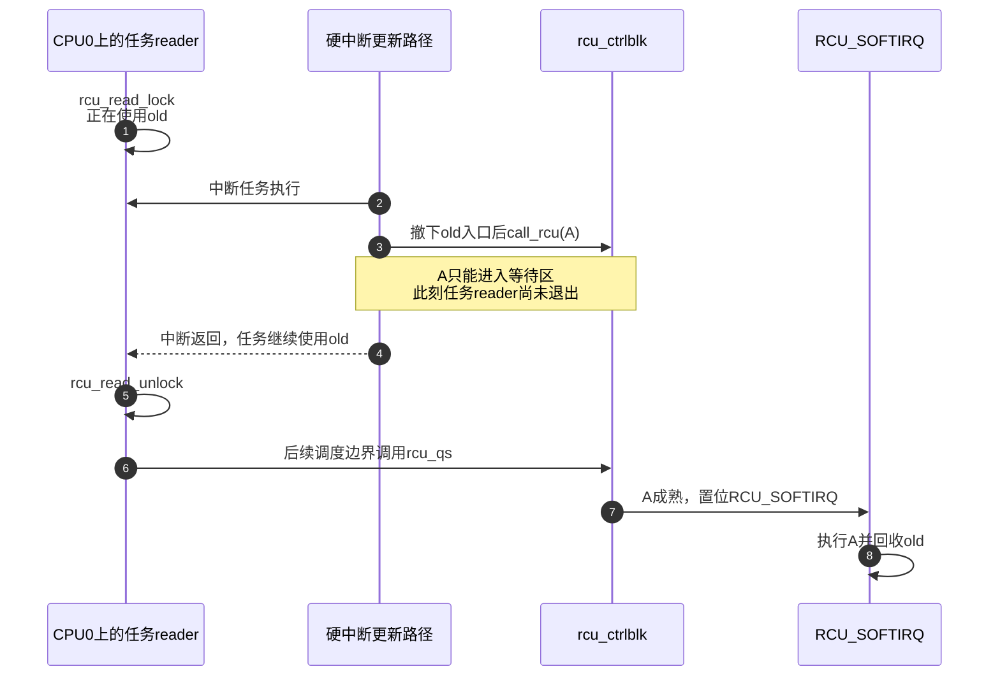
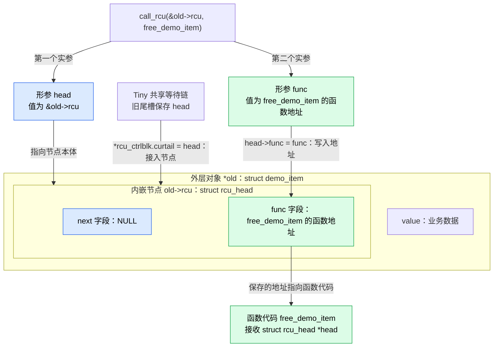
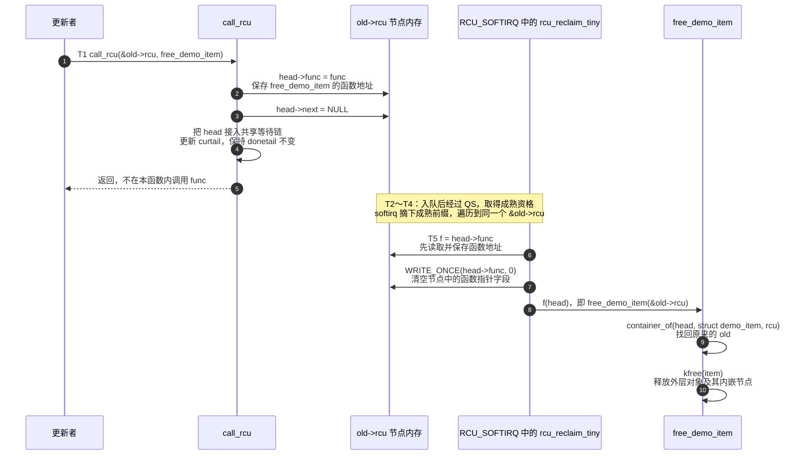
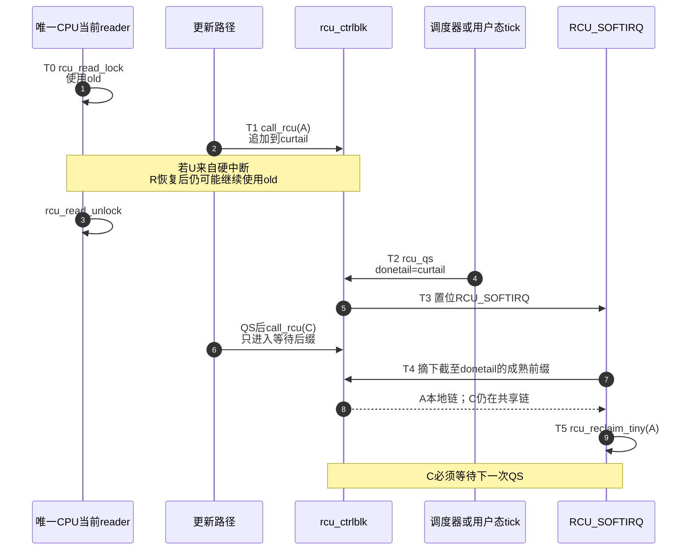

# 第13章\_Linux\_6.12\_Tiny\_RCU源码实现

## 13.1\_实现所有权与本章读者任务

* `RCU` 是英文全称 **Read-Copy Update（读-复制-更新）** 的缩写；
* `CPU` 是 **Central Processing Unit（中央处理器）** 的缩写；
* `UP` 是 **Uniprocessor（单处理器）** 的缩写。

本章先使用两个普通 RCU 公共 C 函数接口：`rcu_read_lock()` / `rcu_read_unlock()` 标出 reader 临界区的进入与退出，`call_rcu()` 把一个 `struct rcu_head` callback 提交给宽限期后的异步执行路径。它们的公共契约不因底层选择 Tiny 而改变，本章只追踪这些调用在 Tiny 配置下落到哪些状态地址和执行事件。

本章只追 Linux 6.12.20 的 **普通 Tiny RCU**。读者不需要先读完 Tree RCU，也不会在这里展开 Tiny SRCU、Tasks RCU 或 Tree RCU 的内部状态。唯一必须带入的公共契约是：

* reader 取得受 RCU 保护的指针；
* 更新者先撤掉旧入口；
* 旧 reader 跨过宽限期后，更新者才可以回收旧对象。

本章沿用公共契约中的 **宽限期（Grace Period，GP）**：等待撤销前可能持有旧指针的读者越过读侧边界。**静止态（Quiescent State，QS）** 是本实现据以排除这类旧读者的执行事件，不是“CPU 什么都没干”。

本章要把下面六个问题连成一轮真实运行过程：

1. 单 CPU 为什么仍然需要 RCU，而不只是“串行执行所以直接释放”；
2. `rcu_read_lock()` 没有建立 reader 链表时，旧 reader 为什么仍然不会跨过静止态；
3. `call_rcu()` 怎样用一个单链表和两个二级指针区分“已成熟”与“仍等待”的 callback；
4. 调度切换、用户态时钟中断和 idle 路径怎样共同产生或催促 `rcu_qs()`；
5. `RCU_SOFTIRQ` 怎样只摘下成熟前缀，而不误执行同一静止态之后新入队的 callback；
6. `synchronize_rcu()` 为什么可以立即返回，`rcu_barrier()` 为什么反而必须排队等待。

这里会遇到 **softirq（software interrupt，软件中断）**，它是内核在硬中断返回等检查点执行延期工作的通用子系统。本章只展开 RCU 自己拥有的三个接缝：`open_softirq()` 登记 RCU action、`raise_softirq_irqoff()` 设置本 CPU pending 位，以及通用分派器最终调用 `rcu_process_callbacks()`；pending 位扫描、`irq_exit_rcu()`、`__do_softirq()`、重启预算和 `ksoftirqd` 的完整实现所有权仍属于中断/softirq 专题。现有[中断专题覆盖边界](../../../../knowledge/linux/synchronization_and_asynchrony/asynchrony/interrupts/大纲.md#1.2_当前覆盖边界与源码缺口)已经明确记录这项待补源码闭环，不能把本章的 RCU 接入说明当成整个 softirq 子系统的逐行讲解。

模块角色与建议阅读顺序见 [Tiny RCU 模块源码概念导读](../navigation/P11_Linux_6.12_Tiny_RCU模块源码概念导读.md#11.1_模块问题与当前配置前提)，跨版本稳定的机制边界见 [Tiny RCU 单 CPU 实现](../../../../knowledge/linux/synchronization_and_asynchrony/synchronization/rcu/P20_Tiny_RCU_单CPU实现.md#20.1_单CPU删除了什么问题)，源码家族入口见 [Linux 6.12 RCU 源码总阅读索引](../navigation/P01_Linux_6.12_RCU源码总阅读索引.md#1.5_唯一实现讲解入口)。

源码身份固定为 NXP `linux-imx` 标签 `lf-6.12.20-2.0.0`、提交 `dfaf2136deb2af2e60b994421281ba42f1c087e0`、Linux 6.12.20；直接证据为 [`tiny.c`](../../linux/kernel/rcu/tiny.c)、[`rcutiny.h`](../../linux/include/linux/rcutiny.h)、[`rcupdate.h`](../../linux/include/linux/rcupdate.h) 和 [`rcu.h`](../../linux/kernel/rcu/rcu.h)。中文 Doxygen 与阶段说明为仓库补充，函数原语句按固定版本核对。

**配置边界：** 本章分析 `CONFIG_TINY_RCU=y`、非 SMP、非 PREEMPT_RCU 的普通 RCU 后端。调试开关另用 2026-09-05/06 的历史生成配置作为条件样本，简称“样本配置”；它不证明当前工作树、当前运行镜像或所有 Tiny 构建具有相同开关。历史身份及重建步骤见 [配置与构建证据核对](../../../../engineering/build/P01_Tiny_RCU配置与构建证据核对.md#1.2.3_真正生效的是生成配置)。当前目标配置和运行实验未验证。

本章先推导运行状态，再说明样本开关如何改变检查。Kconfig 名称是构建符号；`CONFIG_PROVE_RCU`/`DEBUG_LOCK_ALLOC` 控制 RCU 证明和 Lockdep 登记，`DEBUG_OBJECTS_RCU_HEAD` 控制节点生命周期检查，`RCU_TRACE` 控制 RCU trace 事件。它们不是 Tiny 功能状态机的同一个开关。其余字段和私有名字在首次进入对应函数前解释，结尾另列速查。

## 13.2\_沿T0到T5区分执行边界与队列交付

这里有互相约束的多组状态：读侧执行边界、callback 的等待/成熟/在途所有权，以及 poll 序列与通知位；不能用单个“已完成”位替代。以下阶段贯穿本章。


| 阶段 | 进入触发 | 关键地址变化 | 写入者 → 后续读取者 | 退出条件 |
| --- | --- | --- | --- | --- |
| T0 旧 reader 活跃 | `rcu_read_lock()` | 当前执行轨迹进入非抢占 reader | reader → 调度器 | reader 合法退出后才允许进入 QS |
| T1 callback 提交 | `call_rcu(A)` | `*curtail=A`，`curtail=&A.next` | 更新路径 → `rcu_qs()` | A 位于等待后缀 |
| T2 QS 产生 | 切换或用户态 tick | `donetail=curtail`，`gp_seq+=2` | 调度/tick → softirq | 调用前批次获得成熟资格 |
| T3 结果发布 | `raise_softirq_irqoff()` | 本 CPU `RCU_SOFTIRQ` pending 位置位 | `rcu_qs()` → softirq 核心 | handler 获得运行机会 |
| T4 成熟前缀摘链 | `rcu_process_callbacks()` | 共享头移到等待后缀，分界处置 NULL | softirq → 本地 callback 循环 | 本地链与共享链分离 |
| T5 回收执行 | `rcu_reclaim_tiny()` | `head->func` 清零或对象被 `kvfree()` | softirq → 对象生命周期 | 全部本地成熟项执行完成 |

## 13.3\_单CPU仍然会出现旧reader与更新者的时间交错

“只有一个 CPU”只消除了 **真正同时在两个 CPU 上执行内核代码** 的情形，没有消除任务、硬中断和 softirq 在同一 CPU 上的先后嵌套。下面这条合法交错足以说明 callback 不能立即执行：



若硬中断中的更新路径在 `call_rcu(A)` 后立刻释放旧对象，被中断的任务恢复时就会访问已释放内存。Tiny RCU 的价值正在这里：它不需要跨 CPU 汇聚，却仍要保存“这个回调必须等当前执行轨迹越过 QS”的时间债务。

同步更新者通常从进程上下文调用 `synchronize_rcu()`。在 UP、非抢占构建中，另一个任务中的旧 reader 若不先结束或越过调度边界，当前更新任务根本没有机会开始执行；硬中断中的旧 reader也必须先返回，任务才能继续调用同步接口。这组前提解释了同步入口为何可以退化，但 **不能** 推出异步 callback 也能在任意上下文立即执行。

## 13.4\_reader不登记名单但不能跨过调度边界

Tiny 不保存 reader 名单，但必须保证 reader 不会悄悄跨过被当作 QS 的调度事件。下面先看读侧怎样建立非抢占执行边界，再看调度器怎样消费这条边界。

### 13.4.1\_公共读侧包装保留非抢占执行约束

普通读侧在 `!CONFIG_PREEMPT_RCU` 分支调用 `__rcu_read_lock()`/`__rcu_read_unlock()`：前者执行 `preempt_disable()`，后者先 `preempt_enable()`，再按 `CONFIG_RCU_STRICT_GRACE_PERIOD` 常量决定是否调用严格测试钩子。这两个公共函数与非抢占 Tree 共用，完整函数体的唯一位置在 [非抢占读侧边界](P02_Linux_6.12_Tree_RCU_等待桥_QS与节点汇聚关键函数源码实现.md#2.5_rcu_note_context_switch与rcu_qs记录静止态)。Tiny 分支把严格钩子定义为空宏；这里继续核对它们在本章配置下的实际效果。

样本配置是 `CONFIG_PREEMPT_NONE=y`、`CONFIG_PREEMPT_COUNT=y`、`CONFIG_PREEMPTION=n`。按 `include/linux/preempt.h` 的实际分支，`preempt_disable()` 增加抢占计数并执行编译器屏障，`preempt_enable()` 执行编译器屏障并减少计数，不进入可抢占构建的 `__preempt_schedule()` 分支。因此不能把当前读侧包装说成全空，也不能说解锁会主动触发任务抢占。Tiny 不为每个 reader 分配节点，也不在 `rcu_ctrlblk` 中增加 reader 计数；正确性依赖的约束是：**合法普通 reader 不阻塞，并且不能跨过真正的任务调度切换。**

公共 `rcu_read_lock()` / `rcu_read_unlock()` 还包含 Lockdep 登记与上下文检查。样本中 `CONFIG_DEBUG_LOCK_ALLOC=y`，对应 map 登记不是空操作；但 Tiny 的 `rcu_is_watching()` 在 `include/linux/rcutiny.h` 中恒返 `true`，所以包装中的 `RCU_LOCKDEP_WARN(!rcu_is_watching(), ...)` 条件恒假。两者不能混称为“都有检查”或“都没有检查”；公共适配实现见 [RCU 读侧检查包装](P04_Linux_6.12_RCU_Lockdep适配层源码实现.md#4.4.2_三种读侧API为何按这个顺序配对)。

这里的“无 reader 名单”不是“没有通信”。reader 把成本转成执行约束；调度器在上下文切换点读取这条约束已经结束的事实，再调用 Tiny 的 QS 路径。被删除的是逐 reader 登记和跨 CPU 汇聚，不是读侧边界。

### 13.4.2\_调度器把上下文切换变成QS

`include/linux/rcutiny.h` 在 Tiny 配置下提供：

```c
/**
 * @brief 在真实任务切换前报告普通 Tiny RCU 静止态。
 * @note 保留上游宏的两个调用位置；样本配置中的 Tasks 调用为空操作。
 */
#define rcu_note_context_switch(preempt) \
	do { \
		rcu_qs(); \
		rcu_tasks_qs(current, (preempt)); \
	} while (0)
```

`kernel/sched/core.c::__schedule()` 在关闭本地中断后调用这个宏。一个合法非抢占 reader 不可能执行到 `__schedule()` 后仍声称自己处在原临界区，所以这次切换足以排除调用前的旧普通 reader。

样本未启用 `CONFIG_TASKS_RCU_GENERIC`，`include/linux/rcupdate.h` 选中 `#define rcu_tasks_qs(t, preempt) do { } while (0)`。因此这次构建的宏只产生普通 Tiny 的 `rcu_qs()` 动作，没有额外向 Tasks reader 发送通知。

## 13.5\_一个链表和两个二级指针怎样表达三种状态

确认 reader 不会跨过调度 QS 后，下一步是保存 callback 欠账。Tiny 没有分段队列对象，而是用一个全局控制块在同一条链上表达空、成熟前缀和等待后缀。

### 13.5.1\_控制块只有四个字段

```c
/**
 * @brief Tiny RCU 的全局 callback 控制块。
 * @note 仓库补充中文 Doxygen，字段来自 kernel/rcu/tiny.c。
 */
struct rcu_ctrlblk {
	struct rcu_head *rcucblist; /* 整条共享链表的头指针。 */
	struct rcu_head **donetail; /* 成熟前缀之后那个next槽位的地址。 */
	struct rcu_head **curtail;  /* 当前整条链表尾部next槽位的地址。 */
	unsigned long gp_seq;       /* 无阻塞poll API观察的变化序列。 */
};

static struct rcu_ctrlblk rcu_ctrlblk = {
	.donetail = &rcu_ctrlblk.rcucblist,
	.curtail  = &rcu_ctrlblk.rcucblist,
	.gp_seq   = 0 - 300UL,
};
```

`donetail` 和 `curtail` 都不是“最后一个 `rcu_head *`”，而是 **某个指针槽位的地址**。这种二级指针设计让追加和切断都不需要寻找前驱节点。

### 13.5.2\_三个逻辑区域怎样落到同一条链

| 逻辑状态 | 指针关系 | 含义 |
| --- | --- | --- |
| 空队列 | `rcucblist == NULL`，两个 tail 都指向 `&rcucblist` | 共享链没有 callback；已摘下的局部 list 仍可能有在途项 |
| 全部等待 | `donetail == &rcucblist`，`curtail` 指向末节点的 `next` | 还没经过入队后的 QS |
| 成熟前缀 + 等待后缀 | `donetail` 指向两段交界处的 `next`，`curtail` 指向全链尾槽 | 前缀可执行，后缀还不能执行；消费者摘走的在途批次另由局部 list 持有 |

设 A、B 已入队，随后发生一次 QS，再在 softirq 执行前入队 C：

```text
rcucblist
    │
    ▼
    A ──next──> B ──next──> C ──next──> NULL
                 ▲           ▲
                 │           │
       donetail=&B.next   curtail=&C.next

       已成熟前缀 A、B     等待后缀 C
```

这就是 Tiny 的“代际”表达：没有 GP kthread，也没有分段 callback 列表，但 `donetail` 仍然把 **QS 之前已经存在的批次** 与 **QS 之后才入队的批次** 隔开。

所有会修改这三个链表指针的短临界区都使用 `local_irq_save()`。UP 消除了远端 CPU 并发，却没有消除本 CPU 硬中断对任务或 softirq 的嵌套；本地关中断正是这里替代自旋锁的互斥手段。

本地中断保护必须配对保存与恢复进入前的状态。`flags` 由宏写入，不读取未初始化值；具体 ARM 宏、指令和嵌套反例见 [中断状态与队列互斥](P19_Linux_6.12_ARM中断状态保存与Tiny队列互斥源码实现.md#19.1_两次指针写入之间为什么不能插入IRQ)。

## 13.6\_call\_rcu只入队不宣布安全

上一节已经说明节点怎样串成等待链，但队列以后拿到一个节点时，还需要知道“该执行哪个函数、把哪个对象交给它”。`call_rcu()` 的两个参数正好提供这两项信息：

| 参数 | C 类型与实际传入的值 | 在本次登记中的作用 |
| --- | --- | --- |
| `head` | `struct rcu_head *`，指向调用者提供的回调节点 | 指定本次入队的是哪个节点；节点通常内嵌在待回收对象中 |
| `func` | `rcu_callback_t`，是函数指针类型，定义为 `typedef void (*rcu_callback_t)(struct rcu_head *head);` | 指定以后调用哪个函数；该函数接收一个 `struct rcu_head *`，返回 `void` |

`head` 指向的节点中有 `next` 和 `func` 两个字段：`next` 保存后继节点地址，`func` 保存回调函数地址。因此 **绑定发生在 `head->func = func` 这一句**：等号右边是本次调用传入的函数指针，左边是节点内用于保存它的字段。它只保存地址，此时没有调用这个函数。类型声明可在 [`include/linux/types.h`](../../linux/include/linux/types.h) 核对；该版本通过宏把 `rcu_head` 映射为 `callback_head`，二者在这里指同一种节点结构。

下面保留 [`kernel/rcu/tiny.c`](../../linux/kernel/rcu/tiny.c) 中 `call_rcu()` 的完整函数体，以及紧邻它的泄漏占位回调。`doublefrees` 是函数内静态的 `atomic_t` 原子计数器，供错误分支限制打印次数；`tiny_rcu_leak_callback()` 是不做回收的空函数。错误字符串中的 **CB（callback，回调）** 是上游使用的简称。是否进入这些诊断动作，要在读完原函数后按配置判断。

```c
/**
 * @brief 诊断分支使用的空回调，避免继续调用原来的普通回调。
 * @note 仓库补充中文说明；函数体按上游保留为空。
 */
static void tiny_rcu_leak_callback(struct rcu_head *rhp)
{
}

/**
 * @brief 把一个 callback 追加到 Tiny 共享链表。
 * @param head 调用者对象内嵌的 rcu_head。
 * @param func 宽限期后执行的回调。
 * @note 仓库补充中文说明；保留上游完整函数体，配置生效情况在下文解释。
 */
void call_rcu(struct rcu_head *head, rcu_callback_t func)
{
	static atomic_t doublefrees;
	unsigned long flags;

	if (debug_rcu_head_queue(head)) {
		if (atomic_inc_return(&doublefrees) < 4) {
			pr_err("%s(): Double-freed CB %p->%pS()!!!  ", __func__, head, head->func);
			mem_dump_obj(head);
		}

		if (!__is_kvfree_rcu_offset((unsigned long)head->func))
			WRITE_ONCE(head->func, tiny_rcu_leak_callback);
		return;
	}

	head->func = func; /* 把回调函数地址保存到本次入队的节点内。 */
	head->next = NULL; /* 初始化链表后继；这与回调函数地址是两个字段。 */

	local_irq_save(flags); /* 宏先写入旧中断状态，再在关IRQ状态下进入队列操作。 */
	*rcu_ctrlblk.curtail = head;     /* 旧尾槽现在指向新节点。 */
	rcu_ctrlblk.curtail = &head->next; /* 新尾槽变成新节点的next。 */
	local_irq_restore(flags); /* 使用上面保存的值，恢复调用前的中断状态。 */

	if (unlikely(is_idle_task(current))) {
		resched_cpu(0); /* 只催促调度；真正成熟仍由rcu_qs完成。 */
	}
}
```

现在再套入 [构建核对篇的历史样本](../../../../engineering/build/P01_Tiny_RCU配置与构建证据核对.md#1.2.3_真正生效的是生成配置)：`CONFIG_DEBUG_OBJECTS_RCU_HEAD` 未启用，`kernel/rcu/rcu.h` 为 `debug_rcu_head_queue()` 提供恒返 0 的内联定义。所以样本不会进入上面完整保留的错误分支，原子计数、打印、替换回调和提前返回都不会发生。它是 **有定义但不检查**，不是已经检查并确认安全。完整条件编译两侧及其状态含义见 [13.14](#13.14_错误路径与执行上下文不能被短代码掩盖)。

`flags` 的赋值藏在 `local_irq_save()` 的宏展开中，不需要调用者预先初始化；它保存的是 CPU 的旧中断状态，保护对象则是两次共享队列指针更新。具体赋值、ARM 指令与恢复顺序见 [19.2](P19_Linux_6.12_ARM中断状态保存与Tiny队列互斥源码实现.md#19.2_flags先由保存宏写入再交给恢复宏读取)。

**把两个实参放回一个具体对象中。** 下面是解释绑定关系的教学片段，省略分配、发布和撤销入口的完整流程。假设 `old` 指向一个用 `kmalloc()` 分配的 `struct demo_item`；更新者已经撤掉它的共享入口，剩余使用者都受普通 RCU 读侧保护，没有额外长期引用。`container_of()` 根据成员地址、所属结构体类型和成员名找回外层对象，`kfree()` 最终释放该对象。

```c
struct demo_item {
	int value;           /* 业务数据。 */
	struct rcu_head rcu; /* 内嵌回调节点，与业务数据处于同一次分配中。 */
};

static void free_demo_item(struct rcu_head *head)
{
	struct demo_item *item = container_of(head, struct demo_item, rcu);

	kfree(item); /* 宽限期后，由内嵌节点找回并释放外层对象。 */
}

static void retire_demo_item(struct demo_item *old)
{
	/* 前提：旧入口已撤销；同一节点尚未入队。 */
	call_rcu(&old->rcu, free_demo_item);
	/* 交给回调回收，此后不再通过 old 访问或释放对象。 */
}
```

调用时，`&old->rcu` 传给形参 `head`，函数名 `free_demo_item` 转换为函数指针后传给形参 `func`。下面画的是 **本次入队完成、还没有后续节点接入时** 的地址关系；箭头表示传参、字段写入或指针指向，不表示回调已经执行。



这次登记保存的是 **一个节点地址，以及该节点内部的一份函数指针**。RCU 不复制整个 `demo_item`，也不在别处建立“对象编号 → 函数”的映射表。`head` 这个形参即使随 `call_rcu()` 返回而结束使用，节点及其 `func` 字段仍然留在 `old` 的内存中，队列可以沿保存的节点地址找到它们。

**以后怎样把同一个节点交回这个函数。** 下图放大 [13.2 的 T1～T5 阶段](#13.10_一次异步回收的统一阶段)，只追踪普通函数回调。`rcu_reclaim_tiny()` 是成熟节点的执行入口，其中局部函数指针 `f` 用于暂存 `head->func`；队列成熟与摘链细节分别见 [13.8](#13.8_rcu_qs一次性冻结当前等待批次) 和 [13.9](#13.9_RCU_SOFTIRQ只摘成熟前缀再执行)。



图中第 2 步建立绑定，第 6～8 步消费绑定：**传入回调的参数仍是当初登记的那个节点地址**。即使第 7 步清空了节点字段，第 6 步保存的局部变量 `f` 仍指向函数代码，所以第 8 步可以正常调用。回调中的 `head` 与 `call_rcu()` 中的 `head` 是不同调用现场的形参，它们承接的是同一个指针值；`container_of()` 再从成员位置找回外层对象，而不是由 RCU 猜测业务类型。

不同对象的节点可以保存同一个 `free_demo_item` 函数地址，回调凭每次收到的 `head` 区分要回收哪个对象。反过来，同一个节点在已有回调尚未执行时不能再次登记：那会改写尚待消费的 `func` 和 `next`，破坏第一次登记。上述图示对应普通函数指针分支；`kfree_rcu()` / `kvfree_rcu()` 的偏移编码分支见 [13.9.2](#13.9.2_恢复硬中断后才调用业务callback)。

`call_rcu()` 本身没有改 `donetail`，也没有 raise `RCU_SOFTIRQ`。因此它的唯一正常结果是“callback 已进入等待后缀”，不是“旧对象已经安全”。

若调用者正是 idle task，系统可能长时间没有普通任务切换。`resched_cpu(0)` 请求唯一 CPU 进入调度路径，以便随后由 `rcu_note_context_switch()` 调用 `rcu_qs()`。它是 **催促 QS 的通信**，不是回调执行通知。

## 13.7\_谁产生QS谁只催促QS

Tiny 有两条日常 QS 来源、一条供长时间 softirq 处理主动让出边界的辅助入口，以及一条催促路径：

| 事件 | 入口 | 动作 | 为什么安全 |
| --- | --- | --- | --- |
| 任务上下文切换 | `__schedule()` → `rcu_note_context_switch()` | 直接调用 `rcu_qs()` | 非抢占 reader 不得跨越该切换 |
| 调度 tick 打断用户态 | `update_process_times()` → `rcu_sched_clock_irq(1)` | 直接调用 `rcu_qs()` | 用户态不可能持有内核普通 RCU reader 临界区 |
| 长时间 softirq 处理显式报告 | `rcu_softirq_qs_periodic()` → `rcu_softirq_qs()` | 满足周期后调用 `rcu_qs()` | 帮助器要求调用处 softirq 与抢占原本均启用，因此不在 BH-disabled 或普通非抢占 reader 中 |
| 调度 tick 打断内核态且有 callback 欠账 | `rcu_sched_clock_irq(0)` | 设置任务与抢占 resched 标志 | 当前内核轨迹可能仍在 reader 中，只能催促后续调度，不能现在宣布 QS |

对应函数为：

```c
/**
 * @brief 根据调度时钟中断打断的位置决定报告还是催促QS。
 * @param user 非零表示中断发生在用户态。
 */
void rcu_sched_clock_irq(int user)
{
	if (user) {
		rcu_qs();
	} else if (rcu_ctrlblk.donetail != rcu_ctrlblk.curtail) {
		set_tsk_need_resched(current);
		set_preempt_need_resched();
	}
}
```

`donetail != curtail` 表示链表中存在尚未跨过 QS 的 callback。没有欠账时，内核态 tick 不必为了 Tiny 额外请求调度；有欠账时，它也不冒充完成证据，只推动 CPU 尽快到达真正的调度边界。

长处理帮助器不是在任意 softirq 原子区里强行宣布 QS。调用者必须在调用前启用 softirq 与抢占，已退出那些隐式读侧临界区；宏暂时禁用抢占只是稳定本次报告。它按 `jiffies` 与 `HZ/10` 的时间门限减少报告频率，不保证固定墙钟时刻发生。Tiny 的包装只调用普通 `rcu_qs()`；不能把公共注释里的 Tasks 语义照搬成 Tiny 在这里也报告 Tasks QS。

```c
/* 仓库补充：完整宏来自 include/linux/rcupdate.h；old_ts必须先由调用者赋初值。 */
#define rcu_softirq_qs_periodic(old_ts) \
do { \
	if (!IS_ENABLED(CONFIG_PREEMPT_RT) && \
	    time_after(jiffies, (old_ts) + HZ / 10)) { \
		preempt_disable(); \
		rcu_softirq_qs(); \
		preempt_enable(); \
		(old_ts) = jiffies; \
	} \
} while (0)
```

```c
/**
 * @brief Tiny的长处理辅助入口直接报告普通QS，调用者必须满足安全上下文前提。
 * @note 中文说明为仓库补充；下方保留 include/linux/rcutiny.h 函数的完整语句，省去原英文注释。
 */
static inline void rcu_softirq_qs(void)
{
	rcu_qs();
}
```

## 13.8\_rcu\_qs一次性冻结当前等待批次

```c
/**
 * @brief 把调用时已经排队的全部callback标记为成熟。
 * @note 该函数不执行callback，只发布分界并置位softirq。
 */
void rcu_qs(void)
{
	unsigned long flags;

	local_irq_save(flags);
	if (rcu_ctrlblk.donetail != rcu_ctrlblk.curtail) {
		rcu_ctrlblk.donetail = rcu_ctrlblk.curtail;
		raise_softirq_irqoff(RCU_SOFTIRQ);
	}
	WRITE_ONCE(rcu_ctrlblk.gp_seq, rcu_ctrlblk.gp_seq + 2);
	local_irq_restore(flags);
}
```

进入前，`curtail` 指向“当时最后一个 callback 的 `next` 槽”。把 `donetail` 赋成这个地址，就冻结了本次 QS 覆盖的批次。之后即使硬中断又调用 `call_rcu(C)`，C 也只会接在这个槽位之后，`donetail` 不再向后移动，所以 C 不会偷用更早的 QS。

`raise_softirq_irqoff()` 在本 CPU 的 softirq pending 位中置 `RCU_SOFTIRQ`；通用子系统在合适上下文还可能唤醒处理线程，实际 handler 要到允许处理 softirq 的边界才运行。QS 完成证明与 callback 执行因此仍是两个事件。

`gp_seq` 每次加 2，使无阻塞 poll 调用者看到状态变化，同时保持低位不与 `RCU_GET_STATE_COMPLETED=1` 这个特殊“已经完成”cookie 冲突。它不是 Tree RCU 的完整起止状态机，也不负责决定 callback 分段；成熟资格仍由 `donetail` 决定。

## 13.9\_RCU\_SOFTIRQ只摘成熟前缀再执行

`rcu_qs()` 只发布成熟资格，真正的结果交付由 softirq 完成。为避免业务 callback 长时间占用关中断区，handler 先短暂切断共享链，恢复硬中断后再遍历本地成熟链。

### 13.9.1\_先在关中断区切断共享链

先保留 `rcu_process_callbacks()` 的完整函数体：前半段修改共享链，后半段遍历已经摘下的本地链。这样可以直接看到 `local_irq_restore(flags)` 与 callback 循环的先后位置；本小节解释摘链，下一小节解释执行。

```c
/**
 * @brief 摘下donetail之前的成熟前缀，并在共享链上保留等待后缀。
 * @note 仓库补充中文说明，保留 kernel/rcu/tiny.c 的完整函数体。
 */
static __latent_entropy void rcu_process_callbacks(void)
{
	struct rcu_head *next, *list;
	unsigned long flags;

	local_irq_save(flags);
	if (rcu_ctrlblk.donetail == &rcu_ctrlblk.rcucblist) {
		local_irq_restore(flags);
		return; /* 没有成熟前缀。 */
	}

	list = rcu_ctrlblk.rcucblist;              /* 本地链从旧头开始。 */
	rcu_ctrlblk.rcucblist = *rcu_ctrlblk.donetail; /* 共享头改成等待后缀。 */
	*rcu_ctrlblk.donetail = NULL;              /* 切断成熟前缀与后缀。 */
	if (rcu_ctrlblk.curtail == rcu_ctrlblk.donetail)
		rcu_ctrlblk.curtail = &rcu_ctrlblk.rcucblist; /* 没有等待后缀。 */
	rcu_ctrlblk.donetail = &rcu_ctrlblk.rcucblist;  /* 新共享链暂无成熟项。 */
	local_irq_restore(flags);

	/* 恢复原中断状态后才消费本地成熟链。 */
	while (list) {
		next = list->next;
		prefetch(next);
		debug_rcu_head_unqueue(list); /* 样本配置为空操作，仍保留原调用。 */
		rcu_reclaim_tiny(list);
		list = next;
	}
}
```

套回 A、B 成熟而 C 仍等待的例子：

1. `list` 得到 A；
2. `rcucblist = *donetail` 让共享头变成 C；
3. `*donetail = NULL` 把 `B.next` 清零，本地链只剩 A→B；
4. `donetail` 回到 `&rcucblist`，表示新共享链 C 尚未成熟；
5. `curtail` 仍是 `&C.next`，以后追加 D 仍是 O(1)。

若当时没有 C，`curtail == donetail`，切走 A、B 后队列为空，所以 `curtail` 也必须重置为 `&rcucblist`。漏掉这一步，下一次入队会写入已经脱离共享链的旧节点槽位。

### 13.9.2\_恢复硬中断后才调用业务callback

上一小节完整函数末尾的 `while (list)` 每轮先把后继保存到 `next`，再执行当前节点的回调，最后用 `list = next` 进入下一项。因为回调可能释放包含当前节点的对象，所以必须在调用前读取 `list->next`，不能调用后再访问它。`prefetch(next)` 是预取提示，不承担摘链或判定成熟的职责。

共享链的关中断临界区已经结束，业务 callback 不会把本地硬中断长期关闭；但它仍运行在 `RCU_SOFTIRQ` 上下文，不是可任意睡眠的进程上下文。

`debug_rcu_head_unqueue()` 在样本配置中不做任何事情；真正从共享队列摘下成熟节点的是上一小节的指针修改，不能把函数名中的 `unqueue` 误读成实际摘链动作。之后进入 `rcu_reclaim_tiny()`，它把 `head->func` 解释为普通函数地址或 `kfree_rcu()` / `kvfree_rcu()` 使用的对象内偏移。下面保留该函数的完整原始函数体：

```c
/**
 * @brief 消费一个已经成熟的 Tiny 节点，执行普通回调或按偏移释放对象。
 * @note 仓库补充中文说明；保留 kernel/rcu/tiny.c 的全部分支和 trace 调用。
 */
static inline bool rcu_reclaim_tiny(struct rcu_head *head)
{
	rcu_callback_t f;
	unsigned long offset = (unsigned long)head->func;

	rcu_lock_acquire(&rcu_callback_map); /* 样本有效：登记Lockdep回调上下文。 */
	if (__is_kvfree_rcu_offset(offset)) {
		trace_rcu_invoke_kvfree_callback("", head, offset);
		kvfree((void *)head - offset); /* 偏移分支不调用普通函数指针。 */
		rcu_lock_release(&rcu_callback_map);
		return true;
	}

	trace_rcu_invoke_callback("", head);
	f = head->func;
	debug_rcu_head_callback(head); /* 独立于DEBUG_OBJECTS_RCU_HEAD的检查。 */
	WRITE_ONCE(head->func, (rcu_callback_t)0L);
	f(head);
	rcu_lock_release(&rcu_callback_map);
	return false;
}
```

这里仍有三个必须按样本配置分开的细节：

1. `rcu_lock_acquire()` / `rcu_lock_release()` 由 `CONFIG_DEBUG_LOCK_ALLOC` 控制，样本为 `y`，所以保留对 `rcu_callback_map` 的 Lockdep 影子状态登记。它们不为 Tiny 队列取得一把真实锁，也不建立节点重复入队检查；map 的公共实现见 [回调上下文身份](P04_Linux_6.12_RCU_Lockdep适配层源码实现.md#4.7_rcu_callback_map怎样标记延迟动作上下文)。
2. `debug_rcu_head_callback()` 定义在 `rcu.h` 的 `CONFIG_DEBUG_OBJECTS_RCU_HEAD` 条件块之后，不随该开关关闭而消失。它只在 `rhp->func` 为 NULL 时调用 `kmem_dump_obj(rhp)`，没有返回错误来阻断调用者；样本中 `CONFIG_PRINTK=y`，`include/linux/slab.h` 选择实际对象诊断函数的声明，而非恒返 `false` 的空帮助器。Tiny 在此前用 `__is_kvfree_rcu_offset(offset)` 的 `offset < 4096` 条件分流，NULL 对应的零值也属于偏移编码范围，因此合法普通回调走到这里时条件为假；它不是 Tiny 普通回调的重复入队防线，更不能保证损坏指针被安全拦截。
3. `WRITE_ONCE(head->func, 0)` 清的是节点中的函数指针字段，不是 debug objects 账本。先保存到 `f`，再清字段，最后 `f(head)`，正好对应 13.6 图中的绑定消费顺序。偏移分支则直接计算对象起始地址并 `kvfree()`；两种分支都只消费已经成熟的本地链。

源码中的 `trace_rcu_invoke_callback()` 和 `trace_rcu_invoke_kvfree_callback()` 在 `include/trace/events/rcu.h` 中使用 `TRACE_EVENT_RCU` 定义；样本中 `CONFIG_RCU_TRACE=n`，该宏选择 `TRACE_EVENT_NOP`。因此不能把这两处 trace 调用当成样本构建已经记录回调执行的证据，也不能由 `CONFIG_TRACING=y` 推出它们开启。

### 13.9.3\_偏移编码从哪来以及无节点调用为何不同

普通函数指针已经在 T1 绑定；带节点的释放辅助则把“节点地址减对象地址”编码到同一字段。Tiny 的 `__kvfree_call_rcu()` 正是编码入口，`__is_kvfree_rcu_offset()` 按小于 4096 的范围识别编码。下面的 GNU C 指针减法是在内核编译约定下计算字节偏移；有效调用必须满足公共宏对内嵌节点偏移和分配方式的约束，不能随意塞入整数或 NULL 回调来模拟。

```c
/**
 * @brief 有节点时编码偏移并异步排队；无节点时在可睡眠上下文同步等待后释放。
 * @note 中文说明为仓库补充；下方保留 include/linux/rcutiny.h 函数的完整语句，省去原英文注释。
 */
static inline void __kvfree_call_rcu(struct rcu_head *head, void *ptr)
{
	if (head) {
		call_rcu(head, (rcu_callback_t) ((void *) head - ptr));
		return;
	}

	might_sleep();
	synchronize_rcu();
	kvfree(ptr);
}
```

`head != NULL` 时仍走 `call_rcu()`、QS 和 softirq，最终消费者用 `head - offset` 找回对象。`head == NULL` 时没有节点可供异步登记，因此先 `might_sleep()` 检查调用条件，再同步等待并 `kvfree(ptr)`；Tiny 的同步等待可退化，也不能删除公共上下文约束。KASAN 通用配置开启时，外层 `kvfree_call_rcu()` 先记录辅助栈再进入此函数；这是诊断信息，不改变成熟资格。

## 13.10\_一次异步回收的统一阶段



这条时序里的通信全部发生在唯一 CPU 上，但依然有三个不同的状态位置：当前执行轨迹的非抢占边界、`rcu_ctrlblk` 的 callback 分界、本 CPU 的 softirq pending 位。在本篇 ARM 条件下，该位保存在 per-CPU `irq_stat.__softirq_pending`，`softirq_vec[RCU_SOFTIRQ].action` 保存消费者函数地址；对应定义见固定 [interrupt.h](https://github.com/nxp-imx/linux-imx/blob/dfaf2136deb2af2e60b994421281ba42f1c087e0/include/linux/interrupt.h) 与 [softirq.c](https://github.com/nxp-imx/linux-imx/blob/dfaf2136deb2af2e60b994421281ba42f1c087e0/kernel/softirq.c)。这些状态相互配合，但不共用一个完成位：GP 观察、callback 成熟与实际执行必须分别判断。

## 13.11\_synchronize\_rcu立即返回不等于没有宽限期语义

异步路径必须保存被硬中断打断的旧 reader 债务；同步路径却从合法进程上下文开始，调用现场本身已经排除了这类旧轨迹。下面先证明立即返回的前提，再看 poll API 怎样观察这次进展。

### 13.11.1\_合法调用现场本身已经排除了旧reader

```c
/**
 * @brief Tiny配置下同步等待普通RCU旧reader。
 * @note 函数不阻塞，但仍检查非法读侧嵌套并发布poll序列变化。
 */
void synchronize_rcu(void)
{
	RCU_LOCKDEP_WARN(lock_is_held(&rcu_bh_lock_map) ||
			 lock_is_held(&rcu_lock_map) ||
			 lock_is_held(&rcu_sched_lock_map),
			 "Illegal synchronize_rcu() in RCU read-side critical section");
	preempt_disable();
	WRITE_ONCE(rcu_ctrlblk.gp_seq, rcu_ctrlblk.gp_seq + 2);
	preempt_enable();
}
```

证明分两类看：

- 另一个任务中的旧 reader：在 UP、非抢占内核中，它若不先结束，当前任务就不能开始执行到本函数；若通过调度切换交出 CPU，该切换本身就是 QS。
- 硬中断或 softirq 中的旧 reader：当前进程上下文必须等中断/softirq 返回后才能继续调用本函数；它们已经退出旧读侧轨迹。

因此合法调用者到达函数体时，调用前的旧 reader 集合已经为空，不必再创建 GP 线程或等待队列。样本中 `CONFIG_PROVE_RCU=y` 使 `RCU_LOCKDEP_WARN()` 的检查分支存在，三个 map 的 held 查询用于发现“自己还在 RCU read-side critical section 内就调用同步接口”的非法情况；真正报告还要求 `debug_lockdep_rcu_enabled()` 成立，且该调用点尚未报告过。它不依赖 `CONFIG_DEBUG_OBJECTS_RCU_HEAD`，也不检查节点是否重复入队；具体告警门控见 [RCU 自等待检查](P04_Linux_6.12_RCU_Lockdep适配层源码实现.md#4.6.3_断言和自等待检查怎样使用map)。

这不是所有配置都成立的编译器优化，也不能成为业务代码在中断上下文调用同步 API 的理由；公共 API 的调用上下文契约仍按可能睡眠的同步接口对待。

### 13.11.2\_poll接口把QS压缩成序列是否变化

```c
/**
 * @brief 仓库补充：按Tiny的序列协议取得或判断GP观察状态。
 */
unsigned long get_state_synchronize_rcu(void)
{
	return READ_ONCE(rcu_ctrlblk.gp_seq);
}

/**
 * @brief 仓库补充：按Tiny的序列协议取得或判断GP观察状态。
 */
unsigned long start_poll_synchronize_rcu(void)
{
	unsigned long gp_seq = get_state_synchronize_rcu();

	if (unlikely(is_idle_task(current))) {
		resched_cpu(0);
	}
	return gp_seq;
}

/**
 * @brief 仓库补充：按Tiny的序列协议取得或判断GP观察状态。
 */
bool poll_state_synchronize_rcu(unsigned long oldstate)
{
	return oldstate == RCU_GET_STATE_COMPLETED ||
	       READ_ONCE(rcu_ctrlblk.gp_seq) != oldstate;
}
```

`get_state_*()` 只取 cookie，适合调用者已经知道以后一定会有 QS 的情况；`start_poll_*()` 在 idle 上额外催促调度；`poll_state_*()` 只判断 cookie 之后是否观察到序列变化。它不扫描 callback 链，也不代表某个 callback 已执行。

有限宽度的 `gp_seq` 只能作为协议规定的短期 cookie，不能长期保存并当作永久唯一 GP 编号。每次加 2 保留偶数集合；`RCU_GET_STATE_COMPLETED` 是公共常量宏，值 1 表示无需等待。比较得到 true 也不推进 `donetail`，尤其同步入口只推进 poll 序列，不能代替 callback 的成熟和执行。

Tiny 中 `synchronize_rcu_expedited()` 直接调用 `synchronize_rcu()`，因为这里没有一套更慢的多 CPU normal GP 可以用 IPI 加速；两者共享同一 UP 证明。

```c
/**
 * @brief 在Tiny前提下复用合法同步调用现场的证明，保留调用上下文诊断。
 * @note 中文说明为仓库补充；下方保留 include/linux/rcutiny.h 函数的完整语句，省去原英文注释。
 */
static inline void synchronize_rcu_expedited(void)
{
	synchronize_rcu();
}

/**
 * @brief 在Tiny前提下复用合法同步调用现场的证明，保留调用上下文诊断。
 * @note 中文说明为仓库补充；下方保留 include/linux/rcutiny.h 函数的完整语句，省去原英文注释。
 */
static inline void cond_synchronize_rcu(unsigned long oldstate)
{
	might_sleep();
}
```

`cond_synchronize_rcu(oldstate)` 不读取传入 cookie，只调用 `might_sleep()`：到达合法调用现场本身已足够排除旧读者。这与用于非阻塞观察的 `poll_state_synchronize_rcu()` 不同。full 形式的 cookie 结构只保存一个 `rgos_norm`，包装把同一状态传给上述接口；没有另开 Tree 那样的 normal/expedited 双序列机制。

## 13.12\_rcu\_barrier等待的是旧callback实际执行

`synchronize_rcu()` 等调用前旧 reader，不保证此前排队 callback 已经运行。模块卸载等场景若要确保旧 callback 不再引用即将消失的代码，必须使用 `rcu_barrier()`：

```c
/**
 * @brief 等待调用边界前已经排队的普通RCU callback执行完毕。
 */
void rcu_barrier(void)
{
	wait_rcu_gp(call_rcu_hurry);
}
```

公共等待桥的完整实现见 [栈上哨兵与completion](P02_Linux_6.12_Tree_RCU_等待桥_QS与节点汇聚关键函数源码实现.md#2.3_同步调用怎样借回调等待GP结束)。公共 `wait_rcu_gp()` 在栈上建立 `rcu_synchronize`，通过 `call_rcu_hurry()` 把 `wakeme_after_rcu()` completion callback 追加到 Tiny FIFO 尾部，然后等待 completion。样本未启用 `CONFIG_RCU_LAZY` 时，`call_rcu_hurry()` 内联为普通 `call_rcu()`。

由于成熟前缀按链表顺序执行，哨兵 callback 能执行就说明它之前已经在队列中的 callback 均已执行。旧批次可能已经摘到消费者的局部 `list` 中，共享链暂时为空；在 UP 上，合法进程上下文的 barrier 不能越过尚未返回的 softirq 回调。因此随后追加的哨兵仍位于这批在途工作之后。barrier 不需要 Tree RCU 的逐 CPU 扫描，但普通运行态仍要等哨兵经过后续 QS 和 softirq；这正是“等 reader”与“等 callback”的区别。

## 13.13\_rcu\_init的三个动作不是Tiny的全部实现

```c
/**
 * @brief 在start_kernel早期登记Tiny运行入口和公共辅助设施。
 */
void __init rcu_init(void)
{
	open_softirq(RCU_SOFTIRQ, rcu_process_callbacks);
	rcu_early_boot_tests();
	tasks_cblist_init_generic();
}
```

这三个顶层动作分别是：

1. 把 `softirq_vec[RCU_SOFTIRQ].action` 设为 `rcu_process_callbacks()`，接通 Tiny 的长期 callback 消费者；
2. 调用 `update.c` 的[公共早期测试入口](P18_Linux_6.12_RCU早期请求与执行模式交接源码实现.md#18.2_I1为何在树建立以前先运行自检)；样本中 `CONFIG_PROVE_RCU=y`，但真正排入测试 callback 还受启动参数 `rcu_self_test` 控制；
3. 保留 `tasks_cblist_init_generic()` 这个公共调用位置；样本中 `CONFIG_TASKS_RCU_GENERIC` 未启用，`kernel/rcu/rcu.h` 直接提供空的 `static inline void tasks_cblist_init_generic(void) { }`，样本不会执行 Tasks callback 账本初始化。

它们不包含 `call_rcu()`、`rcu_qs()` 和 `rcu_process_callbacks()` 的运行循环，因为控制块已经静态初始化，函数之间靠以后发生的入队、调度边界和 softirq 事件协作。`rcu_init()` 短，只说明 Tiny 不需要动态构造多 CPU 拓扑和 GP kthread，不能推出“Tiny 只是启动时跑一次串行验证”。

样本配置虽然含 `CONFIG_NEED_TASKS_RCU=y`，却没有启用 `CONFIG_TASKS_RCU`、`CONFIG_TASKS_RUDE_RCU`、`CONFIG_TASKS_TRACE_RCU` 或它们选择的 `CONFIG_TASKS_RCU_GENERIC`。因此应把第三个调用讲成当前头文件中的空定义，而不是让读者以为本次真的进入 Tasks 实现后才逐项跳过初始化；前两个调用也仍须按其自身的编译和运行条件判断。

## 13.14\_错误路径与执行上下文不能被短代码掩盖

13.6 保留了 `call_rcu()` 中的错误处理，但它是否执行，取决于下面的帮助器定义。以下摘自 [`kernel/rcu/rcu.h`](../../linux/kernel/rcu/rcu.h)，保留控制入队检查的 **完整 `#ifdef` / `#else` 两侧**，以及位于条件块之外的 `debug_rcu_head_callback()`。

开启侧的 `rcuhead_debug_descr` 是 RCU 节点的检查类型描述对象，定义在 `kernel/rcu/update.c`；`STATE_RCU_HEAD_READY` / `STATE_RCU_HEAD_QUEUED` 是检查框架记录的就绪/已登记状态值，不是 Tiny 链表中的指针或成熟分界。`debug_object_activate()` 登记对象激活并返回结果，`debug_object_active_state()` 核对并推进这份检查状态，`debug_object_deactivate()` 撤销激活；这些操作与真实链表操作分别进行。

```c
/* 仓库补充：这组原始定义来自 kernel/rcu/rcu.h，两个配置分支均保留。 */
#ifdef CONFIG_DEBUG_OBJECTS_RCU_HEAD
# define STATE_RCU_HEAD_READY  0
# define STATE_RCU_HEAD_QUEUED 1

extern const struct debug_obj_descr rcuhead_debug_descr;

static inline int debug_rcu_head_queue(struct rcu_head *head)
{
	int r1;

	r1 = debug_object_activate(head, &rcuhead_debug_descr);
	debug_object_active_state(head, &rcuhead_debug_descr,
				  STATE_RCU_HEAD_READY,
				  STATE_RCU_HEAD_QUEUED);
	return r1;
}

static inline void debug_rcu_head_unqueue(struct rcu_head *head)
{
	debug_object_active_state(head, &rcuhead_debug_descr,
				  STATE_RCU_HEAD_QUEUED,
				  STATE_RCU_HEAD_READY);
	debug_object_deactivate(head, &rcuhead_debug_descr);
}
#else /* !CONFIG_DEBUG_OBJECTS_RCU_HEAD：样本构建选中这一侧。 */
static inline int debug_rcu_head_queue(struct rcu_head *head)
{
	return 0;
}

static inline void debug_rcu_head_unqueue(struct rcu_head *head)
{
}
#endif /* CONFIG_DEBUG_OBJECTS_RCU_HEAD */

/* 此函数在条件块之外，不能随上面两个帮助器一起判断为空。 */
static inline void debug_rcu_head_callback(struct rcu_head *rhp)
{
	if (unlikely(!rhp->func))
		kmem_dump_obj(rhp);
}
```

样本中 `CONFIG_DEBUG_OBJECTS=n`，其子开关 `CONFIG_DEBUG_OBJECTS_RCU_HEAD` 也未启用，所以选中 `#else`：入队帮助器固定返回 0，配套帮助器为空，没有维护节点生命周期检查账本。位于 `#endif` 后面的函数仍保留自己的 NULL 检查；它在 Tiny 回收路径中的位置和限制已在 [13.9.2](#13.9.2_恢复硬中断后才调用业务callback) 逐项解释。

这不是 Tiny 固有的限制。固定版本的 [`lib/Kconfig.debug`](../../linux/lib/Kconfig.debug) 只要求 `DEBUG_OBJECTS_RCU_HEAD` 依赖 `DEBUG_OBJECTS`，没有排除 Tiny；另行启用后才选择上面的检查分支。以下表格把样本行为与可选诊断分开：

| 分支 | 触发条件 | 处理 | 证明边界 |
| --- | --- | --- | --- |
| 样本配置的重复入队 | 同一 `rcu_head` 尚在队列又被提交 | `debug_rcu_head_queue()` 仍返回 0，继续改写节点的 `func`、`next` 和尾槽 | 没有重复入队拦截；调用者违反约束后可能破坏链表、丢失回调或重复执行 |
| 另行启用节点生命周期检查后的诊断分支 | `CONFIG_DEBUG_OBJECTS_RCU_HEAD=y`，且帮助器返回非零 | 前几次错误打印；普通 callback 改成泄漏占位函数并提前返回 | 属于可选配置路径，样本配置不编入有效调用；检查器还须处于有效状态，不能把它当成功回收 |
| `__is_kvfree_rcu_offset()` | `func` 中编码对象内偏移 | `kvfree(head - offset)` | 只改变结果交付方式，不改变 QS 成熟条件 |
| softirq 运行期间又 `call_rcu()` | callback 或硬中断追加新节点 | 新节点进入共享等待后缀 | 不能复用刚刚消费的成熟资格 |
| idle 中入队或启动 poll | 当前是 idle task | `resched_cpu(0)` | 只保证系统被催促到调度路径，不直接保证 callback 已执行 |
| 内核态 tick 看到欠账 | `donetail != curtail` | 设置 resched 标志 | 当前轨迹可能仍是 reader，不能直接调用回收函数 |

样本中 `CONFIG_PROVE_LOCKING=y`、`CONFIG_PROVE_RCU=y` 让部分 Lockdep 与早期检查代码真实编入，但 `CONFIG_DEBUG_OBJECTS_RCU_HEAD=n` 使节点生命周期检查缺席。对于重复入队，**即使错误路径实际发生，也不能期待该帮助器告警**；对于已编入的 Lockdep 检查，“未告警”还要求检查器有效、目标路径已接入并且相关交错确实执行过。Tiny 的正确性仍由调用约束、QS 分界和摘链顺序建立，不能由“启动无告警”代替。

## 13.15\_修改边界

1. 不能在 `call_rcu()` 中直接执行 callback。调用者可能是打断旧 reader 的硬中断，立即执行会形成 UAF（Use-After-Free，释放后使用）。
2. 不能把 `donetail` 简化成布尔“有 QS”。它必须冻结当时的队尾，防止 QS 后新入队 callback 偷用旧证据。
3. 不能在遍历业务 callback 时一直关闭本地硬中断。关中断只保护共享链摘取；实际 callback 在 softirq 上下文运行。
4. 不能删除 idle 和内核态 tick 的 resched 催促。否则有 callback 欠账时，唯一 CPU 可能迟迟不到达产生 QS 的调度边界。
5. 不能把 `synchronize_rcu()` 变成完全空函数而忽略 `gp_seq`。阻塞等待可以消失，但 poll API 仍要观察到一次宽限期进展。
6. 不能因 `CONFIG_SMP=n` 删除 `rcu_assign_pointer()`/`rcu_dereference()` 的发布取得约束。编译器、设备、中断和将来配置变化仍要求公共指针契约成立。
7. 改动 `rcu_init()` 时必须分别验证 softirq 登记、`PROVE_RCU` early test 和 Tasks 条件分支；三者共享入口但不属于同一运行状态机。
8. 任何声称支持 SMP 或 `PREEMPT_RCU` 的修改都已经超出 Tiny 的证明前提，应切换到对应后端，而不是给这一个全局控制块补远端 CPU 特例。

## 13.16\_实现不变量与阅读结论

Tiny RCU 的正确性最终压缩成六条必须同时成立的不变量：

1. 普通 reader 不得阻塞或跨越真正的任务调度切换；
2. `call_rcu()` 只追加到 `curtail`，不移动成熟分界；
3. `rcu_qs()` 只把调用时已经存在的等待后缀纳入本批次；
4. `rcu_process_callbacks()` 只摘 `donetail` 之前的成熟前缀；
5. callback 实际执行与 QS 证明分属 softirq 和调度/tick 两个事件；
6. 同步等待与 poll 针对 GP 证据；异步 callback 和 barrier 还涉及实际交付，分别等待不同结果，不能按“函数都很短”互换。

因此，Tiny 不是“单 CPU 上做个串行验证”。它是普通 RCU 在 UP、非抢占前提下的完整后端：把 reader 证明从多 CPU 状态汇聚压缩为本地执行边界，把 callback 代际压缩为两个二级指针，把完成通知交给本地 softirq。它删除了跨 CPU 证明成本，却完整保留了旧 reader 边界、异步回收顺序和 callback 生命周期。

用 A、B、C 检查结果：A、B 已经由 QS 成熟，C 后来才入队。若只调用一次 `synchronize_rcu()`，是否三者都能直接释放？**答案：** 不能。同步入口只保证旧 reader 并推进 poll 序列，callback 的成熟边界仍由 `donetail` 决定；C 还要等其入队后的 QS。若 A 的回调释放了自己的外层对象，遍历者怎样找到 B？**答案：** 在回调前已经把 A 的 `next` 保存到局部变量，不能回调后再读 A。若未启用节点检查而重复提交 A，为什么没报错？**答案：** 帮助器恒返 0，不构成任何正确性证明。

模块概念入口：[Tiny RCU 模块源码概念导读](../navigation/P11_Linux_6.12_Tiny_RCU模块源码概念导读.md#11.3_角色状态与通信关系)。

总阅读索引：[Linux 6.12 RCU 源码总阅读索引](../navigation/P01_Linux_6.12_RCU源码总阅读索引.md#1.6_建议的源码阅读顺序)。
## 13.17\_源码符号覆盖账本

| 唯一展开符号 | 本章标题 | 主要状态副作用 |
| --- | --- | --- |
| 配置与构建核对；后端规则唯一展开在 P17 | [1.2](../../../../engineering/build/P01_Tiny_RCU配置与构建证据核对.md#1.2_配置怎样在链接期选择Tiny) | 让普通 RCU 的同名符号只由 `tiny.o` 提供 |
| `rcu_note_context_switch()`；公共读侧函数回链 P02 | [13.4](#13.4_reader不登记名单但不能跨过调度边界) | 用非抢占执行约束包住 reader，并在调度边界报告 QS |
| `struct rcu_ctrlblk` | [13.5](#13.5_一个链表和两个二级指针怎样表达三种状态) | 保存共享 callback 链表、成熟分界、队尾和 poll 序列 |
| `local_irq_save()` / `local_irq_restore()`、对应 raw 宏和 ARM 保存/恢复函数 | [19.2](P19_Linux_6.12_ARM中断状态保存与Tiny队列互斥源码实现.md#19.2_flags先由保存宏写入再交给恢复宏读取) | 向局部变量写入旧中断状态，屏蔽本 CPU 普通 IRQ，保护队列更新后恢复原状态 |
| `call_rcu()` | [13.6](#13.6_call_rcu只入队不宣布安全) | 追加 callback，必要时催促 idle CPU 调度 |
| `debug_rcu_head_queue()`、`debug_rcu_head_unqueue()` | [13.14](#13.14_错误路径与执行上下文不能被短代码掩盖) | 保留原始条件编译两侧；样本分别返回 0、执行空操作，不维护入队检查账本 |
| `rcu_sched_clock_irq()`、`rcu_softirq_qs()` | [13.7](#13.7_谁产生QS谁只催促QS) | 用户态 tick 或满足前提的长 softirq 路径报告 QS；内核态 tick 在有欠账时请求调度 |
| `rcu_qs()` | [13.8](#13.8_rcu_qs一次性冻结当前等待批次) | 把当前队尾发布为成熟分界，按需置位 softirq，并推进 poll 序列 |
| `rcu_process_callbacks()`、`rcu_reclaim_tiny()` | [13.9](#13.9_RCU_SOFTIRQ只摘成熟前缀再执行) | 摘下成熟前缀，在 softirq 上下文调用普通 callback 或直接 `kvfree()` |
| `debug_rcu_head_callback()` | [13.14](#13.14_错误路径与执行上下文不能被短代码掩盖) | 不受节点生命周期检查开关控制；函数指针为 NULL 时调用对象诊断，不阻止随后的函数调用 |
| `synchronize_rcu()` 与 poll API | [13.11](#13.11_synchronize_rcu立即返回不等于没有宽限期语义) | 利用合法调用现场本身已是 QS，并使轮询者看到序列变化 |
| `rcu_barrier()` | [13.12](#13.12_rcu_barrier等待的是旧callback实际执行) | 在 FIFO 尾部追加 completion 哨兵并等待其执行 |
| `rcu_init()` | [13.13](#13.13_rcu_init的三个动作不是Tiny的全部实现) | 登记 `RCU_SOFTIRQ`、接入早期自检、调用条件化的 Tasks 初始化 |

以后讲解这些 Tiny 函数体时，应链接本表中的唯一标题，不在知识正文或模块导读中再复制一套逐句实现。

本章复核每个函数的 **实现原理** 时统一追问四件事：进入前由哪项 UP/非抢占约束限定上下文；函数修改 `rcu_ctrlblk`、当前执行轨迹还是 softirq pending 位中的哪个地址；后续由哪个调度入口、softirq handler、poll 调用者或等待者读取；这段顺序封住的是旧 reader 跨界、callback 偷代、丢失唤醒还是过早回收。回读各节时按这四项核对，不能用函数名直译代替状态与通信过程。


### 13.17.1\_回读源码时的类型与术语速查

| 名字与源码类型 | 本章中的本地含义 |
| --- | --- |
| `CONFIG_TINY_RCU`、`CONFIG_PREEMPT_RCU`、`CONFIG_PROVE_RCU`、`CONFIG_PROVE_LOCKING`、`CONFIG_RCU_LAZY` | Kconfig 配置符号，分别控制 Tiny 后端、可抢占普通 RCU、RCU 证明检查、Lockdep 证明和 lazy callback |
| `CONFIG_DEBUG_OBJECTS`、`CONFIG_DEBUG_OBJECTS_RCU_HEAD` | Kconfig 配置符号，分别控制通用对象生命周期检查框架和 RCU 节点的检查接入；选择 Tiny 不等于选择这两项 |
| `CONFIG_DEBUG_LOCK_ALLOC`、`CONFIG_RCU_TRACE`、`CONFIG_PREEMPT_COUNT` | Kconfig 配置符号，分别控制锁依赖状态登记、可选 RCU trace 事件和抢占计数维护；三者须分别核对，不能由 Tiny 名称推断 |
| `CONFIG_TASKS_RCU_GENERIC`、`CONFIG_TRACING`、`CONFIG_PRINTK` | Kconfig 配置符号，分别控制 Tasks RCU 公共实现、通用跟踪设施和内核日志输出；通用设施开启不代表每个子系统检查点都开启 |
| `SMP` | **Symmetric Multiprocessing（对称多处理）** 的 Kconfig 配置符号；写入生成配置后名为 `CONFIG_SMP`，值为 `n` 表示该内核不构建多 CPU 支持 |
| `donetail`、`curtail`、`gp_seq` | `struct rcu_ctrlblk` 的 C 字段；分别保存成熟分界、整链队尾槽地址和 poll 观察序列 |
| `next` | `struct rcu_head` 的 C 字段，把 callback 节点串成单链表 |
| `list` | `rcu_process_callbacks()` 的 C 局部变量，临时持有已从共享队列摘下的成熟链 |
| `local_irq_save()` | 关闭并保存本地硬中断状态的 C 宏/底层接口，用于保护 UP 上仍会被硬中断嵌套的共享指针 |
| `update_process_times()` | 调度时钟处理链中的 C 函数，调用 `rcu_sched_clock_irq()` |
| `rcu_softirq_qs_periodic()`、`rcu_softirq_qs()` | 长时间 softirq 处理路径使用的 C 宏和内联函数，满足调用前提与周期后转入 `rcu_qs()` |
| `WRITE_ONCE()`、`READ_ONCE()` | 对单个共享 C 对象执行一次可观察访问的内核宏，防止编译器合并或拆分这里的序列读写 |
| `raise_softirq_irqoff()` | 在本地中断已关闭前提下置 softirq pending 位的 C 函数 |
| `RCU_GET_STATE_COMPLETED` | 表示“无需再等”的 C 宏常量；值为 1，与 Tiny 的偶数 `gp_seq` 更新区分 |
| `RCU_LOCKDEP_WARN()` | 条件成立时交给 RCU Lockdep 报告非法上下文的 C 诊断宏 |
| `synchronize_rcu_expedited()` | 请求 expedited 语义的 C 函数；在 Tiny 条件下内联复用 `synchronize_rcu()` |
| `wait_rcu_gp()`、`call_rcu_hurry()`、`wakeme_after_rcu()` | `rcu_barrier()` 使用的 C 宏/函数：建立等待对象、排入哨兵 callback、完成唤醒 |
| `rcu_synchronize` | 公共等待桥的 C 结构体标签，完整类型写作 `struct rcu_synchronize`，内含 `rcu_head` 与 completion |
| UAF | **Use-After-Free（释放后使用）**，旧 reader 在对象释放后继续解引用造成的生命周期错误 |
