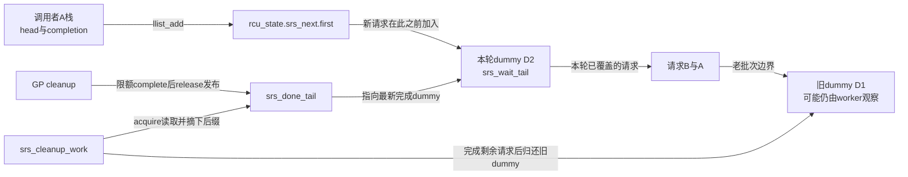
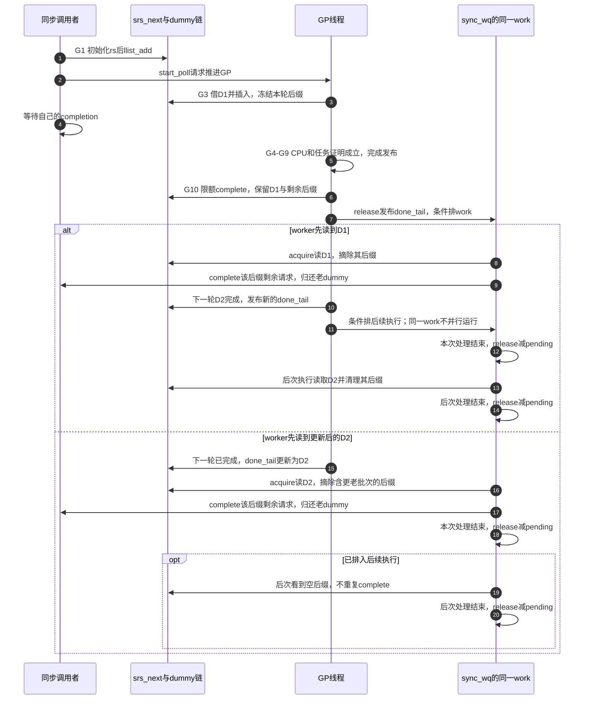

# 第14章\_Linux\_6.12\_Tree\_RCU\_同步等待批处理源码实现

## 14.1\_GP已经完成为什么调用者还在等

默认 `synchronize_rcu()` 普通路径把一个唤醒callback排入队列，再等自己的completion。GP结束只是使callback具备执行资格；队列推进和执行者调度还可能增加返回延迟。Linux 6.12.20另外提供可选路径：调用者直接进入一条等待链，GP线程在确认本轮完成后交付部分等待者，剩余工作交给workqueue。

这样减少的是普通callback队列到同步等待返回之间的环节，不是少等旧reader。新问题随之出现：调用者持续加入时，怎样区分本轮可完成和下一轮才可完成的请求？怎样防止GP线程被大量唤醒工作占满？工作线程与下一轮GP交错时，谁能改哪一段链？本章逐函数回答这些问题。

本篇代码来自NXP `linux-imx` 固定提交 `dfaf2136deb2af2e60b994421281ba42f1c087e0`、Linux 6.12.20的 [`kernel/rcu/tree.c`](../../linux/kernel/rcu/tree.c) 和 [`tree.h`](../../linux/kernel/rcu/tree.h)。本轮核对源文件，不宣称目标运行配置启用了这个默认关闭的优化。中文Doxygen和代码内中文说明均由仓库补充；裁剪处明确说明省略的诊断。

入口依次为[源码总导航](../navigation/P01_Linux_6.12_RCU源码总阅读索引.md#1.6_建议的源码阅读顺序)、[同步等待模块导读](../navigation/P08_Linux_6.12_Tree_RCU_同步等待与rcu_barrier模块源码概念导读.md)、[普通GP完成发布](P05_Linux_6.12_Tree_RCU_GP全局生命周期源码实现.md#5.11_rcu_gp_cleanup发布完成并承接下一代)。默认回调等待对象及桥接函数仍见[等待桥实现](P02_Linux_6.12_Tree_RCU_等待桥_QS与节点汇聚关键函数源码实现.md#2.3_同步调用怎样借回调等待GP结束)。

## 14.2\_并发加入时怎样保存批次边界

调用者各自在栈上准备 `rcu_synchronize`，其中head可接入链表，completion供自己等待；不为每个请求分配全局槽。共享入口 `srs_next` 是单向无锁链，加入操作把新节点放到头部。GP init插入一个无业务等待者的dummy节点D：在D之后的请求进入本轮批次，在D之前后来加入的请求留给后续轮。截止点是dummy插入的原子链操作，不是仅看全局gp_seq变为进行态的时刻。

在主篇的G0～G10中，登记请求对应G1，插入dummy位于G3开始阶段；真正冻结每叶CPU/任务责任还在后续G4。全局序列先开始、dummy随后插入，不意味着新请求只等了半轮：批次边界仍在本轮叶节点责任建立前。这条批处理分支的完成交付位于G9全局完成发布之后的G10阶段。

| 状态地址 | 初值与所有者 | 写入、消费与同步 |
| --- | --- | --- |
| 调用者栈上 `rs.head/completion` | 每次调用初始化 | 调用者加入后等待；完成路径只在完整GP证据后complete，返回前栈必须存活 |
| `rcu_state.srs_next` | 静态空链 | 调用者与GP init执行llist_add；后续遍历只处理已分隔的后缀 |
| `srs_wait_tail` | NULL | GP init保存本轮dummy，GP cleanup取走并清NULL；同一GP线程串行写 |
| `srs_done_tail` | NULL | GP cleanup以release发布已完成批次dummy，worker以acquire取得并拆出其后缀 |
| `srs_wait_nodes[5]` | 静态数组；每项 `inuse=0` | GP init用acquire cmpxchg借出，cleanup/worker用release归还；不承载调用者completion |
| `srs_cleanup_work` | 静态work初始化器绑定cleanup函数 | `sync_wq`执行；同一work不会由多个worker并发执行，可在运行期间再排下一次 |
| `srs_cleanups_pending` | ATOMIC_INIT(0) | 排work前加一、未成功排入回退、worker完成时release减一；保护dummy快速归还条件 |

`tree.h`定义 `struct sr_wait_node` 为 `atomic_t inuse` 和 `struct llist_node node`。`SR_NORMAL_GP_WAIT_HEAD_MAX=5` 是dummy池大小，`SR_MAX_USERS_WAKE_FROM_GP=5` 是GP线程直接唤醒的上限；数值相同但职责不同，不能互换。`sync_wq`在 `rcu_init()` 中由 `alloc_workqueue("sync_wq", WQ_MEM_RECLAIM, 0)` 创建，分配失败有WARN诊断；本篇运行路径以它已成功就绪为前提。WQ_MEM_RECLAIM为回收相关进展提供workqueue保障，不保证调用者立即返回。



为看清链的方向，取只有A、B的例子：先后加入后为 `head → B → A`，本轮init变为 `head → D1 → B → A`；C随后加入成为 `head → C → D1 → B → A`。本轮只能沿D1之后交付B、A，不能从全局head开始把C也完成。

## 14.3\_请求登记与dummy节点怎样划定本轮

`SRS` 是这组源码字段采用的内部前缀；源码没有为它声明可供 API 依赖的正式全称。本章把它称为 **同步等待者直接批处理分支**，避免杜撰缩写展开。该分支默认由模块参数 `rcu_normal_wake_from_gp=0` 关闭。

```c
/**
 * @brief 在默认 callback 等待与可选直接批处理之间选择。
 * @note 中文说明由仓库补充；源码裁剪自 kernel/rcu/tree.c，仅省略上游块注释。
 */
static void synchronize_rcu_normal(void)
{
	struct rcu_synchronize rs;

	trace_rcu_sr_normal(rcu_state.name, &rs.head, TPS("request"));
	if (!READ_ONCE(rcu_normal_wake_from_gp)) {
		wait_rcu_gp(call_rcu_hurry); /* 默认：用 callback 完成栈上 completion。 */
		goto trace_complete_out;
	}

	init_rcu_head_on_stack(&rs.head);
	init_completion(&rs.completion);
	if (IS_ENABLED(CONFIG_PROVE_RCU))
		rs.head.func = (void *)get_state_synchronize_rcu();
	rcu_sr_normal_add_req(&rs);
	(void)start_poll_synchronize_rcu(); /* 确保需要的 GP 会被推进。 */
	wait_for_completion(&rs.completion);
	destroy_rcu_head_on_stack(&rs.head);

trace_complete_out:
	trace_rcu_sr_normal(rcu_state.name, &rs.head, TPS("complete"));
}

/**
 * @brief 在可选直接等待分支中，把当前调用者的栈上请求加入全局入口。
 */
static void rcu_sr_normal_add_req(struct rcu_synchronize *rs)
{
	llist_add((struct llist_node *)&rs->head, &rcu_state.srs_next);
}

/** @brief 用地址范围区分固定dummy节点和调用者的栈上请求节点。 */
static bool rcu_sr_is_wait_head(struct llist_node *node)
{
	return &(rcu_state.srs_wait_nodes)[0].node <= node &&
		node <= &(rcu_state.srs_wait_nodes)[SR_NORMAL_GP_WAIT_HEAD_MAX - 1].node;
}

/** @brief 从固定数组借一个批次分隔dummy节点；它不承载调用者completion。 */
static struct llist_node *rcu_sr_get_wait_head(void)
{
	struct sr_wait_node *sr_wn;
	int i;

	for (i = 0; i < SR_NORMAL_GP_WAIT_HEAD_MAX; i++) {
		sr_wn = &(rcu_state.srs_wait_nodes)[i];
		if (!atomic_cmpxchg_acquire(&sr_wn->inuse, 0, 1))
			return &sr_wn->node;
	}
	return NULL;
}

/** @brief cleanup不再引用dummy节点后，以release语义归还。 */
static void rcu_sr_put_wait_head(struct llist_node *node)
{
	struct sr_wait_node *sr_wn =
		container_of(node, struct sr_wait_node, node);

	atomic_set_release(&sr_wn->inuse, 0);
}

/**
 * @brief GP init 用 dummy wait-head 锁存本轮要覆盖的请求批次。
 * @return dummy 节点暂时耗尽时，要求再启动一轮重试。
 */
static bool rcu_sr_normal_gp_init(void)
{
	struct llist_node *first;
	struct llist_node *wait_head;
	bool start_new_poll = false;

	first = READ_ONCE(rcu_state.srs_next.first);
	if (!first || rcu_sr_is_wait_head(first))
		return start_new_poll;
	wait_head = rcu_sr_get_wait_head();
	if (!wait_head) {
		/* 容量不足仅请求后续GP重试，不完成未划界请求。 */
		start_new_poll = true;
		return start_new_poll;
	}
	llist_add(wait_head, &rcu_state.srs_next);
	WARN_ON_ONCE(rcu_state.srs_wait_tail != NULL);
	rcu_state.srs_wait_tail = wait_head;
	ASSERT_EXCLUSIVE_WRITER(rcu_state.srs_wait_tail);
	return start_new_poll;
}
```

`synchronize_rcu_normal()` 在分支开启时先初始化调用者栈上的 `struct rcu_synchronize` 和 `completion`，再 `rcu_sr_normal_add_req(&rs)`、`start_poll_synchronize_rcu()`，最后睡在 **自己的 completion**。`srs_next` 只承载请求节点，不是调用者睡眠的等待队列。

`CONFIG_PROVE_RCU` 开启时，这条直接分支不会把 `head.func` 当 callback 函数调用，而是临时保存 `get_state_synchronize_rcu()` 的旧状态；`rcu_sr_normal_complete()` 在真正 `complete()` 前用它检查完整 GP 是否已经过去。该字段复用属于诊断证明，关闭 `CONFIG_PROVE_RCU` 不会移除 SRS 的功能等待协议。

## 14.4\_cleanup与workqueue怎样分担交付

`ASSERT_EXCLUSIVE_WRITER`标记单写者约束供检查使用，不承担锁或原子发布功能。cleanup取得 `srs_wait_tail` 后完成有限数量调用者，把尚未完成的批次通过 release store 交给 `srs_done_tail`，再由 `srs_cleanup_work` 继续处理：

```c
/** @brief 把llist请求节点还原为调用者的栈对象并唤醒。 */
static void rcu_sr_normal_complete(struct llist_node *node)
{
	struct rcu_synchronize *rs = container_of(
		(struct rcu_head *)node, struct rcu_synchronize, head);
	unsigned long oldstate = (unsigned long)rs->head.func;

	WARN_ONCE(IS_ENABLED(CONFIG_PROVE_RCU) &&
		  !poll_state_synchronize_rcu(oldstate),
		  "A full grace period is not passed yet: %lu",
		  rcu_seq_diff(get_state_synchronize_rcu(), oldstate));
	complete(&rs->completion);
}

/** @brief GP cleanup 先限额交付本轮直接等待批次，再发布剩余尾部。 */
static void rcu_sr_normal_gp_cleanup(void)
{
	struct llist_node *wait_tail, *next = NULL, *rcu = NULL;
	int done = 0;

	wait_tail = rcu_state.srs_wait_tail;
	if (wait_tail == NULL)
		return;
	rcu_state.srs_wait_tail = NULL;

	llist_for_each_safe(rcu, next, wait_tail->next) {
		if (rcu_sr_is_wait_head(rcu))
			break;
		rcu_sr_normal_complete(rcu);
		wait_tail->next = next;
		if (++done == SR_MAX_USERS_WAKE_FROM_GP)
			break;
	}

	/* 没有并发cleanup work时，可在fastpath归还相邻dummy节点。 */
	if (wait_tail->next && wait_tail->next->next == NULL &&
	    rcu_sr_is_wait_head(wait_tail->next) &&
	    !atomic_read_acquire(&rcu_state.srs_cleanups_pending)) {
		rcu_sr_put_wait_head(wait_tail->next);
		wait_tail->next = NULL;
	}
	smp_store_release(&rcu_state.srs_done_tail, wait_tail);
	if (wait_tail->next) {
		atomic_inc(&rcu_state.srs_cleanups_pending);
		if (!queue_work(sync_wq, &rcu_state.srs_cleanup_work))
			atomic_dec(&rcu_state.srs_cleanups_pending);
	}
}

/** @brief 异步完成限额以后剩余的调用者，并归还旧dummy节点。 */
static void rcu_sr_normal_gp_cleanup_work(struct work_struct *work)
{
	struct llist_node *done, *rcu, *next, *head;

	done = smp_load_acquire(&rcu_state.srs_done_tail);
	if (WARN_ON_ONCE(!done))
		return;
	head = done->next;
	done->next = NULL;
	llist_for_each_safe(rcu, next, head) {
		if (!rcu_sr_is_wait_head(rcu)) {
			rcu_sr_normal_complete(rcu);
			continue;
		}
		rcu_sr_put_wait_head(rcu);
	}
	atomic_dec_return_release(&rcu_state.srs_cleanups_pending);
}
```

预分配的 `srs_wait_nodes[]` 只提供 dummy 分隔节点，并用 `inuse` 原子状态借出/归还。它解决“并发调用者不断无锁加入时，GP init 怎样冻结本轮截止位置”的问题。修改这条路径必须同时保持：栈上请求在 completion 前仍存活、dummy 节点不会过早复用、`srs_done_tail` 的 release/acquire 交接以及 workqueue 单实例执行语义。

## 14.5\_两个GP与一个worker交错时谁能改链

GP cleanup先处理当前dummy之后、直到下一个dummy之前的请求，最多直接完成5个。每次循环预先保存next，再complete调用者；调用者醒来可能立刻返回并销毁栈对象，所以complete后不能再读取该请求节点。`llist_for_each_safe`提供保存next的遍历形式，随后只更新仍由控制路径持有的dummy指针。

最新done dummy自身不能由worker立即归还：并发调用者仍可能从全局链入口接到它，下一轮也需要以它为边界。worker只把 `done->next` 后缀摘走并置NULL，遍历该私有后缀，完成请求、归还更老的dummy。等后续新dummy成为done边界，旧dummy才进入可回收后缀。



图中完成A的路径可能已经发生在GP线程直接交付阶段；worker的complete箭头只代表仍留在其私有后缀中的请求。worker先读旧边界时，后一次执行处理新边界；先读新边界时，后一次执行可能只看到已清空后缀。原子pending计数用于协调快路径能否归还相邻dummy，不是“还有多少业务调用者”的计数。

dummy池暂时耗尽时，init返回要求再发poll请求，本轮不虚造新批次，也不提前complete未划界的请求；以后GP再试。`queue_work`返回false说明这次没有新排入执行，因此撤销本次pending加一，不能把它解释成workqueue已经永远拒绝工作。这套批处理减少同步返回对普通callback执行的依赖，代价是专用链、dummy生命周期、GP直接唤醒预算和worker交接协议；默认回调桥仍是可用的原方案。

## 14.6\_修改与复核

修改时分别检查入队截止、GP证据、栈生命期、dummy复用和worker序列化，不能只测等待函数能否返回。至少覆盖单请求、超过5个请求、连续多轮、dummy耗尽、worker延迟和两种done_tail交错；这些是修改后的验证建议，本轮没有运行目标内核压力实验。

1. C在D1之前加入，能随D1之后的A、B完成吗？不能；链方向表达批次边界，处理必须从wait_tail之后开始。
2. 请求已complete后还可读它的next吗？不能假设；调用者可能已返回，所以源码先保存next。
3. worker为何留下当前done dummy？它仍连接并发入口与未来批次；只有更老dummy进入已摘下后缀时才可归还。
4. GP完成是否保证所有同步调用者已经返回？不保证；直接预算、worker运行和被唤醒任务调度都会影响返回时刻。
5. 修改5这个常量时应同时改两个宏吗？不必；先判断调整的是预分配批次容量还是每轮GP线程的交付预算，再核对相应代价。

普通GP安全证明回到[全局生命周期实现](P05_Linux_6.12_Tree_RCU_GP全局生命周期源码实现.md#5.11_rcu_gp_cleanup发布完成并承接下一代)；默认等待与barrier的区别见[同步等待模块导读](../navigation/P08_Linux_6.12_Tree_RCU_同步等待与rcu_barrier模块源码概念导读.md)。
