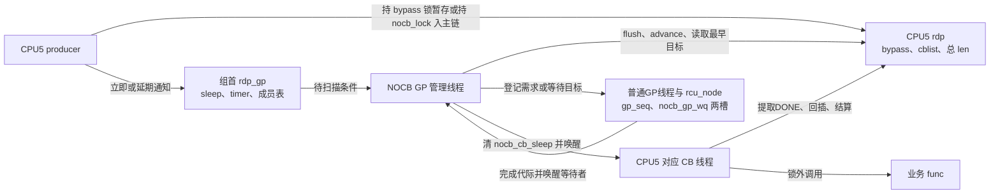
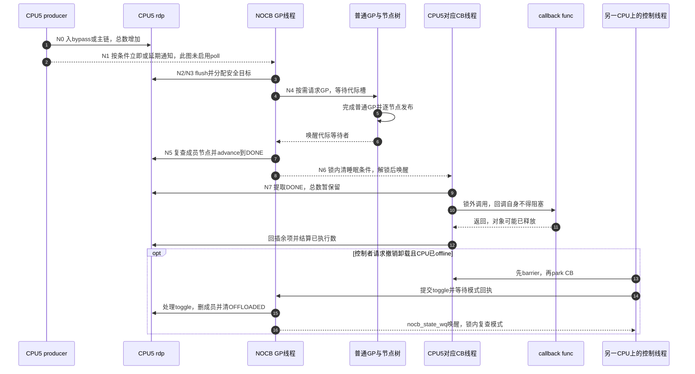

# 第15章\_Linux\_6.12\_Tree\_RCU\_NOCB队列与执行交接源码实现

## 15.1\_本地回调处理怎样变成远端协作

在 [分段与批处理实现](P09_Linux_6.12_Tree_RCU_回调分段与批处理源码实现.md#9.8_C0到C5_把节点位置资格和执行责任接起来) 中，本地 core 负责给 callback 分类、取得 DONE 批次并执行。若 CPU5 承担需要减少系统抖动的工作，这些批次仍会占用它的执行时间。NOCB 为 CPU5 的队列安排管理与执行线程，使这些线程可以按部署策略在其他 CPU 上工作；被卸载 CPU 仍可登记回调、运行读者、报告 QS，并接受必要催促。

这一步新增了共享状态问题：CPU5 生产者、NOCB GP 管理线程和 CB 执行线程可能在不同 CPU 同时访问同一 `rdp`。关 CPU5 的本地 IRQ 已经不够，主链需要 `nocb_lock`；生产速率很高时，这把锁又会在短入队与较长分类/提取之间争用，才引出 bypass 暂存与延后通知。卸载由此改变入队、推进、唤醒和执行整条路径，代价是跨 CPU 同步及线程调度，不能只理解成换一个函数调用者。

本章核对 NXP Linux 6.12.20 固定提交 `dfaf2136deb2af2e60b994421281ba42f1c087e0` 的 [`kernel/rcu/tree_nocb.h`](../../linux/kernel/rcu/tree_nocb.h)，要求 `CONFIG_RCU_NOCB_CPU` 对应分支；lazy、poll 和启动选择分别影响行为。源码身份见 [基线](../../linux/SOURCE_BASELINE.md#1.5.1_RCU家族证据)，当前目标配置与线程 affinity 未在这里实测。前置模块关系见 [回调与 NOCB 导读](../navigation/P07_Linux_6.12_Tree_RCU_回调与NOCB模块源码概念导读.md#7.6_NOCB为何拆成GP线程与CB线程)。

线程被创建并不证明它们已经避开隔离 CPU；这还依赖 affinity 和实际调度。源码创建组管理线程时使用 `rcuog/%d`，CB 线程使用 `rcuo%c/%d` 格式，字母随 flavor 取值。后文按 GP/CB 职责称呼，避免把某个示例进程名当成架构保证。

## 15.2\_三类参与者怎样共享同一份回调责任

管理线程服务一组 `rcu_data`，每个成员仍拥有自己的主链、bypass 和 CB 线程。组首 `rdp_gp` 不是把各成员 callback 合并成一条链；它保存成员表、待扫描条件和模式切换请求。管理线程观察普通 GP 完成，再逐成员推进资格；真正执行 `func()` 的是 CB 线程。



图中的 CPU5 表示队列归属，不是规定 CB 线程当前必须运行在哪个 CPU。普通 GP 线程与 NOCB GP 管理线程也不是同一个执行者：前者建立安全证明，后者消费证明并管理一组队列。

| 状态地址 | 写入者与读取者 | 保护或等待目的 |
| --- | --- | --- |
| `rdp->cblist` | producer、GP/CB 线程、barrier 等 | IRQ 关闭加 `nocb_lock`，保存权威分段资格 |
| `rdp->nocb_bypass`、`lazy_len` | producer 入队，受保护的 flush 路径转移 | `nocb_bypass_lock`；节点尚未绑定 GP |
| `rdp->cblist.len` | 入队计入、实际批次后结算 | 同时覆盖 bypass、主链和已提取未结算责任 |
| `rdp_gp->nocb_gp_sleep/nocb_gp_wq` | 通知路径改条件，GP 线程复查 | 等待新工作或重新扫描，与等 GP 完成不同 |
| `rnp->nocb_gp_wq[2]` | 普通 GP cleanup 唤醒，NOCB GP 线程等待 | 按 `rcu_seq_ctr(target) & 1` 选择完成代际槽 |
| `rdp->nocb_cb_sleep/nocb_cb_wq` | GP/CB 线程在主链保护下协调 | DONE 可执行与 CB 睡眠之间的交接 |
| `rdp_gp->nocb_toggling_rdp`、`rdp->nocb_state_wq` | 控制路径提交，GP 线程处理并回执 | 切换成员身份，不能当成 callback 完成通知 |

本章依次展开 [producer 与旁路](#15.3_nocb_bypass怎样降低生产者锁竞争又避免搁浅)、[管理线程](#15.4_NOCB_GP线程怎样推进队列并等待最早目标代际)、[CB 线程](#15.5_NOCB_CB线程只执行成熟批次)、[动态交接](#15.6_动态offload为何只允许offline_CPU并等待状态交接)。普通 `call_rcu()`、accelerate/advance 和 `rcu_do_batch()` 函数体仍由 P09 唯一展开。

## 15.3\_nocb\_bypass怎样降低生产者锁竞争又避免搁浅

低速 producer 直接拿主链锁即可；高频入队若每次都与 GP 分类、CB 提取争同一把锁，锁和队列相关缓存行就可能在这些 CPU 间频繁迁移。bypass 把暂存动作放到独立锁下，缩短与主链管理直接互斥的路径。但它不是无锁队列，也没有自己的 GP 分类：节点迟早必须 flush 回本 `rdp` 的 NEXT 段。

### 15.3.1\_返回值同时表达节点和锁的交接

`rcu_nocb_try_bypass()` 的 true 表示本次节点已经登记，可能留在 bypass，也可能已经随 flush 进入主链；false 表示调用者仍需入主链，offload 路径此时持有 `nocb_lock`。外层 `call_rcu_nocb()` 因而要把入队和负责解锁的 wake 辅助连起来阅读。

```c
/**
 * @brief 按速率与旁路状态选择入队路径，并保持锁交接约定。
 * @note 中文说明为仓库补充；下方保留 kernel/rcu/tree_nocb.h 函数的完整语句，省去原英文注释。
 */
static bool rcu_nocb_try_bypass(struct rcu_data *rdp, struct rcu_head *rhp,
				bool *was_alldone, unsigned long flags,
				bool lazy)
{
	unsigned long c;
	unsigned long cur_gp_seq;
	unsigned long j = jiffies;
	long ncbs = rcu_cblist_n_cbs(&rdp->nocb_bypass);
	bool bypass_is_lazy = (ncbs == READ_ONCE(rdp->lazy_len));

	lockdep_assert_irqs_disabled();

	if (!rcu_rdp_is_offloaded(rdp)) {
		*was_alldone = !rcu_segcblist_pend_cbs(&rdp->cblist);
		return false;
	}

	if (rcu_scheduler_active != RCU_SCHEDULER_RUNNING) {
		rcu_nocb_lock(rdp);
		WARN_ON_ONCE(rcu_cblist_n_cbs(&rdp->nocb_bypass));
		*was_alldone = !rcu_segcblist_pend_cbs(&rdp->cblist);
		return false;
	}

	if (j == rdp->nocb_nobypass_last) {
		c = rdp->nocb_nobypass_count + 1;
	} else {
		WRITE_ONCE(rdp->nocb_nobypass_last, j);
		c = rdp->nocb_nobypass_count - nocb_nobypass_lim_per_jiffy;
		if (ULONG_CMP_LT(rdp->nocb_nobypass_count,
				 nocb_nobypass_lim_per_jiffy))
			c = 0;
		else if (c > nocb_nobypass_lim_per_jiffy)
			c = nocb_nobypass_lim_per_jiffy;
	}
	WRITE_ONCE(rdp->nocb_nobypass_count, c);

	if (rdp->nocb_nobypass_count < nocb_nobypass_lim_per_jiffy && !lazy) {
		rcu_nocb_lock(rdp);
		*was_alldone = !rcu_segcblist_pend_cbs(&rdp->cblist);
		if (*was_alldone)
			trace_rcu_nocb_wake(rcu_state.name, rdp->cpu,
					    TPS("FirstQ"));

		WARN_ON_ONCE(!rcu_nocb_flush_bypass(rdp, NULL, j, false));
		WARN_ON_ONCE(rcu_cblist_n_cbs(&rdp->nocb_bypass));
		return false;
	}

	if ((ncbs && !bypass_is_lazy && j != READ_ONCE(rdp->nocb_bypass_first)) ||
	    (ncbs &&  bypass_is_lazy &&
	     (time_after(j, READ_ONCE(rdp->nocb_bypass_first) + rcu_get_jiffies_lazy_flush()))) ||
	    ncbs >= qhimark) {
		rcu_nocb_lock(rdp);
		*was_alldone = !rcu_segcblist_pend_cbs(&rdp->cblist);

		if (!rcu_nocb_flush_bypass(rdp, rhp, j, lazy)) {
			if (*was_alldone)
				trace_rcu_nocb_wake(rcu_state.name, rdp->cpu,
						    TPS("FirstQ"));
			WARN_ON_ONCE(rcu_cblist_n_cbs(&rdp->nocb_bypass));
			return false;
		}
		if (j != rdp->nocb_gp_adv_time &&
		    rcu_segcblist_nextgp(&rdp->cblist, &cur_gp_seq) &&
		    rcu_seq_done(&rdp->mynode->gp_seq, cur_gp_seq)) {
			rcu_advance_cbs_nowake(rdp->mynode, rdp);
			rdp->nocb_gp_adv_time = j;
		}

		__call_rcu_nocb_wake(rdp, *was_alldone, flags);

		return true;
	}

	rcu_nocb_bypass_lock(rdp);
	ncbs = rcu_cblist_n_cbs(&rdp->nocb_bypass);
	rcu_segcblist_inc_len(&rdp->cblist);
	rcu_cblist_enqueue(&rdp->nocb_bypass, rhp);

	if (lazy)
		WRITE_ONCE(rdp->lazy_len, rdp->lazy_len + 1);

	if (!ncbs) {
		WRITE_ONCE(rdp->nocb_bypass_first, j);
		trace_rcu_nocb_wake(rcu_state.name, rdp->cpu, TPS("FirstBQ"));
	}
	rcu_nocb_bypass_unlock(rdp);

	if (!ncbs || (bypass_is_lazy && !lazy)) {

		rcu_nocb_lock(rdp);
		if (!rcu_segcblist_pend_cbs(&rdp->cblist)) {
			trace_rcu_nocb_wake(rcu_state.name, rdp->cpu,
					    TPS("FirstBQwake"));
			__call_rcu_nocb_wake(rdp, true, flags);
		} else {
			trace_rcu_nocb_wake(rcu_state.name, rdp->cpu,
					    TPS("FirstBQnoWake"));
			rcu_nocb_unlock(rdp);
		}
	}
	return true;
}

/**
 * @brief 按速率与旁路状态选择入队路径，并保持锁交接约定。
 * @note 中文说明为仓库补充；下方保留 kernel/rcu/tree_nocb.h 函数的完整语句，省去原英文注释。
 */
static void call_rcu_nocb(struct rcu_data *rdp, struct rcu_head *head,
			  rcu_callback_t func, unsigned long flags, bool lazy)
{
	bool was_alldone;

	if (!rcu_nocb_try_bypass(rdp, head, &was_alldone, flags, lazy)) {

		rcutree_enqueue(rdp, head, func);
		__call_rcu_nocb_wake(rdp, was_alldone, flags);
	}
}
```

速率计数按 jiffy 衰减，不是每跨一个 jiffy 都简单清零。低速非 lazy 项先 flush 旧旁路再直接入主链；早期启动不使用旁路。已有非 lazy 旁路跨过其首项 jiffy、全 lazy 旁路超过 lazy 时间或长度达到 `qhimark` 时，则尝试随新节点一起 flush。管理线程的检查周期和阈值另见下一节，不能把这里的 producer 阈值当成所有 flush 路径的同一个截止点。

暂存前已经增加 `cblist.len`；第一次旁路入队，或者原来全是 lazy 而新项非 lazy 时，要重查是否需要通知管理者。否则一旦 producer 不再提交，队列就可能永远没有下一次触发。这个分支保证的是存在后续扫描途径，并不保证 callback 在固定时限内执行。

### 15.3.2\_flush搬归属但不能重复计数

flush 同时需要主链保护与旁路锁：先把旁路节点转到临时链，再合入 NEXT，清 lazy 数并更新首项时间。已有旁路的总数已经计入，只对随这次 flush 新加入的 `rhp` 增加一次总数。以下完整辅助展示失败返回和释放旁路锁的约定。

```c
/**
 * @brief 在主链和旁路保护下转移节点，已有总数不重复计入。
 * @note 中文说明为仓库补充；下方保留 kernel/rcu/tree_nocb.h 函数的完整语句，省去原英文注释。
 */
static bool rcu_nocb_do_flush_bypass(struct rcu_data *rdp, struct rcu_head *rhp_in,
				     unsigned long j, bool lazy)
{
	struct rcu_cblist rcl;
	struct rcu_head *rhp = rhp_in;

	WARN_ON_ONCE(!rcu_rdp_is_offloaded(rdp));
	rcu_lockdep_assert_cblist_protected(rdp);
	lockdep_assert_held(&rdp->nocb_bypass_lock);
	if (rhp && !rcu_cblist_n_cbs(&rdp->nocb_bypass)) {
		raw_spin_unlock(&rdp->nocb_bypass_lock);
		return false;
	}

	if (rhp)
		rcu_segcblist_inc_len(&rdp->cblist);

	if (lazy && rhp) {
		rcu_cblist_enqueue(&rdp->nocb_bypass, rhp);
		rhp = NULL;
	}
	rcu_cblist_flush_enqueue(&rcl, &rdp->nocb_bypass, rhp);
	WRITE_ONCE(rdp->lazy_len, 0);

	rcu_segcblist_insert_pend_cbs(&rdp->cblist, &rcl);
	WRITE_ONCE(rdp->nocb_bypass_first, j);
	rcu_nocb_bypass_unlock(rdp);
	return true;
}

/**
 * @brief 在主链和旁路保护下转移节点，已有总数不重复计入。
 * @note 中文说明为仓库补充；下方保留 kernel/rcu/tree_nocb.h 函数的完整语句，省去原英文注释。
 */
static bool rcu_nocb_flush_bypass(struct rcu_data *rdp, struct rcu_head *rhp,
				  unsigned long j, bool lazy)
{
	if (!rcu_rdp_is_offloaded(rdp))
		return true;
	rcu_lockdep_assert_cblist_protected(rdp);
	rcu_nocb_bypass_lock(rdp);
	return rcu_nocb_do_flush_bypass(rdp, rhp, j, lazy);
}

/**
 * @brief 在主链和旁路保护下转移节点，已有总数不重复计入。
 * @note 中文说明为仓库补充；下方保留 kernel/rcu/tree_nocb.h 函数的完整语句，省去原英文注释。
 */
static void rcu_nocb_try_flush_bypass(struct rcu_data *rdp, unsigned long j)
{
	rcu_lockdep_assert_cblist_protected(rdp);
	if (!rcu_rdp_is_offloaded(rdp) ||
	    !rcu_nocb_bypass_trylock(rdp))
		return;
	WARN_ON_ONCE(!rcu_nocb_do_flush_bypass(rdp, NULL, j, false));
}
```

`rhp != NULL` 而旁路已空时返回 false，由外层走普通入队/通知；`rhp == NULL` 的同步 flush 路径即使无节点也完成检查并返回 true。try-flush 若拿不到旁路锁就暂不搬运，后续循环仍能重查。带 lazy 新项时先把它接到旁路末尾，以保留其与已有旁路节点的排队顺序；总数不能因为这次转链再增加旧节点数量。

### 15.3.3\_立即唤醒延期timer与poll分别承担什么

主链从没有 pending 变成有需求时，通常应叫醒 GP 管理者；但关 IRQ 等脆弱路径、离线 CPU、纯 lazy 需求及回调洪峰需要不同处理。`__call_rcu_nocb_wake()` 在所有返回分支都负责放掉 `nocb_lock`，再决定立即唤醒、设置延期或由 poll 负责。

```c
/**
 * @brief 释放主链锁并按上下文、lazy 和压力条件安排后续扫描。
 * @note 中文说明为仓库补充；下方保留 kernel/rcu/tree_nocb.h 函数的完整语句，省去原英文注释。
 */
static void __call_rcu_nocb_wake(struct rcu_data *rdp, bool was_alldone,
				 unsigned long flags)
				 __releases(rdp->nocb_lock)
{
	long bypass_len;
	unsigned long cur_gp_seq;
	unsigned long j;
	long lazy_len;
	long len;
	struct task_struct *t;
	struct rcu_data *rdp_gp = rdp->nocb_gp_rdp;

	t = READ_ONCE(rdp->nocb_gp_kthread);
	if (rcu_nocb_poll || !t) {
		rcu_nocb_unlock(rdp);
		trace_rcu_nocb_wake(rcu_state.name, rdp->cpu,
				    TPS("WakeNotPoll"));
		return;
	}

	len = rcu_segcblist_n_cbs(&rdp->cblist);
	bypass_len = rcu_cblist_n_cbs(&rdp->nocb_bypass);
	lazy_len = READ_ONCE(rdp->lazy_len);
	if (was_alldone) {
		rdp->qlen_last_fqs_check = len;

		if (lazy_len && bypass_len == lazy_len) {
			rcu_nocb_unlock(rdp);
			wake_nocb_gp_defer(rdp, RCU_NOCB_WAKE_LAZY,
					   TPS("WakeLazy"));
		} else if (!irqs_disabled_flags(flags) && cpu_online(rdp->cpu)) {

			rcu_nocb_unlock(rdp);
			wake_nocb_gp(rdp, false);
			trace_rcu_nocb_wake(rcu_state.name, rdp->cpu,
					    TPS("WakeEmpty"));
		} else {

			rcu_nocb_unlock(rdp);
			wake_nocb_gp_defer(rdp, RCU_NOCB_WAKE,
					   TPS("WakeEmptyIsDeferred"));
		}
	} else if (len > rdp->qlen_last_fqs_check + qhimark) {

		rdp->qlen_last_fqs_check = len;
		j = jiffies;
		if (j != rdp->nocb_gp_adv_time &&
		    rcu_segcblist_nextgp(&rdp->cblist, &cur_gp_seq) &&
		    rcu_seq_done(&rdp->mynode->gp_seq, cur_gp_seq)) {
			rcu_advance_cbs_nowake(rdp->mynode, rdp);
			rdp->nocb_gp_adv_time = j;
		}
		smp_mb();
		if ((rdp->nocb_cb_sleep ||
		     !rcu_segcblist_ready_cbs(&rdp->cblist)) &&
		    !timer_pending(&rdp_gp->nocb_timer)) {
			rcu_nocb_unlock(rdp);
			wake_nocb_gp_defer(rdp, RCU_NOCB_WAKE_FORCE,
					   TPS("WakeOvfIsDeferred"));
		} else {
			rcu_nocb_unlock(rdp);
			trace_rcu_nocb_wake(rcu_state.name, rdp->cpu, TPS("WakeNot"));
		}
	} else {
		rcu_nocb_unlock(rdp);
		trace_rcu_nocb_wake(rcu_state.name, rdp->cpu, TPS("WakeNot"));
	}
}
```

`was_alldone` 指此前没有待等 GP 的主链项，并不等于所有业务函数已返回。纯 lazy 旁路使用较迟 timer；原来 IRQ 开启且 CPU 在线可立即唤醒；其余首项需求延期。过载分支在观察目标已完成时可以试做 nowake 推进，随后用屏障把入队排在检查 timer 之前，再决定是否设置强制延期通知。

```c
/**
 * @brief 在组首保护下协调条件、延期 timer 与实际唤醒。
 * @note 中文说明为仓库补充；下方保留 kernel/rcu/tree_nocb.h 函数的完整语句，省去原英文注释。
 */
static bool __wake_nocb_gp(struct rcu_data *rdp_gp,
			   struct rcu_data *rdp,
			   bool force, unsigned long flags)
	__releases(rdp_gp->nocb_gp_lock)
{
	bool needwake = false;

	if (!READ_ONCE(rdp_gp->nocb_gp_kthread)) {
		raw_spin_unlock_irqrestore(&rdp_gp->nocb_gp_lock, flags);
		trace_rcu_nocb_wake(rcu_state.name, rdp->cpu,
				    TPS("AlreadyAwake"));
		return false;
	}

	if (rdp_gp->nocb_defer_wakeup > RCU_NOCB_WAKE_NOT) {
		WRITE_ONCE(rdp_gp->nocb_defer_wakeup, RCU_NOCB_WAKE_NOT);
		del_timer(&rdp_gp->nocb_timer);
	}

	if (force || READ_ONCE(rdp_gp->nocb_gp_sleep)) {
		WRITE_ONCE(rdp_gp->nocb_gp_sleep, false);
		needwake = true;
	}
	raw_spin_unlock_irqrestore(&rdp_gp->nocb_gp_lock, flags);
	if (needwake) {
		trace_rcu_nocb_wake(rcu_state.name, rdp->cpu, TPS("DoWake"));
		swake_up_one_online(&rdp_gp->nocb_gp_wq);
	}

	return needwake;
}

/**
 * @brief 在组首保护下协调条件、延期 timer 与实际唤醒。
 * @note 中文说明为仓库补充；下方保留 kernel/rcu/tree_nocb.h 函数的完整语句，省去原英文注释。
 */
static bool wake_nocb_gp(struct rcu_data *rdp, bool force)
{
	unsigned long flags;
	struct rcu_data *rdp_gp = rdp->nocb_gp_rdp;

	raw_spin_lock_irqsave(&rdp_gp->nocb_gp_lock, flags);
	return __wake_nocb_gp(rdp_gp, rdp, force, flags);
}

/**
 * @brief 在组首保护下协调条件、延期 timer 与实际唤醒。
 * @note 中文说明为仓库补充；下方保留 kernel/rcu/tree_nocb.h 函数的完整语句，省去原英文注释。
 */
static void wake_nocb_gp_defer(struct rcu_data *rdp, int waketype,
			       const char *reason)
{
	unsigned long flags;
	struct rcu_data *rdp_gp = rdp->nocb_gp_rdp;

	raw_spin_lock_irqsave(&rdp_gp->nocb_gp_lock, flags);

	if (waketype == RCU_NOCB_WAKE_LAZY &&
	    rdp->nocb_defer_wakeup == RCU_NOCB_WAKE_NOT) {
		mod_timer(&rdp_gp->nocb_timer, jiffies + rcu_get_jiffies_lazy_flush());
		WRITE_ONCE(rdp_gp->nocb_defer_wakeup, waketype);
	} else if (waketype == RCU_NOCB_WAKE_BYPASS) {
		mod_timer(&rdp_gp->nocb_timer, jiffies + 2);
		WRITE_ONCE(rdp_gp->nocb_defer_wakeup, waketype);
	} else {
		if (rdp_gp->nocb_defer_wakeup < RCU_NOCB_WAKE)
			mod_timer(&rdp_gp->nocb_timer, jiffies + 1);
		if (rdp_gp->nocb_defer_wakeup < waketype)
			WRITE_ONCE(rdp_gp->nocb_defer_wakeup, waketype);
	}

	raw_spin_unlock_irqrestore(&rdp_gp->nocb_gp_lock, flags);

	trace_rcu_nocb_wake(rcu_state.name, rdp->cpu, reason);
}

/**
 * @brief 在组首保护下协调条件、延期 timer 与实际唤醒。
 * @note 中文说明为仓库补充；下方保留 kernel/rcu/tree_nocb.h 函数的完整语句，省去原英文注释。
 */
static int rcu_nocb_need_deferred_wakeup(struct rcu_data *rdp, int level)
{
	return READ_ONCE(rdp->nocb_defer_wakeup) >= level;
}

/**
 * @brief 在组首保护下协调条件、延期 timer 与实际唤醒。
 * @note 中文说明为仓库补充；下方保留 kernel/rcu/tree_nocb.h 函数的完整语句，省去原英文注释。
 */
static bool do_nocb_deferred_wakeup_common(struct rcu_data *rdp_gp,
					   struct rcu_data *rdp, int level,
					   unsigned long flags)
	__releases(rdp_gp->nocb_gp_lock)
{
	int ndw;
	int ret;

	if (!rcu_nocb_need_deferred_wakeup(rdp_gp, level)) {
		raw_spin_unlock_irqrestore(&rdp_gp->nocb_gp_lock, flags);
		return false;
	}

	ndw = rdp_gp->nocb_defer_wakeup;
	ret = __wake_nocb_gp(rdp_gp, rdp, ndw == RCU_NOCB_WAKE_FORCE, flags);
	trace_rcu_nocb_wake(rcu_state.name, rdp->cpu, TPS("DeferredWake"));

	return ret;
}

/**
 * @brief 在组首保护下协调条件、延期 timer 与实际唤醒。
 * @note 中文说明为仓库补充；下方保留 kernel/rcu/tree_nocb.h 函数的完整语句，省去原英文注释。
 */
static void do_nocb_deferred_wakeup_timer(struct timer_list *t)
{
	unsigned long flags;
	struct rcu_data *rdp = from_timer(rdp, t, nocb_timer);

	WARN_ON_ONCE(rdp->nocb_gp_rdp != rdp);
	trace_rcu_nocb_wake(rcu_state.name, rdp->cpu, TPS("Timer"));

	raw_spin_lock_irqsave(&rdp->nocb_gp_lock, flags);
	smp_mb__after_spinlock();
	do_nocb_deferred_wakeup_common(rdp, rdp, RCU_NOCB_WAKE_BYPASS, flags);
}

/**
 * @brief 在组首保护下协调条件、延期 timer 与实际唤醒。
 * @note 中文说明为仓库补充；下方保留 kernel/rcu/tree_nocb.h 函数的完整语句，省去原英文注释。
 */
static bool do_nocb_deferred_wakeup(struct rcu_data *rdp)
{
	unsigned long flags;
	struct rcu_data *rdp_gp = rdp->nocb_gp_rdp;

	if (!rdp_gp || !rcu_nocb_need_deferred_wakeup(rdp_gp, RCU_NOCB_WAKE))
		return false;

	raw_spin_lock_irqsave(&rdp_gp->nocb_gp_lock, flags);
	return do_nocb_deferred_wakeup_common(rdp_gp, rdp, RCU_NOCB_WAKE, flags);
}
```

立即通知先在组首 `nocb_gp_lock` 下取消旧延期并清 `nocb_gp_sleep`，解锁后再 swake。管理线程即使尚未真正睡下，稍后复查条件也能看见工作；唤醒不是脱离条件变量的一次脉冲。延期路径记录强度和 timer，普通 core 的快路径只处理相应强度的延期，timer 负责较低强度及遗漏的后续处理。

`RCU_NOCB_WAKE_BYPASS` 采用两 jiffy 的延期，普通通知通常为一 jiffy，lazy 使用可配置的 lazy flush 间隔。这些是安排检查的策略，调度延迟、锁竞争和 GP 证明仍影响执行时间，不能作为内存必定在该时刻释放的保证。源码 lazy 分支还分别读取传入 `rdp` 的延期字段并更新组首字段；阅读时保留这两个地址，不能自行把所有 `rdp` 改写成组首。

启用 `rcu_nocb_poll` 时生产者省去部分唤醒，但管理线程必须周期扫描；非空成员组走 `schedule_timeout_idle(1)`，空组仍可等待成员加入。未创建管理线程的早期阶段也会跳过唤醒，由初始化路径接续；不能把“没有 kthread，所以直接返回”解释为运行时任意丢工作都合法。

## 15.4\_NOCB\_GP线程怎样推进队列并等待最早目标代际

管理线程每轮遍历组内成员。先按年龄/长度尝试 flush，再在成员自己的叶锁下 advance/accelerate，记录组内最早未满足目标；有 DONE 就清该成员的 CB 睡眠条件，解主链锁后唤醒执行者。这样一个慢业务回调不会阻止管理线程继续给其他成员推进资格。

```c
/**
 * @brief 扫描各成员资格并区分等待新工作与等待 GP 完成。
 * @note 中文说明为仓库补充；下方保留 kernel/rcu/tree_nocb.h 函数的完整语句，省去原英文注释。
 */
static void nocb_gp_sleep(struct rcu_data *my_rdp, int cpu)
{
	trace_rcu_nocb_wake(rcu_state.name, cpu, TPS("Sleep"));
	swait_event_interruptible_exclusive(my_rdp->nocb_gp_wq,
					!READ_ONCE(my_rdp->nocb_gp_sleep));
	trace_rcu_nocb_wake(rcu_state.name, cpu, TPS("EndSleep"));
}

/**
 * @brief 扫描各成员资格并区分等待新工作与等待 GP 完成。
 * @note 中文说明为仓库补充；下方保留 kernel/rcu/tree_nocb.h 函数的完整语句，省去原英文注释。
 */
static void nocb_gp_wait(struct rcu_data *my_rdp)
{
	bool bypass = false;
	int __maybe_unused cpu = my_rdp->cpu;
	unsigned long cur_gp_seq;
	unsigned long flags;
	bool gotcbs = false;
	unsigned long j = jiffies;
	bool lazy = false;
	bool needwait_gp = false;
	bool needwake;
	bool needwake_gp;
	struct rcu_data *rdp, *rdp_toggling = NULL;
	struct rcu_node *rnp;
	unsigned long wait_gp_seq = 0;
	bool wasempty = false;

	WARN_ON_ONCE(my_rdp->nocb_gp_rdp != my_rdp);

	list_for_each_entry(rdp, &my_rdp->nocb_head_rdp, nocb_entry_rdp) {
		long bypass_ncbs;
		bool flush_bypass = false;
		long lazy_ncbs;

		trace_rcu_nocb_wake(rcu_state.name, rdp->cpu, TPS("Check"));
		rcu_nocb_lock_irqsave(rdp, flags);
		lockdep_assert_held(&rdp->nocb_lock);
		bypass_ncbs = rcu_cblist_n_cbs(&rdp->nocb_bypass);
		lazy_ncbs = READ_ONCE(rdp->lazy_len);

		if (bypass_ncbs && (lazy_ncbs == bypass_ncbs) &&
		    (time_after(j, READ_ONCE(rdp->nocb_bypass_first) + rcu_get_jiffies_lazy_flush()) ||
		     bypass_ncbs > 2 * qhimark)) {
			flush_bypass = true;
		} else if (bypass_ncbs && (lazy_ncbs != bypass_ncbs) &&
		    (time_after(j, READ_ONCE(rdp->nocb_bypass_first) + 1) ||
		     bypass_ncbs > 2 * qhimark)) {
			flush_bypass = true;
		} else if (!bypass_ncbs && rcu_segcblist_empty(&rdp->cblist)) {
			rcu_nocb_unlock_irqrestore(rdp, flags);
			continue;
		}

		if (flush_bypass) {

			(void)rcu_nocb_try_flush_bypass(rdp, j);
			bypass_ncbs = rcu_cblist_n_cbs(&rdp->nocb_bypass);
			lazy_ncbs = READ_ONCE(rdp->lazy_len);
		}

		if (bypass_ncbs) {
			trace_rcu_nocb_wake(rcu_state.name, rdp->cpu,
					    bypass_ncbs == lazy_ncbs ? TPS("Lazy") : TPS("Bypass"));
			if (bypass_ncbs == lazy_ncbs)
				lazy = true;
			else
				bypass = true;
		}
		rnp = rdp->mynode;

		needwake_gp = false;
		if (!rcu_segcblist_restempty(&rdp->cblist,
					     RCU_NEXT_READY_TAIL) ||
		    (rcu_segcblist_nextgp(&rdp->cblist, &cur_gp_seq) &&
		     rcu_seq_done(&rnp->gp_seq, cur_gp_seq))) {
			raw_spin_lock_rcu_node(rnp);
			needwake_gp = rcu_advance_cbs(rnp, rdp);
			wasempty = rcu_segcblist_restempty(&rdp->cblist,
							   RCU_NEXT_READY_TAIL);
			raw_spin_unlock_rcu_node(rnp);
		}

		WARN_ON_ONCE(wasempty &&
			     !rcu_segcblist_restempty(&rdp->cblist,
						      RCU_NEXT_READY_TAIL));
		if (rcu_segcblist_nextgp(&rdp->cblist, &cur_gp_seq)) {
			if (!needwait_gp ||
			    ULONG_CMP_LT(cur_gp_seq, wait_gp_seq))
				wait_gp_seq = cur_gp_seq;
			needwait_gp = true;
			trace_rcu_nocb_wake(rcu_state.name, rdp->cpu,
					    TPS("NeedWaitGP"));
		}
		if (rcu_segcblist_ready_cbs(&rdp->cblist)) {
			needwake = rdp->nocb_cb_sleep;
			WRITE_ONCE(rdp->nocb_cb_sleep, false);
		} else {
			needwake = false;
		}
		rcu_nocb_unlock_irqrestore(rdp, flags);
		if (needwake) {
			swake_up_one(&rdp->nocb_cb_wq);
			gotcbs = true;
		}
		if (needwake_gp)
			rcu_gp_kthread_wake();
	}

	my_rdp->nocb_gp_bypass = bypass;
	my_rdp->nocb_gp_gp = needwait_gp;
	my_rdp->nocb_gp_seq = needwait_gp ? wait_gp_seq : 0;

	if (!rcu_nocb_poll) {

		if (lazy && !bypass) {
			wake_nocb_gp_defer(my_rdp, RCU_NOCB_WAKE_LAZY,
					TPS("WakeLazyIsDeferred"));

		} else if (bypass) {
			wake_nocb_gp_defer(my_rdp, RCU_NOCB_WAKE_BYPASS,
					TPS("WakeBypassIsDeferred"));
		}
	}

	if (rcu_nocb_poll) {

		if (gotcbs)
			trace_rcu_nocb_wake(rcu_state.name, cpu, TPS("Poll"));
		if (list_empty(&my_rdp->nocb_head_rdp)) {
			raw_spin_lock_irqsave(&my_rdp->nocb_gp_lock, flags);
			if (!my_rdp->nocb_toggling_rdp)
				WRITE_ONCE(my_rdp->nocb_gp_sleep, true);
			raw_spin_unlock_irqrestore(&my_rdp->nocb_gp_lock, flags);

			nocb_gp_sleep(my_rdp, cpu);
		} else {
			schedule_timeout_idle(1);
		}
	} else if (!needwait_gp) {

		nocb_gp_sleep(my_rdp, cpu);
	} else {
		rnp = my_rdp->mynode;
		trace_rcu_this_gp(rnp, my_rdp, wait_gp_seq, TPS("StartWait"));
		swait_event_interruptible_exclusive(
			rnp->nocb_gp_wq[rcu_seq_ctr(wait_gp_seq) & 0x1],
			rcu_seq_done(&rnp->gp_seq, wait_gp_seq) ||
			!READ_ONCE(my_rdp->nocb_gp_sleep));
		trace_rcu_this_gp(rnp, my_rdp, wait_gp_seq, TPS("EndWait"));
	}

	if (!rcu_nocb_poll) {
		raw_spin_lock_irqsave(&my_rdp->nocb_gp_lock, flags);

		rdp_toggling = my_rdp->nocb_toggling_rdp;
		if (rdp_toggling)
			my_rdp->nocb_toggling_rdp = NULL;

		if (my_rdp->nocb_defer_wakeup > RCU_NOCB_WAKE_NOT) {
			WRITE_ONCE(my_rdp->nocb_defer_wakeup, RCU_NOCB_WAKE_NOT);
			del_timer(&my_rdp->nocb_timer);
		}
		WRITE_ONCE(my_rdp->nocb_gp_sleep, true);
		raw_spin_unlock_irqrestore(&my_rdp->nocb_gp_lock, flags);
	} else {
		rdp_toggling = READ_ONCE(my_rdp->nocb_toggling_rdp);
		if (rdp_toggling) {

			raw_spin_lock_irqsave(&my_rdp->nocb_gp_lock, flags);
			my_rdp->nocb_toggling_rdp = NULL;
			raw_spin_unlock_irqrestore(&my_rdp->nocb_gp_lock, flags);
		}
	}

	if (rdp_toggling) {
		nocb_gp_toggle_rdp(my_rdp, rdp_toggling);
		swake_up_one(&rdp_toggling->nocb_state_wq);
	}

	my_rdp->nocb_gp_seq = -1;
	WARN_ON(signal_pending(current));
}

/**
 * @brief 扫描各成员资格并区分等待新工作与等待 GP 完成。
 * @note 中文说明为仓库补充；下方保留 kernel/rcu/tree_nocb.h 函数的完整语句，省去原英文注释。
 */
static int rcu_nocb_gp_kthread(void *arg)
{
	struct rcu_data *rdp = arg;

	for (;;) {
		WRITE_ONCE(rdp->nocb_gp_loops, rdp->nocb_gp_loops + 1);
		nocb_gp_wait(rdp);
		cond_resched_tasks_rcu_qs();
	}
	return 0;
}
```

成员推进读取 `rdp->mynode->gp_seq`，等待最早目标时则借组首 `my_rdp->mynode` 的两个代际槽之一睡眠。各节点由同一普通 GP 推进，但发布可以逐节点发生；因此被组首唤醒只是重新扫描的机会，不能代替成员自己的完成检查。

要区分两种等待：没有 GP 目标时等组首 `nocb_gp_wq` 的新工作条件；已有目标时等节点 `nocb_gp_wq[rcu_seq_ctr(target) & 1]`，条件是目标完成 **或** 新工作要求重扫。管理线程回到循环时在组首锁下处理延期和 `nocb_gp_sleep`，并取走模式切换请求，之后才改成员表、发 `nocb_state_wq` 回执。

仍留在旁路的项必须保有 timer/poll 路径。每次 try-flush 失败不意味节点丢失，回读旁路计数后仍会安排后续检查。`nocb_gp_bypass`、`nocb_gp_gp`、`nocb_gp_seq` 记录本轮等待情况；真正的 callback 资格仍由各成员的分段和节点序列决定。

## 15.5\_NOCB\_CB线程只执行成熟批次

CB 线程被唤醒后不是直接信任“有人叫醒了我”，而是按 `nocb_cb_sleep` 和 park 请求复查条件；实际调用仍经 P09 的 `rcu_do_batch()`，只抽取 DONE。结束后尝试吸收新完成代际，再在主链锁下决定自己应睡还是继续。

```c
/**
 * @brief 复查执行条件，运行 DONE 批次并决定再次睡眠。
 * @note 中文说明为仓库补充；下方保留 kernel/rcu/tree_nocb.h 函数的完整语句，省去原英文注释。
 */
static inline bool nocb_cb_wait_cond(struct rcu_data *rdp)
{
	return !READ_ONCE(rdp->nocb_cb_sleep) || kthread_should_park();
}

/**
 * @brief 复查执行条件，运行 DONE 批次并决定再次睡眠。
 * @note 中文说明为仓库补充；下方保留 kernel/rcu/tree_nocb.h 函数的完整语句，省去原英文注释。
 */
static void nocb_cb_wait(struct rcu_data *rdp)
{
	struct rcu_segcblist *cblist = &rdp->cblist;
	unsigned long cur_gp_seq;
	unsigned long flags;
	bool needwake_gp = false;
	struct rcu_node *rnp = rdp->mynode;

	swait_event_interruptible_exclusive(rdp->nocb_cb_wq,
					    nocb_cb_wait_cond(rdp));
	if (kthread_should_park()) {

		if (rdp->nocb_cb_sleep) {
			rcu_nocb_lock_irqsave(rdp, flags);
			WARN_ON_ONCE(rcu_segcblist_n_cbs(&rdp->cblist));
			rcu_nocb_unlock_irqrestore(rdp, flags);
			kthread_parkme();
		}
	} else if (READ_ONCE(rdp->nocb_cb_sleep)) {
		WARN_ON(signal_pending(current));
		trace_rcu_nocb_wake(rcu_state.name, rdp->cpu, TPS("WokeEmpty"));
	}

	WARN_ON_ONCE(!rcu_rdp_is_offloaded(rdp));

	local_irq_save(flags);
	rcu_momentary_eqs();
	local_irq_restore(flags);

	local_bh_disable();
	rcu_do_batch(rdp);
	local_bh_enable();
	lockdep_assert_irqs_enabled();
	rcu_nocb_lock_irqsave(rdp, flags);
	if (rcu_segcblist_nextgp(cblist, &cur_gp_seq) &&
	    rcu_seq_done(&rnp->gp_seq, cur_gp_seq) &&
	    raw_spin_trylock_rcu_node(rnp)) {
		needwake_gp = rcu_advance_cbs(rdp->mynode, rdp);
		raw_spin_unlock_rcu_node(rnp);
	}

	if (!rcu_segcblist_ready_cbs(cblist)) {
		WRITE_ONCE(rdp->nocb_cb_sleep, true);
		trace_rcu_nocb_wake(rcu_state.name, rdp->cpu, TPS("CBSleep"));
	} else {
		WRITE_ONCE(rdp->nocb_cb_sleep, false);
	}

	rcu_nocb_unlock_irqrestore(rdp, flags);
	if (needwake_gp)
		rcu_gp_kthread_wake();
}

/**
 * @brief 复查执行条件，运行 DONE 批次并决定再次睡眠。
 * @note 中文说明为仓库补充；下方保留 kernel/rcu/tree_nocb.h 函数的完整语句，省去原英文注释。
 */
static int rcu_nocb_cb_kthread(void *arg)
{
	struct rcu_data *rdp = arg;

	for (;;) {
		nocb_cb_wait(rdp);
		cond_resched_tasks_rcu_qs();
	}
	return 0;
}
```

GP 线程清睡眠条件与 CB 线程设回睡眠条件均受同一主链锁协调，防止 DONE 已出现却错过后续执行。CB 线程也可能通过 `rcu_advance_cbs()` 提出 GP 唤醒需求，因此“CB 线程只执行”是主要职责划分，不能理解为它完全不推进队列资格；它没有代替普通 GP 收集全系统安全证据。

BH 禁用提供回调预期环境，并避免模式转换期间同一自重排回调在本 CPU softirq 与线程路径不当交错。线程可在两次回调之间开放 BH 并重调度，单次回调仍不得阻塞。park 请求先要求 barrier 等责任完成；即使出现夹在计数结算间的另一次 barrier，也必须先处理可运行责任，而不能无条件一醒来就 park。

## 15.6\_动态offload为何只允许offline\_CPU并等待状态交接

现在普通与 NOCB 两套执行者都已明确。切换不能只改一个 flag：旧执行者可能还在主链锁内，新执行者可能据 flag 决定是否加锁，管理线程还可能正在遍历成员表。此版本公共接口把真正模式改变限制为目标 CPU offline，控制路径持 `cpus_read_lock()` 稳住热插拔状态，再用全局 `nocb_mutex` 串行化配置。

### 15.6.1\_入口约束和只支持重新卸载的边界

```c
/**
 * @brief 在稳定的热插拔状态下串行化模式变化。
 * @note 中文说明为仓库补充；下方保留 kernel/rcu/tree_nocb.h 函数的完整语句，省去原英文注释。
 */
int rcu_nocb_cpu_offload(int cpu)
{
	struct rcu_data *rdp = per_cpu_ptr(&rcu_data, cpu);
	int ret = 0;

	cpus_read_lock();
	mutex_lock(&rcu_state.nocb_mutex);
	if (!rcu_rdp_is_offloaded(rdp)) {
		if (!cpu_online(cpu)) {
			ret = rcu_nocb_rdp_offload(rdp);
			if (!ret)
				cpumask_set_cpu(cpu, rcu_nocb_mask);
		} else {
			pr_info("NOCB: Cannot CB-offload online CPU %d\n", rdp->cpu);
			ret = -EINVAL;
		}
	}
	mutex_unlock(&rcu_state.nocb_mutex);
	cpus_read_unlock();

	return ret;
}

/**
 * @brief 在稳定的热插拔状态下串行化模式变化。
 * @note 中文说明为仓库补充；下方保留 kernel/rcu/tree_nocb.h 函数的完整语句，省去原英文注释。
 */
int rcu_nocb_cpu_deoffload(int cpu)
{
	struct rcu_data *rdp = per_cpu_ptr(&rcu_data, cpu);
	int ret = 0;

	cpus_read_lock();
	mutex_lock(&rcu_state.nocb_mutex);
	if (rcu_rdp_is_offloaded(rdp)) {
		if (!cpu_online(cpu)) {
			ret = rcu_nocb_rdp_deoffload(rdp);
			if (!ret)
				cpumask_clear_cpu(cpu, rcu_nocb_mask);
		} else {
			pr_info("NOCB: Cannot CB-deoffload online CPU %d\n", rdp->cpu);
			ret = -EINVAL;
		}
	}
	mutex_unlock(&rcu_state.nocb_mutex);
	cpus_read_unlock();

	return ret;
}
```

当前模式已经等于请求模式时接口可直接返回 0；需要改变模式而 CPU 在线才返回 `-EINVAL`。还必须往内部看：`rcu_nocb_rdp_offload()` 要求该 `rdp` 已有启动期建立的 `nocb_gp_rdp`，且 GP kthread 存在，因此这里只支持 **re-offload**，不是任意从未纳入启动卸载集合的 CPU 都能动态加入。

### 15.6.2\_先提交请求再由管理者修改成员身份

```c
/**
 * @brief 由控制者提交请求，管理者修改成员身份，等待者锁内复查。
 * @note 中文说明为仓库补充；下方保留 kernel/rcu/tree_nocb.h 函数的完整语句，省去原英文注释。
 */
static int rcu_nocb_queue_toggle_rdp(struct rcu_data *rdp)
{
	struct rcu_data *rdp_gp = rdp->nocb_gp_rdp;
	bool wake_gp = false;
	unsigned long flags;

	raw_spin_lock_irqsave(&rdp_gp->nocb_gp_lock, flags);

	WRITE_ONCE(rdp_gp->nocb_toggling_rdp, rdp);
	if (rdp_gp->nocb_gp_sleep) {
		rdp_gp->nocb_gp_sleep = false;
		wake_gp = true;
	}
	raw_spin_unlock_irqrestore(&rdp_gp->nocb_gp_lock, flags);

	return wake_gp;
}

/**
 * @brief 由控制者提交请求，管理者修改成员身份，等待者锁内复查。
 * @note 中文说明为仓库补充；下方保留 kernel/rcu/tree_nocb.h 函数的完整语句，省去原英文注释。
 */
static void nocb_gp_toggle_rdp(struct rcu_data *rdp_gp, struct rcu_data *rdp)
{
	struct rcu_segcblist *cblist = &rdp->cblist;
	unsigned long flags;

	raw_spin_lock_irqsave(&rdp->nocb_lock, flags);
	if (!rcu_segcblist_test_flags(cblist, SEGCBLIST_OFFLOADED)) {

		list_add_tail(&rdp->nocb_entry_rdp, &rdp_gp->nocb_head_rdp);
		rcu_segcblist_set_flags(cblist, SEGCBLIST_OFFLOADED);
	} else {

		list_del(&rdp->nocb_entry_rdp);
		rcu_segcblist_clear_flags(cblist, SEGCBLIST_OFFLOADED);
	}
	raw_spin_unlock_irqrestore(&rdp->nocb_lock, flags);
}

/**
 * @brief 由控制者提交请求，管理者修改成员身份，等待者锁内复查。
 * @note 中文说明为仓库补充；下方保留 kernel/rcu/tree_nocb.h 函数的完整语句，省去原英文注释。
 */
static bool rcu_nocb_rdp_offload_wait_cond(struct rcu_data *rdp)
{
	unsigned long flags;
	bool ret;

	raw_spin_lock_irqsave(&rdp->nocb_lock, flags);
	ret = rcu_segcblist_test_flags(&rdp->cblist, SEGCBLIST_OFFLOADED);
	raw_spin_unlock_irqrestore(&rdp->nocb_lock, flags);

	return ret;
}

/**
 * @brief 由控制者提交请求，管理者修改成员身份，等待者锁内复查。
 * @note 中文说明为仓库补充；下方保留 kernel/rcu/tree_nocb.h 函数的完整语句，省去原英文注释。
 */
static bool rcu_nocb_rdp_deoffload_wait_cond(struct rcu_data *rdp)
{
	unsigned long flags;
	bool ret;

	raw_spin_lock_irqsave(&rdp->nocb_lock, flags);
	ret = !rcu_segcblist_test_flags(&rdp->cblist, SEGCBLIST_OFFLOADED);
	raw_spin_unlock_irqrestore(&rdp->nocb_lock, flags);

	return ret;
}
```

控制者把唯一待切换 `rdp` 放入组首槽并清睡眠条件；全局串行化防止两个控制请求同时覆盖该槽。GP 线程在 [扫描循环末尾](#15.4_NOCB_GP线程怎样推进队列并等待最早目标代际) 取走请求，持目标 `nocb_lock` 增删 `nocb_entry_rdp` 并设置/清除 `SEGCBLIST_OFFLOADED`，再唤醒 `nocb_state_wq`。等待者持同一锁复查 flag，确认管理者已经完成该身份交接。

### 15.6.3\_撤销卸载先排空并停执行者

```c
/**
 * @brief 按排空、停执行者和成员回执顺序完成执行责任交接。
 * @note 中文说明为仓库补充；下方保留 kernel/rcu/tree_nocb.h 函数的完整语句，省去原英文注释。
 */
static int rcu_nocb_rdp_deoffload(struct rcu_data *rdp)
{
	unsigned long flags;
	int wake_gp;
	struct rcu_data *rdp_gp = rdp->nocb_gp_rdp;

	WARN_ON_ONCE(cpu_online(rdp->cpu) && rdp->cpu != raw_smp_processor_id());

	pr_info("De-offloading %d\n", rdp->cpu);

	rcu_barrier();

	if (rdp->nocb_cb_kthread)
		kthread_park(rdp->nocb_cb_kthread);

	rcu_nocb_lock_irqsave(rdp, flags);
	WARN_ON_ONCE(rcu_cblist_n_cbs(&rdp->nocb_bypass));
	WARN_ON_ONCE(rcu_segcblist_n_cbs(&rdp->cblist));
	rcu_nocb_unlock_irqrestore(rdp, flags);

	wake_gp = rcu_nocb_queue_toggle_rdp(rdp);

	mutex_lock(&rdp_gp->nocb_gp_kthread_mutex);

	if (rdp_gp->nocb_gp_kthread) {
		if (wake_gp)
			wake_up_process(rdp_gp->nocb_gp_kthread);

		swait_event_exclusive(rdp->nocb_state_wq,
				      rcu_nocb_rdp_deoffload_wait_cond(rdp));
	} else {

		raw_spin_lock_irqsave(&rdp->nocb_lock, flags);
		rcu_segcblist_clear_flags(&rdp->cblist, SEGCBLIST_OFFLOADED);
		raw_spin_unlock_irqrestore(&rdp->nocb_lock, flags);

		list_del(&rdp->nocb_entry_rdp);
	}

	mutex_unlock(&rdp_gp->nocb_gp_kthread_mutex);

	return 0;
}

/**
 * @brief 按排空、停执行者和成员回执顺序完成执行责任交接。
 * @note 中文说明为仓库补充；下方保留 kernel/rcu/tree_nocb.h 函数的完整语句，省去原英文注释。
 */
static int rcu_nocb_rdp_offload(struct rcu_data *rdp)
{
	int wake_gp;
	struct rcu_data *rdp_gp = rdp->nocb_gp_rdp;

	WARN_ON_ONCE(cpu_online(rdp->cpu));

	if (!rdp->nocb_gp_rdp)
		return -EINVAL;

	if (WARN_ON_ONCE(!rdp_gp->nocb_gp_kthread))
		return -EINVAL;

	pr_info("Offloading %d\n", rdp->cpu);

	WARN_ON_ONCE(rcu_cblist_n_cbs(&rdp->nocb_bypass));
	WARN_ON_ONCE(rcu_segcblist_n_cbs(&rdp->cblist));

	wake_gp = rcu_nocb_queue_toggle_rdp(rdp);
	if (wake_gp)
		wake_up_process(rdp_gp->nocb_gp_kthread);

	swait_event_exclusive(rdp->nocb_state_wq,
			      rcu_nocb_rdp_offload_wait_cond(rdp));

	kthread_unpark(rdp->nocb_cb_kthread);

	return 0;
}
```

撤销卸载的正常运行路径依次是 `rcu_barrier()` → park CB 线程 → 检查队列已空 → 提交 GP 成员移除 → 等待回执 → 返回外层清 mask。barrier 等的是既有回调责任，park 保证 CB 不在锁序列中，GP 回执保证旧管理者不再把该 `rdp` 当成员。三者的证明对象不同，不能用一次 flag 写入替代。

重新卸载则检查已有启动关系和 GP 线程，提交成员加入，等 `OFFLOADED` 置位以后才 unpark CB。撤销路径还有“GP 线程尚未创建”的直接清 flag/删链分支，受组线程 mutex 保护；内部辅助允许早期启动的特殊调用，不能反向扩展公共运行时接口的 online 限制。`nocb_mutex` 还协调 mask 与 lazy shrinker 的观察；`nocb_is_setup` 是启动设置状态，不能拿它代替每 CPU 的模式位。

这一固定版本头文件仍有描述 `SEGCBLIST_LOCKING/RCU_CORE/KTHREAD_GP` 的旧注释图，而当前枚举和上述执行路径已经不同。分析本版本交接应以实际 flag 定义、调用顺序和等待条件为依据，不把旧注释图直接当成现行状态机。

## 15.7\_N0到N7\_同一回调的远端生命周期

普通链的 C0～C5 资格仍然成立；这里把额外的旁路、通知和线程交接展开成 N0～N7。它们是多组正交状态的阅读阶段，不是每节点内置枚举。

| 阶段 | 写入者与状态地址 | 后续读取与退出条件 |
| --- | --- | --- |
| N0 登记 | producer 写 `func/next`、主链或旁路及总数 | RCU 接管节点，调用者不再占有 |
| N1 通知 | producer 改组首睡眠/延期状态 | 有立即、timer 或 poll 的后续扫描途径 |
| N2 flush | 受保护的 flush 路径搬旁路到主链 NEXT | 可分类，总数不重复计入 |
| N3 目标 | 管理路径 accelerate、写段目标和 GP 需求 | 普通 GP 知道需推进到哪代 |
| N4 取证 | 普通 GP 发布节点完成值 | 管理者等待/重扫并核对成员节点 |
| N5 成熟 | 管理或 CB 路径 advance | DONE 表示可执行，不是已执行 |
| N6 交付 | 管理者清 `nocb_cb_sleep` 并唤醒 | CB 获得运行机会且条件成立 |
| N7 执行结算 | CB 提取、调用、回插余项并减数 | 已调用责任结算，余项继续安排 |



末尾模式切换由另一 CPU 的控制线程发起，不要求已离线的 CPU5 继续执行控制代码。callback 完成回执和模式切换回执也不是同一个事件：前者解决生命周期，后者改变未来队列处理者。

## 15.8\_用反例检查交接是否闭合

若只增加 bypass 不安排后续扫描，最后一项会在 producer 停止后搁浅；若 flush 再把旧节点加入总数，barrier 观察会过度计数；若只清 OFFLOADED 不 park 和等待管理者退出，旧线程与新路径可能依据不同模式访问同一队列。三个错误分别漏了活性、计数和所有权交接，不能都笼统叫“加锁问题”。

阅读时沿节点核对：bypass 最终怎样进主链、谁给目标、谁发布完成、谁执行函数、谁结算总数。再独立核对执行者睡眠和模式切换：条件存在哪、谁改变、唤醒后谁重查。NOCB 不移除 CPU 的 reader/QS/expedited 责任；lazy 延期、批次调优和 poll 只能改变等待或运行成本，不能放宽 DONE 的安全条件。

下一步沿 P10 的 barrier 实现检查“没有 callback 被漏等”的证明，它会同时依赖本章旁路 flush、保守总数和锁外执行的事实。总入口：[Linux 6.12 RCU 源码总阅读索引](../navigation/P01_Linux_6.12_RCU源码总阅读索引.md#1.4_模块概念导读入口)。
