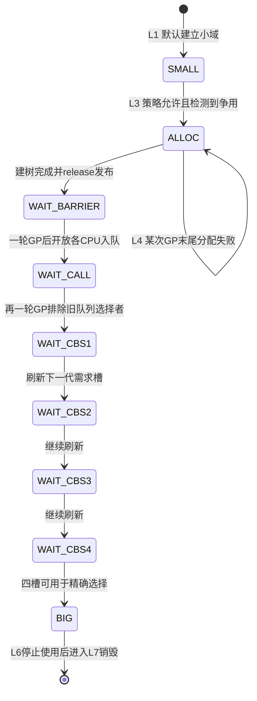
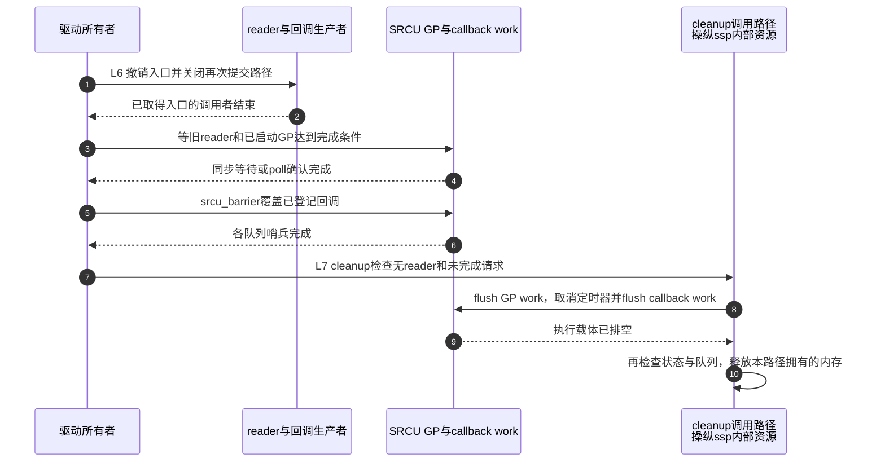

# 第16章\_Linux\_6.12\_Tree\_SRCU实例建立扩展与销毁源码实现

## 16.1\_一轮GP之外还有实例寿命

**讲解层次：实现层。** [Tree SRCU 核心实现](P11_Linux_6.12_Tree_SRCU源码实现.md#11.1_实现所有权与版本边界)已经追完睡眠 listener 的一次注销：进入记账、双扫描、回调交付、等待者继续。但驱动可能同时管理许多通知域，只有少数域繁忙；若每个域从建立起就分配完整节点树，会为冷门域支付用不到的内存与初始化成本。另一方面，繁忙域把各 CPU 的回调都塞进同一队列，又会把锁竞争集中起来。

本章追踪另一个周期：一个域怎样先具备合法账本和执行载体，怎样按负载由集中队列转为分散队列，以及驱动卸载时怎样证明所有路径已经停止。这里只改变更新侧组织，不能把尺寸变化理解成 reader 保护契约变化。

源码身份为 NXP Linux 6.12.20、固定提交 `dfaf2136deb2af2e60b994421281ba42f1c087e0`，分析 `CONFIG_TREE_SRCU` 分支。上游位置为 [`include/linux/srcu.h`](../../linux/include/linux/srcu.h)、[`include/linux/srcutree.h`](../../linux/include/linux/srcutree.h) 与 [`kernel/rcu/srcutree.c`](../../linux/kernel/rcu/srcutree.c)。当前目标机配置与运行轨迹未核验；下面的中文 Doxygen 是仓库补充，所展开函数保留完整语句，只去掉原英文注释。

模块角色与阅读入口见 [Tree SRCU 模块概念导读](../navigation/P09_Linux_6.12_Tree_SRCU模块源码概念导读.md#9.3_源码文件和对象层次)。本章不重复核心篇的结构体和 `srcu_gp_end()` 函数体。

## 16.2\_沿同一实例划分阶段和源码入口

先分清三个生命周期参与者。驱动拥有域的外部可达性，负责允许或阻止新的 API 调用；SRCU 初始化路径拥有内部状态的建立和发布；GP work 只能推进已经登记的责任，不能替驱动撤销外部调用入口。它们作用于不同状态。

| 阶段 | 触发与写入者 | 状态地址与变化 | 后续读取者及退出条件 |
| --- | --- | --- | --- |
| L0 未发布 | 驱动创建实例 | `ssp` 尚未交给并发使用者 | 初始化成功前不可调用动态实例的其他 API |
| L1 建立 | 初始化路径 | 分配/连接 `srcu_sup`、`sda`，初始化 work、锁、队列和序列 | release 发布 `srcu_gp_seq_needed` 的已初始化值 |
| L2 小域运行 | reader 和请求者 | reader 写各 CPU 计数；callback 进入 boot 队列 | 不要求一定扩展，可长期保持 SMALL |
| L3 请求扩展 | 争用检测或策略路径 | `srcu_size_state: SMALL→ALLOC` | GP 完成路径尝试分配节点树 |
| L4 过渡 | GP work | 发布树、扩大 barrier 扫描、开放 per-CPU 入队、刷新四槽 | 达到 BIG，旧选择者已跨过必要 GP |
| L5 大域运行 | 请求者和 GP work | 节点槽与 CPU 掩码承载需求和交付 | 驱动准备关闭实例；本版本不自动缩回 SMALL |
| L6 停止使用 | 驱动与业务调用者 | 撤销入口、等在途调用和 reader、排尽旧 callback/poll 请求 | 没有新责任能够进入 |
| L7 释放 | `cleanup_srcu_struct()` | 排尽 work/定时器，检查责任，释放动态分配 | 检查失败则告警并保留内存，不能宣称销毁成功 |

初始化策略也可以直接建立 BIG，从 L1 进入 L5；它发生在实例对调用者开放之前，不必模拟运行中 L4 的交接。

| 唯一实现符号 | 标题 | 本地阅读目的 |
| --- | --- | --- |
| 静态初始化宏、`__DEFINE_SRCU` | [16.3](#16.3_动态实例与静态声明为什么不是同一种建立方式) | 区分普通内核、模块以及动态资源所有权 |
| `init_srcu_struct_fields/data`、`check_init_srcu_struct`、两个初始化入口 | [16.4](#16.4_先建立可用载体再发布初始化完成) | 观察初始化成功和失败路径；保留已有 reader 计数 |
| `init_srcu_struct_nodes`、`srcu_invl_snp_seq` | [16.5](#16.5_节点树怎样连接到已有的每CPU账本) | 建立 parent、CPU 范围、位掩码与发布门槛 |
| 两个 transition 函数、三个 contention 辅助函数 | [16.6](#16.6_为什么扩展必须跨过多轮GP) | 把争用事件变成转换请求，再完成布局交接 |
| `srcu_init`、模块 coming/going/notify | [16.7](#16.7_启动与模块路径怎样接管静态资源) | 早期请求转入 workqueue，模块负责 per-CPU 资源 |
| `srcu_readers_active`、`cleanup_srcu_struct` | [16.8](#16.8_cleanup为何不能代替关闭协议) | 区分诊断、执行载体排空与业务停用 |

## 16.3\_动态实例与静态声明为什么不是同一种建立方式

驱动可以把 `struct srcu_struct` 放在自己分配的对象中，先调用 `init_srcu_struct()`，成功后再发布给调用者。该路径需要自己分配 usage 和 per-CPU 数据，退出时由 cleanup 释放。另一种是 `DEFINE_SRCU`/`DEFINE_STATIC_SRCU` 声明，使用编译期建立的 usage 和静态入口，并由 SRCU 的专门路径补齐运行期部分；用户代码不应再对这种声明调用 init/cleanup。

`DEFINE_STATIC_SRCU` 中的 static 限定符影响名字可见性，不表示 reader 不能迁移。普通 C 的 `static struct srcu_struct domain;` 只是零初始化对象，若未使用 DEFINE 宏，仍须走显式 init；不要把变量存储期等同于 SRCU 初始化方式。

```c
/* 以下中文阅读说明由仓库补充；保留原定义与条件分支。 */
#define SRCU_GP_SEQ_INITIAL_VAL ((0UL - 100UL) << RCU_SEQ_CTR_SHIFT)
#define SRCU_GP_SEQ_INITIAL_VAL_WITH_STATE (SRCU_GP_SEQ_INITIAL_VAL - 1)

#define __SRCU_USAGE_INIT(name)									\
{												\
	.lock = __SPIN_LOCK_UNLOCKED(name.lock),						\
	.srcu_gp_seq = SRCU_GP_SEQ_INITIAL_VAL,							\
	.srcu_gp_seq_needed = SRCU_GP_SEQ_INITIAL_VAL_WITH_STATE,				\
	.srcu_gp_seq_needed_exp = SRCU_GP_SEQ_INITIAL_VAL,					\
	.work = __DELAYED_WORK_INITIALIZER(name.work, NULL, 0),					\
}

#define __SRCU_STRUCT_INIT_COMMON(name, usage_name)						\
	.srcu_sup = &usage_name,								\
	__SRCU_DEP_MAP_INIT(name)

#define __SRCU_STRUCT_INIT_MODULE(name, usage_name)						\
{												\
	__SRCU_STRUCT_INIT_COMMON(name, usage_name)						\
}

#define __SRCU_STRUCT_INIT(name, usage_name, pcpu_name)						\
{												\
	.sda = &pcpu_name,									\
	__SRCU_STRUCT_INIT_COMMON(name, usage_name)						\
}

#ifdef MODULE
# define __DEFINE_SRCU(name, is_static)								\
	static struct srcu_usage name##_srcu_usage = __SRCU_USAGE_INIT(name##_srcu_usage);	\
	is_static struct srcu_struct name = __SRCU_STRUCT_INIT_MODULE(name, name##_srcu_usage);	\
	extern struct srcu_struct * const __srcu_struct_##name;					\
	struct srcu_struct * const __srcu_struct_##name						\
		__section("___srcu_struct_ptrs") = &name
#else
# define __DEFINE_SRCU(name, is_static)								\
	static DEFINE_PER_CPU(struct srcu_data, name##_srcu_data);				\
	static struct srcu_usage name##_srcu_usage = __SRCU_USAGE_INIT(name##_srcu_usage);	\
	is_static struct srcu_struct name =							\
		__SRCU_STRUCT_INIT(name, name##_srcu_usage, name##_srcu_data)
#endif
#define DEFINE_SRCU(name)		__DEFINE_SRCU(name, )
#define DEFINE_STATIC_SRCU(name)	__DEFINE_SRCU(name, static)
```

`SRCU_GP_SEQ_INITIAL_VAL` 故意接近无符号序列回绕处，使初始化后的测试较早经历回绕；它不是从零开始的已完成次数。`WITH_STATE` 则在 `srcu_gp_seq_needed` 低位保留未初始化标志，供第一次更新侧调用识别。两个字段名字相近，却暂时分别承担“GP 序列”和“初始化是否完成”的用途。

非模块 DEFINE 路径用 `DEFINE_PER_CPU` 建立账本；模块路径暂不提供 `sda`，把实例指针放进 `___srcu_struct_ptrs`，由模块通知路径分配。`__SRCU_DEP_MAP_INIT` 在启用 Lockdep 时提供依赖图名称，未启用时为空；它不负责读者计数。

## 16.4\_先建立可用载体再发布初始化完成

公开域入口只是一个指针集合。要使第一次请求能够安全排队，必须先建立域级控制、每 CPU 队列和执行载体，再让并发更新者看见完成标记；下面依次跟踪入口、分配和发布。

### 16.4.1\_调用入口不能绕过分配失败

启用 `CONFIG_DEBUG_LOCK_ALLOC` 时，`srcu.h` 把 `init_srcu_struct` 定义为带调用点 lock class key 的宏，转入 `__init_srcu_struct()`；否则调用普通函数。两者的功能建立都交给 `init_srcu_struct_fields(ssp, false)`，返回负错误值时不得把域发布给其他线程。

```c
/**
 * @brief 分别对应启用与关闭 CONFIG_DEBUG_LOCK_ALLOC 的两个互斥入口。
 * @note 中文说明为仓库补充；下方保留 kernel/rcu/srcutree.c 函数的完整语句，省去原英文注释。
 */
int __init_srcu_struct(struct srcu_struct *ssp, const char *name,
		       struct lock_class_key *key)
{

	debug_check_no_locks_freed((void *)ssp, sizeof(*ssp));
	lockdep_init_map(&ssp->dep_map, name, key, 0);
	return init_srcu_struct_fields(ssp, false);
}

/**
 * @brief 分别对应启用与关闭 CONFIG_DEBUG_LOCK_ALLOC 的两个互斥入口。
 * @note 中文说明为仓库补充；下方保留 kernel/rcu/srcutree.c 函数的完整语句，省去原英文注释。
 */
int init_srcu_struct(struct srcu_struct *ssp)
{
	return init_srcu_struct_fields(ssp, false);
}
```

上面的两个入口来自互斥配置，不是同一编译单元中让用户自由选择的双接口。调试版先检查锁对象生命周期，再初始化 Lockdep map，不能把它理解成额外一次 GP。

### 16.4.2\_建立域级状态与每CPU执行载体

L1 必须先使每个后续执行者都有有效落点：GP work 要能反查 `ssp`，callback work 要能反查本 CPU 的 `sdp`，定时器要知道要排哪个 work。最后的 release 才让更新侧看到初始化完成；否则另一个 CPU 可能先看到“可用”标志，却使用尚未建立的锁或函数指针。

```c
/**
 * @brief 核对状态建立、发布以及失败返回的实际先后顺序。
 * @note 中文说明为仓库补充；下方保留 kernel/rcu/srcutree.c 函数的完整语句，省去原英文注释。
 */
static int init_srcu_struct_fields(struct srcu_struct *ssp, bool is_static)
{
	if (!is_static)
		ssp->srcu_sup = kzalloc(sizeof(*ssp->srcu_sup), GFP_KERNEL);
	if (!ssp->srcu_sup)
		return -ENOMEM;
	if (!is_static)
		spin_lock_init(&ACCESS_PRIVATE(ssp->srcu_sup, lock));
	ssp->srcu_sup->srcu_size_state = SRCU_SIZE_SMALL;
	ssp->srcu_sup->node = NULL;
	mutex_init(&ssp->srcu_sup->srcu_cb_mutex);
	mutex_init(&ssp->srcu_sup->srcu_gp_mutex);
	ssp->srcu_idx = 0;
	ssp->srcu_sup->srcu_gp_seq = SRCU_GP_SEQ_INITIAL_VAL;
	ssp->srcu_sup->srcu_barrier_seq = 0;
	mutex_init(&ssp->srcu_sup->srcu_barrier_mutex);
	atomic_set(&ssp->srcu_sup->srcu_barrier_cpu_cnt, 0);
	INIT_DELAYED_WORK(&ssp->srcu_sup->work, process_srcu);
	ssp->srcu_sup->sda_is_static = is_static;
	if (!is_static)
		ssp->sda = alloc_percpu(struct srcu_data);
	if (!ssp->sda)
		goto err_free_sup;
	init_srcu_struct_data(ssp);
	ssp->srcu_sup->srcu_gp_seq_needed_exp = SRCU_GP_SEQ_INITIAL_VAL;
	ssp->srcu_sup->srcu_last_gp_end = ktime_get_mono_fast_ns();
	if (READ_ONCE(ssp->srcu_sup->srcu_size_state) == SRCU_SIZE_SMALL && SRCU_SIZING_IS_INIT()) {
		if (!init_srcu_struct_nodes(ssp, GFP_ATOMIC))
			goto err_free_sda;
		WRITE_ONCE(ssp->srcu_sup->srcu_size_state, SRCU_SIZE_BIG);
	}
	ssp->srcu_sup->srcu_ssp = ssp;
	smp_store_release(&ssp->srcu_sup->srcu_gp_seq_needed,
			SRCU_GP_SEQ_INITIAL_VAL);
	return 0;

err_free_sda:
	if (!is_static) {
		free_percpu(ssp->sda);
		ssp->sda = NULL;
	}
err_free_sup:
	if (!is_static) {
		kfree(ssp->srcu_sup);
		ssp->srcu_sup = NULL;
	}
	return -ENOMEM;
}

/**
 * @brief 核对状态建立、发布以及失败返回的实际先后顺序。
 * @note 中文说明为仓库补充；下方保留 kernel/rcu/srcutree.c 函数的完整语句，省去原英文注释。
 */
static void init_srcu_struct_data(struct srcu_struct *ssp)
{
	int cpu;
	struct srcu_data *sdp;

	WARN_ON_ONCE(ARRAY_SIZE(sdp->srcu_lock_count) !=
		     ARRAY_SIZE(sdp->srcu_unlock_count));
	for_each_possible_cpu(cpu) {
		sdp = per_cpu_ptr(ssp->sda, cpu);
		spin_lock_init(&ACCESS_PRIVATE(sdp, lock));
		rcu_segcblist_init(&sdp->srcu_cblist);
		sdp->srcu_cblist_invoking = false;
		sdp->srcu_gp_seq_needed = ssp->srcu_sup->srcu_gp_seq;
		sdp->srcu_gp_seq_needed_exp = ssp->srcu_sup->srcu_gp_seq;
		sdp->srcu_barrier_head.next = &sdp->srcu_barrier_head;
		sdp->mynode = NULL;
		sdp->cpu = cpu;
		INIT_WORK(&sdp->work, srcu_invoke_callbacks);
		timer_setup(&sdp->delay_work, srcu_delay_timer, 0);
		sdp->ssp = ssp;
	}
}
```

这里有三个容易漏看的条件。第一，`is_static` 表示已有 usage/per-CPU 资源，不能重新分配或在错误分支中替其所有者释放。第二，`init_srcu_struct_data()` 没有把 reader 的两组计数重新清零：静态实例可能已经有 reader 在运行，清零会丢失已登记责任；动态 `alloc_percpu` 分配得到的零初始化区域则提供最初账本；固定版本 [`mm/percpu.c` 的分配路径](https://github.com/nxp-imx/linux-imx/blob/dfaf2136deb2af2e60b994421281ba42f1c087e0/mm/percpu.c#L1897-L1899)在返回前逐 possible CPU 清零分配区。第三，`sda_is_static` 记录 cleanup 可以释放哪些资源，而不是记录当前是否存在 reader。

函数先分配 usage，再分配 per-CPU 数据，初始化建树失败则按相反方向释放本次动态资源。成功路径最后写 `srcu_ssp`，再用 `smp_store_release` 发布已初始化的 `srcu_gp_seq_needed`。这只完成 SRCU 内部发布；驱动把 `ssp` 放入自己的共享对象时，仍须遵守该共享对象的锁或发布协议。

### 16.4.3\_静态实例首次更新为何需要双重检查

```c
/**
 * @brief 利用预先建立的域锁串行化第一次更新侧初始化。
 * @note 中文说明为仓库补充；下方保留 kernel/rcu/srcutree.c 函数的完整语句，省去原英文注释。
 */
static void check_init_srcu_struct(struct srcu_struct *ssp)
{
	unsigned long flags;

	if (!rcu_seq_state(smp_load_acquire(&ssp->srcu_sup->srcu_gp_seq_needed)))
		return;
	spin_lock_irqsave_rcu_node(ssp->srcu_sup, flags);
	if (!rcu_seq_state(ssp->srcu_sup->srcu_gp_seq_needed)) {
		spin_unlock_irqrestore_rcu_node(ssp->srcu_sup, flags);
		return;
	}
	init_srcu_struct_fields(ssp, true);
	spin_unlock_irqrestore_rcu_node(ssp->srcu_sup, flags);
}
```

第一次 acquire 读若发现序列低位为零，说明此前 release 发布已经完成，可以快返；否则拿编译期已建立的域锁后再查一次，只有仍未初始化的一方执行建立。锁内重查防止多个 CPU 同时重置队列和 work。这个入口只补齐静态实例的运行期字段，不能修复未经 init 就被使用的动态实例：后者连 `srcu_sup` 都可能无效。

## 16.5\_节点树怎样连接到已有的每CPU账本

小域已经有各 CPU 的 reader 计数，扩展时并不迁移它们。新增的是一棵 **回调需求汇聚树**：叶节点知道自己覆盖哪些 CPU，CPU 知道自己属于哪个叶节点、占叶节点掩码的哪一位，父节点再合并目标。树建立前，这些链接不能被并发请求者使用。

```c
/**
 * @brief 先完整连接节点和 CPU，再以 WAIT_BARRIER 发布树。
 * @note 中文说明为仓库补充；下方保留 kernel/rcu/srcutree.c 函数的完整语句，省去原英文注释。
 */
static inline bool srcu_invl_snp_seq(unsigned long s)
{
	return s == SRCU_SNP_INIT_SEQ;
}

/**
 * @brief 先完整连接节点和 CPU，再以 WAIT_BARRIER 发布树。
 * @note 中文说明为仓库补充；下方保留 kernel/rcu/srcutree.c 函数的完整语句，省去原英文注释。
 */
static bool init_srcu_struct_nodes(struct srcu_struct *ssp, gfp_t gfp_flags)
{
	int cpu;
	int i;
	int level = 0;
	int levelspread[RCU_NUM_LVLS];
	struct srcu_data *sdp;
	struct srcu_node *snp;
	struct srcu_node *snp_first;

	rcu_init_geometry();
	ssp->srcu_sup->node = kcalloc(rcu_num_nodes, sizeof(*ssp->srcu_sup->node), gfp_flags);
	if (!ssp->srcu_sup->node)
		return false;

	ssp->srcu_sup->level[0] = &ssp->srcu_sup->node[0];
	for (i = 1; i < rcu_num_lvls; i++)
		ssp->srcu_sup->level[i] = ssp->srcu_sup->level[i - 1] + num_rcu_lvl[i - 1];
	rcu_init_levelspread(levelspread, num_rcu_lvl);

	srcu_for_each_node_breadth_first(ssp, snp) {
		spin_lock_init(&ACCESS_PRIVATE(snp, lock));
		WARN_ON_ONCE(ARRAY_SIZE(snp->srcu_have_cbs) !=
			     ARRAY_SIZE(snp->srcu_data_have_cbs));
		for (i = 0; i < ARRAY_SIZE(snp->srcu_have_cbs); i++) {
			snp->srcu_have_cbs[i] = SRCU_SNP_INIT_SEQ;
			snp->srcu_data_have_cbs[i] = 0;
		}
		snp->srcu_gp_seq_needed_exp = SRCU_SNP_INIT_SEQ;
		snp->grplo = -1;
		snp->grphi = -1;
		if (snp == &ssp->srcu_sup->node[0]) {

			snp->srcu_parent = NULL;
			continue;
		}

		if (snp == ssp->srcu_sup->level[level + 1])
			level++;
		snp->srcu_parent = ssp->srcu_sup->level[level - 1] +
				   (snp - ssp->srcu_sup->level[level]) /
				   levelspread[level - 1];
	}

	level = rcu_num_lvls - 1;
	snp_first = ssp->srcu_sup->level[level];
	for_each_possible_cpu(cpu) {
		sdp = per_cpu_ptr(ssp->sda, cpu);
		sdp->mynode = &snp_first[cpu / levelspread[level]];
		for (snp = sdp->mynode; snp != NULL; snp = snp->srcu_parent) {
			if (snp->grplo < 0)
				snp->grplo = cpu;
			snp->grphi = cpu;
		}
		sdp->grpmask = 1UL << (cpu - sdp->mynode->grplo);
	}
	smp_store_release(&ssp->srcu_sup->srcu_size_state, SRCU_SIZE_WAIT_BARRIER);
	return true;
}
```

`SRCU_SNP_INIT_SEQ=0x2` 是无效槽标记，不能误当作一个真实回调目标。初始化遍历先设置节点锁、四个无效代际和零 CPU 掩码；随后连接父节点，再从每个 possible CPU 向上填充 `grplo/grphi`。`grpmask` 的位偏移相对于叶节点的最小 CPU 编号，因此它不是全系统 CPU 号直接当位号。

最后的 release 把 `srcu_size_state` 变成 WAIT_BARRIER，和请求、barrier 路径的 acquire 配对；看到该阶段的执行者才能读取树链接。分配失败在发布以前返回 false，运行中扩展留在 ALLOC，之后有 GP 完成时可再次尝试。没有新 GP 时它也不会凭空启动独立“扩展线程”。

本函数调用的 `rcu_init_geometry/rcu_init_levelspread` 复用 Tree RCU 的几何计算，只决定层数和节点分布；没有把 SRCU reader 证明变成 `qsmask` 上报。几何建立的唯一展开见 [配置与几何实现](P17_Linux_6.12_RCU配置选择参数与树形容量源码实现.md#17.4.2_几何计算的完整决策顺序)。

## 16.6\_为什么扩展必须跨过多轮GP

树已经能够分配，但运行中的请求者和 barrier 可能仍按旧布局行动。扩展因此分为“提出请求”和“逐步改变可见范围”，二者之间用本域 GP 协调旧使用者。

### 16.6.1\_竞争只发起请求不直接切换布局

假设 CPU1、CPU2 都把 callback 放到 boot CPU 的队列，争用同一 `sdp->lock`。失败的 trylock 说明此刻有人持锁，不能据此断言所有域都需要树。代码先按策略检查本域每 jiffy 的累计失败事件，超过门槛才把 SMALL 改为 ALLOC。读侧计数和旧队列在此时仍有效。

```c
/**
 * @brief 将观察到的更新侧锁争用转换成尺寸请求，实际转换由后续 GP 推进。
 * @note 中文说明为仓库补充；下方保留 kernel/rcu/srcutree.c 函数的完整语句，省去原英文注释。
 */
static void __srcu_transition_to_big(struct srcu_struct *ssp)
{
	lockdep_assert_held(&ACCESS_PRIVATE(ssp->srcu_sup, lock));
	smp_store_release(&ssp->srcu_sup->srcu_size_state, SRCU_SIZE_ALLOC);
}

/**
 * @brief 将观察到的更新侧锁争用转换成尺寸请求，实际转换由后续 GP 推进。
 * @note 中文说明为仓库补充；下方保留 kernel/rcu/srcutree.c 函数的完整语句，省去原英文注释。
 */
static void srcu_transition_to_big(struct srcu_struct *ssp)
{
	unsigned long flags;

	if (smp_load_acquire(&ssp->srcu_sup->srcu_size_state) != SRCU_SIZE_SMALL)
		return;
	spin_lock_irqsave_rcu_node(ssp->srcu_sup, flags);
	if (smp_load_acquire(&ssp->srcu_sup->srcu_size_state) != SRCU_SIZE_SMALL) {
		spin_unlock_irqrestore_rcu_node(ssp->srcu_sup, flags);
		return;
	}
	__srcu_transition_to_big(ssp);
	spin_unlock_irqrestore_rcu_node(ssp->srcu_sup, flags);
}

/**
 * @brief 将观察到的更新侧锁争用转换成尺寸请求，实际转换由后续 GP 推进。
 * @note 中文说明为仓库补充；下方保留 kernel/rcu/srcutree.c 函数的完整语句，省去原英文注释。
 */
static void spin_lock_irqsave_check_contention(struct srcu_struct *ssp)
{
	unsigned long j;

	if (!SRCU_SIZING_IS_CONTEND() || ssp->srcu_sup->srcu_size_state)
		return;
	j = jiffies;
	if (ssp->srcu_sup->srcu_size_jiffies != j) {
		ssp->srcu_sup->srcu_size_jiffies = j;
		ssp->srcu_sup->srcu_n_lock_retries = 0;
	}
	if (++ssp->srcu_sup->srcu_n_lock_retries <= small_contention_lim)
		return;
	__srcu_transition_to_big(ssp);
}

/**
 * @brief 将观察到的更新侧锁争用转换成尺寸请求，实际转换由后续 GP 推进。
 * @note 中文说明为仓库补充；下方保留 kernel/rcu/srcutree.c 函数的完整语句，省去原英文注释。
 */
static void spin_lock_irqsave_sdp_contention(struct srcu_data *sdp, unsigned long *flags)
{
	struct srcu_struct *ssp = sdp->ssp;

	if (spin_trylock_irqsave_rcu_node(sdp, *flags))
		return;
	spin_lock_irqsave_rcu_node(ssp->srcu_sup, *flags);
	spin_lock_irqsave_check_contention(ssp);
	spin_unlock_irqrestore_rcu_node(ssp->srcu_sup, *flags);
	spin_lock_irqsave_rcu_node(sdp, *flags);
}

/**
 * @brief 将观察到的更新侧锁争用转换成尺寸请求，实际转换由后续 GP 推进。
 * @note 中文说明为仓库补充；下方保留 kernel/rcu/srcutree.c 函数的完整语句，省去原英文注释。
 */
static void spin_lock_irqsave_ssp_contention(struct srcu_struct *ssp, unsigned long *flags)
{
	if (spin_trylock_irqsave_rcu_node(ssp->srcu_sup, *flags))
		return;
	spin_lock_irqsave_rcu_node(ssp->srcu_sup, *flags);
	spin_lock_irqsave_check_contention(ssp);
}
```

持锁版本只发布 ALLOC；不持锁版本先读再加域锁重查，使重复请求幂等。`sdp` 的 contention 包装在 trylock 失败后先拿域锁记争用、释放域锁，再正式等待队列锁，没有在这条路径中同时长期持有两者。域级包装则拿到域锁后直接记事件。

固定默认 `small_contention_lim=100` 表示同一 jiffy 的检测事件数门槛，条件是递增后 **大于** 100 才触发；不是100个读者或100纳秒。没有启用 CONTEND 策略、或已离开 SMALL 时不再用这条规则重复触发。状态成为 ALLOC 不保证下一刻就分配成功，更不保证已经开放 per-CPU 入队。

### 16.6.2\_先让barrier看见新队列再允许生产者使用

设旧 barrier 只准备扫描 boot 队列。如果先允许 CPU2 把回调放进自己的队列，再让这个 barrier 完成，它可能漏掉本应等待的旧回调。相反，先让新 barrier 扫描所有 possible CPU，是保守扩大范围；之后再开放分散入队，就不会出现“队列已经使用但等待者尚不知道”的窗口。



图展示已经请求扩展的路径；没有扩展的小域同样可以完成 L6/L7，并不要求先成为 BIG 才能销毁。

`srcu_gp_end()` 的唯一完整实现见 [核心篇完成路径](P11_Linux_6.12_Tree_SRCU源码实现.md#11.8.1_srcu_gp_end先发布完成再选择有callback的CPU)。它在每轮末尾按状态分配树或前进一阶段，并不是本图另外存在一个工作线程。具体队列选择门槛见 [核心篇尺寸表](P11_Linux_6.12_Tree_SRCU源码实现.md#11.7.2_srcu_gp_start_if_needed完成四件事)。

请求和 barrier 在选择布局期间进入内部 SRCU 读侧，使过渡 GP 能等待仍在使用旧布局的选择者。四个 WAIT_CBS 阶段还给需求槽足够时间刷新；此前 GP 完成对叶范围使用全部 CPU 掩码，即使调度了一条空队列也只会多做检查，不会漏掉应执行的回调。达到 BIG 后才依赖精确槽位与 CPU 掩码减少调度。

这条转换的收益是分散回调队列锁、合并相同代际请求；代价是树内存、节点锁和多轮交接。低争用域继续保持 SMALL 是有效选择，不是功能残缺；每次 reader 进入/退出仍是 per-CPU 记账，不能说小域把所有 reader 都锁在 boot CPU。

## 16.7\_启动与模块路径怎样接管静态资源

静态声明的资源不完全由业务 init 管理：早期启动还没有可用 workqueue，模块的 per-CPU 区也由加载协议建立。分别找到接管者，才能解释为什么 DEFINE 实例不能照动态实例手工初始化。

### 16.7.1\_全局启动排出早期积压请求

`call_srcu` 在 workqueue 尚未就绪的早期不能正常排 work，于是把域的 work entry 暂放 `srcu_boot_list`。这条分支的环境只有 boot CPU、并且关闭中断，不能当成一般无锁队列复用。等 RCU workqueue 和定时器建立后，`srcu_init()` 才把这些请求转交正常执行载体。

```c
/**
 * @brief 决定默认尺寸策略，并在执行载体就绪后排出早期域请求。
 * @note 中文说明为仓库补充；下方保留 kernel/rcu/srcutree.c 函数的完整语句，省去原英文注释。
 */
void __init srcu_init(void)
{
	struct srcu_usage *sup;

	if (SRCU_SIZING_IS(SRCU_SIZING_AUTO)) {
		if (nr_cpu_ids >= big_cpu_lim) {
			convert_to_big = SRCU_SIZING_INIT;
			pr_info("%s: Setting srcu_struct sizes to big.\n", __func__);
		} else {
			convert_to_big = SRCU_SIZING_NONE | SRCU_SIZING_CONTEND;
			pr_info("%s: Setting srcu_struct sizes based on contention.\n", __func__);
		}
	}

	srcu_init_done = true;
	while (!list_empty(&srcu_boot_list)) {
		sup = list_first_entry(&srcu_boot_list, struct srcu_usage,
				      work.work.entry);
		list_del_init(&sup->work.work.entry);
		if (SRCU_SIZING_IS(SRCU_SIZING_INIT) &&
		    sup->srcu_size_state == SRCU_SIZE_SMALL)
			sup->srcu_size_state = SRCU_SIZE_ALLOC;
		queue_work(rcu_gp_wq, &sup->work.work);
	}
}
```

AUTO 的默认阈值 `big_cpu_lim=128` 比较的是 `nr_cpu_ids`，不是当前 online CPU 数。达到阈值就选 INIT，否则选 NONE 加 CONTEND 位；用户参数可改变策略，不能写成所有机器都在争用后扩展。已在早期使用的小域即使此刻选择 INIT，也先标为 ALLOC 后继续交接；还未投入使用的新实例才在 init 内直接建立 BIG。

### 16.7.2\_模块的静态声明为何仍有动态perCPU资源

模块 DEFINE 宏把实例指针登记在专门 section，模块加载路径据此分配 per-CPU 数据；usage 和入口仍由模块静态存储承载。模块退出路径只释放自己拥有的资源，不要求使用者手工对 DEFINE 实例调用 init/cleanup。

```c
/**
 * @brief CONFIG_MODULES 分支按模块状态管理 DEFINE 声明的 per-CPU 资源。
 * @note 中文说明为仓库补充；下方保留 kernel/rcu/srcutree.c 函数的完整语句，省去原英文注释。
 */
static int srcu_module_coming(struct module *mod)
{
	int i;
	struct srcu_struct *ssp;
	struct srcu_struct **sspp = mod->srcu_struct_ptrs;

	for (i = 0; i < mod->num_srcu_structs; i++) {
		ssp = *(sspp++);
		ssp->sda = alloc_percpu(struct srcu_data);
		if (WARN_ON_ONCE(!ssp->sda))
			return -ENOMEM;
	}
	return 0;
}

/**
 * @brief CONFIG_MODULES 分支按模块状态管理 DEFINE 声明的 per-CPU 资源。
 * @note 中文说明为仓库补充；下方保留 kernel/rcu/srcutree.c 函数的完整语句，省去原英文注释。
 */
static void srcu_module_going(struct module *mod)
{
	int i;
	struct srcu_struct *ssp;
	struct srcu_struct **sspp = mod->srcu_struct_ptrs;

	for (i = 0; i < mod->num_srcu_structs; i++) {
		ssp = *(sspp++);
		if (!rcu_seq_state(smp_load_acquire(&ssp->srcu_sup->srcu_gp_seq_needed)) &&
		    !WARN_ON_ONCE(!ssp->srcu_sup->sda_is_static))
			cleanup_srcu_struct(ssp);
		if (!WARN_ON(srcu_readers_active(ssp)))
			free_percpu(ssp->sda);
	}
}

/**
 * @brief CONFIG_MODULES 分支按模块状态管理 DEFINE 声明的 per-CPU 资源。
 * @note 中文说明为仓库补充；下方保留 kernel/rcu/srcutree.c 函数的完整语句，省去原英文注释。
 */
static int srcu_module_notify(struct notifier_block *self,
			      unsigned long val, void *data)
{
	struct module *mod = data;
	int ret = 0;

	switch (val) {
	case MODULE_STATE_COMING:
		ret = srcu_module_coming(mod);
		break;
	case MODULE_STATE_GOING:
		srcu_module_going(mod);
		break;
	default:
		break;
	}
	return ret;
}
```

`MODULE_STATE_COMING` 逐个分配，失败返回 `-ENOMEM`；本函数没有在内部循环撤销此前成功项，因此不能凭这段局部源码声称完整模块加载事务已回滚。完整失败收尾还属于模块加载器的外部协议。`GOING` 先检查运行期字段是否初始化，再调用 cleanup 处理树与执行载体；最后确认无读者后释放模块专用 per-CPU 区。

通知函数通过 `srcu_module_nb` 注册到模块通知链。该内部路径是用户“不手工清理 DEFINE 实例”的实现原因，不是允许模块带着在途 reader 或回调代码卸载；模块自身仍负责 L6 的停用条件。

## 16.8\_cleanup为何不能代替关闭协议

可运行的实例已经把责任分散到 reader、队列、GP work 和定时器。释放前必须先阻止责任继续产生，再收回这些载体；cleanup 只负责后半段，并以检查暴露调用方漏做的前提。

### 16.8.1\_先切断新增责任再释放状态载体

回到 listener 驱动。只删除一条 listener 的共享指针，可能足以启动保护该对象的一轮 GP，却不足以销毁整个 SRCU 域：其他 listener 仍可能进入同一域，另一个线程也可能继续调用 `call_srcu`。L6 因而先撤销整个实例的外部入口，并等待已经取得入口的调用者结束。

之后分别排清两类责任：旧 reader 的访问由合适的 SRCU GP 等待覆盖，已登记异步回调由 `srcu_barrier()` 等待执行；已启动的 poll GP 也须完成。回调如果还能再次提交工作，必须先关闭这种生产路径，单次 barrier 不会无限追踪其调用边界之后的所有新责任。



步骤 1～2 是业务关闭协议，cleanup 不会替调用者加一把能阻止所有外部入口的锁。步骤 3 与 5 分别证明 reader 和回调责任；步骤 8 才处理 work/定时器载体。把这些步骤压成“一次计数为零然后 free”会漏掉尚未登记、将要排队或正在执行的路径。

### 16.8.2\_检查失败为何选择泄漏

```c
/**
 * @brief 只能在调用者已停止使用实例之后诊断并释放，不实现并发关闭。
 * @note 中文说明为仓库补充；下方保留 kernel/rcu/srcutree.c 函数的完整语句，省去原英文注释。
 */
static bool srcu_readers_active(struct srcu_struct *ssp)
{
	int cpu;
	unsigned long sum = 0;

	for_each_possible_cpu(cpu) {
		struct srcu_data *cpuc = per_cpu_ptr(ssp->sda, cpu);

		sum += atomic_long_read(&cpuc->srcu_lock_count[0]);
		sum += atomic_long_read(&cpuc->srcu_lock_count[1]);
		sum -= atomic_long_read(&cpuc->srcu_unlock_count[0]);
		sum -= atomic_long_read(&cpuc->srcu_unlock_count[1]);
	}
	return sum;
}

/**
 * @brief 只能在调用者已停止使用实例之后诊断并释放，不实现并发关闭。
 * @note 中文说明为仓库补充；下方保留 kernel/rcu/srcutree.c 函数的完整语句，省去原英文注释。
 */
void cleanup_srcu_struct(struct srcu_struct *ssp)
{
	int cpu;
	struct srcu_usage *sup = ssp->srcu_sup;

	if (WARN_ON(!srcu_get_delay(ssp)))
		return;
	if (WARN_ON(srcu_readers_active(ssp)))
		return;
	flush_delayed_work(&sup->work);
	for_each_possible_cpu(cpu) {
		struct srcu_data *sdp = per_cpu_ptr(ssp->sda, cpu);

		del_timer_sync(&sdp->delay_work);
		flush_work(&sdp->work);
		if (WARN_ON(rcu_segcblist_n_cbs(&sdp->srcu_cblist)))
			return;
	}
	if (WARN_ON(rcu_seq_state(READ_ONCE(sup->srcu_gp_seq)) != SRCU_STATE_IDLE) ||
	    WARN_ON(rcu_seq_current(&sup->srcu_gp_seq) != sup->srcu_gp_seq_needed) ||
	    WARN_ON(srcu_readers_active(ssp))) {
		pr_info("%s: Active srcu_struct %p read state: %d gp state: %lu/%lu\n",
			__func__, ssp, rcu_seq_state(READ_ONCE(sup->srcu_gp_seq)),
			rcu_seq_current(&sup->srcu_gp_seq), sup->srcu_gp_seq_needed);
		return;

	}
	kfree(sup->node);
	sup->node = NULL;
	sup->srcu_size_state = SRCU_SIZE_SMALL;
	if (!sup->sda_is_static) {
		free_percpu(ssp->sda);
		ssp->sda = NULL;
		kfree(sup);
		ssp->srcu_sup = NULL;
	}
}
```

`srcu_readers_active()` 把两组进入减去退出，并未取得原子快照；它适合在使用者已经停止的前提下做错误检查，不能在活跃实例上证明“以后也没有 reader”。与 GP 的有序双扫描不同，不能把它拿去替换 `srcu_readers_active_idx_check()`。

cleanup 先拒绝仍有加急需求或 reader 的明显错误，再 flush 域级 work，逐 CPU 同步撤掉 callback 定时器、flush callback work，检查队列总责任。最后重新检查 GP 为 IDLE、完成序列等于目标，并再次检查 reader。任何条件失败都告警并返回，宁可保留资源，也不能在仍有执行者时释放。

`del_timer_sync` 和 `flush_work` 只处理相应执行载体，不是禁止未来重排的全域开关；L6 的前提缺失时仍不安全。最后无条件释放树并清空树入口；仅 `sda_is_static=false` 才释放 per-CPU 区和 usage 并清空 `ssp` 指针。`ssp` 本身属于调用者，若嵌在驱动对象中还需由驱动释放，但只能在整个关闭协议成功完成之后。

## 16.9\_用三个修改判断检验生命周期

如果把每 CPU 初始化里的两个 reader 计数显式置零，为什么反而可能出错？静态实例可能已经有 reader 登记，首次更新侧初始化会抹掉它们的进入责任。动态分配时的初始零值与运行中重新清零不是同一件事。

如果让 WAIT_BARRIER 和 WAIT_CALL 同时生效，会少掉哪条保证？仍只扫描 boot 队列的旧 barrier 可能与已经进入新 CPU 队列的生产者并发；原协议用先扩大等待范围、再经 GP 开放生产范围消除这个窗口。

如果一次 `srcu_readers_active()` 返回 false，就直接释放 `sda`，会漏什么？至少可能漏未停止的新进入、已排或正在执行的回调、尚未结束的 GP、定时器或 work。诊断读数不能建立外部入口关闭条件。

本章使一个实例从创建到释放都有明确所有者和交接点。阅读其他 RCU 家族时仍要分别核对其生命周期，不能把 Tree SRCU 的私有域分配和尺寸阶段套到系统全局普通 RCU 域。

返回 [Tree SRCU 核心周期](P11_Linux_6.12_Tree_SRCU源码实现.md#11.11_一轮注销操作的端到端源码时序)；返回 [源码总阅读索引](../navigation/P01_Linux_6.12_RCU源码总阅读索引.md#1.6_建议的源码阅读顺序)。
