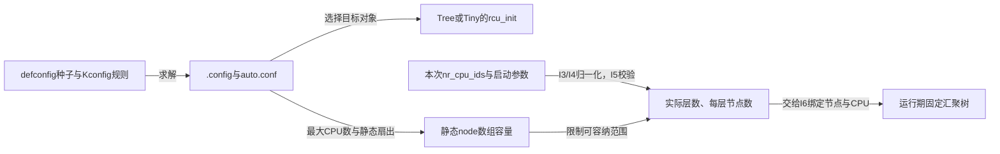
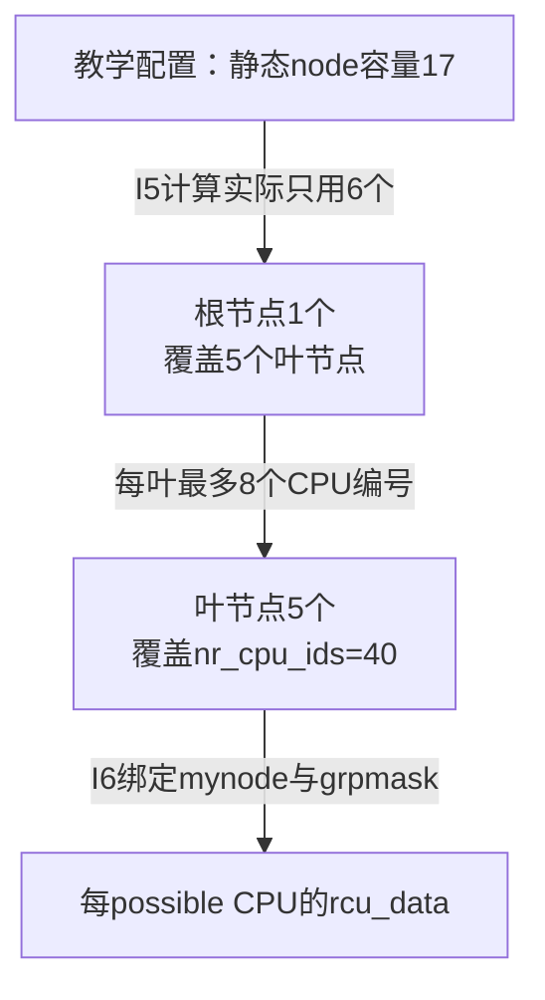

# 第17章\_Linux\_6.12\_RCU配置选择参数与树形容量源码实现

## 17.1\_先决定编译什么再决定初始化多大

**讲解层次：实现层。** [启动主事务](P12_Linux_6.12_Tree_RCU_rcu_init启动初始化源码实现.md#12.1_从start_kernel里的一个调用固定本章任务)在 I5 以前已经调用了参数公告与净化函数。这里先追问更早的决定：同名 `rcu_init()` 怎样由构建系统选成 Tree 或 Tiny？选定 Tree 后，编译期最大 CPU 容量又怎样变成本次启动实际使用的树？

配置种子、求解后的配置、链接对象、启动参数是四种证据。它们分别决定可用实现、编入的分支与这次启动的策略，不能用“defconfig 没有这一行”或“日志有这个名字”代替整条推导。本篇沿这条链解释 I3～I5，并保持主事务的 I 阶段编号。

源码固定为 NXP Linux 6.12.20、提交 `dfaf2136deb2af2e60b994421281ba42f1c087e0`；相关位置为 [`kernel/rcu/Kconfig`](../../linux/kernel/rcu/Kconfig)、[`kernel/Kconfig.preempt`](https://github.com/nxp-imx/linux-imx/blob/dfaf2136deb2af2e60b994421281ba42f1c087e0/kernel/Kconfig.preempt)、[`kernel/rcu/Makefile`](https://github.com/nxp-imx/linux-imx/blob/dfaf2136deb2af2e60b994421281ba42f1c087e0/kernel/rcu/Makefile) 和 [`kernel/rcu/tree.c`](../../linux/kernel/rcu/tree.c)。配置种子的例证另见同一提交的 [`imx_v7_defconfig`](https://github.com/nxp-imx/linux-imx/blob/dfaf2136deb2af2e60b994421281ba42f1c087e0/arch/arm/configs/imx_v7_defconfig)。当前目标工作树配置未验证。本文 C 函数的中文说明为仓库补充，条件与语句按固定源码核验；Kconfig 片段只选当前推导需要的条目，不冒充完整配置文件。



## 17.2\_先证明当前调用解析为哪一种RCU

`rcu_init()` 声明于：`include/linux/rcupdate.h`：

```c
void rcu_init(void);
```

看到 `arch/arm/configs/imx_v7_test_defconfig` 没有 `CONFIG_TREE_RCU=y`，不能直接推出“这个内核没有配置 RCU”。这里必须依次区分 **配置种子、Kconfig 派生结果、最终链接对象** 三层证据。

### 17.2.1\_defconfig没有RCU行为什么仍会启用RCU

`defconfig` 不是最终配置的完整清单，而是交给 Kconfig 求解器的一组输入。执行：

```bash
make ARCH=arm imx_v7_test_defconfig
```

以后，Kconfig 还会应用依赖、`default` 和 `select`，最后把求解结果写入 `.config`；真正供后续构建规则读取的还包括由它生成的 `include/config/auto.conf`。因此，检查某个实现是否启用时，证据强弱依次是：

```text
最终 .config / include/config/auto.conf
    > Kconfig 的依赖、default 与 select 推导
    > defconfig 中是否出现同名字符串
```

`kernel/rcu/Kconfig` 中的 `TREE_RCU`、`PREEMPT_RCU` 和 `TINY_RCU` 都只有 `bool`，没有面向配置界面的提示字符串。这类 **隐藏配置符号** 不能由用户在菜单中直接勾选，通常由其他配置和 Kconfig 规则自动派生。“`defconfig` 没写 RCU”在这里往往正是正常现象，而不是 RCU 被关闭的证据。

固定提交中的标准 `arch/arm/configs/imx_v7_defconfig` 也能说明这种关系：它显式给出 `CONFIG_SMP=y` 与 `CONFIG_PREEMPT=y`，却没有显式写 `CONFIG_TREE_RCU=y`；Tree/Preempt RCU 由下面的隐藏规则派生。`imx_v7_test_defconfig` 不在本章固定提交的源码快照中，所以本章不把它的具体内容冒充成固定版本证据；若要确认开发工作树中这个自定义/后续配置的实际结果，必须在那棵源码树上重新生成并检查最终 `.config`。

### 17.2.2\_SMP与抢占模型怎样派生RCU实现

固定提交的 [`kernel/rcu/Kconfig`](../../linux/kernel/rcu/Kconfig) 给出三条关键规则。在 Kconfig 源文件中，`SMP`、`PREEMPTION`、`TREE_RCU`、`PREEMPT_RCU` 与 `TINY_RCU` 都是配置符号名称；写入生成的 `.config` 后才带 `CONFIG_` 前缀：

```kconfig
config TREE_RCU
    bool
    default y if SMP

config PREEMPT_RCU
    bool
    default y if PREEMPTION
    select TREE_RCU

config TINY_RCU
    bool
    default y if !PREEMPT_RCU && !SMP
```

`kernel/Kconfig.preempt` 又把用户选择的抢占模型接到内部公共能力；其中 `PREEMPT`、`PREEMPT_BUILD` 与 `PREEMPTION` 仍是 Kconfig 配置符号名称：

```kconfig
config PREEMPT_BUILD
    bool
    select PREEMPTION

config PREEMPT
    bool "Preemptible Kernel (Low-Latency Desktop)"
    select PREEMPT_BUILD
```

于是可以按因果关系，而不是按“文件里有没有 RCU 字样”，展开为：

```text
CONFIG_SMP=y
    → TREE_RCU 的 default 条件成立
    → CONFIG_TREE_RCU=y

CONFIG_PREEMPT=y
    → CONFIG_PREEMPT_BUILD=y
    → CONFIG_PREEMPTION=y
    → PREEMPT_RCU 的 default 条件成立
    → CONFIG_PREEMPT_RCU=y
    → select CONFIG_TREE_RCU=y

CONFIG_SMP=n 且 CONFIG_PREEMPT_RCU=n
    → TINY_RCU 的 default 条件成立
    → CONFIG_TINY_RCU=y
```

这里有两个容易混淆的结论：

1. 只要 `CONFIG_SMP=y`，即使没有启用可抢占 RCU，也会自动选择 Tree RCU；
2. 即使是单 CPU 构建，只要 `CONFIG_PREEMPTION=y` 使 `CONFIG_PREEMPT_RCU=y`，后者仍会选择 Tree RCU。只有 **非 SMP 且非 PREEMPT_RCU** 的构建才落入 Tiny RCU。

可以把常见结果压缩成下表：

| 求解条件 | 普通 RCU 后端 | 读侧模型 |
| --- | --- | --- |
| `CONFIG_SMP=y`，`CONFIG_PREEMPT_RCU=n` | Tree RCU | 不跟踪被抢占的普通 RCU reader |
| `CONFIG_PREEMPT_RCU=y`，无论是否 SMP | Tree RCU | 跟踪被抢占的普通 RCU reader |
| `CONFIG_SMP=n` 且 `CONFIG_PREEMPT_RCU=n` | Tiny RCU | 利用单 CPU、非可抢占条件简化普通 RCU |

### 17.2.3\_最终配置怎样决定链接哪个rcu\_init

若要核对 `imx_v7_test_defconfig`，应使用独立输出目录，避免覆盖开发工作树当前正在使用的 `.config`：

```bash
rcu_config_out=/tmp/imx_rcu_config_check
mkdir -p "$rcu_config_out"
make ARCH=arm O="$rcu_config_out" imx_v7_test_defconfig
grep -E '^(CONFIG_(SMP|PREEMPT|PREEMPT_BUILD|PREEMPTION|PREEMPT_RCU|TREE_RCU|TINY_RCU)=|# CONFIG_(SMP|PREEMPT|PREEMPT_BUILD|PREEMPTION|PREEMPT_RCU|TREE_RCU|TINY_RCU) is not set)' \
    "$rcu_config_out/.config"
```

若结果含有 `CONFIG_SMP=y`，至少应看到 `CONFIG_TREE_RCU=y`；若还含有 `CONFIG_PREEMPTION=y`，则应同时看到 `CONFIG_PREEMPT_RCU=y`；Tiny 分支应显示为未启用。这个实测结果才回答“这份板级配置最终选中了哪一种 RCU”。

随后，`kernel/rcu/Makefile` 根据已经求解的配置把不同目标文件链接进内核：

```makefile
obj-y += update.o sync.o
obj-$(CONFIG_TREE_SRCU) += srcutree.o
obj-$(CONFIG_TREE_RCU) += tree.o
obj-$(CONFIG_TINY_RCU) += tiny.o
```

RCU的类型判断发生在 **构建期链接**，分类型实现并引入相应的工程文件：

| 构建条件 | 提供 `rcu_init()` 的文件 | 这个函数建立什么 |
| --- | --- | --- |
| `CONFIG_TREE_RCU=y` | `kernel/rcu/tree.c` | 分层节点、每 CPU 状态、普通/expedited/NOCB/延迟释放等 Tree 基础设施 |
| `CONFIG_TINY_RCU=y` | `kernel/rcu/tiny.c` | 单 CPU 普通 RCU 的 softirq、早期测试和 Tasks callback 账本 |

`CONFIG_PREEMPT_RCU=y` 又会选择 `tree_plugin.h` 中的可抢占读侧分支，但仍然复用同一个 `tree.c::rcu_init()`、同一 `rcu_state` 和同一节点树。它改变的是被抢占 reader 的债务保存和节点完成条件，不会动态替换成另一套初始化入口。

若最终配置确认 `CONFIG_PREEMPT_RCU=y` 与 `CONFIG_TREE_RCU=y`，就沿以下编译链解释；旧快照曾记录这一组合，但本次未验证当前目标，不声称这两个符号必须逐字写在某个 `defconfig` 中：

```text
CONFIG_PREEMPT_RCU=y
    → 选择 CONFIG_TREE_RCU=y
    → kernel/rcu/tree.o 提供 rcu_init()
    → tree.c 末尾包含 tree_plugin.h
    → rcu_bootup_announce() 选择“Preemptible hierarchical RCU”分支
```

Tiny RCU 固定版本中的同名函数只有三个顶层动作：注册 `RCU_SOFTIRQ`、运行早期测试、初始化 Tasks callback 账本。这里说的只是 **`tiny.c::rcu_init()` 入口很短**，不是说 Tiny RCU 的全部工作只有一次串行测试。Tiny RCU 是针对非 SMP、非 PREEMPT_RCU 构建的完整替代后端：它利用同一时刻只有一个 CPU 执行内核代码的约束，省掉 Tree RCU 的多 CPU 分层汇聚状态，但仍要向内核其余子系统提供读侧契约、宽限期推进和 callback 延迟执行能力。单 CPU 上任务、中断和 softirq 仍会在时间上交错，更新后也仍可能需要等旧读侧使用结束再回收对象；被省掉的是 **跨 CPU 的证明汇聚成本**，不是 RCU 的生命周期语义。

因此，这段 Tiny 代码是 **互斥的替代实现证据**，不是当前 Tree RCU 调用接下来还会执行的第二段代码，也不是用来验证 Tree RCU 的串行测试框架。

## 17.3\_I3与I4先公布异常配置再净化线程优先级

这两步共同把“用户请求的启动配置”变成“日志可观察且后继消费者可安全采用的配置”，但二者修改的字段并不相同。

### 17.3.1\_rcu\_bootup\_announce()不只是打印实现名称

本章采用的历史 Tree 快照由 `CONFIG_PREEMPT_RCU=y` 选择 `tree_plugin.h` 中的可抢占分支，所以该快照启动日志中的实现名称是 `Preemptible hierarchical RCU implementation.`。这里的 **hierarchical** 对应后面建立的 `rcu_node` 汇聚树；**preemptible** 表示普通 RCU 读侧临界区内的任务可以被抢占，Tree RCU 必须额外跟踪被阻塞的读者。它不表示 `rcu_init()` 本身已经打开抢占或已经启动 RCU 线程。

随后 `rcu_bootup_announce_oddness()` 把偏离默认值、会改变证明边界或常用于调试的条件写入启动日志：

| 条件族 | 典型检查项 | 对运行机制的含义 |
| --- | --- | --- |
| 树形 | `rcu_fanout_leaf`、`rcu_fanout_exact`、运行时 `nr_cpu_ids` | 改变层数、节点数或叶节点覆盖范围 |
| 回调压力 | `blimit`、`qhimark`、`qlowmark`、`qovld` | 改变每轮调用数量与过载判定 |
| FQS | 首次/后续强制静止态延迟、调度器催促延迟 | 改变普通 GP 主动探测参与者的时机 |
| 停滞检测 | `CONFIG_PROVE_RCU`、stall timeout、stall suppress | 改变诊断能力，不等价于改变 RCU 正确性契约 |
| 抢占与提升 | `CONFIG_RCU_BOOST`、`kthread_prio`、boost delay | 改变被阻塞读者和 RCU 线程的调度行为 |
| 回调执行 | `use_softirq` | 在 RCU softirq 与每 CPU `rcuc` 线程之间选择 |
| no-CB 与调试 | NOCB、对象调试、EQS 调试、GP 调试延迟 | 改变卸载或观测路径 |
| Tasks RCU | Tasks、Tasks Rude、Tasks Trace 启用情况 | 决定 I13 要初始化哪些独立回调队列族 |

这条调用链还会进入 `rcupdate_announce_bootup_oddness()` 和 `rcu_tasks_bootup_oddness()`。因此它覆盖 Tree RCU、通用 RCU 参数以及 Tasks RCU 三层信息，而不是只打印一行名称。

### 17.3.2\_公告路径包含两处实际参数修正

“announce” 这个名字容易让人误以为路径只读。实际至少有两处钳位：

1. Tree RCU 把 `nohz_full_patience_delay` 限制在 `0～5000 ms`，然后换算为 jiffies，供 nohz_full CPU 的催促策略使用。
2. Tasks RCU 把 `rcu_task_stall_info_mult` 限制在 `1～10`，避免停滞信息输出倍率越界。

所以若移动或删除 I3，既会丢启动诊断，也可能让消费者看到未经净化的参数。日志中观察到“参数被修正”还只能证明配置归一化发生，不能证明 GP 线程或 Tasks RCU 线程已经运行。

### 17.3.3\_sanitize\_kthread\_prio()为什么放在公告以后

```c
/**
 * @brief 把命令行给出的 RCU 内核线程优先级收敛到合法区间。
 * @note 中文说明由本仓库补充；源码裁剪自 kernel/rcu/tree.c。
 */
static void __init sanitize_kthread_prio(void)
{
	int kthread_prio_in = kthread_prio;

	if (IS_ENABLED(CONFIG_RCU_BOOST) && kthread_prio < 2 &&
	    IS_BUILTIN(CONFIG_RCU_TORTURE_TEST))
		kthread_prio = 2;
	else if (IS_ENABLED(CONFIG_RCU_BOOST) && kthread_prio < 1)
		kthread_prio = 1;
	else if (kthread_prio < 0)
		kthread_prio = 0;
	else if (kthread_prio > 99)
		kthread_prio = 99;

	if (kthread_prio != kthread_prio_in)
		pr_alert("%s: Limited prio to %d from %d\n",
			 __func__, kthread_prio, kthread_prio_in);
}
```

I3 先公布用户请求值，I4 再公布实际修正值，日志因而保留“输入是什么、内核最终采用什么”两份证据。普通 RCU boost 至少取 `1`；内建 `RCU_TORTURE_TEST` 与 boost 同时启用时至少取 `2`；其他情况仍限制在实时优先级表示所接受的 `0～99`。这些值稍后供 `rcuc`、`rcub`、`rcuo` 和 expedited 相关线程使用，I4 自己 **不创建、不唤醒、不调度** 任何线程。

## 17.4\_I5从编译期容量中裁出本次启动真正使用的树

参数归一化以后，I5 才能把静态数组的最大容量换算成此次启动实际要初始化的层数与节点前缀。

### 17.4.1\_为什么既有编译期几何又有运行时几何

`struct rcu_state` 中的 `node[]` 是静态数组，尺寸必须在编译时由 `CONFIG_NR_CPUS`、`RCU_FANOUT` 和 `RCU_FANOUT_LEAF` 决定；但一次启动可能通过 `nr_cpus=` 减少 `nr_cpu_ids`，也可能通过 `rcutree.rcu_fanout_leaf=` 改变叶节点覆盖量。I5 不能重新分配 `node[]`，只能验证参数后，计算这个静态容量中本次实际使用的前缀：

| 输出 | 含义 | I6中的消费者 |
| --- | --- | --- |
| `rcu_num_lvls` | 实际树层数 | 控制逐层初始化循环 |
| `num_rcu_lvl[]` | 每层实际节点数 | 决定每层数组片段长度 |
| `rcu_num_nodes` | 实际节点总数 | 遍历与诊断边界 |
| `rcu_fanout_leaf` | 最终叶节点扇出 | 计算叶节点数量和 CPU 范围 |
| FQS jiffies 参数 | 首次、后续和调度器催促延迟 | 后续 GP/FQS 路径 |

### 17.4.2\_几何计算的完整决策顺序

```c
/**
 * @brief 完整控制分支按固定版本核对；状态作用由相邻正文解释。
 * @note 中文说明为仓库补充；下方保留 kernel/rcu/tree.c 函数的完整语句，省去原英文注释。
 */
void rcu_init_geometry(void)
{
	ulong d;
	int i;
	static unsigned long old_nr_cpu_ids;
	int rcu_capacity[RCU_NUM_LVLS];
	static bool initialized;

	if (initialized) {

		WARN_ON_ONCE(old_nr_cpu_ids != nr_cpu_ids);
		return;
	}

	old_nr_cpu_ids = nr_cpu_ids;
	initialized = true;

	d = RCU_JIFFIES_TILL_FORCE_QS + nr_cpu_ids / RCU_JIFFIES_FQS_DIV;
	if (jiffies_till_first_fqs == ULONG_MAX)
		jiffies_till_first_fqs = d;
	if (jiffies_till_next_fqs == ULONG_MAX)
		jiffies_till_next_fqs = d;
	adjust_jiffies_till_sched_qs();

	if (rcu_fanout_leaf == RCU_FANOUT_LEAF &&
	    nr_cpu_ids == NR_CPUS)
		return;
	pr_info("Adjusting geometry for rcu_fanout_leaf=%d, nr_cpu_ids=%u\n",
		rcu_fanout_leaf, nr_cpu_ids);

	if (rcu_fanout_leaf < 2 ||
	    rcu_fanout_leaf > sizeof(unsigned long) * 8) {
		rcu_fanout_leaf = RCU_FANOUT_LEAF;
		WARN_ON(1);
		return;
	}

	rcu_capacity[0] = rcu_fanout_leaf;
	for (i = 1; i < RCU_NUM_LVLS; i++)
		rcu_capacity[i] = rcu_capacity[i - 1] * RCU_FANOUT;

	if (nr_cpu_ids > rcu_capacity[RCU_NUM_LVLS - 1]) {
		rcu_fanout_leaf = RCU_FANOUT_LEAF;
		WARN_ON(1);
		return;
	}

	for (i = 0; nr_cpu_ids > rcu_capacity[i]; i++) {
	}
	rcu_num_lvls = i + 1;

	for (i = 0; i < rcu_num_lvls; i++) {
		int cap = rcu_capacity[(rcu_num_lvls - 1) - i];
		num_rcu_lvl[i] = DIV_ROUND_UP(nr_cpu_ids, cap);
	}

	rcu_num_nodes = 0;
	for (i = 0; i < rcu_num_lvls; i++)
		rcu_num_nodes += num_rcu_lvl[i];
}
```

上面保留完整函数语句，包括参数调整日志和局部 `cap` 变量。第一次调用把 `initialized` 设真；若另一个早期子系统再次调用，它只核对 `nr_cpu_ids` 是否稳定后返回。这不是“第二次刷新几何”。

参数非法或静态数组容量不足时，函数 `WARN_ON` 并退回编译期几何；这是显式失败关闭到已知可容纳结构，而不是强行按越界参数写 `node[]`。`rcu_init_levelspread()` 随后还会在 I6 中决定父节点如何平均接纳子节点：默认尽量均衡；`rcu_fanout_exact` 为真时才严格按叶扇出和内部扇出分组。

`rcu_init_levelspread()` 进一步把每层节点数变成每节点的覆盖宽度。它初始化未使用项为 `INT_MIN`，exact 分支保留指定扇出，默认分支则从 CPU 数向根逐层向上取整，使这一层的对象分给上一层节点。

```c
/**
 * @brief 由实际每层数量求覆盖宽度，区分exact参数与默认均衡。
 * @note 中文说明为仓库补充；下方保留 kernel/rcu/rcu.h 函数的完整语句，省去原英文注释。
 */
static inline void rcu_init_levelspread(int *levelspread, const int *levelcnt)
{
	int i;

	for (i = 0; i < RCU_NUM_LVLS; i++)
		levelspread[i] = INT_MIN;
	if (rcu_fanout_exact) {
		levelspread[rcu_num_lvls - 1] = rcu_fanout_leaf;
		for (i = rcu_num_lvls - 2; i >= 0; i--)
			levelspread[i] = RCU_FANOUT;
	} else {
		int ccur;
		int cprv;

		cprv = nr_cpu_ids;
		for (i = rcu_num_lvls - 1; i >= 0; i--) {
			ccur = levelcnt[i];
			levelspread[i] = (cprv + ccur - 1) / ccur;
			cprv = ccur;
		}
	}
}
```

用一个教学配置算一遍：编译时 `NR_CPUS=256`、内部和叶扇出都为16，可以容纳两层共17个节点。此次启动 `nr_cpu_ids=40`，叶扇出参数改为8，容量依次是8和128，仍需两层；实际根层 `ceil(40/128)=1`，叶层 `ceil(40/8)=5`，合计6个节点。默认均衡时叶宽8、根宽5；exact模式的根宽仍取16，但只有5个叶节点需要连接。静态数组容量17、实际节点数6、当前在线CPU数是三个不同的量。



FQS 延时也在几何入口中初始化，但它是扫描策略，不改变节点父子关系。`adjust_jiffies_till_sched_qs()` 优先接受显式参数，否则由首次加两次后续 FQS 间隔求值，再取至少 `HZ/10 + nr_cpu_ids/RCU_JIFFIES_FQS_DIV`。这只是何时邀请调度器协助提供 QS，不能当成 GP 必定完成的期限。

### 17.4.3\_dump\_tree只增加观测不改变拓扑

I6 完成后，`dump_tree` 为真才调用 `rcu_dump_rcu_node_tree()`。此时打印的是按层排列的节点 CPU 范围与各节点在父节点中的组号；函数不重新分配或重连节点。它适合核对启动参数是否形成预期几何，但日志缺失可能只是 `dump_tree` 未启用，不能反推初始化失败。

## 17.5\_编译配置如何改变同一个函数体的实际事务

| 配置/参数 | 本章条件或证据边界 | 对I0～I13的影响 |
| --- | --- | --- |
| `CONFIG_TREE_RCU` | 本章分析条件为 y | 链接 `tree.o` 中的本函数；若改为 Tiny RCU，整个实现被 `tiny.c::rcu_init()` 替换 |
| `CONFIG_PREEMPT_RCU` | 展示其 y/n 分支 | 公告可抢占 hierarchical RCU，启用阻塞读者状态；不是另一个 `rcu_init()` |
| `CONFIG_PREEMPT_RT` | 依 `.config` 实值 | 为真时 `use_softirq=false`，以后由 `rcuc` 线程执行 core |
| `CONFIG_RCU_NOCB_CPU` | 依 `.config` 实值 | I6 建 NOCB 节点/per-CPU 状态，线程仍稍后创建；实际卸载还取决于 mask |
| `CONFIG_RCU_BOOST` | 依 `.config` 实值 | I4 的最小优先级与 I6 的 boost 状态生效 |
| `CONFIG_PROVE_RCU` | 依 `.config` 实值 | I1/I12 自检与可选 `rcu_self_test` 才存在 |
| `CONFIG_PM_SLEEP` | 依 `.config` 实值 | I8 登记 PM notifier；关闭时编译为空操作 |
| `CONFIG_TASKS_RCU*` | 依各 flavor | 任一启用则 I13 分配对应的 per-CPU callback 数组 |
| `rcutree.use_softirq` | 启动参数 | 非 RT 下决定 I7 是否登记 RCU softirq |
| `rcutree.rcu_fanout_leaf`/`rcu_fanout_exact` | 启动参数 | 改变 I5/I6 的实际树形；非法时退回编译期几何 |
| `rcutree.qovld` | 启动参数 | I10 选择默认、禁用或显式过载阈值 |
| `rcutree.dump_tree` | 启动参数 | 只在 I6 后打印拓扑 |

Tiny RCU 的同名函数只登记 `RCU_SOFTIRQ`、执行早期测试并初始化 Tasks callback list，不建立 `rcu_node` 树、三个 Tree RCU workqueue或 boot CPU 三段协议。本章采用的 Tree 配置快照由 Makefile 与 `.config` 在链接期排除了该路径，不能在运行时从 Tree 切到 Tiny；采用 Tiny 的配置则相反，由链接期排除 `tree.o`。


## 17.6\_从配置证据返回初始化事务

若 defconfig 未出现 TREE_RCU，而 SMP 已启用，应先沿隐藏 Kconfig 默认规则推导，再核对最终配置；直接判断“未启用RCU”会丢掉求解阶段。若启动参数把叶扇出设为1，几何函数告警并恢复编译期值，不会按一个非法位图宽度继续构造树。若系统当前只在线一个CPU，也不能据此把已编译的Tree实现替换成Tiny。

本篇现在确定了“编译哪套实现、采用什么参数、静态容量中使用多少节点”。下一步把这些数值写成真实锁、父指针和CPU入口，返回 [I6及后续启动事务](P12_Linux_6.12_Tree_RCU_rcu_init启动初始化源码实现.md#12.6_I6把几何兑现为全局树_每节点状态和每CPU入口)；完整 `rcu_init_one()` 仍只在 [拓扑实现](P06_Linux_6.12_Tree_RCU_拓扑与CPU热插拔源码实现.md#6.4_rcu_init_one建立固定汇聚树并绑定每CPU叶节点)展开。
