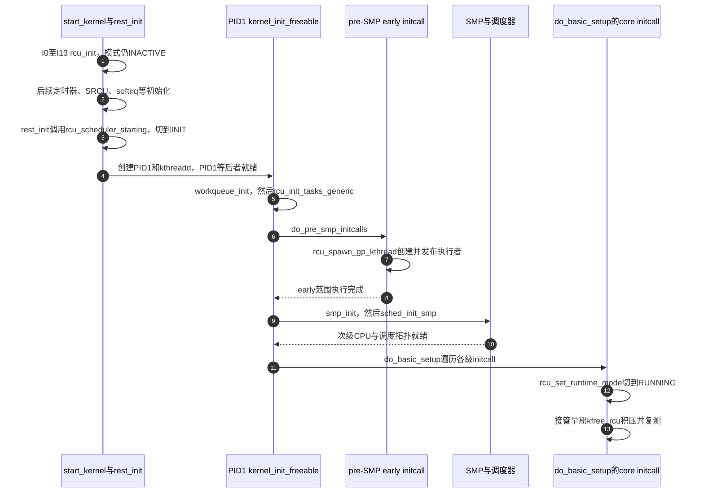

# 第18章\_Linux\_6.12\_RCU早期请求与执行模式交接源码实现

## 18.1\_没有执行者时登记的请求由谁接管

**讲解层次：实现层。** [启动主事务](P12_Linux_6.12_Tree_RCU_rcu_init启动初始化源码实现.md#12.1_从start_kernel里的一个调用固定本章任务)先建立地址和入口，普通 GP 线程却要更晚才创建。那么 I1 自检提前提交的回调、释放对象与 poll cookie 会不会丢失？本篇把“先有责任、后有执行者”的交接独立追到底。

沿主事务的 I1/I2、I12/I13 先看测试请求、每 CPU 释放批次和 Tasks 分片怎样留下可追踪状态，再继续到 `rest_init()`、完整 workqueue、pre-SMP early initcall、SMP bring-up 和 core initcall。只有这些不同时间点被分开，才能解释为何 `rcu_init()` 返回不等于 RCU 已处于 RUNNING。

源码固定为 NXP Linux 6.12.20、提交 `dfaf2136deb2af2e60b994421281ba42f1c087e0`，主体位置为 [`init/main.c`](../../linux/init/main.c)、[`kernel/rcu/tree.c`](../../linux/kernel/rcu/tree.c)、[`update.c`](../../linux/kernel/rcu/update.c) 与 [`tasks.h`](https://github.com/nxp-imx/linux-imx/blob/dfaf2136deb2af2e60b994421281ba42f1c087e0/kernel/rcu/tasks.h)。当前目标配置与启动执行未验证；下面的配置是分析条件，中文 Doxygen 为仓库补充，所展开 C 函数保留完整语句与分支。

## 18.2\_I1为何在树建立以前先运行自检

I1 先验证“尚无节点树和运行期执行者时，公共 RCU API 仍不得越界访问”，再把诊断分支和功能分支分开追踪。

### 18.2.1\_CONFIG\_PROVE\_RCU关闭时它是什么

`rcu_early_boot_tests()` 定义在 [`kernel/rcu/update.c`](../../linux/kernel/rcu/update.c)。`CONFIG_PROVE_RCU=n` 时，编译结果就是空函数：

```c
void rcu_early_boot_tests(void) {}
```

这条分支不修改功能状态。`CONFIG_PROVE_RCU` 是 RCU 动态证明/Lockdep 检查相关的 Kconfig 配置项；它属于诊断轴，不是新的 RCU 实现家族。

### 18.2.2\_开启证明检查后测试了哪五条早期路径

开启配置后，`rcu_self_test` 是只读启动参数；只有显式启用它，才登记异步测试动作：

```c
/**
 * @brief 完整控制分支按固定版本核对；状态作用由相邻正文解释。
 * @note 中文说明为仓库补充；下方保留 kernel/rcu/update.c 函数的完整语句，省去原英文注释。
 */
static void early_boot_test_call_rcu(void)
{
	static struct rcu_head head;
	int idx;
	static struct rcu_head shead;
	struct early_boot_kfree_rcu *rhp;

	idx = srcu_down_read(&early_srcu);
	srcu_up_read(&early_srcu, idx);
	call_rcu(&head, test_callback);
	early_srcu_cookie = start_poll_synchronize_srcu(&early_srcu);
	call_srcu(&early_srcu, &shead, test_callback);
	rhp = kmalloc(sizeof(*rhp), GFP_KERNEL);
	if (!WARN_ON_ONCE(!rhp))
		kfree_rcu(rhp, rh);
}

/**
 * @brief 完整控制分支按固定版本核对；状态作用由相邻正文解释。
 * @note 中文说明为仓库补充；下方保留 kernel/rcu/update.c 函数的完整语句，省去原英文注释。
 */
void rcu_early_boot_tests(void)
{
	pr_info("Running RCU self tests\n");

	if (rcu_self_test)
		early_boot_test_call_rcu();
	rcu_test_sync_prims();
}
```

上面的编号有六个语句，但验证的是五类能力：SRCU 读侧配对、普通 callback、SRCU 轮询、SRCU callback 和 `kfree_rcu()`。它们不会在这里被假装成“已经执行完成”：普通/SRCU callback 计数由后续执行增加，`late_initcall(rcu_verify_early_boot_tests)` 再用 `rcu_barrier()`、`srcu_barrier()`、cookie 轮询和计数比较验证，最后清理静态测试 SRCU。

```c
/**
 * @brief 后续执行与late initcall核对两个测试回调是否完成，不以提交成功冒充执行。
 * @note 中文说明为仓库补充；下方保留 kernel/rcu/update.c 函数的完整语句，省去原英文注释。
 */
static void test_callback(struct rcu_head *r)
{
	rcu_self_test_counter++;
	pr_info("RCU test callback executed %d\n", rcu_self_test_counter);
}

/**
 * @brief 后续执行与late initcall核对两个测试回调是否完成，不以提交成功冒充执行。
 * @note 中文说明为仓库补充；下方保留 kernel/rcu/update.c 函数的完整语句，省去原英文注释。
 */
static int rcu_verify_early_boot_tests(void)
{
	int ret = 0;
	int early_boot_test_counter = 0;

	if (rcu_self_test) {
		early_boot_test_counter++;
		rcu_barrier();
		early_boot_test_counter++;
		srcu_barrier(&early_srcu);
		WARN_ON_ONCE(!poll_state_synchronize_srcu(&early_srcu, early_srcu_cookie));
		cleanup_srcu_struct(&early_srcu);
	}
	if (rcu_self_test_counter != early_boot_test_counter) {
		WARN_ON(1);
		ret = -1;
	}

	return ret;
}
```

这套自检的计数目标是普通与 SRCU 两个 `test_callback`；`kfree_rcu` 对象不调用这个测试函数，不能把预期计数写成3。关闭 `rcu_self_test` 时预期为0。源码还在内部一次性测试中清理 `DEFINE_STATIC_SRCU(early_srcu)` 的运行期部分，这是内核自检的特定寿命管理，不是驱动应复制的 DEFINE 实例手工清理模式；静态存储的释放边界见 [SRCU 实例生命周期](P16_Linux_6.12_Tree_SRCU实例建立扩展与销毁源码实现.md#16.8_cleanup为何不能代替关闭协议)。

`kfree_rcu()` 此时甚至早于 I2。固定实现允许这种顺序：每 CPU `krc.initialized` 仍为假时，批量页路径拒绝接收，请求退回内嵌 `rcu_head` 链表；I2 随后建立 `rcu_work` 和监控 work，`rcu_set_runtime_mode()` 更晚调用 `kfree_rcu_scheduler_running()`，才为已有积压安排延迟监控。若重构时把 fallback 删除，早期自检就会直接暴露初始化先后依赖。

### 18.2.3\_同步等待为什么此时不需要真实GP线程

`rcu_test_sync_prims()` 只在 `CONFIG_PROVE_RCU=y` 时执行：

```c
void rcu_test_sync_prims(void)
{
	if (!IS_ENABLED(CONFIG_PROVE_RCU))
		return;
	pr_info("Running RCU synchronous self tests\n");
	synchronize_rcu();
	synchronize_rcu_expedited();
}
```

此时 `rcu_scheduler_active == RCU_SCHEDULER_INACTIVE`。`rcu_blocking_is_gp()` 因而返回真：启动现场只有一个不可抢占的启动任务，阻塞式调用本身足以越过需要证明的边界。普通函数推进早期 `gp_seq` 记账；expedited 函数推进 `expedited_sequence` 记账，但二者都不等待尚不存在的 GP kthread、IPI 或节点树完成。

I1 在树建立以前测试一次，I12 在树和 boot CPU 建立以后再测试一次；后续 `rcu_scheduler_starting()` 与 `rcu_set_runtime_mode()` 还会在模式切换两侧继续调用。它们共同检查“早期空集/单任务证明 → 调度器初始模式 → 完整运行模式”的切换，没有把诊断自检写成功能 GP 的初始化动作。

## 18.3\_I2怎样建立kfree\_rcu延迟释放流水线

I2 先为最早可能到来的延迟释放请求准备所有权和异步承载物，下面从对象类别进入逐句实现。

### 18.3.1\_先分清三类对象

`kfree_rcu()`/`kvfree_rcu()` 是“等待适当 GP 后释放对象”的接口族。I2 不释放任何业务对象，而是初始化三类承载物：

| 承载物 | 地址与所有者 | 作用 |
| --- | --- | --- |
| `rcu_reclaim_wq` | 全局 `workqueue_struct *` | 在可睡眠 workqueue 上下文批量执行最终释放 |
| `struct kfree_rcu_cpu krc` | 每 possible CPU 一份 | 收集尚未提交、等待 GP 和等待最终释放的批次 |
| `rcu-kfree` shrinker | 内存回收器登记对象 | 内存压力下主动排空缓存/批次，而不是绕过 GP |

这里的 shrinker 是 Linux 内存回收回调框架专名；它只催促可回收缓存和已满足条件的批次，不能授权过早释放仍受 RCU 读侧保护的对象。

### 18.3.2\_完整初始化语句及其后续消费者

```c
/**
 * @brief 建立 kvfree_rcu 的全局执行队列、每 CPU 双批次和内存回收入口。
 * @note 中文说明由本仓库补充；源码裁剪自 kernel/rcu/tree.c。
 */
static void __init kfree_rcu_batch_init(void)
{
	int cpu;
	int i, j;
	struct shrinker *kfree_rcu_shrinker;

	rcu_reclaim_wq = alloc_workqueue("kvfree_rcu_reclaim",
			WQ_UNBOUND | WQ_MEM_RECLAIM, 0);
	WARN_ON(!rcu_reclaim_wq);

	/* 页缓存补充延迟只接受 0～100 秒。 */
	if (rcu_delay_page_cache_fill_msec < 0 ||
	    rcu_delay_page_cache_fill_msec > 100 * MSEC_PER_SEC) {
		rcu_delay_page_cache_fill_msec =
			clamp(rcu_delay_page_cache_fill_msec, 0,
			      (int)(100 * MSEC_PER_SEC));
		pr_info("Adjusting rcutree.rcu_delay_page_cache_fill_msec to %d ms.\n",
			rcu_delay_page_cache_fill_msec);
	}

	for_each_possible_cpu(cpu) {
		struct kfree_rcu_cpu *krcp = per_cpu_ptr(&krc, cpu);

		for (i = 0; i < KFREE_N_BATCHES; i++) {
			INIT_RCU_WORK(&krcp->krw_arr[i].rcu_work, kfree_rcu_work);
			krcp->krw_arr[i].krcp = krcp;
			for (j = 0; j < FREE_N_CHANNELS; j++)
				INIT_LIST_HEAD(&krcp->krw_arr[i].bulk_head_free[j]);
		}
		for (i = 0; i < FREE_N_CHANNELS; i++)
			INIT_LIST_HEAD(&krcp->bulk_head[i]);

		INIT_DELAYED_WORK(&krcp->monitor_work, kfree_rcu_monitor);
		INIT_DELAYED_WORK(&krcp->page_cache_work, fill_page_cache_func);
		krcp->initialized = true;
	}

	kfree_rcu_shrinker = shrinker_alloc(0, "rcu-kfree");
	if (!kfree_rcu_shrinker) {
		pr_err("Failed to allocate kfree_rcu() shrinker!\n");
		return;
	}
	kfree_rcu_shrinker->count_objects = kfree_rcu_shrink_count;
	kfree_rcu_shrinker->scan_objects = kfree_rcu_shrink_scan;
	shrinker_register(kfree_rcu_shrinker);
}
```

`KFREE_N_BATCHES=2` 提供两个在途批次槽；新请求先进入 `krc` 的暂存链/批量页，监控路径再把它们移交给可用槽，不是生产者直接写进正在执行的批次；`FREE_N_CHANNELS=2` 按指针最终需要 `kfree()` 还是 `vfree()` 分流。每个批次的 `rcu_work` 先等待 RCU 条件，再在 `rcu_reclaim_wq` 上运行 `kfree_rcu_work()`；`monitor_work` 负责把暂存请求定时推入等待 GP 的批次；`page_cache_work` 只补充用于批量记录指针的页缓存。

`WQ_UNBOUND` 表示工作不绑定提交 CPU；`WQ_MEM_RECLAIM` 要求 workqueue 保留内存回收进展能力。通用 workqueue 对象、pool、worker 和 rescuer 的唯一教程归 [Linux 6.12 工作队列源码总阅读索引](../../workqueue/navigation/P01_Linux_6.12_工作队列源码总阅读索引.md#1.1_版本边界与阅读任务)；本章只负责这三个 RCU 实例的参数、初始化时机和消费者。

失败语义不相同：`rcu_reclaim_wq` 分配失败只触发 `WARN_ON`，函数仍继续建立 per-CPU 状态；shrinker 分配失败会记录错误并返回，但已经建立的正常批处理流水线仍在，只缺少内存压力主动扫描入口。源码没有在这里提供完整回滚或替代 workqueue，因此不能把告警描述成“自动降级后功能等价”。

## 18.4\_I12与I13收尾\_再测同步原语并建立Tasks\_RCU回调分片

Tree RCU 的基础状态已经闭合；最后一组动作分别验证阶段切换，并为独立的 Tasks RCU family 预留 callback 所有权。

### 18.4.1\_I12重新验证的是切换边界

I12 再次调用 `rcu_test_sync_prims()`，仍只在 `CONFIG_PROVE_RCU=y` 时有代码。与 I1 中的调用相比，树、boot CPU 身份、softirq action、workqueue 和 poll 修复入口现在都已存在，但 `rcu_scheduler_active` 仍未进入 INIT/RUNNING。因此这次测试检查“基础状态已经建立时，早期阻塞式同步仍遵守单启动任务语义”，不是要求真实 GP kthread 已完成一轮宽限期。

### 18.4.2\_tasks\_cblist\_init\_generic()初始化的是三种可选Tasks\_flavor

`CONFIG_TASKS_RCU_GENERIC` 在 Tasks RCU、Tasks Rude RCU 或 Tasks Trace RCU 任一 flavor 启用时自动成立。I13 要求 IRQ 关闭并再次确认只有启动 CPU，然后对每个启用 flavor 调用 `cblist_init_generic()`：

```c
/**
 * @brief 完整控制分支按固定版本核对；状态作用由相邻正文解释。
 * @note 中文说明为仓库补充；下方保留 kernel/rcu/tasks.h 函数的完整语句，省去原英文注释。
 */
static void cblist_init_generic(struct rcu_tasks *rtp)
{
	int cpu;
	int lim;
	int shift;
	int maxcpu;
	int index = 0;

	if (rcu_task_enqueue_lim < 0) {
		rcu_task_enqueue_lim = 1;
		rcu_task_cb_adjust = true;
	} else if (rcu_task_enqueue_lim == 0) {
		rcu_task_enqueue_lim = 1;
	}
	lim = rcu_task_enqueue_lim;

	rtp->rtpcp_array = kcalloc(num_possible_cpus(), sizeof(struct rcu_tasks_percpu *), GFP_KERNEL);
	BUG_ON(!rtp->rtpcp_array);

	for_each_possible_cpu(cpu) {
		struct rcu_tasks_percpu *rtpcp = per_cpu_ptr(rtp->rtpcpu, cpu);

		WARN_ON_ONCE(!rtpcp);
		if (cpu)
			raw_spin_lock_init(&ACCESS_PRIVATE(rtpcp, lock));
		if (rcu_segcblist_empty(&rtpcp->cblist))
			rcu_segcblist_init(&rtpcp->cblist);
		INIT_WORK(&rtpcp->rtp_work, rcu_tasks_invoke_cbs_wq);
		rtpcp->cpu = cpu;
		rtpcp->rtpp = rtp;
		rtpcp->index = index;
		rtp->rtpcp_array[index] = rtpcp;
		index++;
		if (!rtpcp->rtp_blkd_tasks.next)
			INIT_LIST_HEAD(&rtpcp->rtp_blkd_tasks);
		if (!rtpcp->rtp_exit_list.next)
			INIT_LIST_HEAD(&rtpcp->rtp_exit_list);
		rtpcp->barrier_q_head.next = &rtpcp->barrier_q_head;
		maxcpu = cpu;
	}

	rcu_task_cpu_ids = maxcpu + 1;
	if (lim > rcu_task_cpu_ids)
		lim = rcu_task_cpu_ids;
	shift = ilog2(rcu_task_cpu_ids / lim);
	if (((rcu_task_cpu_ids - 1) >> shift) >= lim)
		shift++;
	WRITE_ONCE(rtp->percpu_enqueue_shift, shift);
	WRITE_ONCE(rtp->percpu_dequeue_lim, lim);
	smp_store_release(&rtp->percpu_enqueue_lim, lim);

	pr_info("%s: Setting shift to %d and lim to %d rcu_task_cb_adjust=%d rcu_task_cpu_ids=%d.\n",
			rtp->name, data_race(rtp->percpu_enqueue_shift), data_race(rtp->percpu_enqueue_lim),
			rcu_task_cb_adjust, rcu_task_cpu_ids);
}
```

以上保留了函数完整语句与发布后的诊断输出，权威源码位置是 `kernel/rcu/tasks.h` 的 `cblist_init_generic()`。`rtpcp_array` 不是再次分配整组 per-CPU 对象，而是为已经静态定义的 `rtp->rtpcpu` 建立按 possible CPU 枚举顺序排列的指针表。先初始化每个对象的锁、分段回调链、work、反向 `rtpp`、阻塞/退出链和 barrier 哨兵，再计算 CPU ID 到 callback 分片的右移量；最后 release 发布 `percpu_enqueue_lim`，使并发入队者一旦看见非零上限，也必然看见此前全部对象与选择参数。

`kcalloc()` 失败使用 `BUG_ON`，不同于 I2/I10 的告警式失败；因为没有这个数组便无法构造 Tasks RCU 回调所有权，源码选择终止启动。若所有 Tasks flavor 都关闭，`tasks_cblist_init_generic()` 是内联空函数。

```c
/**
 * @brief 前者在早期建立各flavor队列，后者在完整workqueue可用后启动执行者。
 * @note 中文说明为仓库补充；下方保留 kernel/rcu/tasks.h 函数的完整语句，省去原英文注释。
 */
void __init tasks_cblist_init_generic(void)
{
	lockdep_assert_irqs_disabled();
	WARN_ON(num_online_cpus() > 1);

#ifdef CONFIG_TASKS_RCU
	cblist_init_generic(&rcu_tasks);
#endif

#ifdef CONFIG_TASKS_RUDE_RCU
	cblist_init_generic(&rcu_tasks_rude);
#endif

#ifdef CONFIG_TASKS_TRACE_RCU
	cblist_init_generic(&rcu_tasks_trace);
#endif
}

/**
 * @brief 前者在早期建立各flavor队列，后者在完整workqueue可用后启动执行者。
 * @note 中文说明为仓库补充；下方保留 kernel/rcu/tasks.h 函数的完整语句，省去原英文注释。
 */
void __init rcu_init_tasks_generic(void)
{
#ifdef CONFIG_TASKS_RCU
	rcu_spawn_tasks_kthread();
#endif

#ifdef CONFIG_TASKS_RUDE_RCU
	rcu_spawn_tasks_rude_kthread();
#endif

#ifdef CONFIG_TASKS_TRACE_RCU
	rcu_spawn_tasks_trace_kthread();
#endif

	rcu_tasks_initiate_self_tests();
}
```

I13 **不创建 Tasks RCU GP 线程**。真正的 `rcu_init_tasks_generic()` 在 `kernel_init_freeable()` 中、`workqueue_init()` 之后调用，才按启用 flavor 启动 `rcu_tasks_kthread` 等执行者。Tree RCU 和 Tasks RCU 在此共享“RCU”名字与部分 callback 基础设施，但其静止态证明对象不同：Tree RCU 追踪 CPU/任务读侧状态，Tasks RCU family 追踪任务调度、粗暴全任务边界或 tracing 读侧边界。

## 18.5\_函数返回后RCU还远未进入完整运行态

要准确理解 `rcu_init()` 的完成条件，必须继续沿 `start_kernel()` 后半程追踪哪些消费者何时真正获得执行上下文。

### 18.5.1\_启动后半程的真实接力顺序



步骤 6～8 仅遍历 `__initcall_start` 到 `__initcall0_start` 的 early 区间。步骤 9～10 的 SMP bring-up 在其后；步骤 11 的 `do_basic_setup()` 再调用 `do_initcalls()`，core级位于此处。因此步骤 12 的 RUNNING 切换发生在 SMP 之后，不能把所有 initcall 合并为一个 pre-SMP 时刻。

重要的后继动作是：

1. `rcu_init_nohz()` 把 `nohz_full`、默认全卸载或启动参数形成的 CPU 集合并入回调卸载掩码，给对应回调链加上卸载标志并组织线程分组；它不创建这些线程，也不负责建立用户态/空闲态的扩展静止状态账本。
2. `srcu_init()` 选择尺寸策略并把早期积压 SRCU 请求排到已建立的 workqueue，完整函数见 [SRCU 启动交接](P16_Linux_6.12_Tree_SRCU实例建立扩展与销毁源码实现.md#16.7.1_全局启动排出早期积压请求)。
3. `softirq_init()` 初始化 tasklet 的 per-CPU 队列并登记普通/高优先级 tasklet action；I7 已提前登记 RCU action，因此这里不会重复初始化 RCU softirq。
4. `rcu_scheduler_starting()` 把状态从 `INACTIVE` 改为 `INIT`，重新测试同步原语。
5. `workqueue_init()` 后 workqueue 才具备常规 worker 执行能力。
6. pre-SMP early initcall 创建 Tree RCU GP、core、NOCB、boost、expedited 等适用线程；随后才启动次级 CPU。
7. SMP bring-up 后的 core initcall `rcu_set_runtime_mode()` 把模式改为 `RUNNING`，并让早期 `kfree_rcu` 积压进入正常异步流水线。

`rcu_scheduler_active` 是模式状态，`rcu_scheduler_fully_active` 是线程创建条件；名字相似也不能互换。early initcall 中线程已可创建，模式仍可为 INIT，普通同步等待仍遵守该模式的策略。`rcu_spawn_gp_kthread()` 的唯一函数体见 [GP执行者发布](P05_Linux_6.12_Tree_RCU_GP全局生命周期源码实现.md#5.5.2_rcu_spawn_gp_kthread怎样创建并发布任务)。

```c
/**
 * @brief 分别在rest_init与core initcall切换模式，并在边界两侧运行同步自检。
 * @note 中文说明为仓库补充；下方保留 kernel/rcu/tree.c 函数的完整语句，省去原英文注释。
 */
void rcu_scheduler_starting(void)
{
	unsigned long flags;
	struct rcu_node *rnp;

	WARN_ON(num_online_cpus() != 1);
	WARN_ON(nr_context_switches() > 0);
	rcu_test_sync_prims();

	local_irq_save(flags);
	rcu_for_each_node_breadth_first(rnp)
		rnp->gp_seq_needed = rnp->gp_seq = rcu_state.gp_seq;
	local_irq_restore(flags);

	rcu_scheduler_active = RCU_SCHEDULER_INIT;
	rcu_test_sync_prims();
}

/**
 * @brief 分别在rest_init与core initcall切换模式，并在边界两侧运行同步自检。
 * @note 中文说明为仓库补充；下方保留 kernel/rcu/update.c 函数的完整语句，省去原英文注释。
 */
static int __init rcu_set_runtime_mode(void)
{
	rcu_test_sync_prims();
	rcu_scheduler_active = RCU_SCHEDULER_RUNNING;
	kfree_rcu_scheduler_running();
	rcu_test_sync_prims();
	return 0;
}
```

`rcu_scheduler_starting()` 先确认单CPU、尚无上下文切换，测试旧模式；关本地IRQ把各节点的 GP/需求序列修正到全局序列，然后切 INIT 再测试。`rcu_set_runtime_mode()` 则在进入 RUNNING 后接管早期释放积压；模式赋值不等于每个旧回调已经执行完。

```c
/**
 * @brief 检查暂存责任并在RCU回收workqueue排监控，已有定时只在需要时提前。
 * @note 中文说明为仓库补充；下方保留 kernel/rcu/tree.c 函数的完整语句，省去原英文注释。
 */
static bool
need_offload_krc(struct kfree_rcu_cpu *krcp)
{
	int i;

	for (i = 0; i < FREE_N_CHANNELS; i++)
		if (!list_empty(&krcp->bulk_head[i]))
			return true;

	return !!READ_ONCE(krcp->head);
}

/**
 * @brief 检查暂存责任并在RCU回收workqueue排监控，已有定时只在需要时提前。
 * @note 中文说明为仓库补充；下方保留 kernel/rcu/tree.c 函数的完整语句，省去原英文注释。
 */
static void
__schedule_delayed_monitor_work(struct kfree_rcu_cpu *krcp)
{
	long delay, delay_left;

	delay = krc_count(krcp) >= KVFREE_BULK_MAX_ENTR ? 1:KFREE_DRAIN_JIFFIES;
	if (delayed_work_pending(&krcp->monitor_work)) {
		delay_left = krcp->monitor_work.timer.expires - jiffies;
		if (delay < delay_left)
			mod_delayed_work(rcu_reclaim_wq, &krcp->monitor_work, delay);
		return;
	}
	queue_delayed_work(rcu_reclaim_wq, &krcp->monitor_work, delay);
}

/**
 * @brief 检查暂存责任并在RCU回收workqueue排监控，已有定时只在需要时提前。
 * @note 中文说明为仓库补充；下方保留 kernel/rcu/tree.c 函数的完整语句，省去原英文注释。
 */
static void
schedule_delayed_monitor_work(struct kfree_rcu_cpu *krcp)
{
	unsigned long flags;

	raw_spin_lock_irqsave(&krcp->lock, flags);
	__schedule_delayed_monitor_work(krcp);
	raw_spin_unlock_irqrestore(&krcp->lock, flags);
}

/**
 * @brief 检查暂存责任并在RCU回收workqueue排监控，已有定时只在需要时提前。
 * @note 中文说明为仓库补充；下方保留 kernel/rcu/tree.c 函数的完整语句，省去原英文注释。
 */
void __init kfree_rcu_scheduler_running(void)
{
	int cpu;

	for_each_possible_cpu(cpu) {
		struct kfree_rcu_cpu *krcp = per_cpu_ptr(&krc, cpu);

		if (need_offload_krc(krcp))
			schedule_delayed_monitor_work(krcp);
	}
}
```

接管者扫描每个 possible CPU 的暂存批量链和 `head`，有责任才排监控。普通请求在 RUNNING 以前也可以留下这些状态，但不会正常启动监控；切模式后这次扫描补上了执行通知。队列达到批量门槛时选择短延时，否则使用收集间隔；若 work 已有定时，只在新期限更早时修改。这里的 `need_offload_krc` 指释放责任移交工作队列，与 NOCB CPU 的 callback offload 是不同机制。

### 18.5.2\_rcu\_init()明确没有做什么

- 没有调用 `rcu_init_nohz()`、`srcu_init()` 或 `rcu_init_tasks_generic()`。
- 没有创建 GP kthread、`rcuc`、`rcuo`、boost、Tasks 或 expedited kthread。
- 没有启动次级 CPU，也没有替它们填 online 位。
- 没有打开本地 IRQ，没有让 scheduler 开始上下文切换。
- 没有保证三个新 workqueue 上的 work 已经执行。
- 没有主动完成一轮运行期 Tree RCU GP；早期自检采用启动阶段的单任务证明，I11 只在必要时排队补足 poll cookie。
- 没有立即释放 `kfree_rcu()` 对象；I2 只建立延迟释放容器和入口。
- 没有把所有 `rcu_state.node[]` 静态容量都变成实际节点；只初始化 I5 算出的前缀。

## 18.6\_回读初始化调用时的符号速查

读完初始化与执行交接后，可用下面的符号类型账本回查源码角色；表中“宏、函数、字段、类型、变量、配置符号”是 C 源码角色，不是新的 RCU flavor：

| 符号 | 源码类型 | 本章所需朴素含义 |
| --- | --- | --- |
| `CONFIG_SMP`、`CONFIG_PREEMPT`、`CONFIG_PREEMPT_BUILD`、`CONFIG_PREEMPTION` | Kconfig 配置符号 | 分别表示多处理器构建、用户选择的完全可抢占模型、该模型的内部构建开关及其公共能力；它们会参与普通 RCU 实现的自动选择 |
| `CONFIG_TREE_RCU`、`CONFIG_PREEMPT_RCU`、`CONFIG_TINY_RCU` | Kconfig 配置符号 | 分别选择 Tree 实现、Tree 中可抢占读侧模型和单 CPU Tiny 实现 |
| `CONFIG_TREE_SRCU`、`CONFIG_NR_CPUS` | Kconfig 配置符号 | 分别控制 Tree SRCU 与静态最大 CPU 容量 |
| `CONFIG_RCU_BOOST`、`CONFIG_RCU_TORTURE_TEST` | Kconfig 配置符号 | 控制 reader priority boosting 与内建 RCU 压力测试分支 |
| `CONFIG_TASKS_RCU_GENERIC`、`CONFIG_TASKS_RCU` | Kconfig 配置符号 | 前者汇总 Tasks family 公共骨架，后者启用普通 Tasks RCU flavor |
| `WARN_ON`、`WARN_ON_ONCE`、`BUG_ON` | 诊断宏 | 条件为真时分别告警、一次性告警或触发不可继续的错误 |
| `WQ_MEM_RECLAIM`、`WQ_UNBOUND` | workqueue 标志宏 | 分别要求内存回收前进能力、允许工作不绑定提交 CPU |
| `GFP_KERNEL` | 内存分配标志宏 | 允许普通内核上下文睡眠式分配，本章调用现场可用 |
| 强制静止态扫描（Force Quiescent State，FQS） | RCU 慢路径专名 | 在被动证据迟迟不到时检查或催促参与者提供 QS |
| `DEFAULT_RCU_QOVLD_MULT`、`MSEC_PER_SEC`、`KFREE_N_BATCHES`、`FREE_N_CHANNELS` | 编译期常量宏 | 分别给出默认过载倍率、每秒毫秒数、释放批次数和释放通道数 |
| `RCU_NUM_LVLS`、`RCU_JIFFIES_TILL_FORCE_QS`、`RCU_JIFFIES_FQS_DIV`、`ULONG_MAX` | 容量/哨兵常量宏 | 限制静态树层数，派生 FQS 延迟，并用最大无符号长整型表示“未指定” |
| `INIT_RCU_WORK`、`INIT_WORK`、`INIT_DELAYED_WORK`、`INIT_LIST_HEAD` | 初始化宏 | 分别建立 RCU work、普通 work、延迟 work 和空双向链表头 |
| `IS_ENABLED`、`IS_BUILTIN` | 配置查询宏 | 在 C 表达式中判断配置是否启用、是否内建进内核 |
| `DIV_ROUND_UP` | 算术宏 | 执行向上取整除法，保证残余 CPU 仍分到一个节点 |
| `ACCESS_PRIVATE` | 封装访问宏 | 取得被上游标为 private 的锁字段，供同一实现内部初始化 |
| `WRITE_ONCE` | 单次访问宏 | 抑制编译器拆分/合并一次共享字段写入；它本身不是完整跨 CPU 发布协议 |
| `rcu_head`、`rcu_work`、`delayed_work` | 结构体类型 | 分别承载 callback 节点、等待 RCU 条件的 work 和带定时器的 work |
| `alloc_workqueue()`、`local_irq_disable()` | 函数接口 | 分别创建 workqueue 对象、关闭本地中断 |
| `rcu_barrier()`、`srcu_barrier()`、`synchronize_rcu_expedited()` | 同步函数接口 | 分别等待历史 callback 或等待加速 GP 边界 |
| `start_poll_synchronize_rcu_expedited()` | 轮询函数接口 | 返回可供以后检查的 GP cookie，并在条件具备时补排 expedited 工作 |
| `rcu_early_boot_tests()`、`rcu_test_sync_prims()` | 内部自检函数 | 分别在基础设施建立前后检查早期 RCU API 和同步原语契约，不承担正常 GP 推进 |
| `rcutree_prepare_cpu()`、`rcutree_report_cpu_starting()`、`rcutree_online_cpu()` | CPU 生命周期函数 | 依次准备私有容器、发布启动身份、启用在线期状态 |
| `tasks_cblist_init_generic()`、`cblist_init_generic()` | Tasks RCU 初始化函数 | 前者按配置分派 flavor，后者建立一个 flavor 的 per-CPU callback 分片 |
| `rcu_pm_notify()`、`rcu_init_one_nocb()` | 内部函数 | 分别处理 PM 事件、初始化节点的 NOCB 协调状态 |
| `pm_notifier()` | 条件登记宏 | `CONFIG_PM_SLEEP=y` 时生成并注册 notifier block，关闭配置时为空操作 |
| `kfree_rcu_scheduler_running()`、`rcu_set_runtime_mode()` | 后继阶段函数 | 分别接通早期延迟释放积压、把 RCU 切到完整运行模式 |
| `mynode`、`grpmask`、`parent`、`blkd_tasks`、`cbovldmask` | `rcu_data`/`rcu_node` 字段 | 保存叶节点地址、本节点位、父地址、阻塞 reader 链与 callback 过载位 |
| `exp_mutex`、`exp_poll_lock`、`expedited_wq` | expedited 状态字段 | 串行 expedited GP、保护 poll 请求、等待 expedited 状态推进 |
| `system_highpri_wq` | 全局 workqueue 变量 | 内核预建的高优先级工作队列，本章只借它立即补页 |
| `SRS` | 内部字段前缀专名 | 源码没有声明可供 API 依赖的英文全称；本章按行为称为“同步等待者直接批处理分支” |
| `INACTIVE`、`INIT`、`RUNNING` | RCU scheduler 模式枚举值名称 | 依次表示早期单任务阶段、调度器初始阶段和完整运行阶段 |
| 进程标识符（Process Identifier，PID） | 任务编号专名 | 后文 PID 1 指启动的第一个用户态祖先任务 |


## 18.7\_用遗漏一个阶段的反例检查交接

若 I2 把早期 `krc.head` 清空，晚期再有 worker 也找不回已提交对象；如果保留链表却取消 RUNNING 切换后的扫描，旧对象又可能一直等不到新的触发。状态保留与执行通知是两项独立责任。

若把 Tasks 的线程创建提前到 per-CPU 指针表发布之前，执行者会拿到未建立的队列归属；若把 core initcall 当成 pre-SMP，则会错误推断 RUNNING 时仍只有一个在线CPU。判断初始化正确性要逐项核对调用位置、发布值和消费者，不能只读函数名。

本篇关闭了从早期提交到正常执行的缺口。返回 [启动主事务](P12_Linux_6.12_Tree_RCU_rcu_init启动初始化源码实现.md#12.4_逐行展开rcu_init的直接动作)或 [源码总阅读索引](../navigation/P01_Linux_6.12_RCU源码总阅读索引.md#1.6_建议的源码阅读顺序)。
