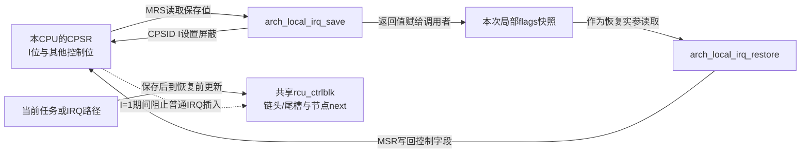
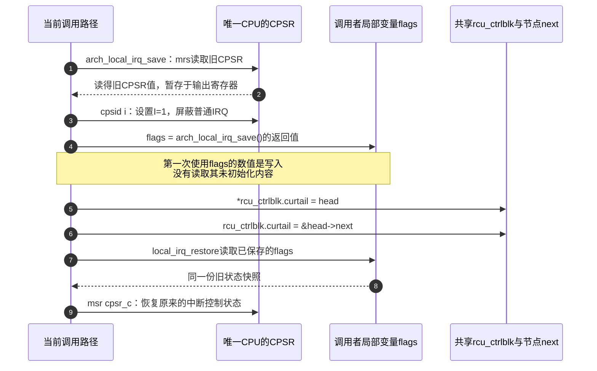

# 第19章\_Linux\_6.12\_ARM中断状态保存与Tiny队列互斥源码实现

## 19.1\_两次指针写入之间为什么不能插入IRQ

Tiny 只有一个 CPU，但任务向共享 callback 队列追加节点时，硬中断仍能打断它并追加另一个节点。若链头已经写成 A、队尾还停在旧槽位，IRQ 就可能覆盖链头，留下互相矛盾的头尾。因此需要保护的是一组共享指针写入，局部变量 `flags` 只是用来恢复调用前的 CPU 中断状态。

本篇从 [Tiny 的共享队列](P13_Linux_6.12_Tiny_RCU源码实现.md#13.5_一个链表和两个二级指针怎样表达三种状态)放大这个保护步骤。源码固定为 NXP Linux 6.12.20、提交 `dfaf2136deb2af2e60b994421281ba42f1c087e0`，ARMv7-A 指令分支与调试开关是本篇分析条件；历史配置不等于本篇配置条件已验证。中文注释为仓库补充。

下面把三类状态分开：CPSR 是处理器状态，`flags` 属于本次调用，链头和尾槽属于共享队列。保护协议连接它们，不能把局部快照误当成队列锁本体。



## 19.2\_flags先由保存宏写入再交给恢复宏读取

队列操作中的 `unsigned long flags;` 是本次调用的局部变量，用来接收 **CPU 在进入临界区前的中断状态快照**。它不需要预先初始化，因为 `local_irq_save(flags)` 是会向参数表达式写值的宏，不是把未初始化数值按值传入的普通 C 函数。实际赋值在下一层宏中的 `flags = arch_local_irq_save()`；随后 `local_irq_restore(flags)` 才读取已经保存的值。自动变量未写初始化式，与运行时读取了未初始化值，是两回事；编译器也可能把这个局部值放在寄存器中，不能仅凭局部声明认定它一定是栈内存。

先沿 [`include/linux/irqflags.h`](../../linux/include/linux/irqflags.h) 查看这四个宏的完整定义，保留 `local_irq_*` 的两种配置分支。`typecheck()` 检查实参类型是否为 `unsigned long`；这里通过 `typeof(flags)` 取得类型，不读取 `flags` 的未初始化数值，定义见 [`include/linux/typecheck.h`](../../linux/include/linux/typecheck.h)。`raw_check_bogus_irq_restore()` 是额外的恢复前检查宏，本篇条件中 `CONFIG_DEBUG_IRQFLAGS=n`，它定义为空操作；下面仍保留原调用。

```c
/* 仓库补充：摘录完整宏定义；同一头文件中的其他中断API不在本节展开。 */
#define raw_local_irq_save(flags) \
	do { \
		typecheck(unsigned long, flags); \
		flags = arch_local_irq_save(); \
	} while (0)
#define raw_local_irq_restore(flags) \
	do { \
		typecheck(unsigned long, flags); \
		raw_check_bogus_irq_restore(); \
		arch_local_irq_restore(flags); \
	} while (0)

#ifdef CONFIG_TRACE_IRQFLAGS
#define local_irq_save(flags) \
	do { \
		raw_local_irq_save(flags); \
		if (!raw_irqs_disabled_flags(flags)) \
			trace_hardirqs_off(); \
	} while (0)
#define local_irq_restore(flags) \
	do { \
		if (!raw_irqs_disabled_flags(flags)) \
			trace_hardirqs_on(); \
		raw_local_irq_restore(flags); \
	} while (0)
#else /* !CONFIG_TRACE_IRQFLAGS */
#define local_irq_save(flags) do { raw_local_irq_save(flags); } while (0)
#define local_irq_restore(flags) do { raw_local_irq_restore(flags); } while (0)
#endif /* CONFIG_TRACE_IRQFLAGS */
```

本篇条件中 `CONFIG_TRACE_IRQFLAGS=y`，所以会选中上面的检查包装。`raw_irqs_disabled_flags(flags)` 检查保存值是否表示“原来已关中断”；只有原来开启时，`trace_hardirqs_off()` / `trace_hardirqs_on()` 才报告关/开状态转换。这些是检查接入，真正操作 CPU 的是 `arch_local_irq_save()` / `arch_local_irq_restore()`。此开关开启与 `CONFIG_RCU_TRACE=n` 并不矛盾，二者控制不同的调用点。

## 19.3\_ARMv7分支怎样读取旧状态并屏蔽IRQ

底层要按 ARM 架构继续追踪。假定生成的 Kconfig 配置为 `CONFIG_CPU_V7=y`、`CONFIG_CPU_32v7=y`，未启用 `CONFIG_CPU_V7M`；`arch/arm/Makefile` 为这组架构输入设置 `__LINUX_ARM_ARCH__=7`。因此 [`arch/arm/include/asm/irqflags.h`](../../linux/arch/arm/include/asm/irqflags.h) 选择 ARMv6 及以上的保存函数，且 `IRQMASK_REG_NAME_R` 为 `"cpsr"`、`IRQMASK_REG_NAME_W` 为 `"cpsr_c"`，不是 Cortex-M 的 `primask` 路径。

**CPSR（Current Program Status Register，当前程序状态寄存器）** 是 CPU 寄存器；其 I 位控制普通 **IRQ（Interrupt Request，中断请求）** 的屏蔽，I=1 表示屏蔽，I=0 表示不屏蔽。正文需要查用的寄存器信息如下，访问通过处理器指令完成，不是 GIC MMIO 地址：

| 寄存器或访问选择 | 本节使用字段 | 访问及效果 | 边界 |
| --- | --- | --- | --- |
| CPSR | I 位，bit 7 | `mrs` 读取保存值；`cpsid i` 置 I=1，屏蔽普通 IRQ | 不等于屏蔽 FIQ |
| `cpsr_c` 写选择 | CPSR 低 8 位控制字段，含 I、F 与模式位 | `msr cpsr_c, flags` 使用保存值恢复控制字段 | 不能随意构造 flags，也不能把它当只写 I 位的普通变量 |
| CPSR | F 位，bit 6 | 本函数没有用 `cpsid f` 修改 F | FIQ 若访问相同队列，单靠本协议无法互斥 |

位定义可在固定 [`arch/arm/include/uapi/asm/ptrace.h`](https://github.com/nxp-imx/linux-imx/blob/dfaf2136deb2af2e60b994421281ba42f1c087e0/arch/arm/include/uapi/asm/ptrace.h) 的 `PSR_I_BIT`/`PSR_F_BIT` 核对；本节不外推到 Cortex-M 的 PRIMASK 或 AArch64 的 DAIF。

以下保留上述架构分支的两个完整函数；其他 ARM 架构分支保存在链接的原始头文件中：

```c
/**
 * @brief 读取旧CPU状态，然后屏蔽普通IRQ，并返回旧状态。
 * @note 仓库补充中文说明；本篇选择 __LINUX_ARM_ARCH__ >= 6 分支。
 */
static inline unsigned long arch_local_irq_save(void)
{
	unsigned long flags;

	asm volatile(
		"	mrs	%0, " IRQMASK_REG_NAME_R "	@ arch_local_irq_save\n"
		"	cpsid	i"
		: "=r" (flags) : : "memory", "cc");
	return flags;
}

/**
 * @brief 使用保存值恢复CPU状态的控制字段，其中包含IRQ屏蔽位。
 * @note 仓库补充中文说明；保留原始汇编语句和操作数约束。
 */
static inline void arch_local_irq_restore(unsigned long flags)
{
	asm volatile(
		"	msr	" IRQMASK_REG_NAME_W ", %0	@ local_irq_restore"
		:
		: "r" (flags)
		: "memory", "cc");
}
```

`mrs` 把旧 CPSR 读入输出寄存器；约束 `"=r" (flags)` 中的 `=` 表示 **只写输出**，不是读取该局部变量的旧值。接着 `cpsid i` 设置 CPU 的 I 位，最后把旧 CPSR 值返回给外层的 `flags`。内联函数里的局部 `flags` 与调用者的 `flags` 是不同 C 作用域的变量，通过返回值和宏内赋值传递同一份快照。恢复函数则用 `"r" (flags)` 读取保存值，`msr cpsr_c, ...` 写回控制字段。`"memory"` 约束阻止编译器把普通队列内存访问随意搬出这段关中断区域；它不是跨 CPU 的锁。

## 19.4\_沿保存更新恢复追踪状态所有权

下面只画 CPU 状态、局部快照和共享队列之间的数据流；检查包装的调用位置以上面的原始宏为准。`head` 是本次待入队节点的指针：



图中第 4 步写入 `flags`，第 7 步才读取它；第 5、6 步必须共同维持队列不变量，所以保护的是 **共享队列更新过程**。例如原来空队列的 `curtail=&rcucblist`：任务先把 `rcucblist` 写成 A、尚未更新 `curtail` 时，如果硬中断也入队 B，就会沿旧尾槽把 `rcucblist` 覆盖成 B；中断返回后，任务再把 `curtail` 改成 `&A.next`。结果链头指向 B，尾槽却落在脱链的 A 内。关本地 IRQ 正是为了不让这段交错插入两次更新之间，和“防止局部变量 flags 被别人改写”没有关系。

## 19.5\_嵌套调用为什么必须恢复而非无条件开启

为什么最后必须恢复，而不能直接开中断，可以用同一组保存/恢复语句比较：

| 进入前的普通 IRQ 状态 | `flags` 保存的 I 位 | 队列更新期间 | `local_irq_restore(flags)` 后 |
| --- | --- | --- | --- |
| 已开启 | 0 | I=1，屏蔽 | 恢复 I=0 |
| 已关闭，例如外层已经关中断 | 1 | I=1，继续屏蔽 | 保持 I=1，不破坏外层约束 |

所以不要给 `flags` 硬编码初值来“修复未初始化”，也不要把 restore 改成无条件 enable；必须在同一控制流中用本次 save 写入的值配对恢复。`mrs` 与 `cpsid` 之间即使先响应了一个 IRQ，队列更新也尚未开始；处理完并返回后才会关 IRQ、进入临界区。这里依赖 UP 与普通 IRQ 屏蔽，不阻止其他 CPU，也不屏蔽 ARM 的 **FIQ（Fast Interrupt Request，快速中断请求）**；不能把这种保护直接用于有其他未屏蔽访问者的共享状态。


## 19.6\_用两个反例检查保护对象

若先写 `flags=0`，再把 restore 改成无条件 enable，是否更安全？**答案：** 不是。外层原来关闭 IRQ 时，内层会错误打开 IRQ；应使用本次 save 实际返回的状态。若平台有 FIQ 更新同一队列，是否仍可直接使用本例？**答案：** 不能；I 位没有屏蔽 FIQ，需要重新确认访问者与互斥协议，不能把 UP 当成排除所有嵌套。

本篇得到的是本地普通 IRQ 互斥协议，不是 GP 成熟证明。恢复中断以后继续沿 [Tiny 追加节点](P13_Linux_6.12_Tiny_RCU源码实现.md#13.6_call_rcu只入队不宣布安全)观察何时成熟和执行。
