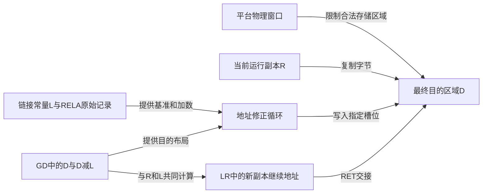

# 第7章\_地址视图与AArch64重定位导读

[地址正文](../../../../knowledge/system_software/uboot/P07_镜像搬迁为什么不等于改变内存映射.md) 已区分 SoC 物理窗口、镜像链接地址、当前运行地址和最终搬迁地址。这个模块沿 [固定版本总索引](README.md) 组织 v2022.10 的对应实现，重点检查同一个地址值究竟来自常量、当前符号、GD 字段还是重定位记录。

## 7.1\_从三个基址追踪当前副本与目标副本

用 L、R、D 分别表示链接、初次运行和最终目的基址。硬件窗口不参与这三个数的自动改写；镜像放在什么位置，必须先满足该位置可访问、可执行及与其他对象不重叠等条件。源码的修正循环只处理它所支持的引用类型，不能替代完整装载检查。

图中的 D 是内存区域，LR 是本 PE 的寄存器，RELA 是镜像内的记录。它们之间没有“改一个变量自动通知其他模块”的机制，每条箭头对应明确读取、写入或控制流动作。

| 所属公共阶段 | 源文件与阅读问题 | 唯一实现入口 |
| --- | --- | --- |
| 进入阶段以前的平台约束 | `mx6ullevk.h` 与 `imx-regs.h` 的常量链：选的是哪个 SoC 分支 | [物理窗口与软件配置](../source_explanations/P07_AArch64相对重定位与地址交接实现.md#7.1_平台窗口与软件选择的地址不是同一个配置) |
| [S0](../../../../knowledge/system_software/uboot/P01_从链接布局到启动阶段的交接.md#1.3_完整_U-Boot_的数据为什么分几次才能使用)：入口修正 | `start.S` 的 `pie_fixup`：R-L 如何作用于记录 | [两次显式加数修正](../source_explanations/P07_AArch64相对重定位与地址交接实现.md#7.2_入口修正与搬迁修正都从RELA加数计算) |
| [S2～S3](../../../../knowledge/system_software/uboot/P01_从链接布局到启动阶段的交接.md#1.3_完整_U-Boot_的数据为什么分几次才能使用)：准备返回并搬迁 | `crt0_64.S`、`relocate_64.S`：LR 的地址为何需要两次调整 | [返回地址交接](../source_explanations/P07_AArch64相对重定位与地址交接实现.md#7.3_返回地址怎样把执行流接到新副本) |
| [S3～S4](../../../../knowledge/system_software/uboot/P01_从链接布局到启动阶段的交接.md#1.3_完整_U-Boot_的数据为什么分几次才能使用)：修正与后续对象准备 | RELA 指定槽位，crt0 后续另清 BSS | [循环与后续边界](../source_explanations/P07_AArch64相对重定位与地址交接实现.md#7.2_入口修正与搬迁修正都从RELA加数计算) |

ARM32 的 REL、主体复制与链接列表实现仍由 [ARM32 模块](P01_ARM32链接布局与启动交接阅读索引.md) 承担，栈/GD 的交接由 [运行环境模块](P04_栈与GD及分配器交接导读.md) 承担。这里比较地址输入和结果，避免为相同版本的同一个函数再建立第二套逐句说明。

## 7.2\_用芯片地图和ELF规则限制结论

i.MX6ULL `IMX6ULLRM` Rev.1、11/2017 的 Table 2-1（pp.175～176）说明 ROM、OCRAM、别名窗口与 DDR 控制器窗口，Figure 8-3（p.260）进一步区分 ROM 正在使用的 OCRAM 内部区域。正文已有必要地址表；原件沿 [ARM 资料索引](../../../../reference/external_resources/arm/README.md) 管理。不要从窗口容量推断焊接容量，也不要从物理窗口存在推断当前可写。

ELF 类型规则采用 [AAELF64 2025Q1，Dynamic relocations](https://github.com/ARM-software/abi-aa/blob/2025Q1/aaelf64/aaelf64.rst#5713dynamic-relocations)，当前使用其中 RELATIVE 的相对装载调整含义。实际结构布局和类型常量仍与本版 `include/elf.h` 核对。正文 C 模型只观察整数地址及指定槽位，没有执行复制后的 ARM 机器码。

本模块新增或补齐的上游原件来自官方提交 `4debc57a3da6c3f4d3f89a637e99206f4cea0a96`，其余 `start.S`、`crt0_64.S` 已由先前模块登记。

| 上游相对路径与本地原件 | SHA-256 |
| --- | --- |
| [include/configs/mx6ullevk.h](../upstream/v2022.10/include/configs/mx6ullevk.h) | `0d51889cbd344b2172fa6503f285a269ea99926dd982aa7fd1d1e664ab94e84f` |
| [arch/arm/include/asm/arch-mx6/imx-regs.h](../upstream/v2022.10/arch/arm/include/asm/arch-mx6/imx-regs.h) | `deb2a3d249ab9c8b2b5806038b004099fb06cad6e8cf1a9ed8a96afffd08680a` |
| [arch/arm/lib/relocate_64.S](../upstream/v2022.10/arch/arm/lib/relocate_64.S) | `870817682ab8b36ec5184ee259b6391676af2af174c8f64ad56894f7fd6aba91` |
| [include/elf.h](../upstream/v2022.10/include/elf.h) | `4654efa1b6bdea340072b6b4269569684c54ab747be9225c7d4a2374e324ad08` |
