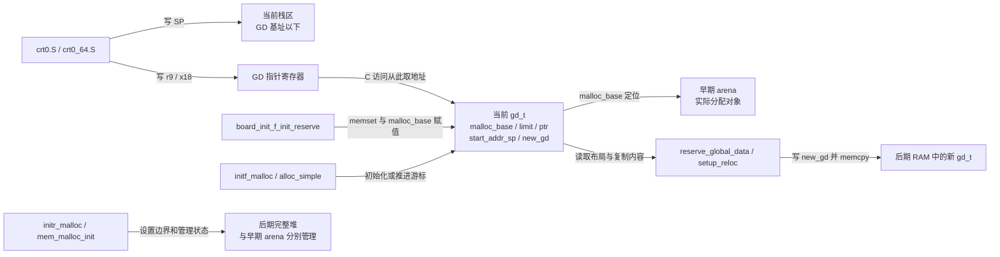
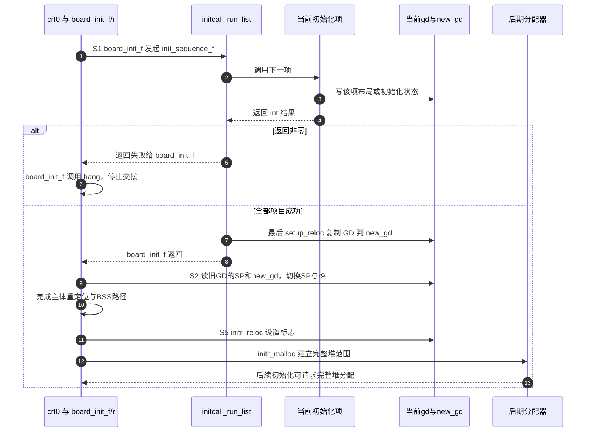

# 第4章\_早期运行环境与GD交接实现

早期 C 函数已经能被调用，仍不代表普通全局对象、完整堆和后期栈都已可用。本篇沿一次主阶段启动，追踪哪个函数计算边界、谁真正切换 SP、哪个地址保存 GD，以及后来的分配器如何消费这些状态。

**讲解层次：实现层，上游 U-Boot v2022.10，提交 `4debc57a3da6c3f4d3f89a637e99206f4cea0a96`。** 主线选 ARM32 通用 crt0、未指定 `CONFIG_MALLOC_F_ADDR`、早期分配区长度非零；ARM64 与 SPL 差量另列。这里没有多核并发初始化模型，不能从一个失败判断推导出多核互斥协议。

| 关联入口 | 阅读任务 |
| --- | --- |
| [源码总索引](../navigation/README.md) | 版本身份与其他模块 |
| [本模块导读](../navigation/P04_栈与GD及分配器交接导读.md) | 按 S0、S1、S2、S5 找状态的写入者和消费者 |
| [早期运行环境正文](../../../../knowledge/system_software/uboot/P04_先建立栈与GD再进入可用的C环境.md) | 因果解释、地址计算与完整宿主实验 |
| [主体重定位实现](P01_ARM32链接布局与启动实现.md#1.3_复制区间与重定位记录不是同一段数据) | 复制镜像和修正记录；不在本篇重复展开 |

## 4.1\_S0\_计算边界与实际修改SP必须分开

入口在 [arch/arm/lib/crt0.S](../upstream/v2022.10/arch/arm/lib/crt0.S)，保留区函数声明在 [include/init.h](../upstream/v2022.10/include/init.h)、定义在 [common/init/board_init.c](../upstream/v2022.10/common/init/board_init.c)。`top` 是当前候选栈顶边界，`base` 是返回后的 GD 起点，两者都是地址数值。`CONFIG_VAL(SYS_MALLOC_F_LEN)` 按当前主/SPL/TPL 构建上下文取得对应预算，宏分派规则见 [构建上下文实现](P02_构建上下文与入口选择实现.md#2.3_配置字符串由特征选择导出_阶段宏由当前编译选择)。

下面裁剪掉栈使用量统计与保护标记钩子，并固定未指定独立 malloc 地址的分支。**中文 Doxygen 与行内说明均为仓库补充，非上游原文；函数中的有效计算保持原版语义。**

```c
/**
 * @brief 在旧调用栈上计算保留区下边界，不修改 CPU 的 SP。
 * @param top 当前可用区域的候选顶部。
 * @return 按 16 字节对齐的 GD 地址，也就是下一段栈的顶部。
 */
ulong board_init_f_alloc_reserve(ulong top)
{
    top -= CONFIG_VAL(SYS_MALLOC_F_LEN); /* 本摘录选择长度非零的分支。 */
    top = rounddown(top - sizeof(struct global_data), 16);
    return top;
}

/**
 * @brief 调用者已移开栈且在 ARM 上建立 GD 指针后，初始化保留区。
 * @param base 刚才计算的 GD 基址，不能换成初始 top。
 */
void board_init_f_init_reserve(ulong base)
{
    struct global_data *gd_ptr;
    gd_ptr = (struct global_data *)base;
    memset(gd_ptr, '\0', sizeof(*gd)); /* sizeof 不读取 gd 指向的字节。 */
    base += roundup(sizeof(struct global_data), 16);
    gd->malloc_base = base;
}
```

两段函数之间的 ARM32 汇编才完成真正的空间交接。以下为 `crt0.S` 中的连续片段，进入时 `r0` 已由配置选出的初始栈顶按 8 字节对齐。

```asm
/* 仓库阅读说明：先在旧栈上求地址，返回以后才换栈。 */
mov sp, r0
bl board_init_f_alloc_reserve
mov sp, r0
/* r9 保存 GD 的地址；GD 内容仍在 RAM 中。 */
mov r9, r0
bl board_init_f_init_reserve
```

**实现原理：** 第一个函数运行期间仍然需要原调用栈；它只减预算并对齐，没有执行 `memset()`。返回汇编后把 SP 移到 GD 下边界，下一个调用的栈向低地址增长，初始化函数才可以写上方的 GD。`rounddown` 向低地址对齐起点，`roundup` 计算 GD 向高地址占用的对齐长度，不能把这两个动作替换成随意增减同一个宏。指定 `CONFIG_MALLOC_F_ADDR` 时，原版不从 top 再扣早期分配预算；地址的最终设置还必须追踪所选阶段的初始化，不能套用本例连续布局。

GD 的类型来自 [include/asm-generic/global_data.h](../upstream/v2022.10/include/asm-generic/global_data.h)：`gd_t` 是 `struct global_data` 的类型别名，字段随配置变化，不能把某次构建的 `sizeof` 作为固定 ABI。ARM 的访问约定在 [arch/arm/include/asm/global_data.h](../upstream/v2022.10/arch/arm/include/asm/global_data.h)：常规 GCC 分支的 `DECLARE_GLOBAL_DATA_PTR` 声明绑定 `r9` 或 `x18` 的寄存器指针；Clang 或 LTO 分支则令 `gd` 展开到 `get_gd()`，通过内联汇编读取该寄存器。`set_gd()` 提供对应写入口，仍不是定义一份普通静态全局指针。`__ASSEMBLY__` 条件把 C 类型定义与汇编包含环境隔开，不负责在运行时分配任何对象。

下图中的地址框都是软件存储区，箭头上的函数才是读写者；同一个 GD 地址可同时被多个调用层使用，这不代表有多个 GD 实例。



**可修改性：** 增大早期 malloc 长度会把 GD 和可用栈顶一起向下推，必须复核最坏栈深、当前代码及缓冲区占用。改变 GD 字段时要让构建重新生成汇编使用的偏移，不能手填旧 `GD_*` 常量。把清零提前到计算函数内会破坏“返回后才覆盖旧栈区域”的不变量；源码没有替板级布局检查所有地址相交，正文的宿主模型提供区间检验方法，但不替代板级验证。

## 4.2\_S1与S5\_分配游标和完整堆分别初始化

S0 只留下 `malloc_base`，还缺容量和使用位置。[common/dlmalloc.c](../upstream/v2022.10/common/dlmalloc.c) 的 `initf_malloc()` 在主阶段初始化序列中补齐它们；分配动作则由 [common/malloc_simple.c](../upstream/v2022.10/common/malloc_simple.c) 消费这些字段。下面保留初始化和分配核心，省略日志及 Valgrind 记账；后者用于诊断分配事件，不参与边界计算。

```c
/** @brief 仓库阅读说明：初始化当前 GD 中的早期分配状态。 */
int initf_malloc(void)
{
#if CONFIG_VAL(SYS_MALLOC_F_LEN)
    assert(gd->malloc_base); /* 诊断前置条件，不能代替区域规划。 */
    gd->malloc_limit = CONFIG_VAL(SYS_MALLOC_F_LEN);
    gd->malloc_ptr = 0;
#endif
    return 0;
}

/**
 * @brief 仓库阅读说明：计算当前请求，越过容量则失败，否则推进游标。
 * @param bytes 请求字节数。
 * @param align 起始地址对齐粒度，由调用者提供。
 */
static void *alloc_simple(size_t bytes, int align)
{
    ulong addr, new_ptr;
    void *ptr;
    addr = ALIGN(gd->malloc_base + gd->malloc_ptr, align);
    new_ptr = addr + bytes - gd->malloc_base;
    if (new_ptr > gd->malloc_limit)
        return NULL;
    ptr = map_sysmem(addr, bytes);
    gd->malloc_ptr = ALIGN(new_ptr, sizeof(new_ptr));
    return ptr;
}
```

**实现原理：** `malloc_simple(bytes)` 以 `align=1` 调用这个内部函数，`memalign_simple(align, bytes)` 则传入额外对齐要求。`addr` 是当前请求的系统地址，`new_ptr` 是请求末端相对于基址的偏移；因此 `malloc_limit` 必须按长度比较。`map_sysmem()` 把系统地址区间变成当前执行环境可使用的指针，其平台映射实现不在本分配算法内，不能因 ARM 某配置下地址数值相同而删去转换。

成功分配后，保存的游标还按 `ulong` 大小对齐。原版的容量判断发生在这次尾部对齐之前；不能声称它和正文额外检查填充空间的 C 模型逐句相同。对特殊长度、整数溢出和非法对齐参数的稳健性修改，应单独测试，而不是在源码摘录中悄悄改成另一种算法。失败的现有容量分支返回 `NULL`，不会推进游标；调用者必须处理失败。`assert()` 的启用情况影响诊断，关闭它不会自动建立 `malloc_base`。

| 状态或接口 | 定义与当前写入者 | 消费与生命周期 |
| --- | --- | --- |
| `gd->malloc_base` | GD 中的地址；S0 初始化，特殊地址路径另写 | 当前早期 arena 的起点，不是完整堆地址 |
| `gd->malloc_limit` | GD 中的长度；`initf_malloc` 设置 | 本轮早期分配的容量 |
| `gd->malloc_ptr` | GD 中的偏移；初始化为零，成功分配推进 | 早期对象存活时不能再次置零，否则后续分配覆盖它们 |
| `GD_FLG_FULL_MALLOC_INIT` | GD flags 位，定义在通用 GD 头文件 | 影响 `malloc/free/realloc` 分流，不能只看名字判断所有状态就绪 |
| `mem_malloc_start/end/brk` | `dlmalloc.c` 的完整堆边界与当前扩展位置 | 由 `mem_malloc_init` 写入，完整堆算法继续消费 |
| `TOTAL_MALLOC_LEN` | `include/env_internal.h` 定义的完整堆预留预算 | `initr_malloc` 必须采用与前期预留一致的长度 |

`TOTAL_MALLOC_LEN` 的条件定义见 [include/env_internal.h](../upstream/v2022.10/include/env_internal.h)：预算以 `CONFIG_SYS_MALLOC_LEN` 为基础，按环境数据是否嵌入、存放位置等条件决定是否再加 `CONFIG_ENV_SIZE`。这里的 environment 是 U-Boot 保存配置键值的环境数据，不能与 CPU 的 C 运行环境混为一谈；本章只需要知道这部分预算也必须由前后期统一计算，不展开环境持久化格式。

S5 的分流必须连着两个文件看。[common/board_r.c](../upstream/v2022.10/common/board_r.c) 的 `init_sequence_r` 先执行 `initr_reloc()`，它设置 `GD_FLG_RELOC | GD_FLG_FULL_MALLOC_INIT`；稍后才执行 `initr_malloc()`，由 `gd->relocaddr - TOTAL_MALLOC_LEN` 定位区域，映射后传给 `mem_malloc_init()`。后者设置完整堆起点、末端及 brk，按配置进行清零/初始设置，并调整管理表。完整分配器内部空闲块算法不属于本章的阶段交接，未作裁剪展示。

这段中间窗口为什么不能继续把标志当成保证？看 `mALLOc()` 的入口裁剪就很清楚。此名称是 `dlmalloc.c` 的内部命名，由 [include/malloc.h](../upstream/v2022.10/include/malloc.h) 的接口宏映射配合使用；`bytes` 是调用者请求长度。

```c
/* 仓库阅读说明：mALLOc 的早期分流及尚未初始化时的退出。 */
#if CONFIG_VAL(SYS_MALLOC_F_LEN)
if (!(gd->flags & GD_FLG_FULL_MALLOC_INIT))
    return malloc_simple(bytes);
#endif
if ((mem_malloc_start == 0) && (mem_malloc_end == 0))
    return NULL;
/* 后续完整堆查找、拆分等算法省略，本章不修改它们。 */
```

标志切换后，调用不会继续走早期分配器；若完整堆范围仍未建立，这里返回失败。SPL 的 `common/spl/spl.c` 在启用完整 SPL 堆时，顺序是先 `mem_malloc_init()` 再设该标志，不能把主阶段顺序倒灌给 SPL。直接选择 `SYS_MALLOC_SIMPLE` 时，`include/malloc.h` 还把接口映射到简化实现，不应默认一定存在“转向 dlmalloc”的后半段。

`fREe()` 在早期标志分支中不回收空间，诊断记账不等于归还容量。切换到完整堆以后，它按完整堆块头解释传入指针，没有替早期 arena 提供自动迁移或统一释放。`realloc()` 的非空旧指针在早期分支会触发不支持的停机路径；不能因 `malloc()` 可用就推广为完整分配 API 均已可用。

**可修改性：** 若初始化项新增分配，应确认它位于有效分配器的建立之后，并处理返回 `NULL`。不能为了“让分配再成功”重置存活 arena 的游标，也不能仅修改标志而省掉堆区域初始化。改变预算需同步前期预留与后期取址；迁移早期对象需明确新对象的分配、内容复制、引用更新和旧区域停用时点。最小验证应覆盖初始为空、对齐边界、容量耗尽、切换窗口以及错误指针不跨分配器释放。

## 4.3\_S1到S2\_复制GD与切换GD是两个动作

GD 可以传递交接结果，前提是后期位置真的有一份有效内容。`common/board_f.c` 的 `reserve_global_data()` 调用 `reserve_stack_aligned(sizeof(gd_t))` 从向下推进的预留边界划出 GD，再用 `map_sysmem()` 把该地址记到 `gd->new_gd`；后续栈预留会继续改变 `start_addr_sp`。因此 `new_gd` 和最终 SP 不必数值相等。

`setup_reloc()` 根据目标地址和当前配置计算 `reloc_off`，再调用 `memcpy(gd->new_gd, (char *)gd, sizeof(gd_t))`。这个复制只覆盖结构体本身，字段里的地址数值照样被复制，不会自动搬动它们指向的设备模型、早期分配对象或其他缓冲。需要迁移的附属对象有自己的步骤，不能从这次 `memcpy` 推出其生命周期已经延长。

下面摘录主 `board_init_f()` 和初始化序列的控制骨架。前者定义在 `common/board_f.c`；后者是 [include/initcall.h](../upstream/v2022.10/include/initcall.h) 中的内联函数。省略的调试地址换算只服务日志定位，不是替函数指针进行重定位。

```c
/** @brief 仓库阅读说明：初始化项是无参数、以 int 返回结果的函数。 */
typedef int (*init_fnc_t)(void);

/** @brief 仓库阅读说明：按数组顺序调用，空指针结束，非零结果中断。 */
static inline int initcall_run_list(const init_fnc_t init_sequence[])
{
    const init_fnc_t *init_fnc_ptr;
    for (init_fnc_ptr = init_sequence; *init_fnc_ptr; ++init_fnc_ptr) {
        int ret = (*init_fnc_ptr)();
        if (ret)
            return -1; /* 原版在这里还打印失败位置和返回值。 */
    }
    return 0;
}

/** @brief 仓库阅读说明：ARM 主路径，成功后返回 crt0 继续交接。 */
void board_init_f(ulong boot_flags)
{
    gd->flags = boot_flags;
    gd->have_console = 0;
    if (initcall_run_list(init_sequence_f))
        hang();
}
```

**实现原理：** `init_sequence_f` 是按依赖顺序组织、以空指针结束的函数指针数组。`boot_flags` 是调用者传来的初始标志，`have_console` 记录控制台当前尚未建立；二者写入当前 GD。`initcall_run_list()` 不做事务回滚，前面已经完成的硬件初始化不会因为后一个函数失败而自动撤销。`hang()` 停止继续推进，不能把其分支改述为“只有第一个 CPU 能通过”。

返回后，ARM32 `crt0.S` 从旧 GD 的 `GD_START_ADDR_SP` 取后期栈并对齐，再按 `GD_NEW_GD` 取新地址写入 r9。`GD_*` 是与 C 字段布局匹配的汇编偏移，读取 `[r9, #偏移]` 才取得字段值；偏移自身不是绝对地址。后续主体复制、返回地址修正和 BSS 清零沿第一章执行。AArch64 的 [crt0_64.S](../upstream/v2022.10/arch/arm/lib/crt0_64.S) 使用 x18 和 16 字节栈对齐，不能直接照抄 ARM32 指令宽度。



第 5～6 步是停止而非回滚；第 7 步的数据复制与第 9 步的寄存器切换各有明确执行者；第 11～12 步再次显示标志与堆范围的先后关系。图只压缩了与本章无关的各初始化项细节，没有把 S2～S4 的主体重定位改写成 GD 复制。

SPL 的条件入口需另读：两份 crt0 都不会在 SPL 分支按主阶段方式调用 `relocate_code()`；可选的 [common/spl/spl.c](../upstream/v2022.10/common/spl/spl.c) `spl_relocate_stack_gd()` 服务栈/GD 迁移，不能据函数名推广为 SPL 整体位置无关。ARM32 的早期 BSS 分支见 [BSS 唯一实现](P01_ARM32链接布局与启动实现.md#1.4_谁清_BSS_要沿_crt0_的条件分支判断)；ARM64 实际指令的 SPL 栈/GD 交接位于其 BSS 清零之前，判断时以代码分支为准，不沿用文件头可能过时的概述。

**可修改性：** 添加初始化项时，应把需要的 GD 字段、内存能力和分配器阶段列为前置条件，把它写出的状态列为后续消费者的前置条件；失败必须阻断依赖它的后续项。改 GD 拷贝时机要逐一检查晚写字段，提前切换 r9/x18 会读到未准备的副本；晚切换则可能继续使用将被覆盖的旧区域。验证不仅看函数返回，还应观察切换前后 GD 地址、相应字段内容、SP 范围以及第一次后期分配的结果。
