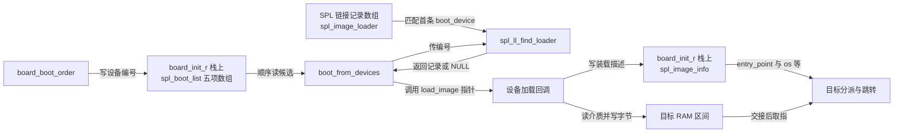
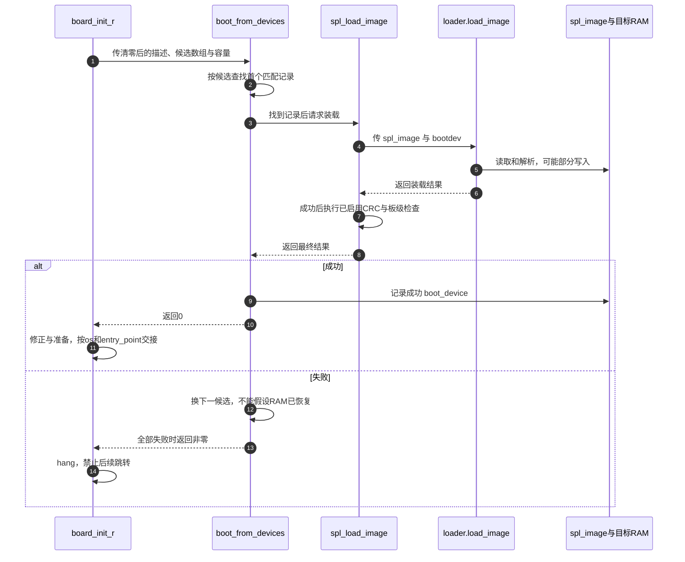

# 第5章\_SPL装载与下一阶段交接实现

一条候选设备记录怎样变成下一条取指地址，中间必须经过哪些状态？本篇把 [加载交接正文](../../../../knowledge/system_software/uboot/P05_为什么需要SPL以及它怎样交出下一阶段.md) 的 L0～L5 落到 SPL 公共框架；重点是候选列表、加载器记录和镜像描述怎样配合，而不是把所有存储驱动重新讲一遍。

**讲解层次：实现层，上游 U-Boot v2022.10，提交 `4debc57a3da6c3f4d3f89a637e99206f4cea0a96`。** [源码总索引](../navigation/README.md) 固定身份，[本模块导读](../navigation/P05_SPL装载与下一阶段交接导读.md) 给出阅读顺序。主要定义在 [common/spl/spl.c](../upstream/v2022.10/common/spl/spl.c)，类型及注册宏在 [include/spl.h](../upstream/v2022.10/include/spl.h)。正文中“下一阶段是 proper”是选定场景，代码还有其他目标分支。

## 5.1\_L2到L3\_候选设备与加载器记录怎样相遇

公共 `board_init_r()` 先在当前调用栈创建五项 `spl_boot_list`，初值全部为 `BOOT_DEVICE_NONE`，并创建一份 `struct spl_image_info spl_image`。准备完成后清零镜像描述、设置可能存在的参数地址，再调用 `board_boot_order()`。弱默认实现仅把 `spl_boot_device()` 返回值放到第一项，板级实现可以提供另一个有界顺序；必须保留终止语义或正确填满传入容量。

候选列表只给出设备类型编号，它还没有提供读取动作。动作来自编译进当前 SPL 的 `spl_image_loader` 链接记录。以 [common/spl/spl_mmc.c](../upstream/v2022.10/common/spl/spl_mmc.c) 中的 MMC 登记为例：

```c
/* 仓库阅读说明：构建期登记一条加载方法，不是在此时访问 MMC。 */
SPL_LOAD_IMAGE_METHOD("MMC1", 0, BOOT_DEVICE_MMC1, spl_mmc_load_image);
```

`"MMC1"` 是可选显示名称，`0` 是该方法的注册优先级，`BOOT_DEVICE_MMC1` 是框架匹配用的设备类型，`spl_mmc_load_image` 是函数指针。它们不能直接等同于 Linux 的 `/dev/mmcblk0`、芯片地址或用户插卡顺序；设备类型到实际控制器的转换仍由 MMC/板级实现完成。

在启用 `CONFIG_SPL_LIBCOMMON_SUPPORT` 的分支，宏核心如下。**以下中文 Doxygen 与行内注释均为仓库补充，非上游原文；展开保留本版语义。**

```c
/** @brief 以设备类型、优先级与回调名构造链接记录的唯一名称。 */
#define SPL_LOAD_IMAGE_METHOD(_name, _priority, _boot_device, _method) \
    SPL_LOAD_IMAGE(_boot_device ## _priority ## _method) = { \
        .name = _name, \
        .boot_device = _boot_device, \
        .load_image = _method, \
    }

/** @brief 把记录放入 spl_image_loader 链接列表。 */
#define SPL_LOAD_IMAGE(__name) \
    ll_entry_declare(struct spl_image_loader, __name, spl_image_loader)
```

关闭该配置时，记录省略 `name` 字段，设备编号和回调仍保留。`##` 在预处理时拼接标识符，priority 进入记录名字以参与列表排序，不是运行时另存一个 priority 字段。`ll_entry_declare` 如何形成有边界的链接数组，沿 [链接列表唯一实现](P01_ARM32链接布局与启动实现.md#1.5_链接列表怎样从声明变成有边界的数组) 阅读。仅有驱动源码而没有构建选择和链接记录，公共框架不会凭名字找到该驱动。

现在候选编号和加载器记录有了交点：`spl_ll_find_loader(boot_device)` 从 `ll_entry_start` 开始，遍历 `ll_entry_count` 个记录，遇到相同 `entry->boot_device` 就返回第一个记录，找不到则返回 `NULL`。**它不在一次失败后自动继续遍历同设备的其他记录。** `boot_from_devices()` 的下一轮前进的是板级候选列表；回调内部是否尝试多种格式或位置又是另一层。

| 对象或字段 | 类型与位置 | 写入、读取和当前生命期 |
| --- | --- | --- |
| `spl_boot_list` | `board_init_r` 局部 `u32` 数组 | 初值为 NONE，板级钩子写候选，公共循环读取 |
| `spl_image_loader.boot_device/load_image` | 当前 SPL 链接记录的编号与函数指针 | 构建期登记，运行时匹配并调用 |
| `spl_boot_device` | 每次包装调用的局部描述 | 包装层填类型和可选名称，传给加载回调 |
| `spl_image_info.load_addr` | 当前调用栈上镜像描述中的地址字段 | 解析/加载路径填写，读取路径据此放置内容 |
| `spl_image_info.entry_point` | 同一描述中的入口地址 | 格式解析或已配置的裸镜像路径填写，交接消费者读取 |
| `size/offset` | 同一描述中的长度与格式相关偏移 | 解析后由具体读取方法解释；单位需看该方法的换算 |
| `os/arg/fdt_addr` | 目标类型、参数与条件存在的设备树地址 | 目标分派和各自 ABI 准备路径消费 |
| `boot_device` | 镜像描述中的成功来源编号 | 公共循环在成功后记录，未成功不得当成有效来源 |

`name`、其他格式标志及条件 CRC 字段不改变本节“候选→回调”的选择规则；CRC 字段在下一节实际使用处解释。结构体没有把镜像字节嵌入其中，不能把复制描述当成已经复制镜像。



**实现原理：** 图中数组和描述都由本次启动调用持有，记录数组来自当前镜像；它们不需要后台通知才能相遇。`boot_from_devices()` 主动读取一个候选编号，查找并调用相应函数，函数通过传入指针写镜像描述，再由返回值报告成功或失败。图中的箭头不是多个 CPU 并发处理同一镜像。

**可修改性：** 添加设备方法需同时核对 Kconfig、对象选择、注册记录和板级候选编号。修改优先级后应检查实际链接列表顺序以及“首次匹配即返回”的行为；不能把新增第二条同设备记录当成已经实现失败回退。增加候选项不得越过调用者数组容量，修改加载描述的字段含义必须同步所有回调和跳转消费者。

## 5.2\_L3到L5\_成功结果怎样成为交接入口

设备回调通过 `spl_load_image()` 包装调用。包装层创建 `struct spl_boot_device bootdev`，把当前记录的 `boot_device` 写进去，`boot_device_name` 置空，再调用 `loader->load_image(spl_image, &bootdev)`。回调返回非零表示失败；返回零后，包装层才执行相应的附加检查。

下面裁剪保留公共回退循环的功能判断，省略串口输出和 `SHOW_ERRORS` 的诊断返回码差异。因此保留的是“0 成功、非零失败”的控制语义，不拿摘录的统一 `-ENODEV` 冒充所有配置下的精确最终错误码。

```c
/**
 * @brief 仓库阅读说明：按板级列表尝试，成功才发布来源；全部失败退出。
 * @param spl_image 各加载方法写入并供后续交接使用的描述。
 * @param spl_boot_list 当前候选数组，遇到 NONE 提前结束。
 * @param count 调用者传入的数组容量，防止越界读取。
 */
static int boot_from_devices(struct spl_image_info *spl_image,
                             u32 spl_boot_list[], int count)
{
    int i;
    for (i = 0; i < count && spl_boot_list[i] != BOOT_DEVICE_NONE; i++) {
        struct spl_image_loader *loader;
        int bootdev = spl_boot_list[i];
        loader = spl_ll_find_loader(bootdev);
        if (loader && !spl_load_image(spl_image, loader)) {
            spl_image->boot_device = bootdev;
            return 0;
        }
    }
    return -ENODEV; /* 诊断配置分支已裁剪，原版也可能保留 -ENXIO。 */
}
```

**实现原理：** 找不到加载器与加载器执行失败都会让循环继续，但日志和最终错误值可能不同。`CONFIG_IS_ENABLED(SHOW_ERRORS)` 改变错误报告细节，不增加新的数据读取方法；串口、通用库和静默控制影响是否打印，不改变“装载成功才记录来源”。具体 `BOOT_DEVICE_*` 编号依赖架构定义；`BOOT_DEVICE_NONE` 在没有其他定义时使用框架提供的哨兵值，不是一个可启动控制器。

包装层在 `CONFIG_SPL_LEGACY_IMAGE_CRC_CHECK` 开启且回调成功、`dcrc_length` 非零时，用 `dcrc_data` 指向的数据和长度计算 CRC，与 `dcrc` 比较，不一致则改为失败。然后才调用板级 `spl_check_board_image()`；该弱默认钩子返回零，不能把“调用了检查函数”写成“已经验证签名”。其他镜像格式的检查还可能在回调内部发生。CRC 能发现指定范围的数据不一致，但不提供签名认证的来源保证。

例如 MMC 的 legacy 路径先解析头部，把字节偏移换算成扇区商与余数，把大小向上取整成扇区数，再 `blk_dread()` 读到 `load_addr`。返回扇区数不等于预期时报告 `-EIO`；有剩余字节偏移时再移动有效数据。这里的完整 MMC 驱动、镜像格式和分区选择未展开，因为本章只依赖其“可能写目标区后失败、成功才有可消费描述”的回调契约。不能把字节数直接当扇区数，也不能把一次短读描述为没有写内存。

公共代码不会在每次尝试前重新清零整个 `spl_image`，也不会还原回调写过的目标 RAM。回调必须对自己的成功字段负责；前次失败留下的字段不能在后次成功时被当作无需覆盖的有效输入。所有候选失败时，`board_init_r()` 打印错误并调用 `hang()`，不会执行后续入口。



第 5 步的数据副作用早于第 8 步最终结果；第 7 步的检查以装载成功和配置启用为条件。第 9～11 步才进入交接消费，第 12～14 步允许继续尝试或最终停止，但没有给失败路径添加回滚保证。

成功后 `board_init_r()` 先执行 `spl_perform_fixups()` 等所选交接准备，再按 `spl_image.os` 分派。`IH_OS_U_BOOT` 分支进入后面的通用准备与跳转；ATF、OP-TEE、OpenSBI、Linux 分支在相关配置开启时有各自调用。这里的 `os` 描述目标镜像类型，不是当前 SPL 的内部阶段。默认分支对未支持类型只打印调试信息，仍可能走到后面的通用跳转，不能将这段 `switch` 本身视为拒绝所有未知目标的白名单。某些 handoff/bloblist 记录错误也只打印提示，并非所有非零返回都会在这段代码里停机；实际证明范围应按各检查点区分。

默认无参数交接函数如下，平台可提供更强的定义覆盖弱实现：

```c
/**
 * @brief 仓库阅读说明：按无参数且不返回的协议进入目标入口。
 * @param spl_image 必须已经由加载与检查路径建立有效 entry_point。
 */
void __weak __noreturn jump_to_image_no_args(struct spl_image_info *spl_image)
{
    typedef void __noreturn (*image_entry_noargs_t)(void);
    image_entry_noargs_t image_entry =
        (image_entry_noargs_t)spl_image->entry_point;
    image_entry(); /* 调试打印已省略；这一步才真正交出控制权。 */
}
```

函数指针转换不会验证地址可执行，也不会自动切换异常级、缓存或参数协议；这些必须在匹配目标的准备路径建立。`__noreturn` 告诉编译器调用不应返回，`__weak` 允许平台覆盖，两者都不是硬件检查机制。

**可修改性：** 增加检查应放在成功结果被消费之前，并让错误传回候选循环；若检查依赖回调已写字段，应证明所有成功分支都初始化它们。修改格式、块大小或目标位置时需复核读取范围、扇区向上取整占用、装载器自身与栈是否会被覆盖。新目标类型必须有匹配入口 ABI，不能只把 `os` 改为另一个枚举后继续调用旧入口。验证至少覆盖无加载器、短读、检查失败、备用成功、全失败不跳转，以及失败后描述/目标区仍可能被修改。

## 5.3\_L0到L2\_公共初始化成功不等于板级DDR已就绪

加载框架只有在可用环境上才成立，但建立环境的职责并不全在 `spl_init()`。本版 `spl_early_init()` 调用 `spl_common_init(true)`，成功后设置 `GD_FLG_SPL_EARLY_INIT`；`spl_init()` 发现该标志尚未设置时再按条件补公共初始化，成功后设置 `GD_FLG_SPL_INIT`。两者共用的 `spl_common_init()` 按配置准备早期分配器、启动计时、日志、设备树和设备模型。每个失败返回可阻断调用者继续，而不是把“某 CPU 已初始化”写成多核互斥。

```c
/** @brief 仓库阅读说明：避免重复建立公共状态，失败不发布完成标志。 */
int spl_init(void)
{
    int ret;
    bool setup_malloc = !(IS_ENABLED(CONFIG_SPL_STACK_R) &&
                          IS_ENABLED(CONFIG_SPL_SYS_MALLOC_SIMPLE));
    if (!(gd->flags & GD_FLG_SPL_EARLY_INIT)) {
        ret = spl_common_init(setup_malloc);
        if (ret)
            return ret;
    }
    gd->flags |= GD_FLG_SPL_INIT;
    return 0;
}
```

`setup_malloc` 在已配置栈迁移与简化分配器组合时为假，避免在这条路径重新设置相应游标；早期阶段已调用公共初始化时，又由 `SPL_EARLY_INIT` 避免重复。分配状态的量纲及重置风险见 [分配器唯一实现](P04_早期运行环境与GD交接实现.md#4.2_S1与S5_分配游标和完整堆分别初始化)。`IS_ENABLED` 检查写出的具体配置名，不能无视它与 `CONFIG_IS_ENABLED` 的阶段前缀区别。

板级 DDR 路径在更早的 `board_init_f()` 或前级固件中。以 [arch/arm/mach-rockchip/spl.c](../upstream/v2022.10/arch/arm/mach-rockchip/spl.c) 为例，顺序包含板级早期钩子、`spl_early_init()`、CPU/计时准备；在 `!CONFIG_TPL || CONFIG_SPL_RAM` 条件下才调用 `dram_init()` 并更新内存顶部信息。这里的 `dram_init()` 仍须追到所选板/SoC 定义，才能证明是否训练 DDR，不能由公共文件中的调用名猜测实现。该文件对 `spl_early_init` 失败调用 `hang()`，对其 `dram_init` 失败则打印后 `return`，不能在讲义中把所有错误出口统一改成停机；上层和实际板级实现要共同保证后续不能消费无效内存。

该 Rockchip 文件还提供 `board_return_to_bootrom()`，调用 `back_to_bootrom(BROM_BOOT_NEXTSTAGE)`；这是一条平台协议，不是所有 SPL 的通用加载步骤。DCD 的 i.MX6ULL 反例则由 ROM 解释镜像数据建立部分硬件条件，所依据的手册表与流程已在 [平台反例正文](../../../../knowledge/system_software/uboot/P05_为什么需要SPL以及它怎样交出下一阶段.md#5.3_用DCD反例校正BootROM的能力边界) 本地说明。三种路径都必须建立真实可用环境，但承担职责的执行代码不同。

**实现原理与可修改性：** 公共初始化标志只证明对应函数成功走完，不覆盖未调用的 DDR、介质或目标格式能力。改板级顺序时先画出“当前执行位置、栈/GD 所在区域、下一函数将读写的区域”，确保准备者不依赖尚未准备的存储。第 5.1 节关系图中的目标 RAM 和第 5.2 节时序第 5 步是本节前置条件的消费处；若 DDR 准备失败却仍进入该步，才是应修复的具体控制流缺口，不能用增加一个名为 init 的函数来代替这个证明。
