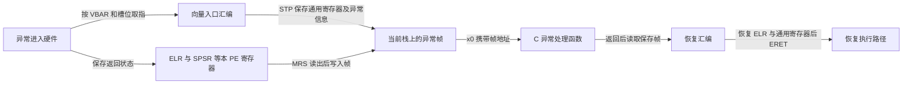
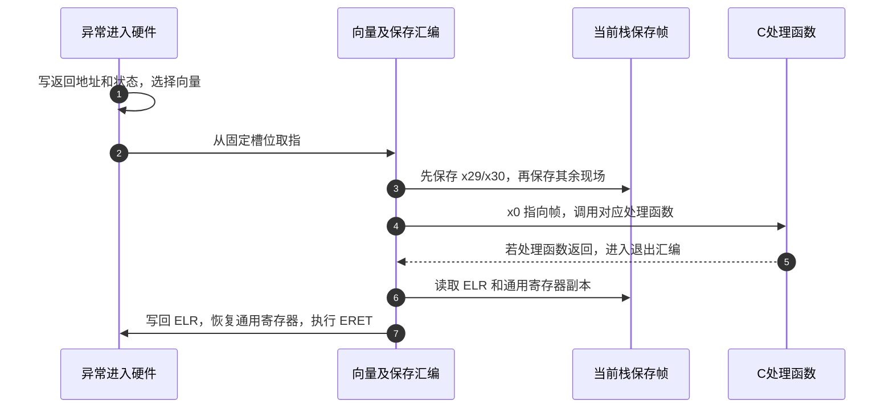

# 第6章\_ARM入口与异常向量实现

本篇承接 [ARM 入口模块导读](../navigation/P06_ARM入口与异常向量导读.md)，版本与原件身份沿 [总索引](../navigation/README.md)。正文的 [E0～E3](../../../../knowledge/system_software/uboot/P06_从复位入口到异常向量与主核交接.md#6.4_入口环境是多个独立条件共同成立) 表示前级交接、处理器准备、多核分派与进入 crt0；以下实现始终沿这组阶段定位，不把某个寄存器置位等同于整个阶段完成。

**讲解层次：实现层，U-Boot v2022.10。** 代码均为裁剪的上游实现，中文注释和 Doxygen 阅读说明是本仓库补充，不是上游原文。硬件字段的当前必要表格已在 [入口正文](../../../../knowledge/system_software/uboot/P06_从复位入口到异常向量与主核交接.md) 就地提供。

## 6.1\_读取当前异常级与改变异常级是两种操作

上游位置为 `arch/arm/include/asm/macro.h` 的 `switch_el`，调用者包括 `arch/arm/cpu/armv8/start.S`。E1 首先需要避免低权限路径写入高权限专用寄存器，而不是无条件把每个调用者都提升到 EL3。

```asm
/*!
 * @brief 按当前 EL 选择标签；本身不切换异常级。
 * @param xreg 可覆盖的通用寄存器。
 * @param el3_label,el2_label,el1_label 当前权限对应的汇编目标。
 * @note 调用环境是正常的 EL1/2/3 入口，不把 EL0 纳入支持范围。
 */
.macro switch_el, xreg, el3_label, el2_label, el1_label
    mrs \xreg, CurrentEL
    cmp \xreg, #0x8
    b.gt \el3_label
    b.eq \el2_label
    b.lt \el1_label
.endm
```

`MRS` 读取本 PE 的硬件状态；比较 `0x8` 实际比较的是 EL 字段编码。三个 `b` 改变取指地址，没有写入目标 EL，也没有执行 `ERET`。若把此宏用于 EL0，不会凭最后一条 `b.lt` 获得 EL1 权限；访问前提本身已经不成立。

`start.S` 的 EL2 分支还先读取 `HCR_EL2.E2H`。该位为 1 时跳到标成 `1:` 的代码，但处理器仍在 EL2：VHE 的访问别名让相关 EL1 名称作用于 EL2 主机环境。不能把汇编数字标签 `1:` 当成改变 EL 的指令。该文件稍后的 `c_runtime_cpu_setup` 有自己设置 VBAR 的代码，应独立核对，不能推定它必然重复入口的每一个条件分支。

实际降级入口位于 `arch/arm/cpu/armv8/transition.S`，其 `armv8_switch_to_el2` 调用 `macro.h` 的 `armv8_switch_to_el2_m`。这个宏先准备下级控制、栈与向量，选择 AArch64/AArch32，最后在 AArch64 分支执行下面的交接尾部：

```asm
/*!
 * @brief EL3 向 AArch64 EL2 交接的尾部裁剪。
 * @pre 下级控制寄存器、SP_EL2、VBAR_EL2 与 SCR_EL3 已按完整宏准备。
 * @param ep 下一阶段入口地址；tmp 是临时寄存器。
 * @note 不是一个可脱离完整宏单独调用的函数。
 */
    ldr \tmp, =(SPSR_EL_DEBUG_MASK | SPSR_EL_SERR_MASK | \
                SPSR_EL_IRQ_MASK | SPSR_EL_FIQ_MASK | \
                SPSR_EL_M_AARCH64 | SPSR_EL_M_EL2H)
    msr spsr_el3, \tmp       /* 准备 ERET 要恢复的模式与屏蔽状态 */
    msr elr_el3, \ep         /* 准备 ERET 的目标程序地址 */
    eret                    /* 在这里交出权限和执行位置 */
```

`EL2H` 选择 EL2 及其专用栈；四个 MASK 常量建立返回后的屏蔽状态。准备好的状态先保存在 EL3 的异常返回寄存器中，由 `ERET` 消费，不是 `MSR ELR_EL3` 一写就跳。此处虽用于启动交接，仍采用架构的异常返回机制。

一个局部修改预测是把 `ERET` 换成 `BR ep`。地址可能到达同一处，但当前权限与 PSTATE 不按 SPSR 恢复，因而不等价。另一个预测是只改 `SPSel`：它只选择栈寄存器，不能替代这里的 `SP_EL2` 准备，也不能替代 crt0 为正常运行写入有效 SP。

## 6.2\_固定向量槽位如何连接软件保存现场

上游位置是 `arch/arm/cpu/armv8/exceptions.S` 的 `vectors`、`_exception_entry`、`_save_el_regs`、`exception_exit` 和 `_restore_regs`。该版本说明自己只处理来自同级的八种入口，不运行需要较低级入口的负载。架构仍定义十六槽位；一个受限运行时实现八槽，并没有改变架构表。

异常硬件保存返回地址和状态到对应 EL 的专用寄存器，随后进入选定向量；通用寄存器不会因此自动全压到 C 栈上。U-Boot 必须在覆盖通用寄存器前保存它们，再把保存区地址作为 C 参数交给处理函数。



下面的 SP_ELx IRQ 槽位与共享保存尾部展示这一连接。完整保存顺序见相同原件，不在其他章节再次展开。

```asm
/*!
 * @brief 本级使用 SP_ELx 时的 IRQ 槽位裁剪。
 * @pre VBAR 指向此表；当前异常栈可写且足够容纳保存帧。
 * @note BL 会覆盖 x30，因此先保存 x29/x30。
 */
    .align 7
    stp x29, x30, [sp, #-16]!
    bl _exception_entry
    bl do_irq
    b exception_exit

/* _exception_entry 逐对保存 x27..x1，跳到 _save_el_regs。 */
/* _save_el_regs 依当前 EL 把 ESR、ELR、SPSR 分别读入 x1/x2/x3。 */
    stp x1, x0, [sp, #-16]!  /* 保存 ESR 与原来的 x0 */
    stp x3, x2, [sp, #-16]!  /* 保存 SPSR 与 ELR */
    mov x0, sp               /* C 参数指向保存帧，不是原来的 x0 */
    ret
```

`[sp,#-16]!` 在写入前递减 SP 并更新 SP；两次尾部存储以后，帧低地址处为保存的 SPSR 与 ELR，随后是 ESR 与原 x0。ESR 是 Exception Syndrome Register，保存异常综合信息，具体字段必须按异常种类解释。

| 本节新增状态 | 访问与落点 | 谁产生、谁消费 |
| --- | --- | --- |
| `ESR_EL1/2/3` | 对应权限的 `MRS`；EC `[31:26]` 为异常类别，ISS `[24:0]` 的含义依类别 | 适用的异常硬件产生综合信息，保存汇编读到帧中；不能假定 IRQ 每次刷新一个可诊断原因 |
| 保存帧中的 SPSR、ELR、ESR 与通用寄存器副本 | 当前异常 SP 向低地址增长的内存 | 汇编写，C 处理函数读取；退出路径再消费需要恢复的字段 |

ESR 字段依据 DDI0487 G.b 的 D1.10.4（p.2478）与 D13.2.37 ESR_EL1（p.3145）。这里的保存并不保证每种异常都给 ESR 写入新值，尤其不能把读到的旧综合信息当成 IRQ 来源编号。



步骤 3 必须早于步骤 4，否则 C 调用会毁掉尚未保存的现场。步骤 5 是有条件的，某些致命异常处理不会返回。此版本 `exception_exit` 读保存的 ELR 并写回系统寄存器；保存帧中的 SPSR 副本被跳过，没有写回 SPSR_ELx。因此不能说“修改帧中任意寄存器字段都会在退出时生效”。ERET 使用硬件 SPSR 的当前内容，具体是否允许修改，要以退出代码实际恢复的字段为准。

入口间的空隙放置共享保存/恢复指令，`.align 7` 保持下一个入口在 128 字节边界。如果新增代码跨过预定间隙，仅有向上对齐可能把后续入口推迟到错误槽位；需检查实际符号偏移，不能只看源码还保留 `.align` 就断言正确。正文实验使用固定 `.org`，是为了让这种越界直接成为汇编错误。

## 6.3\_不能把ARMv7的清理动作套到ARMv8入口

比较位置是 `arch/arm/cpu/armv7/start.S` 的 `reset`、`cpu_init_cp15`，以及 `arch/arm/cpu/armv8/start.S` 的 `reset`。E0 之后二者都要进入 `_main`，但执行模式、控制接口和前级合同不同。

ARMv7 的模式处理裁剪如下：

```asm
/*!
 * @brief 保留 HYP，否则选择 SVC，并屏蔽 IRQ/FIQ。
 * @note 此段只解释 CPSR 修改；不能代表全部低级初始化。
 */
    mrs r0, cpsr
    and r1, r0, #0x1f
    teq r1, #0x1a          /* 当前是否已经是 HYP */
    bicne r0, r0, #0x1f
    orrne r0, r0, #0x13    /* 非 HYP 才改成 SVC */
    orr r0, r0, #0xc0      /* I/F 屏蔽位置 1 */
    msr cpsr, r0
```

后缀 `ne` 使模式改写只在比较不等时执行；最后的 IRQ/FIQ 屏蔽不受这个条件限制。接下来向量配置还受 `SYS_NO_VECTOR_TABLE` 和 `HAS_VBAR` 影响。`SKIP_LOWLEVEL_INIT` 可以跳过低级初始化，`SKIP_LOWLEVEL_INIT_ONLY` 又影响其中 `cpu_init_crit` 的调用。不能只读一个函数体就认定每个镜像都运行了它。

`cpu_init_cp15` 对 SCTLR 先清 V 和 M/C/A，随后设置 A、Z，并按 `SYS_ICACHE_OFF` 清除或设置 I。这说明此路径最后的指令缓存不一定关闭。前面的 TLB、指令缓存、分支预测维护与 DSB/ISB 也属于执行过程，不能删除后只留下控制位写入。

AArch64 入口的 `Initial State` 注释则声明预期环境，并不等于刚执行了一段对应清理代码。其 `CONFIG_ARMV8_SET_SMPEN` 分支访问实现定义的 `S3_1_c15_c2_1`，设置 bit 6；源码注释限定 A53/A57/A72，且当前代码只在 EL3 路径执行。这里只记录该版本的访问行为，不把这项非架构寄存器的编码或位定义当成所有 Arm 核的通用接口。

| 额外条件或接口 | 本版作用 | 阅读边界 |
| --- | --- | --- |
| `S3_1_c15_c2_1` | 条件启用时以 `MRS/MSR` 读改写 bit 6，并执行 ISB | 实现定义；需要对应核手册和前级权限支持，不能套用到别的核 |
| `CNTFRQ_EL0` | 入口配置了频率常量时，在最高实现 EL 路径用 MSR 写入 `[31:0]` 的 Hz 数值，高 32 位为 RES0 | 这是供软件读取的系统计数器频率信息，不是修改 CPU 主频；后缀 EL0 不表示任意 EL0 软件可以写 |
| `save_boot_params` | 使用显式返回标签交回入口 | 尚未建立普通 C 栈，不应把任意 C 保存函数放进来 |

计数器频率字段依据 DDI0487 G.b，D13.8.1（p.4140），硬件不把这个描述值作为调频命令。若要改变这些分支，先检查当前板的前级协议、配置求值与所用核手册；主机上的语法编译不能验证真实缓存和权限行为。本章不复制未核对的 erratum 位定义，具体核修订的勘误条件仍应单独逐项核验。

## 6.4\_等待核怎样消费共享释放地址

上游位置为 `start.S` 的主从分派、`macro.h` 的 `branch_if_master`、`spin_table_v8.S` 的等待桩，以及 `spin_table.c` 的设备树更新。它们属于 E2，随后主核在 E3 选择 SP_ELx 并进入 `_main`，由 crt0 建立实际栈和 GD。

`branch_if_master` 在 `ARMV8_MULTIENTRY` 生效时读取 MPIDR，移除非亲和性字段，只把 Aff3:Aff2:Aff1:Aff0 全零作为当前宏的主核选择。配置不生效时宏直接跳向主核标签。这是该实现的选核规则，不是任何异构 SoC 都可以无条件照搬的架构结论。

```asm
/*!
 * @brief spin-table 分支的等待核入口；裁剪自 spin_table_v8.S。
 * @pre 释放单元及等待桩必须在交接期间保留且可被正确访问。
 * @note 此处只读取，不负责发布、缓存维护或发送事件。
 */
spin_table_secondary_jump:
spin_table_reserve_begin:
0:  wfe
    ldr x0, spin_table_cpu_release_addr
    cbz x0, 0b
    br x0
.align 3
spin_table_cpu_release_addr:
    .quad 0
spin_table_reserve_end:
```

`LDR x0, symbol` 读取符号处的 64 位值；它不是仅把该符号地址放入 x0。`CBZ` 在值仍为零时回到等待，`BR` 消费非零入口。`start.S` 的另一 MULTIENTRY 分支则先加载 `CPU_RELEASE_ADDR` 地址，再从该地址读值；这两种写法不能混淆。

为了让后续软件找到这块共享状态，`spin_table_update_dt` 检查 `/cpus` 下 CPU 节点的 `enable-method`。若发现不采用 `spin-table` 的 CPU 节点，它返回成功而不修改其他方法。全部适用时，为 CPU 节点写 `cpu-release-addr`，并给等待桩与释放单元所在范围增加内存保留记录。这两个动作分别解决“到哪里发布”和“那块内存为何不能提前回收”。

| 设备树字段或返回值 | 当前函数的实际行为 | 不能推断的结论 |
| --- | --- | --- |
| `enable-method` | 先检查 CPU 节点是否全部采用 `spin-table` | 返回 0 不一定意味着已添加释放地址 |
| `cpu-release-addr` | 写入 `&spin_table_cpu_release_addr`，本实现给相关节点同一地址 | 不能画成此实现为每核各分配一份释放单元 |
| 内存保留范围 | 从 `spin_table_reserve_begin` 到 `spin_table_reserve_end` | 不等于保留整个 U-Boot 镜像 |
| `-ENODEV`、`-ENOSPC` | 缺 `/cpus` 或写属性/保留项失败 | 失败前已写过的属性不会由该函数统一回滚 |

共享一个入口单元意味着被唤醒的多个核可以到达同一后续入口，并由后续协议继续区分身份；它不是每核独立启停队列。将 `.quad 0` 改成任意非零常量会绕过“尚未发布”的状态，可能直接跳向无效位置。把 `CBZ` 删掉则会让非发布事件也触发跳转。两种修改都暴露出等待条件必须来自共享状态，而不是来自 `WFE` 是否已经返回。

上述代码提供消费者和交接描述，没有在此处实现外部释放方。实际发布的顺序、内存可见性、事件和下一阶段入口协议要整体核对；本篇源码读取与正文布局实验均未声称已经运行多核硬件验证。
