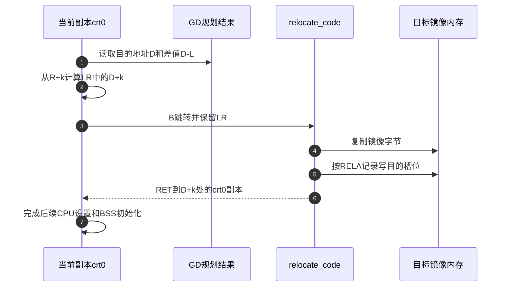

# 第7章\_AArch64相对重定位与地址交接实现

[模块导读](../navigation/P07_地址视图与AArch64重定位导读.md) 组织源文件与原件摘要，版本沿 [总索引](../navigation/README.md)，固定 U-Boot v2022.10。这里放大 [地址正文](../../../../knowledge/system_software/uboot/P07_镜像搬迁为什么不等于改变内存映射.md) 中的 L（链接）、R（初次运行）、D（最终目的）三个视图，不把芯片物理窗口、镜像符号值和 C 指针混成一个地址变量。

**讲解层次：实现层。** 中文注释和 Doxygen 是仓库补充，原件仍保持上游字节；裁剪代码不构成可以独立替换启动文件的实现。

## 7.1\_平台窗口与软件选择的地址不是同一个配置

上游位置为 `include/configs/mx6ullevk.h` 与 `arch/arm/include/asm/arch-mx6/imx-regs.h`。前者把 `PHYS_SDRAM` 定义成 `MMDC0_ARB_BASE_ADDR`，并据此定义 `CONFIG_SYS_SDRAM_BASE`；后者根据 SoC 配置选择控制器窗口常量。

```c
/*!
 * @brief 裁剪展示 MX6ULL 所在分支的物理 DDR 窗口起点。
 * @note 定义常量不等于初始化控制器，也不证明板上内存容量。
 */
#if (defined(CONFIG_MX6SLL) || defined(CONFIG_MX6SL) || \
     defined(CONFIG_MX6SX) || \
     defined(CONFIG_MX6UL) || defined(CONFIG_MX6ULL))
#define MMDC0_ARB_BASE_ADDR 0x80000000
#else
#define MMDC0_ARB_BASE_ADDR 0x10000000
#endif
```

配置为 MX6ULL 时，前述宏链求值得到 SDRAM 基址 `0x80000000`。换成其他 i.MX6 成员可能进入不同分支，所以不能仅凭文件名 `imx-regs.h` 给整个家族指定相同地址。正文用 NXP Table 2-1 核对窗口，而不是拿软件宏反过来证明硬件任意可编程。

同一头文件把 `IRAM_BASE_ADDR` 定为 `0x00900000`；MX6ULL 所在的 `IRAM_SIZE` 分支为 `0x20000`。板头文件据此选择初始 RAM 地址和大小。它表达软件准备使用的区域，不表示当前能覆盖 ROM 尚在使用的全部 OCRAM。镜像链接地址、初始栈位置以及设备树保留区，还要继续沿各自配置求值。

## 7.2\_入口修正与搬迁修正都从RELA加数计算

第一处实现是 `arch/arm/cpu/armv8/start.S` 的 `pie_fixup`，条件为 `CONFIG_POSITION_INDEPENDENT`；第二处是 `arch/arm/lib/relocate_64.S` 的 `relocate_code`。前者在当前运行副本上修正支持项，后者先复制当前镜像到目标，再修正目标位置。

先明确记录布局。它是镜像内 `.rela.dyn` 中的只读输入，不是运行时逐项扫描普通数据推断出来的列表。`include/elf.h` 中相应结构如下：

```c
/*!
 * @brief ELF64 显式加数重定位记录；本版各字段为 8 字节。
 * @note 汇编每次读取 24 字节，必须与此布局相符。
 */
typedef struct {
    Elf64_Addr r_offset;    /* 待写入位置的链接视图地址 */
    Elf64_Xword r_info;     /* 符号索引与重定位类型 */
    Elf64_Sxword r_addend;  /* 用来计算结果的显式加数 */
} Elf64_Rela;
```

| 字段 | 当前汇编读取方式 | 在修正中的用途 |
| --- | --- | --- |
| `r_offset` | 第一对 `LDP` 的 x0，记录内偏移 0 | 加目的位置相对链接位置的差值，得到实际写入地址 |
| `r_info` | 第一对 `LDP` 的 x1，偏移 8 | 低 32 位为类型；本路径只处理 1027 |
| `r_addend` | 随后的 `LDR` 到 x4，偏移 16 | 与同一差值相加，得到写入的值；不是重新读取槽中旧值 |

`start.S` 先用 `ADR` 取得 R，再从 `_TEXT_BASE` 的字面常量读取 L，计算 `x9=R-L`。运行与链接相同就跳过入口修正；否则按记录循环。4 KiB 对齐检查发生在它之前，因为此路径使用的 ADRP 与低 12 位组合依赖该装载条件，不能删掉检查后仍宣称支持任意地址。

搬迁函数先比较 D 与当前运行源地址；需要搬迁时，重新从 `_TEXT_BASE` 取得 L，计算 `x9=D-L`。复制区间由 `__image_copy_start` 与 `__image_copy_end` 界定。随后循环与入口修正采用同样的显式加数思路，下面裁剪的是搬迁版本：

```asm
/*!
 * @brief 搬迁后的相对引用修正循环。
 * @pre x2/x3 是原件记录区当前可访问的起止地址，x9 为 D-L。
 * @note 仅处理 R_AARCH64_RELATIVE，不验证任意外部 ELF 的合法性。
 */
fixloop:
    ldp x0, x1, [x2], #16  /* 读位置和类型，游标前进 16 */
    ldr x4, [x2], #8       /* 读显式加数，游标累计前进 24 */
    and x1, x1, #0xffffffff
    cmp x1, #R_AARCH64_RELATIVE
    bne fixnext
    add x0, x0, x9        /* 位置 = 链接位置 + D-L */
    add x4, x4, x9        /* 值 = 原始加数 + D-L */
    str x4, [x0]
fixnext:
    cmp x2, x3
    b.lo fixloop
```

无论类型是否匹配，读取指令都已使 x2 前进 24 字节。未识别的项被跳过，不能把“没有停机”当作该类型已经得到正确修正。汇编也没有正文教学模型的范围检查；其安全使用依赖受支持的链接产物、布局和启动合同，不能直接当不可信输入解析器。

为什么从 `_TEXT_BASE` 读取 L，而不是随手取一个符号地址？因为部分符号引用可能已经按 R 修正，得到的是运行值。这里需要保留原始链接基准，才能从原始加数算到 D。若错误使用 `D-R`，本例 `0x1018+(0x5000-0x2000)` 会变成 `0x4018`，少加了首次装载差值；若把槽内 `0x2018` 又加 `D-L`，则变成 `0x6018`，重复计入那部分差值。

本节只展开 AArch64 RELA。ARM32 REL 的加数落点与不同修正阶段并不完全相同，沿 [ARM32 唯一实现](P01_ARM32链接布局与启动实现.md) 核对，不用本循环替代它。尤其不能根据“relative”这个相同词推断两者的输入字节布局相同。

## 7.3\_返回地址怎样把执行流接到新副本

复制和指针修正都完成以后，如果返回仍落在旧副本，处理器就没有真正完成执行位置的交接。上游 `arch/arm/lib/crt0_64.S` 在调用搬迁函数之前准备 LR，也就是 x30 中的返回地址。栈与 GD 的处理见 [早期运行环境实现](P04_早期运行环境与GD交接实现.md)，本节只展开返回位置计算。

设 `relocation_return` 相对镜像起点偏移为 k。`ADR lr, relocation_return` 得到当前副本中的 `R+k`。位置无关分支先加 `L-R` 把它还原到链接视图，再加 `gd->reloc_off=D-L`，最终为 `D+k`。

```asm
/*!
 * @brief crt0_64.S 的搬迁返回地址计算裁剪。
 * @pre x18 指向当前所用 GD；其最终位置和差值已由早期规划准备。
 * @note CONFIG_POSITION_INDEPENDENT 分支处理 R 与 L 不同的情况。
 */
    adr lr, relocation_return
#if CONFIG_POSITION_INDEPENDENT
    adrp x0, _start
    add x0, x0, #:lo12:_start
    ldr x9, _TEXT_BASE
    sub x9, x9, x0           /* L-R */
    add lr, lr, x9
#endif
    ldr x9, [x18, #GD_RELOC_OFF]
    add lr, lr, x9           /* 再加 D-L，得到 D+k */
    ldr x0, [x18, #GD_RELOCADDR]
    b relocate_code         /* B 保留刚准备好的 LR */
```

这里必须留意最后是 `B` 而不是普通调用常见的 `BL`。如果改成 `BL`，硬件会把当前分支后的地址写入 LR，覆盖刚算好的新副本继续位置。`relocate_code` 保存并恢复调用者 LR，最终 `RET` 才沿准备好的地址回到新副本。

| 当前状态 | 谁写入、存在哪里 | 后续消费者 |
| --- | --- | --- |
| `gd->relocaddr`、`gd->reloc_off` | 早期内存规划写入 GD；汇编偏移由生成的 asm-offsets 描述 | crt0 读取 D 与 D-L |
| LR 中的 `D+k` | crt0 在进入搬迁函数前计算 | 搬迁函数返回时使用 |
| 目标镜像字节及已修正槽位 | 搬迁代码写入 D 区域 | 返回到新副本的取指与数据访问 |
| BSS | 返回后沿其边界清零 | 后续完整 C 运行环境使用；不应仅靠前面的复制推出已经清零 |



步骤 6 中参与者仍叫 crt0，是同一段逻辑在新地址继续执行，不是返回原地址。步骤 4～5 也不能替代实现要求的指令与数据可见性维护；实际 cache 分支仍以 `relocate_64.S` 和平台合同为准，当前数值实验没有验证这些硬件效果。

`GD_FLG_SKIP_RELOC` 可以在 crt0 中绕过主体搬迁；SPL 又有独立条件路径。因此以上是选定 proper 搬迁路径，不是每份镜像必经流程。对跳过路径，必须由实际入口合同证明原位置及对象状态可继续使用，而不是因为函数名没有报错就假定等价。
