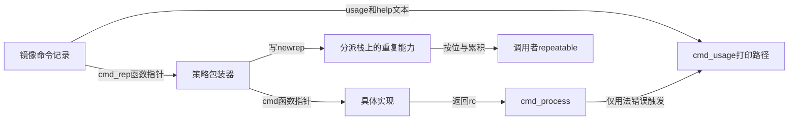

# 第8章\_命令记录与查找分派实现

本篇承接 [命令注册模块导读](../navigation/P08_命令注册与分派导读.md)，版本沿 [总索引](../navigation/README.md)，固定 U-Boot v2022.10。当前输入已经是 argc/argv；字符串解析和缓冲区生命期另由解析模块承担，不在这里重复展开。

**讲解层次：实现层。** 下列中文 Doxygen 和注释为本仓库阅读补充，裁剪代码保留当前讨论所需分支，原件按上游目录保存。

## 8.1\_登记宏如何生成当前版本的命令记录

上游位置为 `include/command.h` 中的 `struct cmd_tbl`、`U_BOOT_CMD`、`U_BOOT_CMD_COMPLETE` 和 `U_BOOT_CMD_MKENT_COMPLETE`。在 `CONFIG_CMDLINE` 生效时，普通宏展开的核心如下；链接列表底层宏仍沿 [唯一实现](P01_ARM32链接布局与启动实现.md#1.5_链接列表怎样从声明变成有边界的数组) 阅读。

```c
/*!
 * @brief 生成 cmd 类型的链接记录，裁剪普通命令行启用分支。
 * @param _rep 选择重复策略包装器；不是结构中的旧整数成员。
 * @note _CMD_HELP 和 _CMD_COMPLETE 根据配置保留可选初始化项。
 */
#define U_BOOT_CMD_MKENT_COMPLETE(_name, _maxargs, _rep, _cmd, \
                                _usage, _help, _comp) \
    { #_name, _maxargs, \
      _rep ? cmd_always_repeatable : cmd_never_repeatable, \
      _cmd, _usage, _CMD_HELP(_help) _CMD_COMPLETE(_comp) }

#define U_BOOT_CMD_COMPLETE(_name, _maxargs, _rep, _cmd, _usage, _help, _comp) \
    ll_entry_declare(struct cmd_tbl, _name, cmd) = \
        U_BOOT_CMD_MKENT_COMPLETE(_name, _maxargs, _rep, _cmd, \
                                 _usage, _help, _comp);

#define U_BOOT_CMD(_name, _maxargs, _rep, _cmd, _usage, _help) \
    U_BOOT_CMD_COMPLETE(_name, _maxargs, _rep, _cmd, _usage, _help, NULL)
```

`#_name` 是预处理器字符串化；`ll_entry_declare` 的 `cmd` 则是列表分类名，两者不是同一个字段。初始化第三项填入 `cmd_rep`，第四项才是普通 `cmd`。因此旧版把第三项解释成整数 `repeatable` 的结构图不能用于这里。

以 `U_BOOT_CMD(echo, CONFIG_SYS_MAXARGS, 1, do_echo, ..., ...)` 为例：记录名字为 `"echo"`，上限来自 `CONFIG_SYS_MAXARGS`，`cmd_rep=cmd_always_repeatable`，`cmd=do_echo`。给 `_rep` 传 0 只会换成 `cmd_never_repeatable`，不会删除实现函数。`CONFIG_CMDLINE` 关闭时有另一套去除登记的宏分支，不能只看这段启用路径推断所有镜像都有命令记录。

对应构建证据为 `cmd/Kconfig` 的 `CMD_ECHO` 与 `cmd/Makefile` 中 `obj-$(CONFIG_CMD_ECHO) += echo.o`。没有把这个对象纳入镜像，链接记录就无从汇集；宏不具备从源文件系统自动发现命令的能力。

`U_BOOT_CMDREP_*` 为需要动态重复能力的实现提供另一入口：它直接接收 `cmd_rep`，普通 `cmd` 则用 `cmd_discard_repeatable` 适配。该适配器调用 `cmd_rep` 后丢弃重复能力输出，使不消费这项输出的调用者仍有普通签名入口。正文当前例子使用普通宏，不把两类登记当成同一初始化顺序。

## 8.2\_查找为何先考虑完整匹配再接受唯一前缀

上游位置为 `common/command.c` 的 `find_cmd` 和 `find_cmd_tbl`。前者通过 `ll_entry_start`、`ll_entry_count` 取得 `cmd` 记录区的起点与条目数，再让后者进行名称匹配。这里的边界来自镜像链接布局，不是运行时向堆中追加的数组。

```c
/*!
 * @brief 名称查找核心裁剪；调用者已取得有效表和长度。
 * @note len 已按输入中第一个点号以前的长度计算。
 */
for (cmdtp = table; cmdtp != table + table_len; cmdtp++) {
    if (strncmp(cmd, cmdtp->name, len) == 0) {
        if (len == strlen(cmdtp->name))
            return cmdtp;         /* 完整名字立即成功 */
        cmdtp_temp = cmdtp;
        n_found++;                /* 暂存缩写候选，继续查歧义 */
    }
}
if (n_found == 1)
    return cmdtp_temp;
return NULL;
```

若输入 `show`，即使表中还有 `showinfo`，完整匹配也立即胜出。若输入 `sho`，两者都只是前缀候选，遍历结束时 `n_found=2`，返回空指针。因为源码在确认唯一性以前不会执行回调，所以“曾经遇到一个匹配候选”不等于命令已经被选中。

查找前用第一个 `.` 计算 `len`，使 `md.b` 可以定位 `md`。后缀语义并非由此循环验证，具体命令仍需解释参数。这个函数也没有提供通用访问控制；命令存在与调用是否满足设备、地址和权限要求是不同问题。

## 8.3\_两层回调怎样分别返回结果与重复能力

上游位置为 `common/command.c` 的 `cmd_process`、`cmd_call`、重复策略包装器和 `cmd_usage`。正常路径先查找，再比较 `argc > maxargs`，最后通过 `cmd_rep` 调用。启用 `CMD_BOOTD` 时还有专门的 bootd 递归检测，不能把这个特例扩大成所有命令都有递归保护。

```c
/*!
 * @brief 普通可重复命令的包装器。
 * @param repeatable 输出重复能力，与返回值表示的执行状态分开。
 */
int cmd_always_repeatable(struct cmd_tbl *cmdtp, int flag, int argc,
                         char *const argv[], int *repeatable)
{
    *repeatable = 1;
    return cmdtp->cmd(cmdtp, flag, argc, argv);
}

/* cmd_never_repeatable 的结构相同，只把输出设为 0。 */
/* cmd_call 的核心是调用 cmdtp->cmd_rep(..., repeatable)。 */
```

普通包装器仍会执行 `cmd`，不会因为输出 0 就禁止本次命令。这项结果交给上层决定是否保留自动重复能力。`cmd_process` 中用 `*repeatable &= newrep` 累积：只要一项执行结果不允许重复，已有的整体许可就被清除。

| 变量与状态 | 落点及写入者 | 读取者与有效期 |
| --- | --- | --- |
| `cmdtp` | 分派函数的局部指针，指向镜像中的命令记录 | 本次参数检查及回调调用 |
| `newrep` | 分派栈上的整数，由 `cmd_rep` 输出 | 本次回调返回后参与整体许可的按位与 |
| `*repeatable` | 调用者提供的累积状态 | 解析或交互层决定是否继续允许自动重复 |
| `rc` | 命令及分派函数逐层返回的执行状态 | 上层决定成功/失败及后续命令行为 |
| `usage`、`help` | 记录中的字符串指针 | `cmd_usage` 读取并打印；不是可调用接口 |



若回调返回 `CMD_RET_USAGE=-1`，`cmd_process` 改为调用 `cmd_usage`；打印函数返回 1，因此上层获得一般失败状态。其他失败并不自动走帮助路径，也没有事务回滚。可选 `ticks` 非空时围绕回调计时，调用者不提供它时不会额外写计时结果。

一个容易犯错的局部改动是把 `*repeatable &= newrep` 改成赋值。假设同一行第一条命令不可重复、第二条可重复，赋值会让第二条重新打开整行许可；按位与才能保留前面已经发现的限制。另一个错误是让自定义 `cmd_rep` 返回成功却不写 `newrep`，此时分派层读取的输出没有得到初始化；两条输出通道都属于接口合同。

回调参数 `argv` 的指向与生命期由调用路径决定，当前常见 simple 解析路径使用局部缓冲区。命令若需要长期保存其中的文本，应按自己的对象生命期复制，而不是保存借来的指针。这项约束会在字符串解析单元中通过具体缓冲区继续展开。
