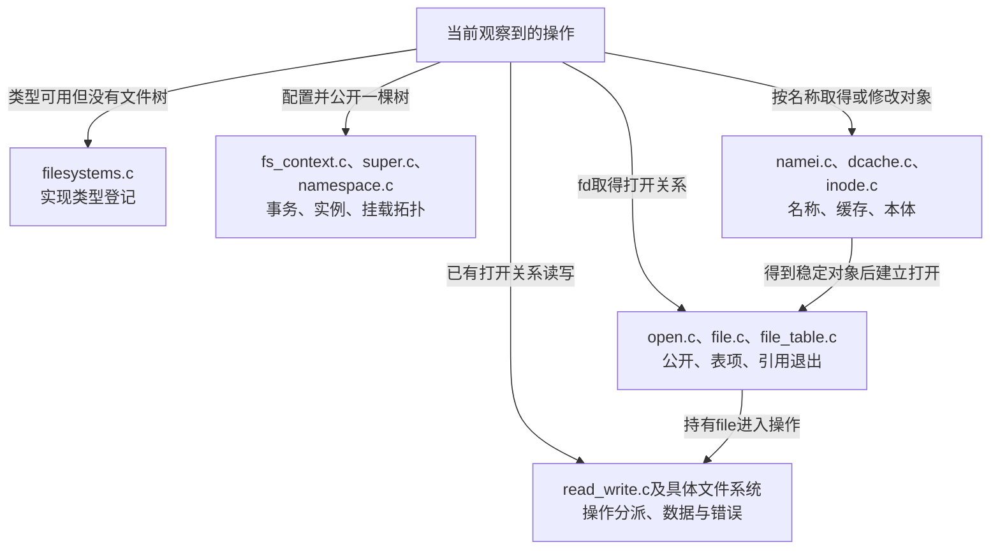

# 第1章\_Linux\_6.12\_VFS源码阅读索引

VFS知识正文先解释为什么名称、文件本体、打开关系和挂载视图必须分开。本索引负责把这些问题放回一个确定版本的源码树：先判断当前操作改动哪份状态，再选择文件和执行路径。仅搜索同名函数容易跳过调用条件，尤其不能把unlink、close和unmount当作同一个“删除对象”。

阅读阶段与目录职责见 [VFS源码阅读大纲](../大纲.md#1.1_从现象进入原件核对)。

## 1.1\_先固定源码身份与运行证据

| 项目 | 本索引使用的证据 |
| --- | --- |
| 官方来源 | [NXP linux-imx](https://github.com/nxp-imx/linux-imx) |
| 发布标签 | lf-6.12.20-2.0.0 |
| 不可变提交 | dfaf2136deb2af2e60b994421281ba42f1c087e0 |
| 内核版本 | Linux 6.12.20 |
| 当前核对方法 | 从已确认官方远端的Git对象库读取固定提交，比较保存原件 |
| 工作树差异 | 当前分支头在该提交后3个提交；不把分支头内容混入本索引 |
| 配置边界 | 工作树为ARM、Tiny RCU，启用ext4、tmpfs、procfs、inotify和命名空间；这是构建配置观察，不是运行证明 |
| 实验边界 | 用户态程序需要Linux及支持硬链接的文件系统，本次没有目标程序运行记录 |

完整身份、历史配置与取得边界见 [Linux源码基线](../../linux/SOURCE_BASELINE.md)。公共VFS对象主要来自架构无关代码，不能因此把某配置的RCU实现、文件系统特性或目标板结果外推到所有Linux系统。

## 1.2\_从状态变化选择阅读方向

第一轮不要同时展开全部目录。先读 [为什么需要VFS](../../../../knowledge/kernel_subsystems/vfs/P01_为什么需要_VFS.md#1.3_在一个完整程序中观察名字与打开关系) 的完整实验和 [抽象机制推演](../../../../knowledge/kernel_subsystems/vfs/P02_VFS抽象机制推演.md#2.1_一张操作表能先做出什么)，明确自己要解释的是哪个共享关系，再用下表定位声明和路径。后续章节按问题逐步细化实现，不能用本索引的一行文件名代替某条路径的完整学习。

[对象周期模块导读](P02_同一次打开怎样跨越对象状态.md#2.1_先确认观察的是哪一条状态轴) 将S0～S6落到公开、名称变化和最终归还，分别进入 [描述符与打开字段](../source_explanations/P01_描述符表与打开对象的状态归属.md#1.1_表项状态与打开状态的边界) 和 [路径名称与实例字段](../source_explanations/P02_路径名称与实例的字段关系.md#2.1_任务的查找上下文不是描述符表)。两份实现页保留声明及明确裁剪边界，导读不重复定义。

[类型交接模块导读](P03_类型描述怎样交给配置请求.md#3.1_先分开类型表与实例集合) 则沿T0～T5解释类型登记、锁内取得owner持有、锁外模块请求与注销边界，对应 [类型表唯一实现](../source_explanations/P03_文件系统类型表的发布与持有.md#3.1_类型表在锁内怎样找到插入位置)。它为配置事务提供入口，不把注册成功当作实例已挂载。

[配置状态模块导读](P04_配置状态怎样变成可挂载的根.md#4.1_先确认四个不同的交付物) 沿C0～C5区分配置fd、root、分离挂载和目录连接，分别进入 [资源取得与释放](../source_explanations/P04_配置上下文的资源取得与释放.md#4.1_字段怎样区分配置和已取得的根) 和 [建树及交付阶段](../source_explanations/P05_建树与分离挂载的阶段交接.md#5.1_命令检查先于状态推进)。参数错误、建树错误和fd交付失败有不同剩余状态。

[实例构造与关闭导读](P05_实例怎样在构造与关闭之间交接.md#5.1_把阶段落到两种引用和三个标志) 沿B0～B5区分候选发布、就绪交接、活动使用与最后回收，进入 [匹配与构造实现](../source_explanations/P06_实例匹配与构造完成的交接.md#6.1_候选先建立锁和基础持有) 和 [关闭及内存回收实现](../source_explanations/P07_实例关闭通知与最终内存回收.md#7.1_最后活动引用把流程交给关闭回调)。

[挂载视图导读](P06_挂载视图怎样接入传播与退出.md#6.1_先区分视图对象和传播连接) 沿M0～M5解释复制、接入、传播、观察与退出，进入 [复制及接入实现](../source_explanations/P08_挂载视图复制与目录接入.md#8.1_先区分命名空间集合与任务的起点)、[传播及记录实现](../source_explanations/P09_传播关系与挂载记录.md#9.1_先准备传播副本再提交拓扑) 和 [退出及引用实现](../source_explanations/P10_挂载脱离与最后引用退出.md#10.1_普通卸载先判断是否允许结束可见使用)。

[名称缓存导读](P07_名称结果怎样发布失效与回收.md#7.1_把名称结果拆成几组可独立变化的状态) 沿D0～D5区分候选、正负结果、哈希可达性和引用，进入 [建立及发布](../source_explanations/P11_名称候选的建立发布与持有.md#11.1_分配候选只建立内存身份) 与 [失效及回收](../source_explanations/P12_名称失效与最后使用者退出.md#12.1_撤销正常名称索引不会自动释放对象)。

[完整路径导读](P08_路径怎样从起点推进到结果交付.md#8.1_把位置文本与约束放进同一周期) 沿L0～L5解释起点、前导、转向、末项和结果交接，进入 [起点及持有](../source_explanations/P13_路径起点与结果持有的交接.md#13.1_本次遍历状态与任务中的嵌套上下文)、[单步推进](../source_explanations/P14_前导分量与单步位置推进.md#14.1_拆分时保留最后名字而不是提前执行末项操作) 与 [链接栈](../source_explanations/P15_符号链接的文本栈与路径跳转.md#15.1_跟随预算与保存后缀需要两种状态)。

[快慢遍历导读](P09_快速观察怎样转为引用并协调慢查询.md#9.1_把观察凭据与持有交接分开) 继续L0～L5中的观察、引用与未命中，进入 [候选验证](../source_explanations/P16_候选读取与快速路径验证.md#16.1_返回候选时同时交出尚待验证的序列)、[引用交接](../source_explanations/P17_从RCU观察交接到路径引用.md#17.1_挂载引用的取得与序列检查必须配对) 与 [并行查询](../source_explanations/P18_并行查询的登记等待与结果发布.md#18.1_目录共享锁不排除两个同名查询)。

[名称修改导读](P10_名称修改怎样锁定检查与交付.md#10.1_沿修改周期区分保护与结果) 沿W0～W5连接父保护、末项检查、后端方法与名称交付，进入 [创建准备](../source_explanations/P19_末项创建的检查与资源交接.md#19.1_父路径到手还不代表可以建立最后名称)、[链接增减](../source_explanations/P20_名称链接的增加撤销与通知.md#20.1_删除方法成功后仍要兑现缓存和通知契约)、[重命名锁序](../source_explanations/P21_重命名的拓扑检查与锁顺序.md#21.1_父目录锁序在稳定拓扑下决定) 与 [缓存移动](../source_explanations/P22_缓存名称移动与读侧序列交接.md#22.1_全局序列只围绕缓存移动这段短更新)。

[打开事务导读](P11_打开请求怎样变成可发布的file.md#11.1_先区分意图构造与公开状态) 沿O0～O6连接输入、预留、构造、末项、具体打开、后置检查与发布，进入 [外层交付](../source_explanations/P23_打开参数与描述符发布的外层事务.md#23.2_预留槽位与转交file分别发生在两端)、[末项创建](../source_explanations/P24_打开末项的查询创建与再检查.md#24.2_锁内查询还要区分是否真的需要创建)、[组合与特殊分支](../source_explanations/P25_组合打开与特殊路径的交接契约.md#25.1_组合方法返回后先判断交付到了哪一步) 和 [file初始化与失败清理](../source_explanations/P26_file初始化与打开后失败清理.md#26.3_具体打开前取得自己的持有与操作表)。

[描述符生命周期导读](P12_描述符共享查询与关闭的交接.md#12.1_沿同一生命周期区分表与file) 沿F0～F5连接预留、发布、共享、撤销与最终清理，进入 [扩容握手](../source_explanations/P27_描述符预留扩容与发布协议.md#27.3_扩容先让安装者改道再复制当前布局)、[引用查询](../source_explanations/P28_描述符查询的引用验证与轻量借用.md#28.1_取得引用之后还要验证槽位与表版本)、[表与file的两层复制](../source_explanations/P29_描述符复制与表共享的两层引用.md#29.1_任务创建先决定共享容器还是复制槽位) 和 [关闭清理](../source_explanations/P30_描述符脱离与最后file引用的释放.md#30.2_用户关闭与内部关闭选择不同的最后归还方式)。

[读写请求导读](P13_读写请求的位置缓冲与结果交接.md#13.1_把请求状态放回一次同步周期) 沿I0～I5连接持有、检查、请求构造、后端执行、结果与归还，分别进入 [位置回填](../source_explanations/P31_读写入口的位置选择与结果回填.md#31.1_普通入口先把共享位置变成本次局部位置)、[分派资格](../source_explanations/P32_读写资格检查与文件操作分派.md#32.1_范围检查与访问许可发生在数据方法之前) 和 [同步缓冲描述](../source_explanations/P33_同步迭代请求与向量缓冲区的交接.md#33.1_文件位置与内存范围分别保存)。

[页缓存导读](P14_页缓存的数据有效性与修改交接.md#14.1_把共享缓存与单次请求分开追踪) 沿C0～C5连接共享索引、内容有效性和实际修改，分别进入 [成员与引用](../source_explanations/P34_页缓存归属索引与竞争插入.md#34.1_mapping把共享对象与偏移索引连起来)、[填充等待](../source_explanations/P35_缓存读的填充等待与有效范围.md#35.3_等待填充之后必须重新检查有效性) 与 [写入接纳](../source_explanations/P36_缓冲写的准备接纳与标脏.md#36.1_通用循环以接纳量提交进度)。

[写回导读](P15_写回提交完成与错误观察.md#15.1_沿同一周期区分责任与结果) 沿B0～B5连接 [登记与调度](../source_explanations/P37_脏状态登记与写回调度.md#37.1_从folio脏位汇聚到inode待处理状态)、[本轮完成](../source_explanations/P38_写回标记与范围完成等待.md#38.3_完成方先结束本轮状态再唤醒)、[同步分派](../source_explanations/P39_同步入口与文件系统持久化.md#39.1_系统调用先取得file再交给其同步方法) 与 [每file错误观察](../source_explanations/P40_写回错误序列与每file观察.md#40.3_检查者怎样推进自己的观察进度)。

[直接I/O导读](P16_直接IO请求与完成责任.md#16.1_先分清请求对象与执行上下文) 沿D0～D5连接 [缓存交接](../source_explanations/P41_直接IO的缓存交接与实现入口.md#41.1_提交以前先处理同范围缓存)、[提交引用](../source_explanations/P42_iomap直接IO的请求建立与提交.md#42.2_提交引用封住子请求提前完成的窗口)、[bio组装](../source_explanations/P43_iomap直接IO的数据映射与bio组装.md#43.2_为已映射范围建立有生命期的bio) 与 [完成通知](../source_explanations/P44_iomap直接IO的完成汇聚与通知.md#44.1_最后一个bio决定怎样继续收尾)。

[文件映射导读](P17_文件映射的缺页与状态交接.md#17.1_沿一次映射访问找到状态落点) 沿M0～M6连接 [VMA引用](../source_explanations/P45_文件映射的发布与引用归还.md#45.1_新VMA先取得后备文件再发布)、[文件页重试](../source_explanations/P46_文件缺页的缓存验证与重试.md#46.1_等待文件页之前先决定保留哪种生命期)、[PTE安装](../source_explanations/P47_文件页到进程页表的安装.md#47.2_拿到文件页以后在PTE锁下再次确认)、[私有COW](../source_explanations/P48_私有文件映射的写时复制.md#48.3_复制期间PTE可能已变化所以发布前再比较)、[共享写准备](../source_explanations/P49_共享映射的写入准备与脏页登记.md#49.1_让文件系统先准备可写页面) 与 [同步及截断](../source_explanations/P50_映射同步与截断撤销.md#50.2_截断在缓存删除前后各撤销一次页表)。

[访问身份与权限导读](P18_访问身份与权限检查的时间边界.md#18.1_先找本次使用的身份与对象) 沿A0～A5连接 [临时凭据](../source_explanations/P51_当前身份与access临时凭据.md#51.2_预检按自己的身份语义临时覆盖)、[权限分派](../source_explanations/P52_inode权限的基本检查与分派.md#52.1_先检查写入限制再选择权限实现)、[身份映射及ACL](../source_explanations/P53_挂载身份换算与ACL判断.md#53.1_先把文件身份放到当前挂载视图)、[能力范围](../source_explanations/P54_capability的命名空间与对象边界.md#54.1_DAC越权也要确认能力作用范围) 和 [LSM登记及调用](../source_explanations/P55_VFS安全钩子的登记与调用.md#55.1_先为每类检查建立可登记的回调槽)。

## 1.3\_对象声明与操作原件各自证明什么

| 状态问题 | 固定原件 | 首先检查的内容 |
| --- | --- | --- |
| 文件系统、本体与一次打开分别在哪里 | [include/linux/fs.h](../../linux/include/linux/fs.h) | file_system_type、super_block、inode、file的字段类型和关系；声明不证明更新顺序 |
| fd数字怎样找到打开对象 | [include/linux/fdtable.h](../../linux/include/linux/fdtable.h)、[fs/file.c](../../linux/fs/file.c) | files_struct、fdtable、分配发布与关闭，不把FD标志混成file状态标志 |
| 当前目录与根如何保存 | [include/linux/fs_struct.h](../../linux/include/linux/fs_struct.h) | root、pwd及对应锁和序列状态 |
| 挂载命名空间怎样从任务到达 | [include/linux/nsproxy.h](../../linux/include/linux/nsproxy.h) | 命名空间关联容器及mnt_ns；与fs_struct的root/pwd分开 |
| 路径为何有两部分 | [include/linux/path.h](../../linux/include/linux/path.h)、[include/linux/mount.h](../../linux/include/linux/mount.h) | path中的vfsmount与dentry，视图根和实例归属 |
| 名称缓存保存哪些关系 | [include/linux/dcache.h](../../linux/include/linux/dcache.h)、[fs/dcache.c](../../linux/fs/dcache.c) | 父对象、名称、inode关联、哈希与引用；不存在名称与已脱链名称不同 |
| 内部挂载拓扑在哪 | [fs/mount.h](../../linux/fs/mount.h)、[fs/namespace.c](../../linux/fs/namespace.c) | 内嵌vfsmount、父挂载、接入点和命名空间 |
| 实现类型与实例怎样分离 | [fs/filesystems.c](../../linux/fs/filesystems.c)、[fs/super.c](../../linux/fs/super.c) | 注册表、实例取得与释放；不是每次mount都新增superblock |
| 挂载参数和半成品在哪里 | [include/linux/fs_context.h](../../linux/include/linux/fs_context.h)、[fs/fs_context.c](../../linux/fs/fs_context.c)、[fs/fsopen.c](../../linux/fs/fsopen.c)、[fs/internal.h](../../linux/fs/internal.h) | 声明、资源持有、用户阶段与内部入口 |
| 用户配置命令与实验结果由什么支撑 | [include/uapi/linux/mount.h](../../linux/include/uapi/linux/mount.h)、[mm/shmem.c](../../linux/mm/shmem.c)、[fs/statfs.c](../../linux/fs/statfs.c) | 命令/属性、tmpfs参数与允许O_PATH的fd查询；源码核对不等于运行 |
| 实例等待由什么承载 | [include/linux/wait_bit.h](../../linux/include/linux/wait_bit.h)、[kernel/sched/wait_bit.c](../../linux/kernel/sched/wait_bit.c) | 按s_flags地址定位共享等待桶，等待项保存地址键，发布与唤醒配对 |
| 挂载传播和记录如何兑现 | [fs/pnode.c](../../linux/fs/pnode.c)、[fs/pnode.h](../../linux/fs/pnode.h)、[fs/proc_namespace.c](../../linux/fs/proc_namespace.c) | 同伴及下游连接、传播副本、mountinfo和事件观察 |
| 公开解析限制如何映射到内部 | [include/uapi/linux/openat2.h](../../linux/include/uapi/linux/openat2.h)、[include/linux/namei.h](../../linux/include/linux/namei.h)、[fs/open.c](../../linux/fs/open.c) | RESOLVE与LOOKUP分开，普通openat不自动取得范围限制 |
| 参数描述验证在哪里 | [include/linux/fs_parser.h](../../linux/include/linux/fs_parser.h)、[fs/fs_parser.c](../../linux/fs/fs_parser.c)、[fs/Kconfig](../../linux/fs/Kconfig) | 描述与参数值分开，验证配置关闭时的替代体 |
| 代码持有与按需装入有哪些配置边界 | [include/linux/module.h](../../linux/include/linux/module.h)、[include/linux/kmod.h](../../linux/include/linux/kmod.h) | 模块引用契约与request_module退化，不等于类型已登记 |
| 名称怎样进入打开或修改 | [fs/namei.c](../../linux/fs/namei.c)、[fs/open.c](../../linux/fs/open.c) | 起点、遍历、最后分量与打开检查，先找实际分支再追回调 |
| 打开对象怎样结束 | [fs/file_table.c](../../linux/fs/file_table.c) | file引用与最终释放工作，不等于所有close返回前完成全部回收 |
| 数据操作怎样派发 | [fs/read_write.c](../../linux/fs/read_write.c) | 文件模式、位置、操作表与返回，随后进入具体实现 |
| inode何时可回收 | [fs/inode.c](../../linux/fs/inode.c) | 引用、缓存和文件系统回收决定，不把i_nlink当内存引用计数 |

这些文件按上游位置保存，便于与固定提交对照。连续正文负责解释当前问题需要的语义；涉及具体函数体时，应在对应唯一实现页逐段展开，不在多个章节复制同一函数作为“证据数量”。

## 1.4\_官方概览与实际定义要怎样互相校验

本轮同时核对固定提交的 [VFS概览](../../linux/Documentation/filesystems/vfs.rst)、[路径查找说明](../../linux/Documentation/filesystems/path-lookup.rst) 和 [描述符管理说明](../../linux/Documentation/filesystems/files.rst)。概览适合建立术语，但其中历史表述或示意片段仍要与当前声明和调用路径比较。

例如概览用mount方法概括挂载，而本版本还包含fs_context初始化路径；具体文件系统究竟接入哪条路径，应检查该实现。描述符说明中的锁外读示例也不能直接变成驱动自己按下标解引用表项的许可：边界、RCU、引用取得和再验证必须结合真实辅助函数。阅读顺序应是“要证明的保证—当前状态—实际写读路径—说明文档对照”，不是从文档截一句话覆盖实现差异。

[挂载API说明](../../linux/Documentation/filesystems/mount_api.rst) 给出配置阶段背景，但其中参数描述类型和subtype字段示意与实际头文件有差异；精确声明、用户phase与失败清理由当前执行路径确定。

已有其他专题负责的实现保持单一展开。字符特殊文件接入链见 [字符设备打开路径](../../../../knowledge/driver_model/character_device/P03_打开路径与文件操作.md)；VFS这里只解释它从名称与打开关系接入的边界。文件操作接口的查询和驱动语义见 [file_operations专题](../../../../knowledge/driver_model/file_operations/大纲.md)，不把驱动侧与VFS整体状态模型混成同一份教程。

## 1.5\_观察能证明什么还要回到实验条件

看到两个fd读到相同内容，只能证明这次数据相同；观察dup后位置共同推进，才支持共享打开关系的判断。unlink后还能读取，证明旧打开不依赖名称重新查找，不证明缓存全部命中或数据已经持久化。源码里存在某文件系统入口，也不证明目标构建启用了它。

记录实验时保留内核版本、文件系统类型、操作顺序、返回值及错误。后续调试章节再把这些现象对应到trace和状态位置；本索引不把静态源码核对写成目标内核验证通过。
