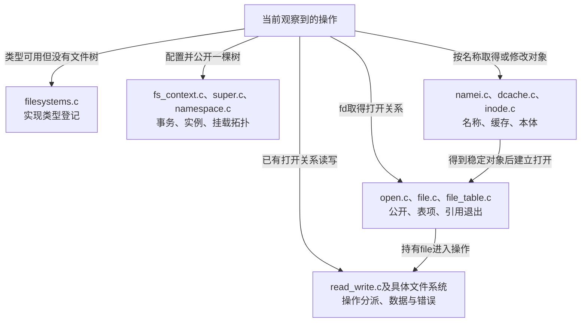

# 第1章\_Linux\_6.12\_VFS源码阅读索引

VFS知识正文先解释为什么名称、文件本体、打开关系和挂载视图必须分开。本索引负责把这些问题放回一个确定版本的源码树：先判断当前操作改动哪份状态，再选择文件和执行路径。仅搜索同名函数容易跳过调用条件，尤其不能把unlink、close和unmount当作同一个“删除对象”。

阅读阶段与目录职责见 [VFS源码阅读大纲](../大纲.md#1.1_从现象进入原件核对)。

## 1.1\_先固定源码身份与运行证据

| 项目 | 本索引使用的证据 |
| --- | --- |
| 官方来源 | [NXP linux-imx](https://github.com/nxp-imx/linux-imx) |
| 发布标签 | lf-6.12.20-2.0.0 |
| 不可变提交 | dfaf2136deb2af2e60b994421281ba42f1c087e0 |
| 内核版本 | Linux 6.12.20 |
| 当前核对方法 | 从已确认官方远端的Git对象库读取固定提交，比较保存原件 |
| 工作树差异 | 当前分支头在该提交后3个提交；不把分支头内容混入本索引 |
| 配置边界 | 工作树为ARM、Tiny RCU，启用ext4、tmpfs、procfs、inotify和命名空间；这是构建配置观察，不是运行证明 |
| 实验边界 | 用户态程序需要Linux及支持硬链接的文件系统，本次没有目标程序运行记录 |

完整身份、历史配置与取得边界见 [Linux源码基线](../../linux/SOURCE_BASELINE.md)。公共VFS对象主要来自架构无关代码，不能因此把某配置的RCU实现、文件系统特性或目标板结果外推到所有Linux系统。

## 1.2\_从状态变化选择阅读方向

第一轮不要同时展开全部目录。先读 [为什么需要VFS](../../../../knowledge/kernel_subsystems/vfs/P01_为什么需要_VFS.md#1.3_在一个完整程序中观察名字与打开关系) 的完整实验和 [抽象机制推演](../../../../knowledge/kernel_subsystems/vfs/P02_VFS抽象机制推演.md#2.1_一张操作表能先做出什么)，明确自己要解释的是哪个共享关系，再用下表定位声明和路径。后续章节按问题逐步细化实现，不能用本索引的一行文件名代替某条路径的完整学习。

[对象周期模块导读](P02_同一次打开怎样跨越对象状态.md#2.1_先确认观察的是哪一条状态轴) 将S0～S6落到公开、名称变化和最终归还，分别进入 [描述符与打开字段](../source_explanations/P01_描述符表与打开对象的状态归属.md#1.1_表项状态与打开状态的边界) 和 [路径名称与实例字段](../source_explanations/P02_路径名称与实例的字段关系.md#2.1_任务的查找上下文不是描述符表)。两份实现页保留声明及明确裁剪边界，导读不重复定义。

## 1.3\_对象声明与操作原件各自证明什么

| 状态问题 | 固定原件 | 首先检查的内容 |
| --- | --- | --- |
| 文件系统、本体与一次打开分别在哪里 | [include/linux/fs.h](../../linux/include/linux/fs.h) | file_system_type、super_block、inode、file的字段类型和关系；声明不证明更新顺序 |
| fd数字怎样找到打开对象 | [include/linux/fdtable.h](../../linux/include/linux/fdtable.h)、[fs/file.c](../../linux/fs/file.c) | files_struct、fdtable、分配发布与关闭，不把FD标志混成file状态标志 |
| 当前目录与根如何保存 | [include/linux/fs_struct.h](../../linux/include/linux/fs_struct.h) | root、pwd及对应锁和序列状态 |
| 挂载命名空间怎样从任务到达 | [include/linux/nsproxy.h](../../linux/include/linux/nsproxy.h) | 命名空间关联容器及mnt_ns；与fs_struct的root/pwd分开 |
| 路径为何有两部分 | [include/linux/path.h](../../linux/include/linux/path.h)、[include/linux/mount.h](../../linux/include/linux/mount.h) | path中的vfsmount与dentry，视图根和实例归属 |
| 名称缓存保存哪些关系 | [include/linux/dcache.h](../../linux/include/linux/dcache.h)、[fs/dcache.c](../../linux/fs/dcache.c) | 父对象、名称、inode关联、哈希与引用；不存在名称与已脱链名称不同 |
| 内部挂载拓扑在哪 | [fs/mount.h](../../linux/fs/mount.h)、[fs/namespace.c](../../linux/fs/namespace.c) | 内嵌vfsmount、父挂载、接入点和命名空间 |
| 实现类型与实例怎样分离 | [fs/filesystems.c](../../linux/fs/filesystems.c)、[fs/super.c](../../linux/fs/super.c) | 注册表、实例取得与释放；不是每次mount都新增superblock |
| 挂载参数和半成品在哪里 | [fs/fs_context.c](../../linux/fs/fs_context.c) | 配置事务、操作入口与清理 |
| 名称怎样进入打开或修改 | [fs/namei.c](../../linux/fs/namei.c)、[fs/open.c](../../linux/fs/open.c) | 起点、遍历、最后分量与打开检查，先找实际分支再追回调 |
| 打开对象怎样结束 | [fs/file_table.c](../../linux/fs/file_table.c) | file引用与最终释放工作，不等于所有close返回前完成全部回收 |
| 数据操作怎样派发 | [fs/read_write.c](../../linux/fs/read_write.c) | 文件模式、位置、操作表与返回，随后进入具体实现 |
| inode何时可回收 | [fs/inode.c](../../linux/fs/inode.c) | 引用、缓存和文件系统回收决定，不把i_nlink当内存引用计数 |

这些文件按上游位置保存，便于与固定提交对照。连续正文负责解释当前问题需要的语义；涉及具体函数体时，应在对应唯一实现页逐段展开，不在多个章节复制同一函数作为“证据数量”。

## 1.4\_官方概览与实际定义要怎样互相校验

本轮同时核对固定提交的 [VFS概览](../../linux/Documentation/filesystems/vfs.rst)、[路径查找说明](../../linux/Documentation/filesystems/path-lookup.rst) 和 [描述符管理说明](../../linux/Documentation/filesystems/files.rst)。概览适合建立术语，但其中历史表述或示意片段仍要与当前声明和调用路径比较。

例如概览用mount方法概括挂载，而本版本还包含fs_context初始化路径；具体文件系统究竟接入哪条路径，应检查该实现。描述符说明中的锁外读示例也不能直接变成驱动自己按下标解引用表项的许可：边界、RCU、引用取得和再验证必须结合真实辅助函数。阅读顺序应是“要证明的保证—当前状态—实际写读路径—说明文档对照”，不是从文档截一句话覆盖实现差异。

已有其他专题负责的实现保持单一展开。字符特殊文件接入链见 [字符设备打开路径](../../../../knowledge/driver_model/character_device/P03_打开路径与文件操作.md)；VFS这里只解释它从名称与打开关系接入的边界。文件操作接口的查询和驱动语义见 [file_operations专题](../../../../knowledge/driver_model/file_operations/大纲.md)，不把驱动侧与VFS整体状态模型混成同一份教程。

## 1.5\_观察能证明什么还要回到实验条件

看到两个fd读到相同内容，只能证明这次数据相同；观察dup后位置共同推进，才支持共享打开关系的判断。unlink后还能读取，证明旧打开不依赖名称重新查找，不证明缓存全部命中或数据已经持久化。源码里存在某文件系统入口，也不证明目标构建启用了它。

记录实验时保留内核版本、文件系统类型、操作顺序、返回值及错误。后续调试章节再把这些现象对应到trace和状态位置；本索引不把静态源码核对写成目标内核验证通过。
