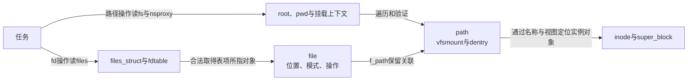
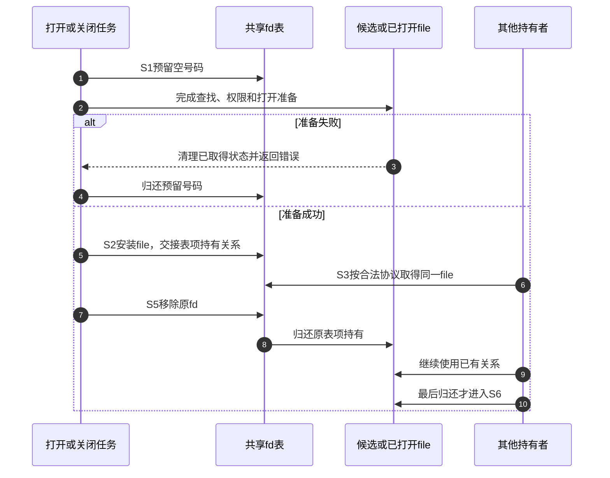

# 第2章\_同一次打开怎样跨越对象状态

[对象拓扑正文](../../../../knowledge/kernel_subsystems/vfs/P03_VFS_状态与对象拓扑.md) 把第一章的名称与打开实验映射到S0～S6。本页面向源码阅读：在固定Linux 6.12.20中找到各阶段真正访问的字段，区分观察对象、发布入口与最终归还。版本、配置和原件地图统一见 [VFS总索引](P01_Linux_6.12_VFS源码阅读索引.md#1.1_先固定源码身份与运行证据)。

## 2.1\_先确认观察的是哪一条状态轴

从read现象开始时，沿任务的files查表，取得file后才进入操作；从open或unlink开始时，先要解释名称查找上下文。两者最终可能访问同一个inode，但过程中持有的状态和需要验证的条件不同。

对象关系的唯一声明说明分为两组：[表项与打开对象](../source_explanations/P01_描述符表与打开对象的状态归属.md#1.1_表项状态与打开状态的边界) 解释为什么dup共享位置而FD标志仍可分开；[路径与实例字段](../source_explanations/P02_路径名称与实例的字段关系.md#2.1_任务的查找上下文不是描述符表) 解释root/pwd、名称和挂载为何不能只保存一个字符串。

## 2.2\_按S0到S6记录谁改变哪个对象

这个周期针对正文的普通文件场景，不包含所有特殊打开或文件系统扩展分支。挂载实例已经可用是S0的前提，不把一次普通open描述成重新创建superblock。

| 阶段 | 当前版本应查看的状态 | 从哪一份声明进入 | 下一步需要确认的事实 |
| --- | --- | --- | --- |
| S0查找上下文 | task.fs、task.files、task.nsproxy | [任务上下文](../source_explanations/P02_路径名称与实例的字段关系.md#2.1_任务的查找上下文不是描述符表) | 起点来自root、pwd还是目录fd，是否共享相关容器 |
| S1未公开准备 | open_fds中的号码预留、候选file、查找path | [位图和指针分工](../source_explanations/P01_描述符表与打开对象的状态归属.md#1.2_fdtable把指针数组与分配状态放在一起) | 失败清理归还什么，是否已经到发布点 |
| S2公开 | fd数组表项装入完整file | [files_struct布局](../source_explanations/P01_描述符表与打开对象的状态归属.md#1.3_files_struct同时承载共享与扩容协调) | 表扩容与并发安装如何协调，引用是否已转交 |
| S3使用与复制 | file.f_count、f_pos、f_flags及新fd表项 | [一次打开字段](../source_explanations/P01_描述符表与打开对象的状态归属.md#1.4_struct_file保存一次打开的共享状态) | 是共享打开、独立打开还是共享整张表 |
| S4删名 | 目录后端、dentry关联/哈希、inode链接数 | [名称缓存字段](../source_explanations/P02_路径名称与实例的字段关系.md#2.3_dentry的名称关联和存续分开维护) | 新查找入口变化与旧引用存续是否分别成立 |
| S5移除fd | 对应表项移除及号码归还 | [描述符与打开边界](../source_explanations/P01_描述符表与打开对象的状态归属.md#1.1_表项状态与打开状态的边界) | 其他表项、映射或在途使用是否仍持有file |
| S6最终归还 | file最后引用、path、inode和实例各层协议 | [inode与实例](../source_explanations/P02_路径名称与实例的字段关系.md#2.4_inode与superblock承载不同共享范围) | 此次调用仅归还引用还是已经执行最终清理 |

这里的通信大多是受协议约束的共享状态访问和直接调用，不是每个对象都有一个独立线程向下发送消息。fd发布让后续访问者能从表中取得file；归还引用让最后使用者分支知道是否可以开始清理；缓存和后端再按自己的条件推进。不能从框图中的方框数推断工作线程数。

## 2.3\_把失败与其他持有者放回同一条时间线

“其他持有者”可能来自dup后的表项，也可能是已经取得引用的内核使用路径。原fd数字一旦可复用，新请求按同一个数字查表就可能取得另一个file；已经合法取得的旧引用则不会因为数字复用自动改指新对象。

当前close系统调用有同步最终清理分支，但前提仍是最后引用。准确实现回指 [close同步清理](../../character_device/source_explanations/fs/open.c.md#1.2_close系统调用的同步清理)；通用fput的不同上下文不能直接套成所有close的时序。具体打开和描述符分派在对应章节继续深入，这张图只规定需要检查的交接点。

## 2.4\_从错误现象选择要修改的层

两个独立open互相推进位置，先查是否意外共享了file或业务私有游标；一个fd关闭让另一个dup失效，先查是否把每次关闭误当最后释放。名称删除后访问失效内存，查旧打开持有和对象退出；名称重建后旧fd仍读旧内容，则先判断它是否正是允许的旧打开语义。

调整挂载视图要同时看path中的mnt与dentry；修改名称缓存不能仅检查inode是否存在；更改描述符表不能用用户态的普通数组替换方法绕过RCU、锁和发布协议。修改前先明确涉及哪个状态轴，修改后分别覆盖未公开失败、并发取得、入口撤销和最后归还。当前字段核对不是目标并发压力测试结果。
