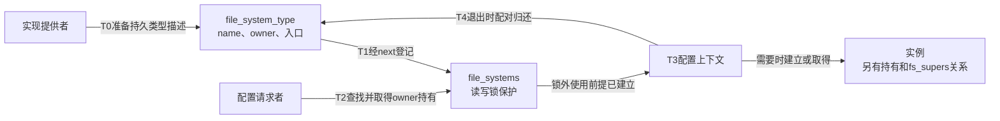
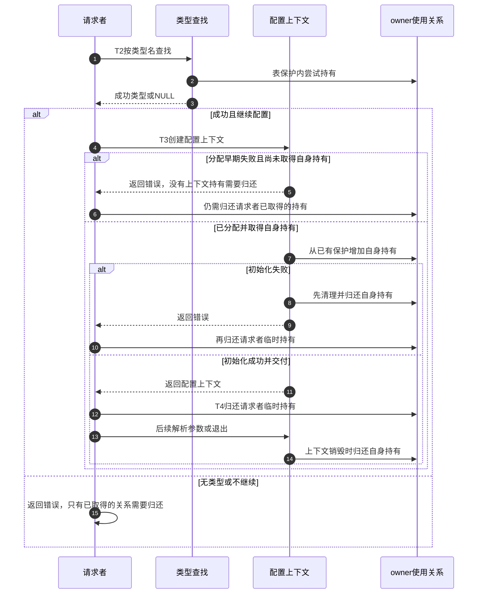

# 第3章\_类型描述怎样交给配置请求

[类型注册正文](../../../../knowledge/kernel_subsystems/vfs/P04_文件系统类型注册.md) 把登记、持有和实例区分开。本导读沿T0～T5定位固定Linux 6.12.20中的共享状态，帮助读者判断“能按名字找到”与“离开登记锁后仍能使用代码”分别由谁保证。版本身份统一见 [VFS总索引](P01_Linux_6.12_VFS源码阅读索引.md)。

## 3.1\_先分开类型表与实例集合

file_systems按类型的next组织当前登记入口；file_system_type.fs_supers关联同一类型的实例。前者由本章的读写锁管理，后者属于superblock流程。看到类型名就去扫描所有实例，会把发现实现和运行实例这两层混在一起。

图中类型表不是消息队列，也不为每种实现启动工作线程。实现初始化直接调用登记函数修改共享链表，请求路径直接查找它；模块按需装入则是锁外的另一条执行路径。

## 3.2\_按阶段进入唯一实现

| 阶段 | 当前要证明什么 | 阅读入口 |
| --- | --- | --- |
| T0描述准备 | 名字与对象存续，参数描述不是用户值 | [登记前提与比较](../source_explanations/P03_文件系统类型表的发布与持有.md#3.1_类型表在锁内怎样找到插入位置) |
| T1链表发布 | 同名拒绝与写锁内连接 | [发布步骤](../source_explanations/P03_文件系统类型表的发布与持有.md#3.1_类型表在锁内怎样找到插入位置) |
| T1可选描述检查 | 检查受配置约束，未验证全部实现 | [参数描述检查](../source_explanations/P03_文件系统类型表的发布与持有.md#3.2_参数描述检查受配置与形式约束) |
| T2首次发现 | 表稳定时取得模块持有，失败可以请求装入 | [锁内观察到锁外使用](../source_explanations/P03_文件系统类型表的发布与持有.md#3.3_查找如何从锁内观察转为锁外使用) |
| T3/T4交接 | 已有保护下增加持有，使用结束配对归还 | [已有使用关系](../source_explanations/P03_文件系统类型表的发布与持有.md#3.4_已有使用关系怎样传递和归还) |
| T5撤销 | 摘链与宽限期不代替所有实例退出 | [注销和查询边界](../source_explanations/P03_文件系统类型表的发布与持有.md#3.5_摘链与查询分别能证明什么) |

request_module可能等待，因此不在file_systems_lock内调用。装入返回0也只允许再次查表，不能直接把模块对象当成已经登记的文件系统类型。子类型能力不匹配时，还要归还第一次取得的持有关系。

## 3.3\_在调用者和消费者之间核对配对

fs_context分配路径从调用者已持有的类型建立自己的fs_type关系，失败和正常销毁都要归还；实例建立还有自己的类型使用期。这里只标明交接责任，不把配置上下文和实例的引用合并成“反正模块还在”。

同一阶段可能存在多份不同所有者的持有。put_filesystem不注销类型，unregister_filesystem也不凭空替这些所有者执行put。后续查看fs_context时，应沿同一组取得和退出位置核对，而不是只数源码里出现多少个get和put名字。

## 3.4\_失败现象应回到哪个分支

类型未出现在/proc/filesystems，先区分未构建、未装入、初始化失败和未登记；出现类型但挂载失败，则继续参数、后端和建树阶段。自动装入返回成功却查不到，应核对别名与实现是否确实注册所请求的名字。注销后仍有实例或代码不能卸载，首先查看合法使用关系，不能把宽限期当成强制回收开关。

本次核对是固定源码与配置分支阅读，没有运行目标模块装卸或故障注入。修改时应覆盖同名拒绝、子类型拒绝的引用归还、装入后重查和未登记对象注销；检查结果应明确区分表内可见性、模块使用期与实例生命周期。
