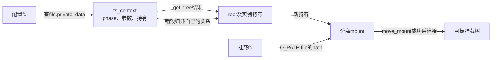
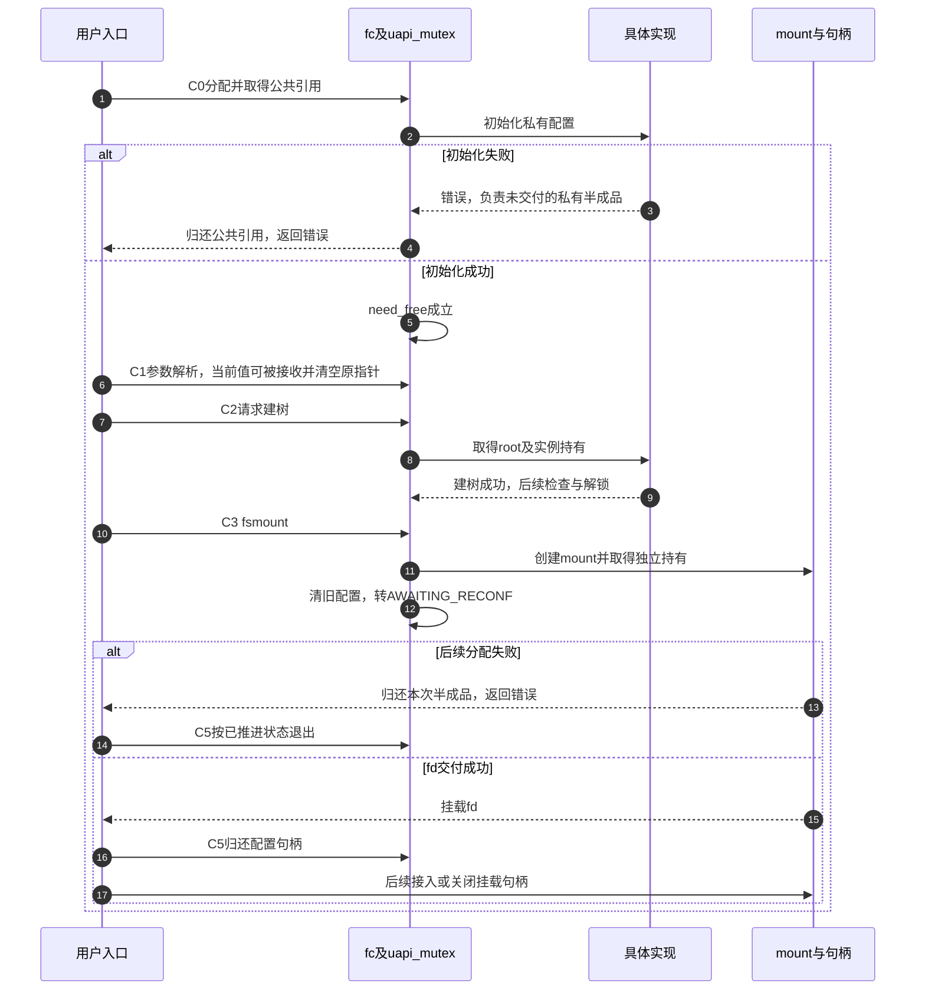

# 第4章\_配置状态怎样变成可挂载的根

[配置事务正文](../../../../knowledge/kernel_subsystems/vfs/P05_fs_context挂载事务.md) 已区分配置句柄、实例根与分离挂载。本导读沿C0～C5进入固定Linux 6.12.20，重点追踪所有权和阶段，不把几个系统调用的名字排列当作完整流程。版本及配置边界从 [VFS总索引](P01_Linux_6.12_VFS源码阅读索引.md#1.1_先固定源码身份与运行证据) 核对。

## 4.1\_先确认四个不同的交付物

C0的fsopen交出配置fd，经匿名file.private_data找到fs_context；C2的CREATE交付可挂载的根到fc.root；C3的fsmount交出持有分离挂载的fd；C4的move_mount才在目标目录视图中建立连接。四者分别改变不同对象，失败与退出不能统一解释成“mount失败”。

分离挂载在该实现内部关联匿名mount namespace，但尚未接到请求者选择的目标目录树。不要把“没有公开目标路径”误写成“内核没有namespace对象”。本章只确定这个交接边界，挂载拓扑的锁和传播在后续模块核对。

## 4.2\_先读配置持有再读用户阶段

| 阅读问题 | 唯一实现入口 | 对应阶段 |
| --- | --- | --- |
| 背景与操作如何存放 | [上下文与参数声明](../source_explanations/P04_配置上下文的资源取得与释放.md#4.1_字段怎样区分配置和已取得的根) | C0 |
| 初始化失败会不会调用私有free | [分配及初始化](../source_explanations/P04_配置上下文的资源取得与释放.md#4.2_先取得公共引用再初始化私有状态) | C0失败 |
| 参数何时转移内存所有权 | [参数分派与source接收](../source_explanations/P04_配置上下文的资源取得与释放.md#4.3_解析链怎样交出参数值) | C1 |
| 普通释放与持锁退出为何不同 | [资源归还](../source_explanations/P04_配置上下文的资源取得与释放.md#4.4_归还根与私有资源有不同前提) | C5 |
| phase由谁检查及推进 | [命令分派与建树](../source_explanations/P05_建树与分离挂载的阶段交接.md#5.1_命令检查先于状态推进) | C1～C2 |
| root怎样兑现及需要什么锁状态 | [建树入口](../source_explanations/P05_建树与分离挂载的阶段交接.md#5.2_取得根还没有接到目录树) | C2 |
| 挂载对象怎样独立持有 | [创建挂载](../source_explanations/P05_建树与分离挂载的阶段交接.md#5.3_新挂载取得自己的实例持有) | C3 |
| 成功清理后为何仍可能返回失败 | [fsmount交付](../source_explanations/P05_建树与分离挂载的阶段交接.md#5.4_清理旧配置与交出fd分属两个时点) | C3晚期失败 |
| 下一次操作为何可能初始化重配置 | [分阶段重置](../source_explanations/P05_建树与分离挂载的阶段交接.md#5.5_重配置初始化为何延后) | C3以后 |

fsopen、fsconfig外层从用户取得参数、检查文件类型并加uapi_mutex；核心命令体依赖这份序列化。旧do_new_mount直接组织配置与建树，设置oldapi并解析历史整块参数，不经过同一套用户phase命令序列。源码中共有fs_context不能用来证明所有入口拥有完全相同的约束。

## 4.3\_失败要按已经取得的资源反向追踪

该图突出C0和C3的失败，C2失败的锁与root清理由实现页另外展开。一次失败后的剩余状态由实际路径决定；不要因为表面上没有返回fd，就假定之前配置完全不变。反过来，普通参数解析错误没有自动把phase改成FAILED，调用者也不能因此假定此前成功参数被清空。

## 4.4\_修改时按契约检查而不是只统计get和put

首先确认参数接收方是否清空被转移的值指针，以及失败前是否已修改私有配置。其次确认init_fs_context成功前的半成品由谁收拾，不能依赖尚未建立的need_free。再检查建树返回的root与实例active关系、s_umount锁状态，以及挂载对象是否已另取持有。最后检查旧配置清理之后的错误点，恢复动作不能沿用旧phase假设。

正文的小程序只观察未知参数拒绝后继续配置、建树后的EBUSY和关闭配置fd后挂载仍可查询，未测试接入目标树或所有低内存错误分支。本次没有目标Linux编译与运行记录。原件mount_api.rst用于理解设计，部分字段片段与本提交实际头文件不同，例如旧参数描述类型与subtype成员；精确声明和阶段以当前头文件及执行路径为准，不将历史示意原样编译。
