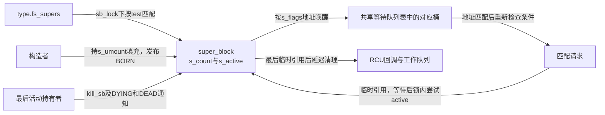
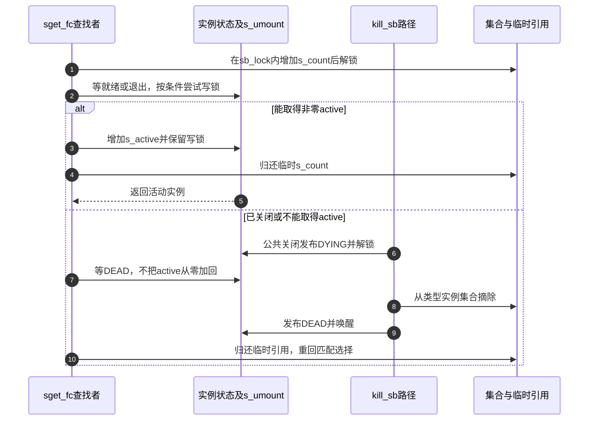

# 第5章\_实例怎样在构造与关闭之间交接

[实例生命周期正文](../../../../knowledge/kernel_subsystems/vfs/P06_superblock实例状态与生命周期.md) 已用两个请求解释未就绪发布与等待。本导读把B0～B5落到固定Linux 6.12.20的sget_fc、实例锁、两种引用与关闭通知。版本边界见 [VFS总索引](P01_Linux_6.12_VFS源码阅读索引.md#1.1_先固定源码身份与运行证据)。

## 5.1\_把阶段落到两种引用和三个标志

B0准备候选，B1把未就绪身份放入集合，B2完成建树交接，B3保持活动使用，B4最后活动引用驱动关闭，B5临时观察结束后释放内存。s_count保护临时观察的对象存续，s_active参与运行实例的关闭决定，BORN/DYING/DEAD传递进展；它们不能合并成一个“实例是否存在”的布尔量。

fs_supers发现者可以遇到构造中或关闭中的对象；全局super_blocks还承担其他遍历。两套集合的摘除时间也不同，不能看到一处list_del就推断所有发现路径同时结束。

## 5.2\_先核对身份再跟等待交接

| 阶段和问题 | 唯一实现位置 |
| --- | --- |
| B0候选为什么持写锁且两计数初值为1 | [候选初始化](../source_explanations/P06_实例匹配与构造完成的交接.md#6.1_候选先建立锁和基础持有) |
| B1锁外分配后为何重查，私有数据何时转移 | [实例匹配与发布](../source_explanations/P06_实例匹配与构造完成的交接.md#6.2_发布前重查避免重复候选) |
| 哪些辅助路径会新建或共享 | [选择策略与填充](../source_explanations/P06_实例匹配与构造完成的交接.md#6.3_匹配规则与根填充各有职责) |
| B2就绪信息如何发布，等待者如何加锁复查 | [状态通信](../source_explanations/P06_实例匹配与构造完成的交接.md#6.4_等待条件与实例锁完成两次确认) |
| B3临时引用如何变成活动持有 | [引用交接](../source_explanations/P06_实例匹配与构造完成的交接.md#6.5_取得活动引用失败就等待旧实例退出) |
| B4最后active归还会触发什么 | [活动退出](../source_explanations/P07_实例关闭通知与最终内存回收.md#7.1_最后活动引用把流程交给关闭回调) |
| 为什么DYING和DEAD不是同一个时点 | [关闭与通知](../source_explanations/P07_实例关闭通知与最终内存回收.md#7.2_先结束公共使用再通知旧实例已退出) |
| B5s_count归零后如何回收，未公开候选有何不同 | [内存释放](../source_explanations/P07_实例关闭通知与最终内存回收.md#7.3_最后临时引用与实际释放仍然分开) |

本轮不重复上一模块的vfs_get_tree与vfs_create_mount函数体：前者发布建树完成信息并继续安全检查，后者另取实例及根持有，见 [建树交接](../source_explanations/P05_建树与分离挂载的阶段交接.md#5.2_取得根还没有接到目录树) 与 [挂载持有](../source_explanations/P05_建树与分离挂载的阶段交接.md#5.3_新挂载取得自己的实例持有)。

## 5.3\_等待退出是为了重新选择而非复活旧实例

图中DYING可能在查找者开始观察之前已经发布，也可能由竞争关闭路径随后发布；它表示必要的先后条件，不限定两任务唯一交错。临时引用保护这段等待中的内存，DEAD保证查找者可以放弃旧实例并重新选择。最终内存释放还取决于其他临时引用，而不是等待者看到DEAD就直接kfree。

## 5.4\_证据和修改范围要保持分层

实际等待队列按s_flags地址映射到共享桶，等待项保存地址键并在唤醒时核对。相关原件为include/linux/wait_bit.h与kernel/sched/wait_bit.c；这里核对接口承载和配对屏障，不复制整个调度器或等待队列通用教程。s_umount的读写锁是另一层串行化，不能拿唤醒代替锁后的状态复查。

更改匹配规则时检查用户命名空间、exclusive及私有数据转移；更改发布时点时检查等待者可见性和后续安全拒绝；更改关闭时检查DYING、类型集合摘除、DEAD以及临时引用的顺序。固定源码说明这些路径如何组织，本次未运行并发挂载、卸载或故障注入，不以图示交错充当实际调度日志。
