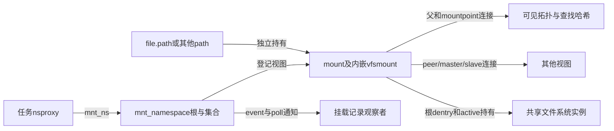
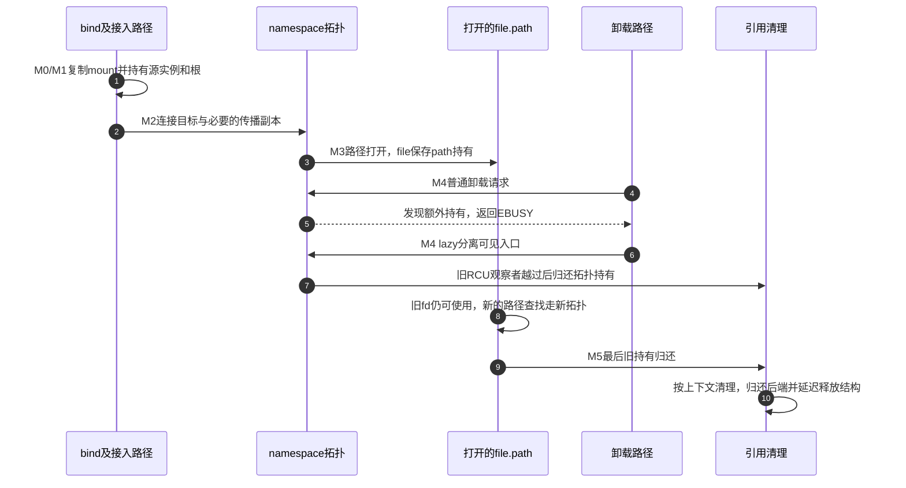

# 第6章\_挂载视图怎样接入传播与退出

[挂载与命名空间正文](../../../../knowledge/kernel_subsystems/vfs/P07_mount与mount_namespace.md) 已说明同一实例可有多个入口、复制拓扑不复制数据，以及 lazy 分离后旧 fd 仍能持有视图。本导读将这些结论落到固定 NXP Linux 6.12.20 的对象、连接、引用与执行路径。源码身份见 [总索引](P01_Linux_6.12_VFS源码阅读索引.md#1.1_先固定源码身份与运行证据)。

## 6.1\_先区分视图对象和传播连接

一次周期分为 M0 取得源或候选、M1 准备复制及传播、M2 接入目标、M3 使用视图、M4 退出拓扑、M5 归还最后持有。它由多组状态组成：namespace 成员资格、父子连接、传播关系、引用计数和后端实例存续各有更新点，不能用一个 mounted 布尔值代替。

namespace_sem 串行化相应拓扑写流程，mount_lock 相关保护覆盖连接和哈希变化；引用保护对象存续，RCU/序列验证保护相应读路径。复制会分配，最后清理也可能睡眠，不能把整个周期都包进一把自旋锁。

## 6.2\_沿同一周期选择实现入口

| 阶段与阅读问题 | 唯一实现说明 |
| --- | --- |
| M0 命名空间保存哪些状态 | [集合与任务起点](../source_explanations/P08_挂载视图复制与目录接入.md#8.1_先区分命名空间集合与任务的起点) |
| M0/M1 新 mount 如何持有旧实例和子树根 | [视图复制](../source_explanations/P08_挂载视图复制与目录接入.md#8.2_复制视图时取得共享后端的持有) |
| M1 新 namespace 怎样调整 root/pwd | [命名空间复制](../source_explanations/P08_挂载视图复制与目录接入.md#8.3_复制命名空间时重新连接任务的路径) |
| M1 bind 为何还需源与目标检查 | [绑定请求](../source_explanations/P08_挂载视图复制与目录接入.md#8.4_绑定请求先验证源与目标再接入) |
| M2 哪些连接与集合一起改变 | [拓扑提交](../source_explanations/P08_挂载视图复制与目录接入.md#8.5_提交同时更新父连接查找入口和集合) |
| M1/M2 shared 父视图如何准备并提交副本 | [传播准备](../source_explanations/P09_传播关系与挂载记录.md#9.1_先准备传播副本再提交拓扑) 与 [关系遍历](../source_explanations/P09_传播关系与挂载记录.md#9.2_传播沿对象连接行进而不是向进程发命令) |
| 改 private/slave 时原连接怎么办 | [传播类型变化](../source_explanations/P09_传播关系与挂载记录.md#9.3_改变传播类型必须重组已有关系) |
| M3 记录观察者怎样收到变化并读字段 | [事件与等待](../source_explanations/P09_传播关系与挂载记录.md#9.4_记录变化通过事件值与等待队列交接) 和 [mountinfo 输出](../source_explanations/P09_传播关系与挂载记录.md#9.5_mountinfo把两个坐标和两层选项分别输出) |
| M4 普通拒绝与 lazy 有何差别 | [卸载入口](../source_explanations/P10_挂载脱离与最后引用退出.md#10.1_普通卸载先判断是否允许结束可见使用) |
| M4 脱离后为何不能立刻归还拓扑持有 | [退出连接](../source_explanations/P10_挂载脱离与最后引用退出.md#10.2_脱离拓扑时分别撤销发现入口与传播关系) 和 [RCU 交接](../source_explanations/P10_挂载脱离与最后引用退出.md#10.3_退出拓扑的那份持有要等旧观察者安全越过) |
| M5 最后归还何时真正释放 mount | [最后引用](../source_explanations/P10_挂载脱离与最后引用退出.md#10.4_最后计数归还才选择真正的清理路径) 和 [根及实例归还](../source_explanations/P10_挂载脱离与最后引用退出.md#10.5_归还根与实例之后还有结构体释放阶段) |

新实例怎样形成可用根仍由上一模块负责；vfs_create_mount 的唯一实现见 [分离挂载持有](../source_explanations/P05_建树与分离挂载的阶段交接.md#5.3_新挂载取得自己的实例持有)。此处从已有根或源 path 接续，不重复建树与实例关闭的完整教程。

## 6.3\_用旧文件与新查找检查退出顺序

这是一种选定交错：若还有其他 path 持有，图中的文件关闭就不是最后一份；若没有旧持有，拓扑引用归还就可能推动清理。lazy 后新路径也可能到达下层原文件，而不一定 ENOENT。正文实验用空的下层目录，才得到特定的 ENOENT 预期。

## 6.4\_把静态证据与目标实验分开

fs/mount.h 定义状态位置，fs/namespace.c 处理复制、接入与退出，fs/pnode.c 处理传播，fs/proc_namespace.c 输出记录与观察协议。附带 sharedsubtree.rst 和 proc.rst 用于核对用户可见含义；历史文档中的默认环境描述不能替代实际系统的传播配置。

正文的完整 C 程序先 unshare 再递归 private，随后建立 tmpfs 和 bind，只操作自身创建的资源。当前没有目标 Linux 编译、运行或跨 namespace 传播压力记录。源码可以证明分支与所有权协议，不能证明某台机器已经具备权限、配置及预期运行结果。
