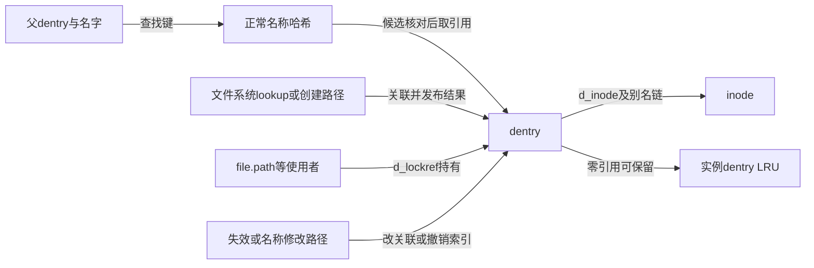
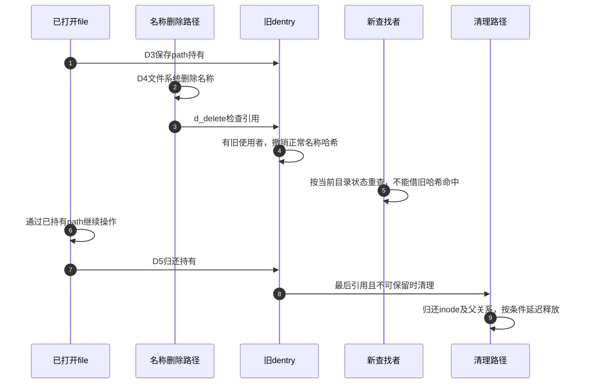

# 第7章\_名称结果怎样发布失效与回收

[名称缓存正文](../../../../knowledge/kernel_subsystems/vfs/P08_dcache与名称状态.md) 已解释负结果的价值，以及名字删除后旧对象为什么仍能被持有。本导读把 D0～D5 对应到固定 NXP Linux 6.12.20 的分配、发布、查找、撤销索引和引用归还。版本边界见 [总索引](P01_Linux_6.12_VFS源码阅读索引.md#1.1_先固定源码身份与运行证据)。

## 7.1\_把名称结果拆成几组可独立变化的状态

D0 是候选分配，D1 是后端结果建立，D2 是发布，D3 是验证和取得持有，D4 是名称变化或失效，D5 是引用归还与回收。d_inode/类型、d_hash、查询进行状态、d_lockref 和 LRU 分别描述关联、可发现性、进度、使用及保留，不能压成“存在/不存在”一个变量。

名字与父变化需要同步，持有只固定对象存续；已经返回的 dentry 不是名称字符串的不可变快照。单纯看到 inode 为空也不能区分未完成候选与已完成负结果。

## 7.2\_按阶段连接唯一实现

| 阶段和问题 | 唯一实现位置 |
| --- | --- |
| D0 候选如何拥有名字与初始引用 | [内存身份](../source_explanations/P11_名称候选的建立发布与持有.md#11.1_分配候选只建立内存身份) |
| D0 父子连接为何不等于正常索引发布 | [父持有](../source_explanations/P11_名称候选的建立发布与持有.md#11.2_父子连接与正常名称索引分开建立) |
| D1/D2 关联inode与发布哈希有何区别 | [关联](../source_explanations/P11_名称候选的建立发布与持有.md#11.3_建立inode关联不能代替发布名称索引) 和 [发布](../source_explanations/P11_名称候选的建立发布与持有.md#11.4_发布结果时结束并行查询再供后续查找) |
| D3 谁核对父和名字，何时增加引用 | [持引用查找](../source_explanations/P11_名称候选的建立发布与持有.md#11.5_查找候选时在锁内核对身份并取得持有) |
| D4 为什么摘哈希不会清除旧inode关联 | [撤销索引](../source_explanations/P12_名称失效与最后使用者退出.md#12.1_撤销正常名称索引不会自动释放对象) |
| D4 删除何时能把对象变为负结果 | [删除后的两条路径](../source_explanations/P12_名称失效与最后使用者退出.md#12.2_删除后的缓存结果取决于是否还有其他持有) |
| D5 为什么零引用仍可留在缓存 | [保留条件](../source_explanations/P12_名称失效与最后使用者退出.md#12.3_零引用保留必须同时满足缓存条件) |
| D5 谁处理最后归还与重新取得引用的交错 | [快速归还](../source_explanations/P12_名称失效与最后使用者退出.md#12.4_快速归还遇到不确定性时持锁重查) 和 [销毁前重查](../source_explanations/P12_名称失效与最后使用者退出.md#12.5_进入销毁前仍要按锁序验证inode与计数) |
| D5 哈希、inode、父和内存分别何时退出 | [资源归还](../source_explanations/P12_名称失效与最后使用者退出.md#12.6_销毁同时归还别名父关系和最终内存) |

dentry 字段的唯一结构讲解仍在 [名称字段关系](../source_explanations/P02_路径名称与实例的字段关系.md#2.3_dentry的名称关联和存续分开维护)。本模块增加操作过程，不复制同版本字段声明。

## 7.3\_把旧引用与新查找放在同一时间线上

图中不把新查找画成必定立即得到 ENOENT：若另一个执行者已重建同名文件，新查找可能返回新对象。要证明具体返回值，还要限定外部修改条件。旧 file 的 inode 身份与之后同名新文件的身份也不能按字符串合并。

## 7.4\_把缓存观察与路径模式的证明分开

fs/dcache.c 证明对象和索引的维护；include/linux/dcache.h 证明结构、类型判定及操作声明；fs/namei.c 证明路径层怎样处理命中、revalidate、慢查找和结果。d_lookup 内部使用 RCU，并不表示整次路径解析采用无逐项引用的 RCU-walk。

正文复用完整名称实验观察外部语义，但用户态 ENOENT 或旧 fd 成功读取不足以证明缓存命中次数和回收时间。本次仅核对固定源码与文档，未取得目标追踪或压力结果。下一模块继续 root/cwd/dirfd 到单分量查找、挂载和符号链接的整条路径。
