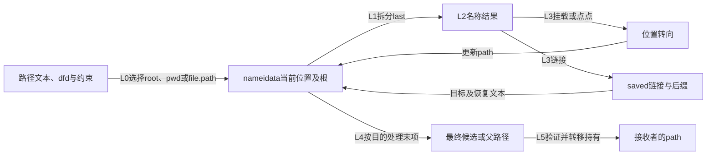
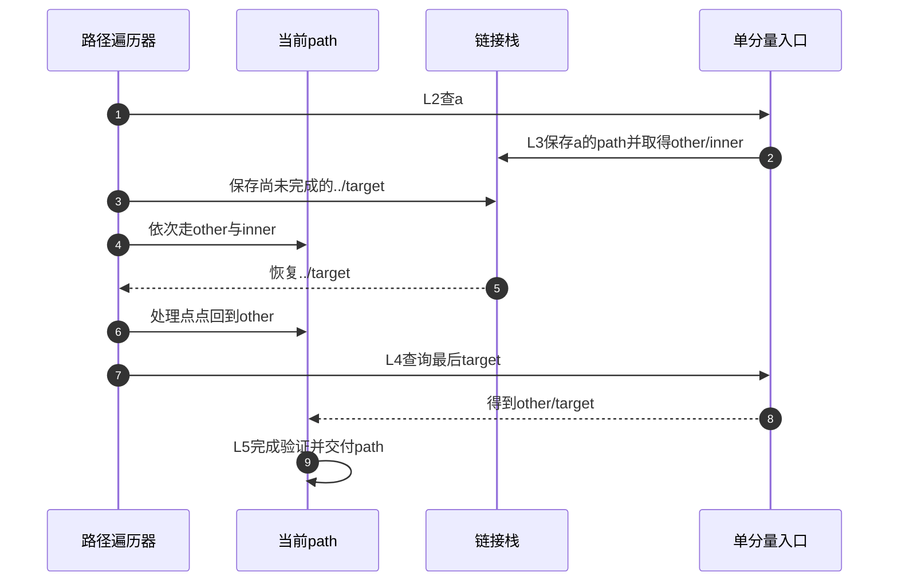

# 第8章\_路径怎样从起点推进到结果交付

[路径查找正文](../../../../knowledge/kernel_subsystems/vfs/P09_路径查找状态机.md) 用 a/../target 展示了字符串化简与真实遍历的差异。本导读把一次普通路径查询对应到固定 NXP Linux 6.12.20 的 nameidata、分量推进、链接栈和结果转移。版本与原件见 [总索引](P01_Linux_6.12_VFS源码阅读索引.md#1.1_先固定源码身份与运行证据)。

## 8.1\_把位置文本与约束放进同一周期

L0 建立起点，L1 拆分前导，L2 查询名字，L3 处理转向，L4 处理最后分量，L5 验证交付并清理。位置可以改变，剩余文本可以因链接压入和恢复，约束则必须在每个相关变化点继续兑现。nameidata 保存本次操作状态，dcache 和 mount 树保存可共享对象关系。

这不是一条所有操作都照抄的函数链。普通完整查询、父路径查询和 open 的末项处理不同；本模块建立共有语义与普通查询链，打开的完整操作状态留在打开章节。

## 8.2\_沿阶段查找实现与后续边界

| 阶段及问题 | 唯一实现位置 |
| --- | --- |
| L0 本次状态如何保存并嵌套 | [nameidata及任务上下文](../source_explanations/P13_路径起点与结果持有的交接.md#13.1_本次遍历状态与任务中的嵌套上下文) |
| L0 怎样选择根、cwd、dirfd及scoped根 | [起点建立](../source_explanations/P13_路径起点与结果持有的交接.md#13.2_建立起点时同时确立观察或持有协议) |
| L1 为何留住最后名称而不直接处理 | [前导拆分](../source_explanations/P14_前导分量与单步位置推进.md#14.1_拆分时保留最后名字而不是提前执行末项操作) |
| L2 普通名字与点分量在哪里分流 | [单步入口](../source_explanations/P14_前导分量与单步位置推进.md#14.2_普通名字查询和点分量走不同的单步入口) |
| L3 为何先处理挂载再判断链接 | [进入候选](../source_explanations/P14_前导分量与单步位置推进.md#14.3_进入候选前先处理挂载再决定是否跟随链接) |
| L3 点点如何跨挂载并检查边界 | [向上路径](../source_explanations/P14_前导分量与单步位置推进.md#14.4_向上走需要同时考虑根边界与挂载根) 与 [并发边界](../source_explanations/P14_前导分量与单步位置推进.md#14.5_受限点点查找还要检测并发拓扑改变) |
| L3 链接预算和当前栈深度有何差别 | [链接栈空间](../source_explanations/P15_符号链接的文本栈与路径跳转.md#15.1_跟随预算与保存后缀需要两种状态) |
| L3 文本与直接路径怎样分别交付 | [链接目标](../source_explanations/P15_符号链接的文本栈与路径跳转.md#15.2_取得目标时把链接本身和清理动作保留下来) 与 [跳转](../source_explanations/P15_符号链接的文本栈与路径跳转.md#15.3_根跳转与直接路径跳转不是同一种输入) |
| L4 全路径与父路径在哪里分开 | [末项交接](../source_explanations/P13_路径起点与结果持有的交接.md#13.4_普通全路径与父路径在最后分量处分流) |
| L5 什么检查决定能否交付 | [结束验证](../source_explanations/P13_路径起点与结果持有的交接.md#13.3_结束验证把快速观察变成可交付结果) |
| L5 重试前有哪些清理 | [入口重试](../source_explanations/P13_路径起点与结果持有的交接.md#13.5_重试必须在前一次资源清理之后进行)、[退出配对](../source_explanations/P13_路径起点与结果持有的交接.md#13.6_退出要分别处理链接资源路径引用和任务上下文) 与 [链接清理](../source_explanations/P15_符号链接的文本栈与路径跳转.md#15.4_完成或失败都要归还链接资源) |

lookup_fast、lookup_slow、并行未命中的登记等待，以及 try_to_unlazy 的模式转换将在 RCU-walk/ref-walk 模块继续。这里先解释每个接口要交付的状态，不复制上一模块的 d_lookup/d_add 实现，也不把模式细节与链接语义混在一页中。

## 8.3\_跟随一个相对链接后恢复原后缀

图中路径布局来自正文实验，假设没有并发重建；它不是本次机器的运行追踪。相对链接的基点是链接所在目录，原后缀需要保存，所以不能在查找前先消除 a/..。

## 8.4\_证明范围从路径语义逐步扩展

fs/namei.c 证明遍历状态、交接和退出，namei.h 定义内部标志及链接预算，openat2.h 定义公开限制，fs/open.c 负责把公开请求映射到内部查找标志。两套位值必须分开；普通openat不能因为带dirfd就被当作受限解析。

完整C程序在独立临时目录建立相对链接和两份目标文件，按创建状态配对清理。没有目标Linux编译运行、并发rename、链接循环或分配失败注入记录。源码核对支持步骤和边界，实验预期只支持给定布局下两条路径的语义差异。
