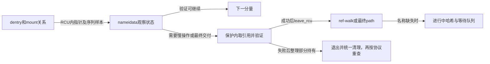
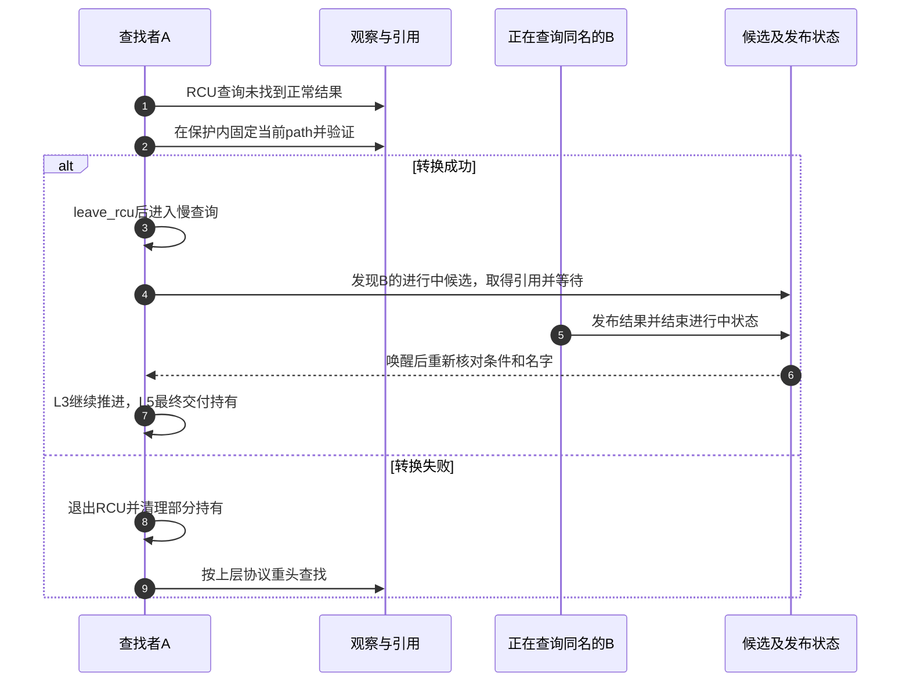

# 第9章\_快速观察怎样转为引用并协调慢查询

[两种遍历模式正文](../../../../knowledge/kernel_subsystems/vfs/P10_RCU-walk与ref-walk.md) 已从共享引用写入解释快速观察的动机，并将模式交接与并行未命中放回L0～L5路径周期。本导读对照固定NXP Linux 6.12.20；版本及配置边界见 [总索引](P01_Linux_6.12_VFS源码阅读索引.md#1.1_先固定源码身份与运行证据)。

## 9.1\_把观察凭据与持有交接分开

RCU内拿到指针、序列验证成立、成功取得引用、退出RCU以及交付结果，是相关但不同的事件。正常读侧先观察，中途需要慢操作或最终需要交付时，在保护内尝试持有并验证；失败的部分持有只供清理，不能继续当成完整path。

ref-walk也能命中缓存；RCU-walk成功后仍要为结果取得持有。模式名称既不是I/O是否发生的证据，也不是整个路径是否并发安全的独立证明。

## 9.2\_用实现入口区分读取转换与等待

| 问题 | 唯一实现入口 |
| --- | --- |
| L2无引用候选怎样返回序列 | [候选读取](../source_explanations/P16_候选读取与快速路径验证.md#16.1_返回候选时同时交出尚待验证的序列) |
| L2命中、未命中和revalidate分别怎样处理 | [快速查询](../source_explanations/P16_候选读取与快速路径验证.md#16.2_快速查询按当前模式解释同一个返回形态) |
| L3跨挂载失败后为何要恢复候选 | [挂载观察](../source_explanations/P16_候选读取与快速路径验证.md#16.3_跨挂载失败后先恢复候选再交接模式) |
| L3点点怎样串联序列 | [向上观察](../source_explanations/P16_候选读取与快速路径验证.md#16.4_向上观察需要串联旧位置父位置和挂载序列) |
| 目录搜索权限能否阻塞 | [权限检查](../source_explanations/P16_候选读取与快速路径验证.md#16.5_权限检查也必须说明能否阻塞) |
| 取得mount持有后验证失败归谁清理 | [挂载合法化](../source_explanations/P17_从RCU观察交接到路径引用.md#17.1_挂载引用的取得与序列检查必须配对) |
| path失败后为何清空不同字段 | [路径合法化](../source_explanations/P17_从RCU观察交接到路径引用.md#17.2_路径合法化保留足够的信息供失败清理) |
| 链接、根和当前位置如何一起交接 | [附加状态](../source_explanations/P17_从RCU观察交接到路径引用.md#17.3_链接栈与根也必须一起接住) 与 [退出顺序](../source_explanations/P17_从RCU观察交接到路径引用.md#17.4_全部必要持有取得后才退出RCU) |
| 已选下一候选为何另有转换函数 | [下一候选](../source_explanations/P17_从RCU观察交接到路径引用.md#17.5_已经选出的下一候选需要额外持有) |
| L2慢查询为何仍需协调同名请求 | [慢查询入口](../source_explanations/P18_并行查询的登记等待与结果发布.md#18.1_目录共享锁不排除两个同名查询) 与 [进行中登记](../source_explanations/P18_并行查询的登记等待与结果发布.md#18.2_先查正常结果再争取进行中登记) |
| 谁保存等待状态，醒来检查什么 | [候选等待](../source_explanations/P18_并行查询的登记等待与结果发布.md#18.3_等待者睡眠前登记并在醒来后重查) |
| 两套哈希之间如何防止遗漏 | [目录发布序列](../source_explanations/P18_并行查询的登记等待与结果发布.md#18.4_目录序列把两个哈希之间的转换连接起来) 与 [完成交接](../source_explanations/P18_并行查询的登记等待与结果发布.md#18.5_完成先撤销进行中身份再交付结果或重查机会) |

最终complete_walk、filename_lookup重试和terminate_walk已经在 [路径交接](../source_explanations/P13_路径起点与结果持有的交接.md#13.3_结束验证把快速观察变成可交付结果) 及后续标题中唯一展开；普通发布d_add也仍由上一模块承担，不能为拼出一条调用链复制整套函数体。

## 9.3\_用一次缺失查询串联模式与等待

该图选择存在其他同名工作者的缺失分支；没有工作者时A自己登记并调用后端。稳定缓存路径可直接继续观察，直到需要最终交付；不能把等待队列画到每次普通命中上。

## 9.4\_源码契约与性能结论使用不同证据

fs/namei.c解释模式和所有权，fs/dcache.c解释两套哈希与候选发布，fs/namespace.c解释mount引用合法化；lockref实现用来核对零引用保留对象可再次取得持有、dead对象拒绝以及条件性快速更新。等待队列头和唤醒函数核对用于说明本次查询的完成通信，不在此重写通用调度器。

没有目标路径追踪、并发缺失压力或性能测量。固定配置不启用SMP，多CPU引用缓存行成本属于有条件的机制推导；不将其写成此配置已测出的瓶颈。继续写侧名称修改时，应复用这里已经建立的读侧观察与验证边界。
