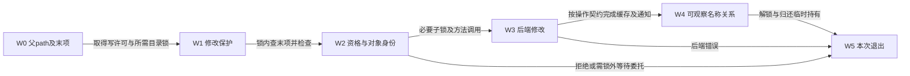
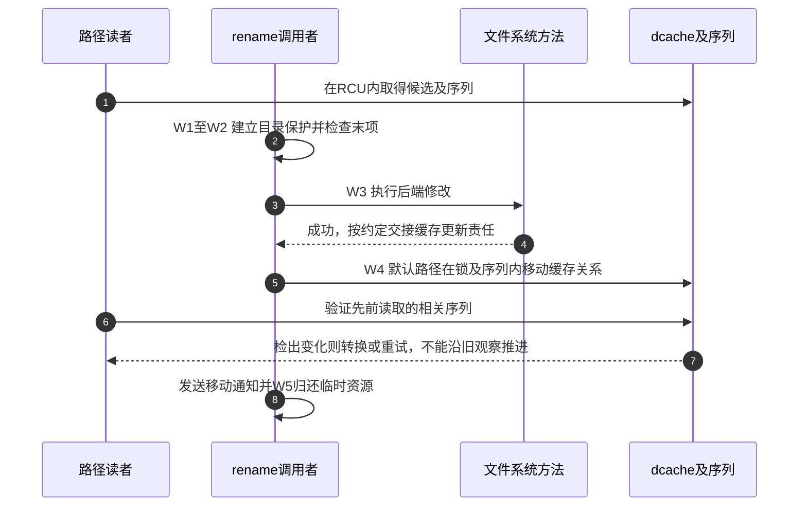

# 第10章\_名称修改怎样锁定检查与交付

[名称修改正文](../../../../knowledge/kernel_subsystems/vfs/P11_创建删除链接与重命名.md) 用同一个A/B替换案例区分名称、对象、引用和打开关系。本导读将W0～W5映射到固定NXP Linux 6.12.20的调用者、VFS检查、文件系统方法与dcache更新；身份和运行边界见 [总索引](P01_Linux_6.12_VFS源码阅读索引.md#1.1_先固定源码身份与运行证据)。

## 10.1\_沿修改周期区分保护与结果

先判断当前代码是建立保护、执行修改，还是传播结果。父path到手并不冻结目录；父锁、目标锁、挂载写许可和临时引用的作用也不同。成功路径和失败路径都必须明确当前已经取得了什么。

W4不是统一的“后端返回、再一律d_add”步骤。创建方法负责完成新对象关联；普通unlink由d_delete_notify连接失效与事件；rename默认由VFS移动dcache，但声明特定标志的后端自行负责。必须分别阅读责任边界。

## 10.2\_按对象变化选择唯一实现入口

| 当前问题 | 版本化实现入口 |
| --- | --- |
| W0～W2创建末项为何返回锁与写许可 | [filename_create](../source_explanations/P19_末项创建的检查与资源交接.md#19.1_父路径到手还不代表可以建立最后名称) |
| 可建与可删分别检查什么 | [资格检查](../source_explanations/P19_末项创建的检查与资源交接.md#19.2_资格检查分别回答可建与可删) |
| 后端create与mkdir前后谁负责什么 | [创建方法](../source_explanations/P19_末项创建的检查与资源交接.md#19.3_VFS建立方法契约并由后端完成对象关联) |
| 成功和失败怎样归还创建资源 | [mkdir调用与清理](../source_explanations/P19_末项创建的检查与资源交接.md#19.4_mkdir调用者把成功和失败都送入配对清理) |
| unlink成功后如何撤销名称及通知 | [删除操作](../source_explanations/P20_名称链接的增加撤销与通知.md#20.1_删除方法成功后仍要兑现缓存和通知契约) 与 [通知顺序](../source_explanations/P20_名称链接的增加撤销与通知.md#20.2_删除通知之前先撤销对应缓存名称) |
| inode最后归还为何在父锁之外 | [unlink调用者](../source_explanations/P20_名称链接的增加撤销与通知.md#20.3_最后inode归还放到父锁之外) |
| 硬链接为何同时检查父和源 | [链接资格](../source_explanations/P20_名称链接的增加撤销与通知.md#20.4_增加硬链接要同时检查新父与旧对象) 与 [用户入口](../source_explanations/P20_名称链接的增加撤销与通知.md#20.5_用户路径还要维持挂载和重试边界) |
| rename如何稳定父拓扑并防止成环 | [父目录锁](../source_explanations/P21_重命名的拓扑检查与锁顺序.md#21.1_父目录锁序在稳定拓扑下决定) 与 [末项检查](../source_explanations/P21_重命名的拓扑检查与锁顺序.md#21.2_父锁内解析末项并拒绝成环或非法组合) |
| 子对象怎样排序，后端返回后怎样交付 | [子对象锁](../source_explanations/P21_重命名的拓扑检查与锁顺序.md#21.3_子对象按类型和地址顺序进一步加锁) 与 [rename操作](../source_explanations/P21_重命名的拓扑检查与锁顺序.md#21.4_后端成功后才执行对应缓存交接) |
| rename_lock和d_seq究竟围住什么 | [短更新](../source_explanations/P22_缓存名称移动与读侧序列交接.md#22.1_全局序列只围绕缓存移动这段短更新) 与 [名称父关系及索引](../source_explanations/P22_缓存名称移动与读侧序列交接.md#22.2_移动要同时维护名字父关系和索引) |

父路径解析、dentry建立和删除失效已经有各自唯一实现，本模块用精确链接复用。通用正文负责推导为什么需要这些保护，本导读负责选定版本中的调用与字段落点，不要求两者互相镜像。

## 10.3\_将读侧观察与修改侧完成放在同一时间线

这里只选择默认由VFS更新dcache的成功路径；失败不应发送成功移动事件，自行移动缓存的后端则有不同调用责任。已有file对旧对象的持有独立存在，不参与“所有读者自动改用新对象”的广播。

## 10.4\_字段原件与实验支持不同层次结论

| 固定原件 | 本次用途 |
| --- | --- |
| [fs/namei.c](../../linux/fs/namei.c) | 最后名称的保护、检查、方法调用和资源退出 |
| [fs/dcache.c](../../linux/fs/dcache.c) | 缓存索引、父关系和序列更新 |
| [fs/inode.c](../../linux/fs/inode.c) | 非目录对象锁排序 |
| [include/linux/fsnotify.h](../../linux/include/linux/fsnotify.h) | 普通删除中缓存失效与通知的顺序 |
| [include/uapi/linux/fs.h](../../linux/include/uapi/linux/fs.h) | renameat2标志定义 |
| [directory-locking.rst](../../linux/Documentation/filesystems/directory-locking.rst) | 目录锁层级与祖先约束，结合真实调用核对顺序 |

正文完整C程序只能验证串行名称替换与旧fd保持对象身份；本次尚未在目标Linux编译运行。没有跨目录压力、锁依赖、远端委托、通知消费者或掉电恢复测试。后续进入open时继续追踪创建后的失败，不把名称成功误写成fd已经发布。
