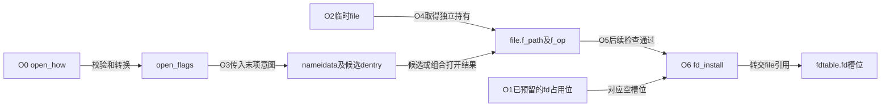
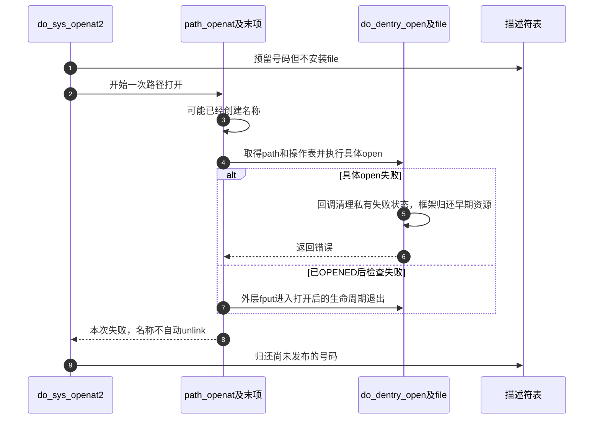

# 第11章\_打开请求怎样变成可发布的file

打开请求从路径文字出发，最终交付的却是一份可由fd取得的file持有。中间既可能修改名称，也可能建立驱动私有状态，失败必须按已经完成的阶段退出。本导读将正文O0～O6落到固定版本的状态位置，避免把几个“成功”混成同一终点。

场景与练习见 [open正文](../../../../knowledge/kernel_subsystems/vfs/P12_open状态机.md#12.1_同一个路径需要不同的打开意图)，身份见 [VFS总索引](P01_Linux_6.12_VFS源码阅读索引.md#1.1_先固定源码身份与运行证据)。这里使用固定NXP Linux 6.12.20，不把调用链存在当成目标运行记录。

## 11.1\_先区分意图构造与公开状态

open_how是用户请求，open_flags是内核解释后的意图，nameidata是遍历上下文，file是本次打开状态，fdtable是最终公开入口。它们的字段分别由参数处理、路径处理、file初始化和描述符发布路径写入，不能让一个字段代替全部状态。

FMODE_CREATED、FMODE_OPENED和槽位指针属于不同状态轴。末项函数失败时不能单独信任CREATED残留；OPENED标记进入完整file退出协议，但O5仍可能失败。最后只有指针发布把这份file持有交给描述符表。

## 11.2\_按完成条件进入具体实现

| 当前问题 | 唯一实现入口 |
| --- | --- |
| O0旧入口规整与openat2校验有什么区别 | [参数与意图](../source_explanations/P23_打开参数与描述符发布的外层事务.md#23.1_先把用户请求分成访问创建与解析意图) |
| O1预留与O6交付如何配对 | [外层事务](../source_explanations/P23_打开参数与描述符发布的外层事务.md#23.2_预留槽位与转交file分别发生在两端) |
| 每次失败重试是否保留旧file | [本次路径资源](../source_explanations/P23_打开参数与描述符发布的外层事务.md#23.3_每次路径尝试拥有自己的临时file) 与 [重试边界](../source_explanations/P23_打开参数与描述符发布的外层事务.md#23.4_模式重试不能复用上一次未完成file) |
| 创建请求为何舍弃快速负候选 | [末项快路径](../source_explanations/P24_打开末项的查询创建与再检查.md#24.1_创建请求不能直接消费无保护的负候选) |
| 创建被禁止时为何还要确认对象是否存在 | [锁内查询](../source_explanations/P24_打开末项的查询创建与再检查.md#24.2_锁内查询还要区分是否真的需要创建) |
| O3的锁、通知和位置替换由谁配对 | [末项调用者](../source_explanations/P24_打开末项的查询创建与再检查.md#24.4_末项调用者配对锁通知与位置推进) |
| atomic_open交付候选还是已打开file | [组合结果](../source_explanations/P25_组合打开与特殊路径的交接契约.md#25.1_组合方法返回后先判断交付到了哪一步) 与 [finish引用契约](../source_explanations/P25_组合打开与特殊路径的交接契约.md#25.2_两个finish辅助消费不同的引用) |
| O_PATH和O_TMPFILE改变了哪些阶段 | [路径句柄](../source_explanations/P25_组合打开与特殊路径的交接契约.md#25.3_O_PATH持有位置而跳过普通数据打开) 与 [临时文件](../source_explanations/P25_组合打开与特殊路径的交接契约.md#25.4_临时文件从目录请求建立无普通名称的对象) |
| O2先初始化哪些字段 | [临时file分配](../source_explanations/P26_file初始化与打开后失败清理.md#26.1_分配成功只建立最初的凭据锁与引用) |
| O4具体open失败由谁清理 | [独立持有与回调](../source_explanations/P26_file初始化与打开后失败清理.md#26.3_具体打开前取得自己的持有与操作表) |
| O5为什么仍可拒绝或截断 | [后置检查](../source_explanations/P26_file初始化与打开后失败清理.md#26.4_打开许可与后置检查保持不同时间点) 与 [截断边界](../source_explanations/P26_file初始化与打开后失败清理.md#26.5_截断在自己的写访问范围内完成) |

路径起点、RCU持有转换与并行候选继续使用前面模块的唯一实现。描述符扩容、共享和最后file释放在下一模块展开，本页只固定它们与打开构造之间的交接点。

## 11.3\_失败链必须按已取得资源逆向核对

图刻意选择失败路径。普通成功时不再执行put_unused_fd，而是fd_install消费file持有；fput也不意味着同步执行完全部release。改变这些位置会影响持有归属，而不只是改变函数调用顺序。

## 11.4\_配置和实验不能替代阶段证据

本次工作配置为ARM、Tiny RCU且未启用SMP；CONFIG_FILE_LOCKING、CONFIG_FSNOTIFY启用，CONFIG_SECURITY与CONFIG_AUDIT未启用。安全包装和审计包装的退化需要与普通权限、资源管理分开阅读。关于安全策略拒绝、审计输出及多CPU发布成本的条件讨论，均不能写成该配置已测得的现象。

正文C实验仅检查排他创建不先截断、O_PATH不能普通read、正常截断改变同一对象长度，本次未在目标Linux编译或运行。源码实现页另外给出修改边界，供核对参数、引用、成功标志和错误配对；它们不是允许直接修改外部证据工作树的指令。
