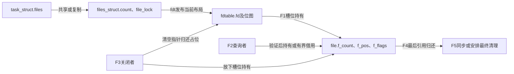
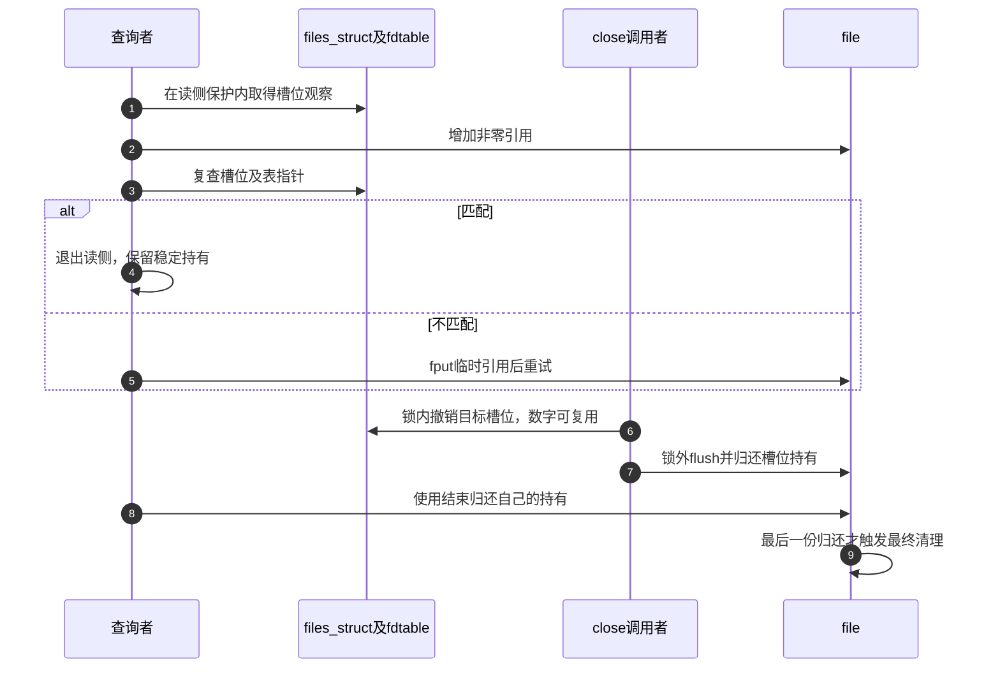

# 第12章\_描述符共享查询与关闭的交接

open交付file之后，描述符层继续承担共享、并发查询和撤销。模块阅读从“哪份持有发生变化”进入：表容器引用、槽位的file引用、使用者的临时引用不能合并计数。场景与完整实验见 [正文](../../../../knowledge/kernel_subsystems/vfs/P13_fd_table与file生命周期.md#13.1_共享号码表与共享打开关系是两回事)，固定源码身份见 [总索引](P01_Linux_6.12_VFS源码阅读索引.md#1.1_先固定源码身份与运行证据)。

## 12.1\_沿同一生命周期区分表与file

F0预留、F1发布承接打开章节；F2建立稳定使用或额外持有；F3撤销一个槽位；F4由剩余持有者继续使用并归还；最后才在F5清理file。这个周期与表布局的扩容正交：扩大数组不等于增加file持有，复制给独立表则需要逐项增加。

字段声明沿用 [描述符对象说明](../source_explanations/P01_描述符表与打开对象的状态归属.md#1.1_表项状态与打开状态的边界)。本模块只展开这些字段在操作时怎样交接，不再复制结构体定义。

## 12.2\_先查发布和读取的配对再查复制

| 阅读问题 | 唯一实现入口 | 应确认的结果 |
| --- | --- | --- |
| 号码预留后为什么仍为空 | [预留](../source_explanations/P27_描述符预留扩容与发布协议.md#27.1_分配号码只改变占用状态) | 位图与指针各自何时改变 |
| 扩容为何与安装握手 | [扩容](../source_explanations/P27_描述符预留扩容与发布协议.md#27.3_扩容先让安装者改道再复制当前布局) | 等待读侧、复制、发布、唤醒的顺序 |
| RCU观察如何成为有效持有 | [查询验证](../source_explanations/P28_描述符查询的引用验证与轻量借用.md#28.1_取得引用之后还要验证槽位与表版本) | 计数增加之后仍检查两个指针 |
| 何时可以省掉引用增减 | [轻量借用](../source_explanations/P28_描述符查询的引用验证与轻量借用.md#28.2_不共享表时的借用有严格使用范围) | struct fd怎样记录退出责任 |
| 共享表与复制表有何区别 | [两层引用](../source_explanations/P29_描述符复制与表共享的两层引用.md#29.1_任务创建先决定共享容器还是复制槽位) | count与f_count分别变化 |
| 定向复制能否覆盖预留项 | [替换检查](../source_explanations/P29_描述符复制与表共享的两层引用.md#29.3_定向替换不能抢走尚未完成的预留) | EBUSY和旧目标的关闭位置 |
| 用户close何时实际释放 | [关闭入口](../source_explanations/P30_描述符脱离与最后file引用的释放.md#30.2_用户关闭与内部关闭选择不同的最后归还方式) | 撤销、flush与同步最后归还 |
| 普通fput怎样安排清理 | [执行上下文](../source_explanations/P30_描述符脱离与最后file引用的释放.md#30.3_最后引用归零后把清理交给可执行的上下文) | task_work、延后工作及最终回调 |

原件主要是 [fs/file.c](../../linux/fs/file.c)、[fs/open.c](../../linux/fs/open.c)、[fs/file_table.c](../../linux/fs/file_table.c) 与 [kernel/fork.c](../../linux/kernel/fork.c)。随树 [files.rst](../../linux/Documentation/filesystems/files.rst) 提供锁与RCU模型，但其中部分指针、辅助名称和“更新都持锁”的概括与当前实现存在差别；具体调用以固定函数为准，不能直接复制旧示例。

## 12.3\_把先撤销后清理与其他使用者放在同一时间线

图中后半段选择“查询已验证成功”的交错；重试分支需重新取得成功结果后才有这份长期持有。仅位于RCU读侧却尚未取得有效引用的指针，不能当作后半段的使用者。

## 12.4\_版本与实验各自覆盖什么

当前固定提交为 `dfaf2136deb2af2e60b994421281ba42f1c087e0`。核对工作配置是ARM、Tiny RCU且未启用SMP；启用了文件锁、epoll、dnotify与锁依赖检查。源码仍包含多核协议和配置分支，文中解释其契约，未声称进行多核压力实测。

正文程序覆盖位置、标志和定向复用的可见关系，没有证明扩容交错、分配器复用、最后release时机或异步队列完成。修改时应分别设计并发开关fd、扩容与查询、目标预留冲突及最后引用跟踪；自动链接检查无法代替这些行为证据。
