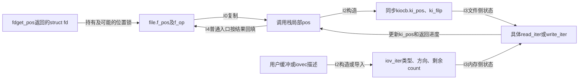
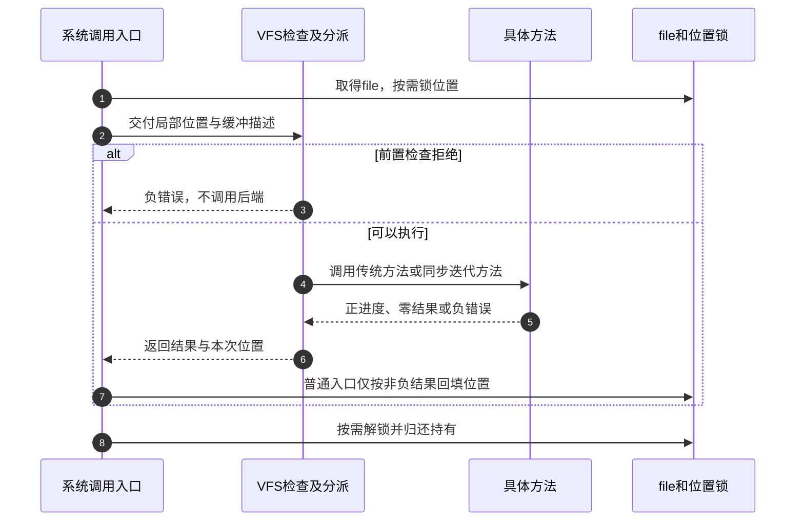

# 第13章\_读写请求的位置缓冲与结果交接

本模块从已发布的file进入同步数据请求。描述符的持有协议已经成立，但它尚未说明这次请求使用哪份位置、缓冲区由谁消费、结果何时回填。场景和实验见 [读写正文](../../../../knowledge/kernel_subsystems/vfs/P14_VFS_read_write分派.md#14.1_一次读写同时携带位置与缓冲区)，固定源码身份见 [总索引](P01_Linux_6.12_VFS源码阅读索引.md#1.1_先固定源码身份与运行证据)。

## 13.1\_把请求状态放回一次同步周期

I0取得file和位置协议，I1检查请求，I2构造具体方法需要的参数，I3由后端执行，I4报告进度并按入口回填位置，I5归还资源。file.f_pos、局部pos、kiocb.ki_pos和iov_iter.count是不同的状态，不能画成一个笼统的offset字段。

图选择迭代适配路径；传统.read/.write直接接收位置指针和用户缓冲，不必经过kiocb。file持有与位置锁的具体实现复用 [描述符查询](../source_explanations/P28_描述符查询的引用验证与轻量借用.md#28.3_位置保护在引用之外增加另一份退出责任)。

## 13.2\_按入口区分位置与方法选择

| 问题 | 唯一实现入口 | 需要核对的差别 |
| --- | --- | --- |
| 普通调用怎样回填位置 | [普通入口](../source_explanations/P31_读写入口的位置选择与结果回填.md#31.1_普通入口先把共享位置变成本次局部位置) | 局部位置、非负返回与fdput_pos |
| 显式位置为什么不改变共享位置 | [定位入口](../source_explanations/P31_读写入口的位置选择与结果回填.md#31.2_显式位置不回填共享位置但仍受打开意图约束) | 能力检查、fdget及追加意图 |
| 前置检查究竟检查什么 | [资格检查](../source_explanations/P32_读写资格检查与文件操作分派.md#32.1_范围检查与访问许可发生在数据方法之前) | 地址范围、位置范围及可选钩子 |
| 标量是否优先迭代方法 | [标量分派](../source_explanations/P32_读写资格检查与文件操作分派.md#32.2_标量读写先检查传统方法再适配迭代接口) | .read/.write优先，迭代是适配分支 |
| 同步请求能否留下待完成工作 | [栈对象边界](../source_explanations/P33_同步迭代请求与向量缓冲区的交接.md#33.2_栈上的同步请求必须在返回前完成) | 同步回调与EIOCBQUEUED不相容 |
| 向量入口怎样导入和推进 | [向量分派](../source_explanations/P33_同步迭代请求与向量缓冲区的交接.md#33.3_向量入口先导入描述再选择后端) | 迭代优先、传统逐段后备与部分进度 |

原件以 [fs/read_write.c](../../linux/fs/read_write.c)、[include/linux/fs.h](../../linux/include/linux/fs.h)、[include/linux/uio.h](../../linux/include/linux/uio.h) 和 [lib/iov_iter.c](../../linux/lib/iov_iter.c) 为主。后端页缓存算法由下一模块承担，此处只固定调用参数和完成责任。

## 13.3\_把失败退出和短进度放在同一调用范围

这个序列中的负错误是内核返回形式；用户C程序通过库接口通常看到-1和errno。向量后备若前段已完成、后段出错，按累计正进度报告；不要把后端某一次负返回直接当作整个向量调用没有完成数据。

## 13.4\_配置与验证只支持相应范围的结论

固定提交为 `dfaf2136deb2af2e60b994421281ba42f1c087e0`。ARM工作配置启用MMU，access_ok经架构头文件进入通用范围检查；这不是用户页面可访问性的完整预验证。CONFIG_SECURITY和FANOTIFY未启用，不把可选访问钩子写成实际拦截观察。

正文实验仅验证共享位置、显式位置、短读取与向量容量。没有目标Linux编译运行、坏地址注入、冻结竞争或异步完成验证；也没有把字节统计、访问通知当成物理I/O或持久化证据。
