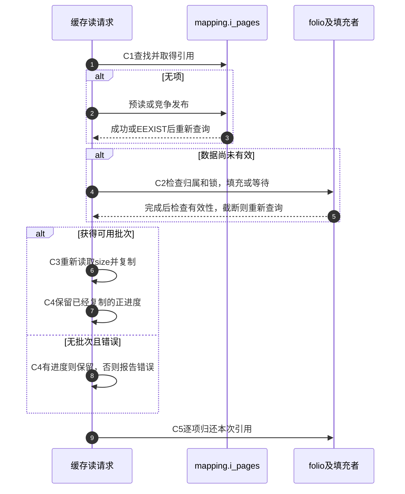

# 第14章\_页缓存的数据有效性与修改交接

读写分派已经交付file、位置和缓冲；本模块继续追踪普通缓存后端怎样找到内容、等待填充并接纳修改。场景与练习见 [页缓存正文](../../../../knowledge/kernel_subsystems/vfs/P15_address_space_folio与页缓存.md#15.1_为什么缓存应跟随文件而不是一次打开)，固定源码身份见 [总索引](P01_Linux_6.12_VFS源码阅读索引.md#1.1_先固定源码身份与运行证据)。

## 14.1\_把共享缓存与单次请求分开追踪

C0选mapping，C1查找或创建并取得本次持有，C2建立可用内容或可修改范围，C3复制实际数据，C4接纳和报告结果，C5归还本次资源。folio引用、成员关系、锁、有效位、脏位与写回位是多组状态，不能合并成一个完成枚举。

pagecache索引由inode关联的mapping共享，f_ra历史归具体file；重新open不会复制整个缓存。实现表把查询、完成和修改拆开阅读，避免从一个函数名猜完整责任。

## 14.2\_按问题进入唯一实现标题

| 问题 | 实现入口 | 需要保留的边界 |
| --- | --- | --- |
| 缓存字段由谁初始化 | [归属与实例](../source_explanations/P34_页缓存归属索引与竞争插入.md#34.1_mapping把共享对象与偏移索引连起来) | i_data构造、当前inode初始化与文件系统a_ops设置是不同阶段 |
| 相同索引谁能发布 | [竞争插入](../source_explanations/P34_页缓存归属索引与竞争插入.md#34.2_插入者在共享索引中决出归属) | XArray锁下冲突，失败撤销新引用和记账 |
| 查询指针怎样转为持有 | [批次查询](../source_explanations/P34_页缓存归属索引与竞争插入.md#34.3_查询取得引用后仍要复查索引) | RCU、folio引用与索引复查各有职责 |
| 可用批次怎样交给用户 | [缓存读取](../source_explanations/P35_缓存读的填充等待与有效范围.md#35.1_读入口把批次与实际复制进度连接起来) | 数据有效以后再次检查size，按copied推进 |
| 预读和创建怎样衔接 | [缺失处理](../source_explanations/P35_缓存读的填充等待与有效范围.md#35.2_未命中先尝试预读再竞争创建) | NOWAIT和NOIO不同，已有批次不被末项错误抹掉 |
| 填充或截断以后怎样继续 | [等待与复查](../source_explanations/P35_缓存读的填充等待与有效范围.md#35.3_等待填充之后必须重新检查有效性) | 锁、mapping归属、局部有效性及重试引用 |
| 完成方怎样通知读者 | [状态与唤醒](../source_explanations/P35_缓存读的填充等待与有效范围.md#35.4_完成方更新状态再唤醒对应等待者) | 哈希等待队列以folio及bit匹配，唤醒不等于成功 |
| 复制量为何不总等于写进度 | [通用写循环](../source_explanations/P36_缓冲写的准备接纳与标脏.md#36.1_通用循环以接纳量提交进度) | bytes、copied、status分别计量 |
| 最小后端怎样结束写入 | [ram_aops](../source_explanations/P36_缓冲写的准备接纳与标脏.md#36.2_ram_aops怎样兑现最小准备和结束协议) | 零填充内存文件，不代表磁盘分配与日志协议 |
| 标脏以后由谁处理 | [后端标脏](../source_explanations/P36_缓冲写的准备接纳与标脏.md#36.3_标脏按mapping的后端协议执行) | noop也修改脏位，但不安排设备写回 |

## 14.3\_将重试和短进度放回请求周期

写路径用准备/复制/结束协议替换C2～C4，资源由具体结束方法按约定归还；不能把读路径的批次folio_put直接照搬到写调用者。Dirty与Writeback组合留给下一模块追踪，不在本页凭一个状态图推断持久化。

## 14.4\_源码边界与可观察结果

证据固定在 `dfaf2136deb2af2e60b994421281ba42f1c087e0`。ARM配置启用MMU、MEMCG，PSI和DEBUG_VM关闭。未以配置推断实际使用大folio，也未把调试断言当成正常状态转换或完成机制。

[完整C实验](../../../../labs/kernel/vfs/materials/cache_visibility_demo.c) 检查独立打开对内容、长度和零间隙的顺序观察；没有目标Linux编译运行记录。缓存命中、块分配、并发truncate、设备完成及持久化都需要额外证据。原件主要位于 [mm/filemap.c](../../linux/mm/filemap.c)、[fs/libfs.c](../../linux/fs/libfs.c)、[mm/truncate.c](../../linux/mm/truncate.c) 和相关头文件，函数体只在上述实现入口展开。
