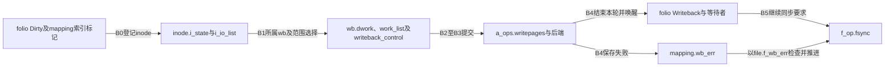
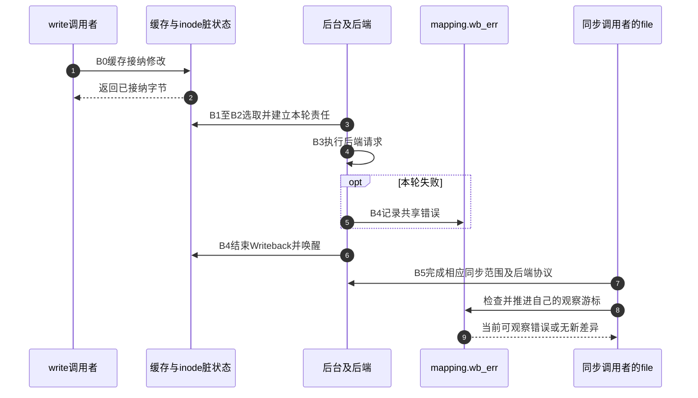

# 第15章\_写回提交完成与错误观察

页缓存模块已经建立有效内容与修改接纳；本模块追踪这些修改怎样变成后端请求，以及返回后的错误怎样留给同步调用者。场景和实验见 [写回正文](../../../../knowledge/kernel_subsystems/vfs/P16_writeback_fsync与错误传播.md#16.1_写成功以后为什么还需要完成协议)，源码身份见 [总索引](P01_Linux_6.12_VFS源码阅读索引.md#1.1_先固定源码身份与运行证据)。

## 15.1\_沿同一周期区分责任与结果

B0登记脏修改，B1安排和选取工作，B2建立本轮Writeback责任，B3后端执行，B4记录错误并结束本轮，B5完成文件系统同步协议和每file观察。共享状态、工作队列和等待通知分别承担发现、执行和继续运行，不能用一个“后台线程负责保存”框覆盖全部机制。

数据Dirty、inode脏位、I_SYNC/I_SYNC_QUEUED、Writeback、错误序列和观察游标都有各自的所有权。图中的先后是一次责任周期，不要求所有步骤均由同一个任务执行。

## 15.2\_按责任进入唯一实现讲解

| 问题 | 实现入口 | 关键区别 |
| --- | --- | --- |
| 后台如何发现修改 | [脏登记](../source_explanations/P37_脏状态登记与写回调度.md#37.1_从folio脏位汇聚到inode待处理状态) | 内容位、索引标记、inode与wb队列分层 |
| 是否每次标脏都唤醒 | [延后调度](../source_explanations/P37_脏状态登记与写回调度.md#37.2_第一次登记怎样安排后续工作) | 首次登记、已有工作与实例注册条件 |
| 清旧状态怎样保住新修改 | [重脏复查](../source_explanations/P37_脏状态登记与写回调度.md#37.4_清理旧责任之后怎样保住并发重脏) | 登记/清理屏障及索引标记配对 |
| 当前轮与后续修改怎样分开 | [开始写回](../source_explanations/P38_写回标记与范围完成等待.md#38.1_把本轮责任从Dirty交给Writeback) | 位、标记、计数及keep_write |
| 完成后如何安全唤醒 | [结束写回](../source_explanations/P38_写回标记与范围完成等待.md#38.3_完成方先结束本轮状态再唤醒) | 临时引用覆盖清位和唤醒 |
| fsync为何还要具体后端 | [VFS入口](../source_explanations/P39_同步入口与文件系统持久化.md#39.1_系统调用先取得file再交给其同步方法) | datasync、范围、方法能力 |
| ext4怎样连接日志及设备 | [ext4同步](../source_explanations/P39_同步入口与文件系统持久化.md#39.3_ext4按日志配置选择不同的完成路径) | journal与nojournal、事务ID及条件flush |
| 错误由谁保存及消费 | [每file观察](../source_explanations/P40_写回错误序列与每file观察.md#40.1_共享记录与观察游标分别保存) | mapping共享记录、独立open与dup共享游标 |

## 15.3\_延后失败仍属于完整调用协议

错误登记与完成唤醒必须分别发生；只有其中一条都不足以保证调用者既继续运行又得知失败。同步路径还要保留前面阶段的错误，不能被后一次检查返回0覆盖。

## 15.4\_配置运行与证据边界

固定提交为 `dfaf2136deb2af2e60b994421281ba42f1c087e0`。当前BLOCK、BUFFER_HEAD、EXT4_FS、JBD2开启，BLK_CGROUP关闭；编译配置不证明具体挂载模式、事务类型或设备缓存行为。同步入口、块后端和控制组条件分支应按各自证据解释。

[同步与名称发布实验](../../../../labs/kernel/vfs/materials/sync_publish_demo.c) 只安排局部调用顺序并检查返回，未在目标Linux编译运行，没有掉电、设备故障、重脏竞争或错误游标注入测试。下一模块研究绕过普通页缓存时，缓冲和完成责任怎样改变。
