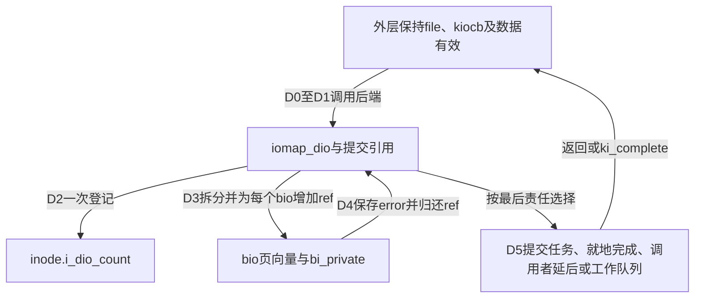
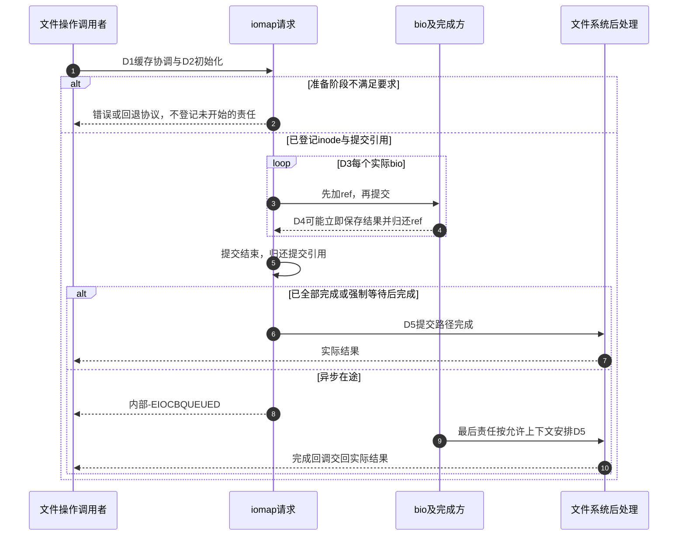

# 第16章\_直接IO请求与完成责任

缓冲路径把数据交给共享缓存，再由写回协议处理；直接路径改为围绕本次文件范围建立传输请求。新的问题是：一个操作拆成多个bio后，如何在提交仍进行、设备已经完成、调用者可能已经返回的交错中守住唯一完成责任？本导读按D0～D5定位源码，不把不同文件系统的两个direct-io.c串成一条链。

## 16.1\_先分清请求对象与执行上下文

kiocb是外层请求，iov_iter是数据范围，iomap_dio是一次直接操作的汇聚状态，bio是提交给块层的子请求。它们都不是线程。执行者包括提交任务、后端完成上下文和可能参与后处理的工作者；每个执行者只能在自己持有的生命期与上下文约束内访问对象。

直接I/O的数据路径、等待方式与持久化是三条独立决策，稳定机制先读 [正文](../../../../knowledge/kernel_subsystems/vfs/P17_Direct_IO与异步完成.md#17.1_直接I/O改变数据路径但不承包所有保证)。版本入口见 [总索引](P01_Linux_6.12_VFS源码阅读索引.md#1.1_先固定源码身份与运行证据)；本导读只组织模块协作，函数体在以下唯一实现标题展开。

## 16.2\_按同一请求的阶段定位源码

| 阶段 | 要追踪的状态 | 唯一实现入口 |
| --- | --- | --- |
| D0/D1 | 文件范围、缓存责任与具体后端选择 | [缓存交接](../source_explanations/P41_直接IO的缓存交接与实现入口.md#41.1_提交以前先处理同范围缓存)、[ext4读入口](../source_explanations/P41_直接IO的缓存交接与实现入口.md#41.3_ext4怎样选择iomap入口) |
| D2 | 私有请求初值、提交引用与inode登记 | [请求建立](../source_explanations/P42_iomap直接IO的请求建立与提交.md#42.2_提交引用封住子请求提前完成的窗口) |
| D3 | 映射类型、页面持有、补零、bio与ref | [映射分派](../source_explanations/P43_iomap直接IO的数据映射与bio组装.md#43.1_映射类型先决定需要做什么)、[bio提交](../source_explanations/P43_iomap直接IO的数据映射与bio组装.md#43.4_真正提交之前必须先登记完成引用) |
| D4 | error、ref、waiter与异步完成分支 | [最后bio的分派](../source_explanations/P44_iomap直接IO的完成汇聚与通知.md#44.1_最后一个bio决定怎样继续收尾) |
| D5 | end_io、缓存检查、位置、同步与返回 | [最终结果](../source_explanations/P44_iomap直接IO的完成汇聚与通知.md#44.2_最终完成先兑现后端再交回结果) |
| 跨请求协调 | superblock队列和inode计数 | [实例生命期](../source_explanations/P44_iomap直接IO的完成汇聚与通知.md#44.3_后处理工作队列与inode计数各管一层) |

D2的提交引用使D3不会被快速完成打断生命期。D4最后归还者也不是永远自己直接调用所有完成函数：它按wait_for_completion与完成能力标志移交。D5把具体文件系统结果与必要同步合成调用者结果；不把单个bio成功等同于整个文件操作成功。

## 16.3\_把正常完成与回退放进同一流程

准备阶段错误不应减少尚未增加的inode计数。提交过部分数据后遇回退，还需等已发请求结束并保持迭代进度，再由外层处理剩余部分。后端已发生的写入不因错误返回自动撤销。缓冲区生命期、页pin/借用与bio清理又是不同层次，不能用一个“释放请求”框吞掉它们。

## 16.4\_版本配置与可观察边界

固定源码为NXP Linux 6.12.20提交 `dfaf2136deb2af2e60b994421281ba42f1c087e0`。本次配置启用FS_IOMAP、BLOCK、AIO和IO_URING，未启用FS_ENCRYPTION、FS_VERITY及DAX。代码中的可选后端、内联数据、轮询、FUA、缓冲回退和延后完成需要实际请求条件才能进入，配置存在不是执行证据。

[正文C材料](../../../../knowledge/kernel_subsystems/vfs/P17_Direct_IO与异步完成.md#17.6_实验先查询约束再验证一次读写) 只演示同步接口的对齐查询、等长传输、内容比较与fsync结果检查。本次没有目标Linux编译运行、设备轨迹、异步故障注入或掉电测试。若要验证上述分支，应先记录文件系统、文件特征、打开标志、请求形状及trace采集条件，再对照D0～D5，不能从耗时或没有告警反推内部路径。
