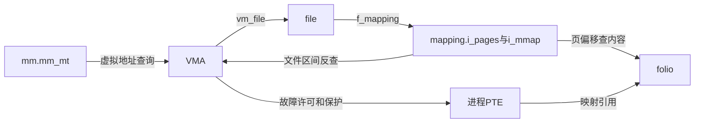
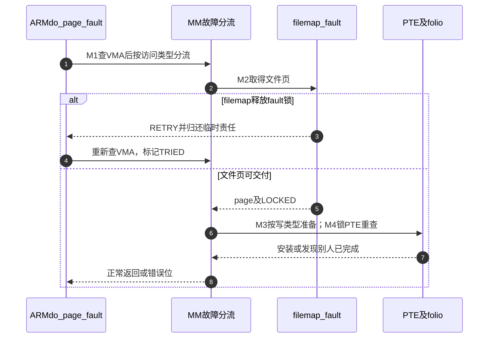

# 第17章\_文件映射的缺页与状态交接

本导读面向Linux 6.12.20固定提交 `dfaf2136deb2af2e60b994421281ba42f1c087e0`，把[文件mmap正文](../../../../knowledge/kernel_subsystems/vfs/P18_文件mmap与page_fault.md)中的M0～M6映射到实现。它负责阅读顺序与调用协作，函数体只在链接的唯一实现标题展开。先从[VFS总索引](P01_Linux_6.12_VFS源码阅读索引.md)确认源码与配置边界。

## 17.1\_沿一次映射访问找到状态落点

文件映射不是“一个页状态机”：mm的VMA拓扑、文件mapping的缓存成员、folio内容/锁、进程PTE以及i_size共同决定当前访问是否成立。M0用file引用保护后备对象，M2验证文件内容，M4发布进程页表，M5处理同步或失效，M6才拆除关系。

| 状态地址 | 写入与读取 | 实现入口 |
| --- | --- | --- |
| `mm->mm_mt`、`vma->vm_start/end/flags/pgoff/file/ops` | mmap发布，fault查找，munmap拆除 | [VMA发布与引用](../source_explanations/P45_文件映射的发布与引用归还.md#45.1_新VMA先取得后备文件再发布) |
| `file->f_mapping->i_pages`、folio | filemap查找/读入，truncate删除，MM取得页引用 | [文件页验证](../source_explanations/P46_文件缺页的缓存验证与重试.md#46.2_页面存在以后仍要核对归属与EOF) |
| `vm_fault`及`pte/ptl` | 单次缺页上下文传递源/目标页与原PTE；MM重新检查再安装 | [PTE安装](../source_explanations/P47_文件页到进程页表的安装.md#47.2_拿到文件页以后在PTE锁下再次确认) |
| `mapping->i_mmap`、`inode->i_size` | 前者从文件区间反查VMA，后者决定有效文件范围 | [失效传播](../source_explanations/P50_映射同步与截断撤销.md#50.3_文件反向索引把失效传播到所有映射者) |

## 17.2\_按重试与安装边界阅读实现

先读[filemap_fault](../source_explanations/P46_文件缺页的缓存验证与重试.md#46.2_页面存在以后仍要核对归属与EOF)，看它如何取得引用、锁页、验证mapping及EOF；再读[maybe_unlock_mmap_for_io](../source_explanations/P46_文件缺页的缓存验证与重试.md#46.1_等待文件页之前先决定保留哪种生命期)，解释为什么fpin不能代替VMA锁。最后进入[do_read_fault与finish_fault](../source_explanations/P47_文件页到进程页表的安装.md#47.1_缺失PTE先分清读取和两种写入)，核查文件页到PTE的移交。

普通读故障不应被缩写成“文件系统安装PTE”。`filemap_fault`交出页；MM在PTE锁下重查并安装。fault-around/map_pages是另一个可直接映射已就绪邻页的协作路径，阅读时单独识别，不能把它的优化行为强加给单页回调。

## 17.3\_两种写入怎样接回同一周期

[do_cow_fault](../source_explanations/P48_私有文件映射的写时复制.md#48.1_首次写缺页先准备独立匿名页)处理缺失PTE的私有写；[do_wp_page与wp_page_copy](../source_explanations/P48_私有文件映射的写时复制.md#48.2_已有只读PTE写入前先判断是否必须复制)处理已有PTE的写保护。共同结果是目标成为私有匿名页，但分配、源引用和PTE切换的入口不同。

[共享写准备](../source_explanations/P49_共享映射的写入准备与脏页登记.md#49.1_让文件系统先准备可写页面)通过page_mkwrite让后端先准备，再安装或更新PTE；[脏页收尾](../source_explanations/P49_共享映射的写入准备与脏页登记.md#49.3_标脏之后可能释放fault锁并节流)连接写回。若这里已释放fault锁且工作完成，COMPLETED表示直接结束，不等于RETRY。

普通ext4映射选择ext4_page_mkwrite，通用filemap_page_mkwrite只是另一种后端实现。读操作共享filemap_fault，不代表写准备也完全相同。

## 17.4\_从同步和失效回看对象生命期

先读[msync范围换算](../source_explanations/P50_映射同步与截断撤销.md#50.1_msync把虚拟地址范围翻译回文件范围)，看到它持file引用退出mmap锁后调用fsync；再读[截断的两次撤销](../source_explanations/P50_映射同步与截断撤销.md#50.2_截断在缓存删除前后各撤销一次页表)，看到VMA仍在而PTE已被撤销。最后回到[VMA最终释放](../source_explanations/P45_文件映射的发布与引用归还.md#45.3_两棵索引与最后一份文件引用分别收尾)，区分“偏移失效”和“对象死亡”。

本次配置MMU开启，SMP、USERFAULTFD、DAX未启用，PER_VMA_LOCK依赖SMP而不启用；透明大页也不在此构建中启用。ARM异常入口仅用于核对重试、锁交接和SIGBUS处理；通用代码中的其他配置分支保留接口边界，不据此声称实际执行过。没有目标Linux运行或并发故障实测。
