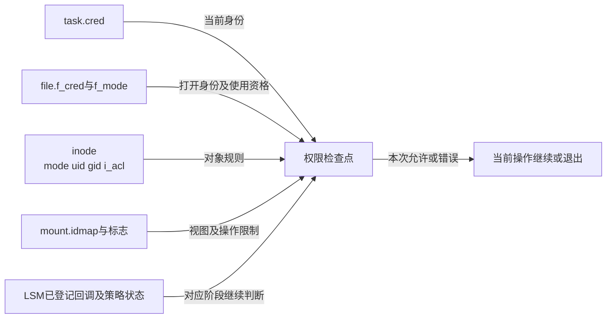
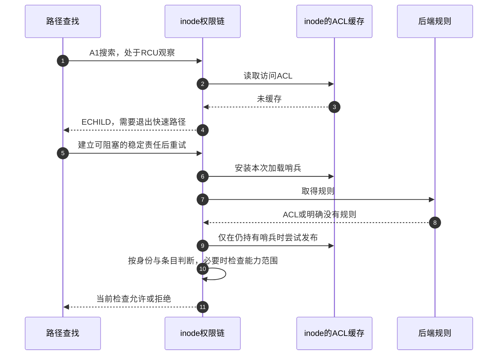

# 第18章\_访问身份与权限检查的时间边界

本导读将 [权限正文](../../../../knowledge/kernel_subsystems/vfs/P19_权限凭据与安全钩子.md)映射到Linux 6.12.20固定提交 `dfaf2136deb2af2e60b994421281ba42f1c087e0`。正文解释授权模型与应用选择，这里按身份、对象、调用时刻组织源码阅读，不重新展开函数体。先从 [总索引](P01_Linux_6.12_VFS源码阅读索引.md)确认版本和原件。

## 18.1\_先找本次使用的身份与对象

一次授权不是inode上的单一状态机。当前cred、file保存的打开身份、inode的mode/ACL、挂载视图和安全策略分别维护，检查读取它们的时间也不同。打开成功建立的是一份具体file，后来的chmod不会直接清掉它的f_mode，但具体后端或安全策略仍可能在使用阶段拒绝。

下表沿用 [正文的A0～A5](../../../../knowledge/kernel_subsystems/vfs/P19_权限凭据与安全钩子.md#19.5_LSM为什么还要在打开以后再检查)。这些阶段表示操作责任，不要求所有状态冻结在同一时刻。

| 阶段 | 状态地址与写读责任 | 实现入口 |
| --- | --- | --- |
| A0 确定主体 | task->cred提供当前主观身份；普通打开先分配未公开file并持有f_cred，access可能临时覆盖当前cred | [身份与引用](../source_explanations/P51_当前身份与access临时凭据.md#51.1_当前主观身份与打开身份分别由谁持有)、[init_file](../source_explanations/P26_file初始化与打开后失败清理.md#26.1_分配成功只建立最初的凭据锁与引用) |
| A1 遍历路径 | 路径查找逐级读取目录inode和当前身份，MAY_NOT_BLOCK决定能否在当前上下文补取ACL | [inode分派](../source_explanations/P52_inode权限的基本检查与分派.md#52.1_先检查写入限制再选择权限实现)、ACL读取（后文展开） |
| A2 最终动作 | idmap换算对象身份，mode/ACL及能力作用域决定本次资格；创建与删除另有父目录检查 | 类别判断（后文展开）、身份换算（后文展开）、[能力范围](../source_explanations/P54_capability的命名空间与对象边界.md#54.1_DAC越权也要确认能力作用范围) |
| A3 完成打开 | file完成模式、后端与安全打开检查，成功后才能发布到fd表 | [do_dentry_open](../source_explanations/P26_file初始化与打开后失败清理.md#26.3_具体打开前取得自己的持有与操作表)、打开钩子（后文展开） |
| A4 使用file | read/write通过f_mode及本次安全钩子检查，再分派后端，不重新走完整名称查找 | [rw_verify_area](../source_explanations/P32_读写资格检查与文件操作分派.md#32.1_范围检查与访问许可发生在数据方法之前) |
| A5 后续变化 | 合法属性更新改变inode mode/ACL，任务凭据或策略也可能改变；各检查点按自己的契约重新读取 | [新打开与旧句柄实验](../../../../knowledge/kernel_subsystems/vfs/P19_权限凭据与安全钩子.md#19.7_实验把新打开和旧句柄分开观察) |

## 18.2\_把权限拒绝与尚缺检查材料分开

先读 [inode_permission](../source_explanations/P52_inode权限的基本检查与分派.md#52.1_先检查写入限制再选择权限实现)，确认只读和对象写入限制先于权限分派。再读 [acl_permission_check](../source_explanations/P52_inode权限的基本检查与分派.md#52.2_类别选择与拒绝结果不能混用)，观察owner类别为什么不回退，以及EAGAIN、ECHILD、EACCES分别如何传播。

若ACL还没缓存，RCU查找不能把缺材料变成允许；可阻塞路径通过 [加载哨兵](../source_explanations/P53_挂载身份换算与ACL判断.md#53.3_加载者只能发布仍属于自己的缓存结果)取得规则。随后 [条目匹配](../source_explanations/P53_挂载身份换算与ACL判断.md#53.4_条目匹配以后仍要应用所属类别的限制)应用具名用户、组与mask。只有普通EACCES才进入能力越权，其他错误保持其原有含义。

目录搜索、创建和删除不共享一个最终对象检查点。已有 [末项资格检查](../source_explanations/P19_末项创建的检查与资源交接.md#19.2_资格检查分别回答可建与可删)解释父目录和目标对象责任；本篇只补上它们调用的权限机制，不重复展开may_create/may_delete。

## 18.3\_再沿打开和使用位置核对安全检查

LSM实现阅读顺序是 [槽位建立](../source_explanations/P55_VFS安全钩子的登记与调用.md#55.1_先为每类检查建立可登记的回调槽)、[登记目标](../source_explanations/P55_VFS安全钩子的登记与调用.md#55.2_安装目标以后才让运行路径看见活动槽)、[按阶段调用](../source_explanations/P55_VFS安全钩子的登记与调用.md#55.3_打开与使用阶段调用不同的钩子)。这样才能解释“钩子”是怎样从模块描述符变成运行时调用，而不把函数名当成已经执行的证据。

本基线MULTIUSER、USER_NS、FS_POSIX_ACL、EXT4_FS_POSIX_ACL、KEYS和CGROUP_DEVICE开启；CONFIG_SECURITY与FANOTIFY关闭。security.h的三个文件权限包装使用桩函数，但security_capable仍保留基础能力判断。源码中的LSM槽位和策略接口是配置开启时的实现能力，不能声明本配置已执行SELinux或AppArmor策略。

## 18.4\_以access的退出边界检验身份模型

最后读 [access临时身份](../source_explanations/P51_当前身份与access临时凭据.md#51.2_预检按自己的身份语义临时覆盖)及 [恢复与引用归还](../source_explanations/P51_当前身份与access临时凭据.md#51.3_恢复旧指针以后才能归还临时身份)。这条路径有A0到A2，却没有A3发布file；其返回0不交付稳定对象，也不冻结以后路径状态。

冷读时应能区分四个结果：无ACL继续mode、ACL未缓存退出RCU重试、普通DAC拒绝尝试适用能力、LSM拒绝终止本次调用。还应能指出临时cred保存在哪、哪个出口恢复、file另持哪份引用。当前只完成固定源码核对和C材料审查，没有目标Linux编译运行、ACL/namespace隔离或LSM策略实测。
