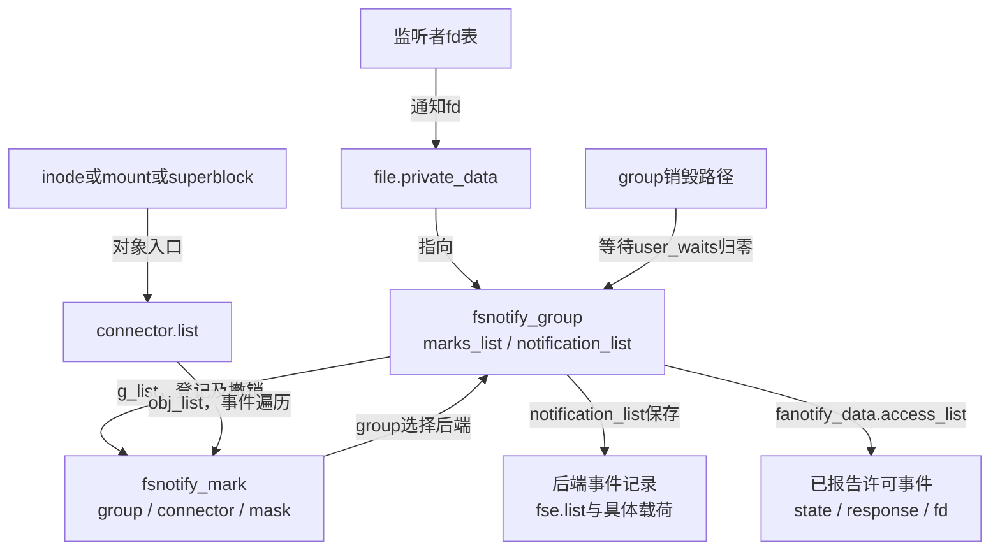
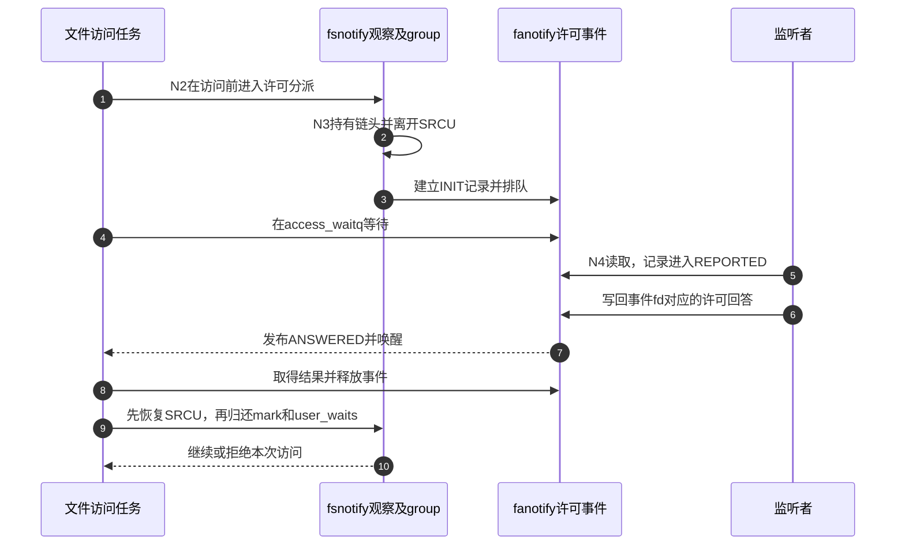

# 第19章\_事件观察与许可响应的交接

文件操作已经有明确的权限检查与对象生命周期，通知层要增加的是观察关系与消息交接。先阅读 [正文的通知周期](../../../../knowledge/kernel_subsystems/vfs/P20_fsnotify_inotify与fanotify.md#20.3_从登记到读取追踪同一次变化)，再沿本篇把N0～N5放进固定源码。这里组织函数协作和状态位置，具体函数体在实现篇唯一展开。

**讲解层次：实现层，Linux 6.12.20。** 固定提交 `dfaf2136deb2af2e60b994421281ba42f1c087e0`，来源和工作树差异见 [总索引](P01_Linux_6.12_VFS源码阅读索引.md)。本次配置开启FSNOTIFY和INOTIFY_USER，关闭FANOTIFY与SECURITY；fanotify许可路径属于核对到的可选实现，不是本次运行观察。

## 19.1\_沿通知周期定位状态与执行者

普通通知由文件操作路径产生、监听者消费；许可事件在同一基础上增加用户回答与访问方等待。两者复用观察索引和队列，但完成条件不同：普通消息读出后可以释放，许可消息还要等待回答或取消收尾。

| 阶段 | 运行路径与状态 | 唯一实现入口 |
| --- | --- | --- |
| N0 建立实例 | group、通知file、队列与后端方法就绪 | [实例fd](../source_explanations/P56_inotify实例与观察编号的建立.md#56.1_通知fd先绑定独立group) |
| N1 登记观察 | 路径解析到inode，建立wd、group链和对象链 | [观察编号](../source_explanations/P56_inotify实例与观察编号的建立.md#56.2_把路径解析结果变成实例内的观察编号)、[mark连接](../source_explanations/P57_观察标记的连接撤销与延后回收.md#57.1_对象侧与group侧分别建立索引) |
| N2 产生事件 | 操作路径传入mask、对象、必要父目录和名字 | [事件接入](../source_explanations/P58_fsnotify事件匹配与分派.md#58.1_操作路径先确定事件对象与父目录名字) |
| N3 匹配排队 | iter_info合并同group观察；后端生成记录并交队列 | [分派](../source_explanations/P58_fsnotify事件匹配与分派.md#58.2_按group汇合不同对象的观察)、[队列所有权](../source_explanations/P59_事件合并排队与溢出.md#59.2_队列容量与记录所有权一起交接) |
| N4 消费 | 监听者脱链、编码并复制；许可记录继续待响应 | [inotify读取](../source_explanations/P60_通知读取与监听实例退出.md#60.1_先取得完整记录再复制给用户)、[fanotify报告](../source_explanations/P62_fanotify响应状态与退出收尾.md#62.1_报告事件需要新建监听者可用的对象fd) |
| N5 收尾 | 撤销观察、停止入队、等待旧持有并归还资源 | [mark最终回收](../source_explanations/P57_观察标记的连接撤销与延后回收.md#57.4_最后一个引用消失后仍要等待旧遍历)、[实例退出](../source_explanations/P60_通知读取与监听实例退出.md#60.4_最后一个通知file退出才销毁监听实例) |

N3没有一个独立的“通知CPU”：匹配和入队通常就在当前文件操作的调用链中执行。回收工作队列处理已经退出的对象，不代替正常事件产生。用户程序通过read或poll等待自己的通知fd，不轮询全部inode。

## 19.2\_先读地址关系再读函数名字

同一个mark从对象侧和group侧都能到达，但两条索引解决不同问题。对象侧用于“这次变化应给谁”，group侧用于“这个监听者退出时还剩哪些观察”。事件队列保存消息，不能据它恢复完整观察集合。

fsnotify_mark_srcu保护对象链遍历时的内存有效性，mark引用保护明确持有者，notification_lock保护队列及许可状态交接。三者不能替换。group.mark_mutex序列化增删观察，又是另一种责任。

源文件阅读顺序因此是group.c和inotify_user.c建立实例，mark.c建立观察索引，fsnotify.c分派，notification.c交接记录，最后回到各后端的read/release。notification.c旧注释里的event_holder不能覆盖当前结构定义，实际普通记录嵌入fsnotify_event.list。

## 19.3\_许可等待增加的责任怎样归还

许可路径离开普通分派读侧以前，必须持有iter_info的各个非空mark链头，登记其group.user_waits；用户回答以后先恢复SRCU，再归还这些持有。否则，漫长用户等待会阻塞回收，或退出SRCU后继续读已经释放的链节点。

具体交接见 [等待前的持有转换](../source_explanations/P61_fanotify许可等待与观察持有.md#61.2_等待用户以前先转移观察责任)。事件的INIT、REPORTED、ANSWERED、CANCELED则决定本条记录由访问任务还是响应路径释放，见 [回答与取消](../source_explanations/P62_fanotify响应状态与退出收尾.md#62.3_回答与取消决定谁释放事件)。

步骤5～8之间可能出现信号取消或监听退出，不能省去状态机再让双方各自free。步骤9又独立于事件回答，关闭group的路径要等它完成，才能继续回收观察。最后监听file释放会处理已报告与未报告两处许可记录，具体见 [退出收尾](../source_explanations/P62_fanotify响应状态与退出收尾.md#62.4_监听者退出必须处理两处未完成请求)。

## 19.4\_用失败分支检验阅读结论

本版inotify新增观察在“配额取得成功、对象连接失败”时缺少一次配额归还，实现篇保留原件与修复依据。另一些容易误判的情况并非相同问题：通知合并减少消息数是接口允许的行为；overflow表示历史不完整；EFAULT可以发生在记录已脱链以后；SRCU回收延时不是固定等待一拍就安全。

fanotify许可失败也不能统一翻译成拒绝。分配失败返回错误，队列未接纳和最后实例退出在这里允许操作，读出失败可生成拒绝，已报告后被信号取消则改变事件释放方。阅读时应沿同一N0～N5周期分别找出返回值、记录归属和观察持有，不以“有错误处理”一句话概括。

正文中的 [完整通知实验](../../../../knowledge/kernel_subsystems/vfs/P20_fsnotify_inotify与fanotify.md#20.6_实验观察已经删除的名字仍在消息中)验证普通事件字段和历史提示，不验证fanotify访问策略。当前没有目标Linux编译运行结果，也没有许可并发压力测试；源码token核对、图与链接检查不能替代这些运行证据。
