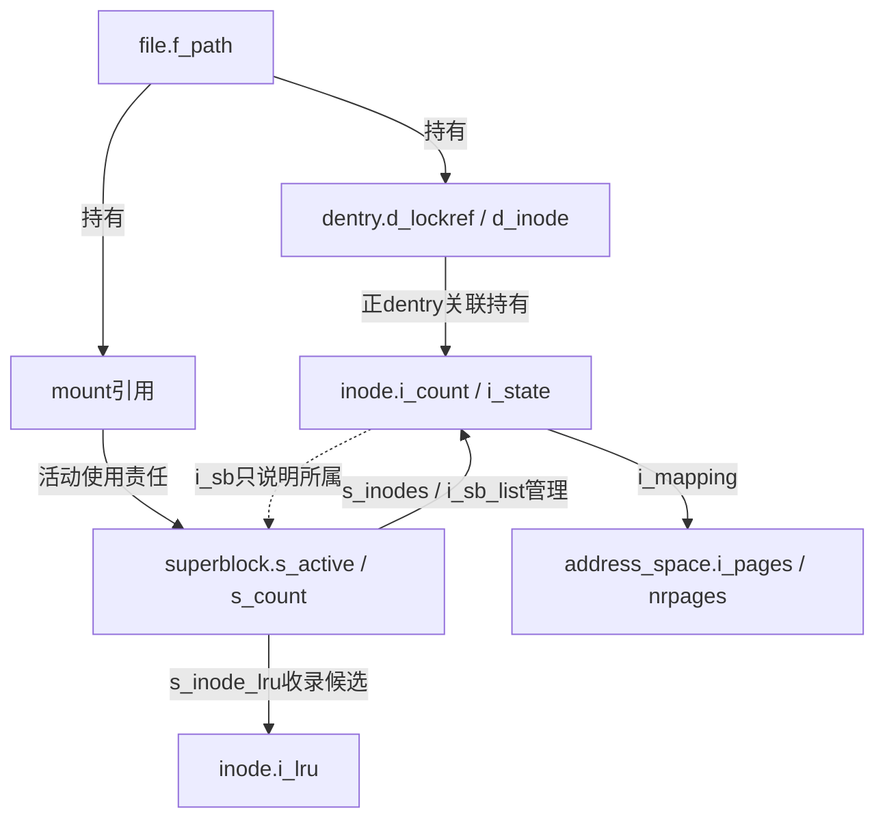
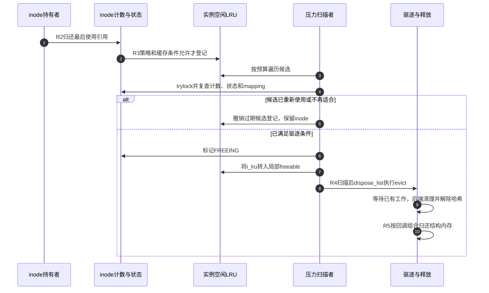

# 第20章\_对象退出与缓存回收的条件

前篇沿通知记录追踪事件与许可响应，本篇回到这些机制共同依赖的对象生命期：目录名字已经撤销，file、映射、通知或内核路径却仍可能持有对象。读源码时需要分别回答“谁不再可见”“谁不再使用”“谁已完成清理”，不能仅沿函数名中的put、destroy和free串成一条无条件释放链。

**讲解层次：实现层，Linux 6.12.20。** 固定提交 `dfaf2136deb2af2e60b994421281ba42f1c087e0`，配置采用ARM、TINY_RCU、HIGHMEM，启用ext4、FSNOTIFY和POSIX ACL，关闭SECURITY及FS_ENCRYPTION。配置只约束本次具体分支，正文的持有责任不能由关闭某个子系统而省略。总体机制与可运行的unlink/dup/mmap实验见 [对象回收正文](../../../../knowledge/kernel_subsystems/vfs/P21_file_dentry_inode与superblock回收.md)。

## 20.1\_按退出阶段找持有与状态

R0～R5是一次操作的阅读阶段，不是file、dentry、inode与实例共用的一份状态枚举。先从实际仍有责任的对象出发，再判断它能推进到哪一阶段。

| 阶段与问题 | 状态落点与参与路径 | 唯一实现入口 |
| --- | --- | --- |
| R0谁取得使用责任 | fd槽位、file引用、VMA及f_path | [最后file与执行上下文](../source_explanations/P30_描述符脱离与最后file引用的释放.md#30.3_最后引用归零后把清理交给可执行的上下文) |
| R1名字撤销后谁仍可用 | 目录绑定、dentry哈希及inode链接数 | [名称失效与别名处理](../source_explanations/P12_名称失效与最后使用者退出.md#12.2_删除后的缓存结果取决于是否还有其他持有) |
| R2最后使用如何归还 | file最终清理、dentry持有、inode.i_count | [最后inode引用](../source_explanations/P63_最后inode引用与缓存保留.md#63.1_最后使用引用先进入缓存或驱逐决策) |
| R3为何还能留下缓存 | dentry保留条件、drop策略、i_lru与mapping | [inode缓存资格](../source_explanations/P63_最后inode引用与缓存保留.md#63.3_缓存保留不等于马上进入空闲LRU)及 [扫描复查](../source_explanations/P65_空闲inode扫描与卸载驱逐.md#65.2_扫描候选仍要重新检查引用与缓存) |
| R4谁等已有工作退出 | I_FREEING、I_SYNC、I_LRU_ISOLATING与后端回调 | [驱逐等待](../source_explanations/P64_inode驱逐与最终释放.md#64.1_先退出工作集合再让后端清理)及 [隔离窗口](../source_explanations/P65_空闲inode扫描与卸载驱逐.md#65.3_暂时放锁为何需要独立隔离状态) |
| R5谁归还结构内存 | inode.i_rcu、free_inode及后端分配器 | [析构与最终释放](../source_explanations/P64_inode驱逐与最终释放.md#64.3_公共析构与最终内存归还分别交接) |
| 实例关闭怎样约束内层 | s_active、s_count、SB_ACTIVE、DYING与DEAD | [实例退出](../source_explanations/P07_实例关闭通知与最终内存回收.md#7.1_最后活动引用把流程交给关闭回调)及 [卸载inode集合](../source_explanations/P65_空闲inode扫描与卸载驱逐.md#65.4_卸载清理扫描的是实例集合) |

## 20.2\_用持有图区分引用与所属实例

file的路径持有dentry和mount；正dentry的inode关联持有inode；挂载视图负责实例活动关系。inode.i_sb只是指出所属实例，不能把它解释成每个inode都对应一份独立s_active持有。实例还通过s_inodes管理全体inode，通过s_inode_lru登记空闲候选，两者不是同一个链。

使用计数、链接数、脏/写回标志与缓存资格共同决定退出；图中没有一条“i_count减一就同步减少s_active”的边。对照源码时，先找实际加减动作，再解释一条指针的所有权。

## 20.3\_按一个候选从保留走到释放

设一个仍有名字的inode暂时没人使用，最后iput允许它保留并登记LRU。内存压力扫描时，它可能仍可回收，也可能已经重新被使用；这些分支决定是撤销过期候选、给第二次机会，还是转交驱逐。

步骤5和步骤7都从LRU移除节点，只有后者进入本轮驱逐。步骤10还可能延后到RCU回调，不能用扫描函数的返回计数当作已经释放结构内存的逐项证据。若步骤4遇到有缓存内容的对象，内部还有设I_LRU_ISOLATING、放锁处理、清位唤醒、重新遍历的窗口，详见对应实现篇。

## 20.4\_验证结果能证明到哪一步

普通用户程序可以证明unlink后旧fd仍可读、两个fd关闭后映射仍有效，不能直接观察内核引用精确值或RCU回调完成。要继续研究回收，应分别观察候选登记、驱逐入口和实际释放回调，避免仅按函数名或统计字段命名判断。

| 观察 | 可以支持 | 不能单独支持 |
| --- | --- | --- |
| stat名字返回ENOENT | 本次名称查找失败 | 原inode已无合法使用者 |
| fstat旧fd的nlink为0 | 文件没有普通硬链接 | file、VMA和内核持有已经全部退出 |
| LRU候选被移除 | 本轮候选关系改变 | 一定发生evict或内存归还 |
| evict到后端清理 | 已满足对应驱逐调用前提 | 磁盘文件必被删除或持久擦除 |
| call_rcu已提交 | 回调进入延后处理协议 | 回调已经运行 |

实现修改应同时检查正常使用、缓存命中、压力回收和实例退出；每条路径的状态写入者、锁与最终释放器必须配对。返回 [源码总索引](P01_Linux_6.12_VFS源码阅读索引.md)，下一步从实例关闭进入正文的冻结与卸载问题，不在本篇把所有退出入口都解释成最后一次iput。
