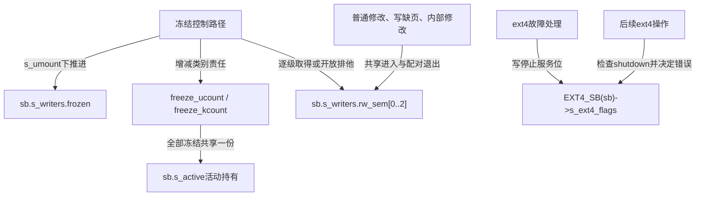
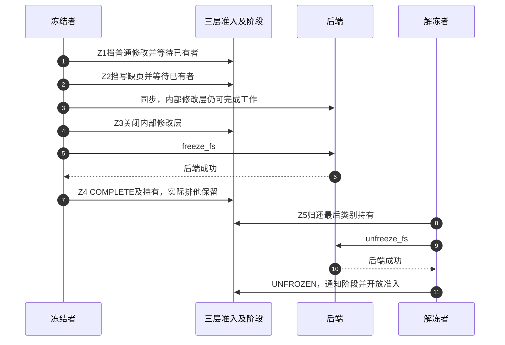

# 第21章\_冻结卸载与故障状态的边界

对象回收说明每份持有怎样退出，但实例可能还要临时停止修改、从挂载拓扑分离，或因设备失效拒绝服务。这三类动作分别修改冻结准入、挂载关系与后端错误状态，不能用一个shutdown函数名串成必经流程。

**讲解层次：实现层，Linux 6.12.20。** 固定提交 `dfaf2136deb2af2e60b994421281ba42f1c087e0`。当前ARM配置采用TINY_RCU，开启BLOCK、EXT4、JBD2、PROVE_LOCKING和DEBUG_LOCK_ALLOC；本次不执行真实冻结、卸载或故障注入。总体因果解释及可执行准入模型见 [正文冻结与退出](../../../../knowledge/kernel_subsystems/vfs/P22_freeze_unmount与故障退出.md)。

## 21.1\_按冻结周期定位状态与参与者

Z0～Z5只用于冻结周期；卸载和故障是相邻协议，不把它们追加成Z6、Z7。先沿一个可写实例的首次冻结建立次序，再检查并发持有、只读、失败与后端差异。

| 阶段与问题 | 状态落点 | 唯一实现入口 |
| --- | --- | --- |
| Z0修改者如何登记 | s_writers.rw_sem[0..2]的共享侧 | [分级准入](../source_explanations/P66_冻结写入的分级准入.md#66.1_修改者在冻结门上取得读侧) |
| Z1怎样挡普通修改 | frozen=WRITE，第0层排他与s_umount锁序 | [冻结协调](../source_explanations/P67_冻结阶段推进与失败回退.md#67.1_逐级收口并把同步放在内部关闭之前) |
| Z2为何先挡写缺页再同步 | 第1层排他、sync_filesystem | [同步交接](../source_explanations/P67_冻结阶段推进与失败回退.md#67.2_同步协调的是多个后端完成步骤) |
| Z3内部工作何时退出 | 第2层排他、freeze_fs回调 | [ext4后端契约](../source_explanations/P68_解冻持有与后端恢复.md#68.3_ext4回调依赖上层冻结门保持区间) |
| Z4返回后谁保持冻结 | COMPLETE、两类持有、共享活动引用、实际排他 | [并发请求](../source_explanations/P67_冻结阶段推进与失败回退.md#67.3_并发冻结请求等待阶段再登记类别)及 [诊断记录交接](../source_explanations/P67_冻结阶段推进与失败回退.md#67.4_诊断持锁记录交接不开放实际准入) |
| Z5怎样允许后续修改 | 类别计数、unfreeze_fs、三层开放 | [解冻持有](../source_explanations/P68_解冻持有与后端恢复.md#68.1_先减少所属类别再判断能否开放) |
| 用户怎样选择实例 | file_inode的i_sb与实例用户命名空间能力 | [用户ioctl入口](../source_explanations/P66_冻结写入的分级准入.md#66.3_用户请求通过文件找到整个实例) |

## 21.2\_三组状态分别保存在哪里

冻结阶段字段负责控制流程，三组信号量负责准入，类别计数负责谁还要求保持区间；这些状态都属于同一个superblock，但读写者和生命周期不同。ext4私有shutdown位又是独立状态，正常解冻不会把它清除。

普通修改在冻结门上取读侧，不表示它在读取文件。frozen值也不是信号量内部block字段；观察到某个控制阶段，不能跳过真实准入的取得完成条件。实例仍可能有其他活动持有，图中共享的一份只说明冻结协议自己的责任。

## 21.3\_从成功保持到最后一次开放

步骤3与4的先后是为了让同步有能力完成内部工作。步骤7到11之间是稳定修改区间，发起冻结的任务不必一直在内核中阻塞；诊断持锁记录可以交接，实际排他不能提前解除。非最后持有或后端失败时不进入图中的最终开放，详细返回值见实现篇。

卸载另走 [挂载脱离与最后引用](../source_explanations/P10_挂载脱离与最后引用退出.md#10.1_普通卸载先判断是否允许结束可见使用)，最后实例清理复用 [关闭与最终释放](../source_explanations/P07_实例关闭通知与最终内存回收.md#7.1_最后活动引用把流程交给关闭回调)。设备故障则进入 [有效实例访问](../source_explanations/P69_设备失效与文件系统停止服务.md#69.1_设备失效通知先取得仍有效的实例)与 [后端停止服务](../source_explanations/P69_设备失效与文件系统停止服务.md#69.2_停止服务位如何改变后续入口)。

## 21.4\_把返回值放回各自接口责任

| 现象或返回 | 应检查的状态 | 不能直接推出 |
| --- | --- | --- |
| 冻结调用返回0 | 所选通用或后端冻结契约、类别持有 | 每份应用内存事务都已提交，或所有文件系统都相同 |
| 中途冻结失败 | 哪几层已取得、回退与活动引用 | 仍有一个可供快照使用的冻结区间 |
| 固定版本非最后解冻返回-EINVAL | 类别计数可能已经减少 | 本次没有状态变化，可以无限重试归还 |
| ext4解冻返回0 | 冻结准入与私有shutdown分别检查 | 设备恢复，或superblock提交已验证成功 |
| lazy卸载返回 | 挂载可达性与旧持有 | 实例已关闭或缓存已全部释放 |
| 错误日志写“只读” | 实际SB_RDONLY、私有错误位及调用锁序 | VFS标志必定已经改变 |

正文C模型只验证准入收口与回退的预期顺序；源码摘录与配置核对支持固定版本分支判断，没有替代Linux运行、并发冻结或设备失效实测。返回 [源码总索引](P01_Linux_6.12_VFS源码阅读索引.md)，下一章通过具体文件系统接入验证对象与操作表怎样建立。
