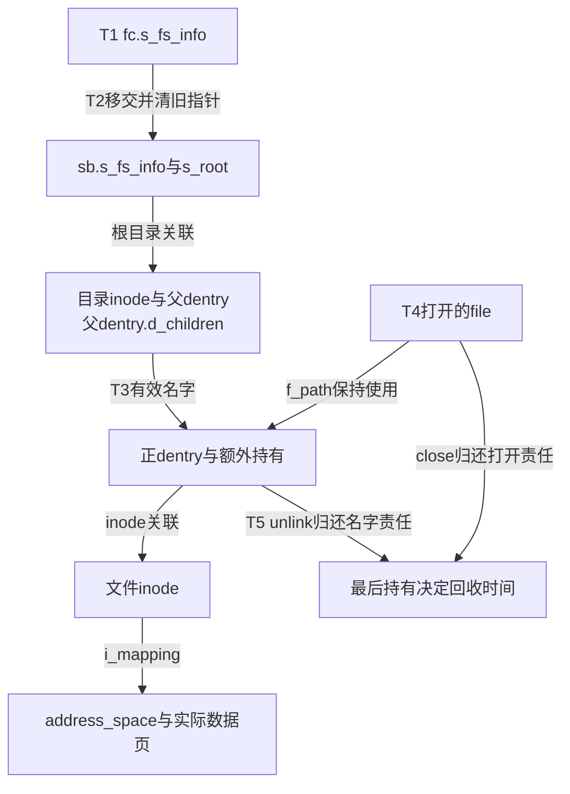
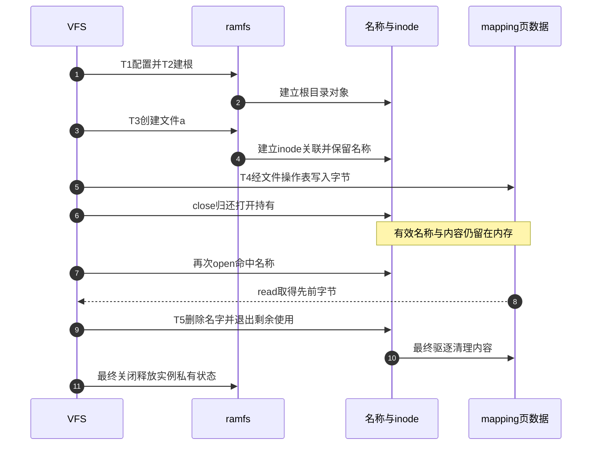

# 第22章\_ramfs把缓存对象变成文件系统

本模块回答后端作者的问题：VFS已经有名称、inode、打开对象和页缓存，ramfs还要增加哪些责任才能成为可使用的文件系统？关键在于这些对象不再只是可从磁盘重建的缓存；有效名称和数据本身就由它们承载。

**讲解层次：固定实现的模块概念导读，Linux 6.12.20。** 提交 `dfaf2136deb2af2e60b994421281ba42f1c087e0`，当前ARM配置MMU=y。知识入口为 [具体文件系统接入](../../../../knowledge/kernel_subsystems/vfs/P23_具体文件系统接入VFS.md)，总入口为 [VFS源码索引](P01_Linux_6.12_VFS源码阅读索引.md)。本页组织职责与阅读顺序，不复制函数体。

## 22.1\_沿一次实例使用定位状态

| 阶段 | 触发与状态地址 | 写入、消费与退出条件 |
| --- | --- | --- |
| T0类型登记 | 初始化登记static ramfs_fs_type | 通用类型查询读取能力，尚无用户实例内容 |
| T1配置请求 | init_fs_context分配fsi，fc.s_fs_info指向它 | 默认0755，parse_param写mode；未移交时free_fc负责释放 |
| T2实例与根 | sget_fc接手sb.s_fs_info并清配置指针 | fill_super写s_op/s_root，根inode和dentry建立；失败沿建树框架回滚 |
| T3名称建立 | 父目录同步范围内创建候选 | ramfs方法建立inode关联，额外dget保住有效名字；链接另增nlink和inode引用 |
| T4内容使用 | file.f_mapping指向inode的address_space | 通用I/O与ram_aops操作内存页，close归还打开持有但不删除名字 |
| T5责任退出 | unlink、截断、最后使用及最终实例关闭 | 分别归还名称、页内容、inode和选项，不能把某一步等同于全部释放 |

阶段描述的是一条使用主线；名称计数、对象引用和页状态仍是不同维度。多个名字和打开者可以使T3～T5交错，不能据此要求整个实例只处于某个单一枚举值。

## 22.2\_先理解驻留再阅读方法表

没有后备目录，正常关闭之后仍要保留正名称；没有后备数据，不能把有效页当成可随时重新读入的干净副本。ramfs分别用名称额外持有和内存页策略承担这些责任。表项不是设计理由，读完这段因果关系以后再看表，才能理解为什么创建与删除必须配对。

这个周期不要求数据曾被写到设备。fsync直接成功与noop_dirty_folio设置脏位能够同时成立，它们回答的是不同接口问题。`size=`被忽略也不能被当作容量限制生效，实验只使用有界的小数据。

## 22.3\_按责任寻找唯一实现

| 当前问题 | 唯一实现入口 | 阅读时要带走的结论 |
| --- | --- | --- |
| 类型和实例为何分开 | [配置根与生命期](../source_explanations/P70_ramfs配置根与实例生命期.md#70.1_类型描述只注册能力而不保存实例状态) | 静态能力共享，私有选项单独分配并移交 |
| 创建为何多取持有 | [名称驻留](../source_explanations/P71_ramfs名称操作与驻留责任.md#71.1_创建成功以后把名字留在内存) | inode关联与名称驻留是两份不同责任 |
| 硬链接和删除怎样配对 | [查找与链接](../source_explanations/P71_ramfs名称操作与驻留责任.md#71.3_查找与硬链接必须保持同一份名称模型) | nlink、inode引用和dentry引用分开核对 |
| 读写如何落到内存 | [页数据与操作表](../source_explanations/P72_ramfs页数据与文件操作表.md#72.1_MMU构建选择具体文件操作表) | 当前MMU方法进入同一mapping，不混用无MMU表 |
| 根构造失败和最终关闭 | [根与退出](../source_explanations/P70_ramfs配置根与实例生命期.md#70.3_根构造与退出各自承担一次清理) | d_make_root消费inode，选项只由当前所有者释放 |
| 属性、截断与fsync | [后端接口边界](../source_explanations/P72_ramfs页数据与文件操作表.md#72.3_属性和同步接口必须按后端契约理解) | 返回成功不等于磁盘持久化 |

通用挂载、名称发布、页复制和驱逐仍由已有模块负责。这里新增的是ramfs如何选择并兑现它们，未复制同版本通用函数体到第二处讲解。

## 22.4\_用关闭重开检查责任而非猜引用数

正文的C程序在确认ramfs类型后建立私有目录，依次写a、链接b、改名c、删a、关闭再打开c。预期链接数为1，重开仍读到原内容；不能从用户态输出反推出某一瞬间d_lockref或i_count的全部内部持有。

核对范围包括配置选择、参数接受边界、失败清理、34段函数和9张静态表的执行token、图与正文的一致性。当前没有目标Linux编译运行、命名空间挂载或内存压力结果。下一模块进入特殊文件与伪文件系统，继续问统一file接口后面是否一定是普通页数据。
