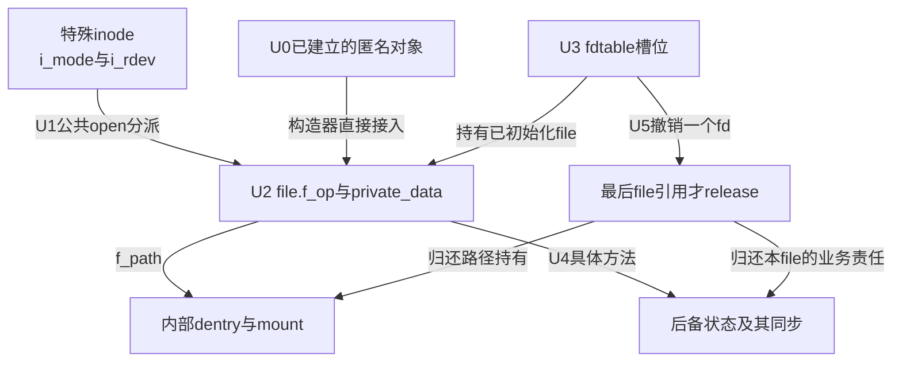
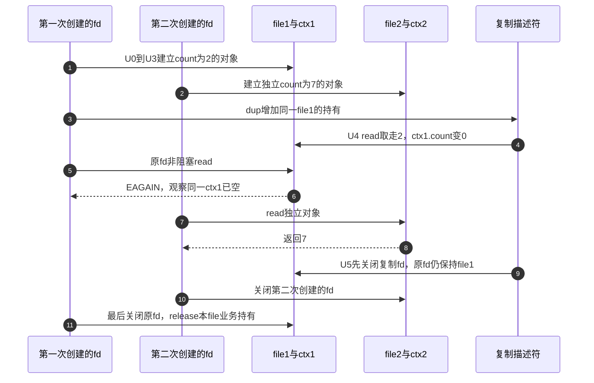

# 第23章\_特殊文件与匿名对象的VFS交接

普通文件靠mapping保存内容，但统一file接口还可连接设备、管道、socket和内核计数器。本模块追踪入口怎样选择最终方法，以及file怎样保住它依赖的对象；不将不同子系统的内部算法拼成一套“所有文件都如此”的实现。

**讲解层次：固定实现的模块概念导读，Linux 6.12.20。** 提交 `dfaf2136deb2af2e60b994421281ba42f1c087e0`。知识入口为 [特殊文件与伪文件系统](../../../../knowledge/kernel_subsystems/vfs/P24_特殊文件与伪文件系统接入.md)，总入口为 [VFS源码索引](P01_Linux_6.12_VFS源码阅读索引.md)。当前BLOCK、EVENTFD、NET、PROC_FS和SYSFS开启，SECURITY关闭。

## 23.1\_沿建立发布使用退出定位状态

| 阶段 | 实际承载 | 写入、消费与退出条件 |
| --- | --- | --- |
| U0实际对象建立 | cdev或子系统私有队列、eventfd_ctx等 | 子系统分配与初始化，不能指望通用fd层猜测对象类型 |
| U1入口选择 | 特殊inode的类型/设备号，或内核伪path | 路径查找选公共入口；直接创建则准备内部dentry及mount |
| U2file完整化 | f_path、f_inode、f_mapping、f_op、private_data | 打开分派或构造器设置方法与状态指针，尚未交给用户 |
| U3描述符发布 | fdtable槽位及CLOEXEC状态 | 预留号码以后安装完整file，失败归还预留 |
| U4使用 | 具体方法消费private_data或其他后备关系 | 真实状态、锁、等待与位置语义由各子系统定义 |
| U5退出 | fd撤销、file最后引用与子系统额外引用 | 最后release归还本file责任，不自动证明所有业务引用已空 |

这六阶段允许子系统在内部调整预留号码的时点，但“完整初始化早于发布”必须保持。inode共享、file共享和业务对象共享是三个不同问题，不能只用fstat的inode编号判断。

## 23.2\_按入口追到最终状态

| 问题 | 唯一实现入口 | 本模块证明的边界 |
| --- | --- | --- |
| 特殊inode为何还要公共open | [类型与字符分派](../source_explanations/P73_特殊inode的类型选择与打开分派.md#73.1_类型位决定初始入口而非最终服务) | i_fop可以只是初始入口，最终file.f_op由打开交接决定 |
| 不走目录查找怎样建立path | [伪路径file](../source_explanations/P74_伪路径file的建立与失败归还.md#74.1_内部path仍有真实持有责任) | 无普通名字仍有dentry与mount的生命期 |
| 是否调用具体open | [file初始化](../source_explanations/P74_伪路径file的建立与失败归还.md#74.2_初始化file不等于重新走一次普通open) | 直接构造路径要求调用者准备实际状态 |
| inode共享是否等于计数共享 | [匿名inode与private_data](../source_explanations/P75_匿名inode的共享与私有对象交接.md#75.2_共享inode不共享每次创建的私有状态) | 同一inode可承载不同file和不同业务对象 |
| getfile与getfd有何不同 | [号码发布](../source_explanations/P75_匿名inode的共享与私有对象交接.md#75.3_号码发布和类别显示都不创造业务状态) | 构造file与预留安装fd是不同职责 |

字符设备号登记及硬件移除继续阅读 [字符设备模块](../../character_device/navigation/P03_文件操作与打开寿命导读.md)。本模块只新增公共类型与打开交接的唯一实现，未复制驱动队列、等待和设备移除教材。

## 23.3\_管道网络与动态属性保留自己的协议

下表是固定原件的边界索引，不是把所有后端算法合并到当前章节。它让读者定位实际状态，再进入相应专题，而不是假定每种file都只读写页缓存。

| 固定原件与入口 | 实际对象位置 | 当前只证明什么 |
| --- | --- | --- |
| [pipe.c](../../linux/fs/pipe.c)，create_pipe_files | 两个file.private_data指向同一inode.i_pipe | 两个file共享管道状态；内部缓冲消费与等待不在此重复展开 |
| [socket.c](../../linux/net/socket.c)，sock_alloc_file | file.private_data指向socket，sock.file回指 | socket_file_ops连接网络服务；目录socket节点不是这一打开路径 |
| [proc/inode.c](../../linux/fs/proc/inode.c)，proc_reg_read及read_iter | inode对应proc_dir_entry，其proc_ops选择提供者 | 非永久条目先use_pde后调用再unuse，条目失效不能只看旧file还存在 |
| [sysfs/file.c](../../linux/fs/sysfs/file.c)，sysfs_kf_seq_show及sysfs_kf_write | kernfs_open_file连接节点，父节点priv取得kobject | 普通文本属性调用show/store，二进制属性走自己的回调 |
| [kernfs/file.c](../../linux/fs/kernfs/file.c) | kernfs_open_file及节点活跃使用协议 | 对象移除与回调有效性由kernfs协调，不能由一个普通fd引用替代 |
| [eventfd.c](../../linux/fs/eventfd.c)，do_eventfd及eventfd_read | file.private_data指向eventfd_ctx，count与wqh共同维护协议 | 独立创建与dup共享关系，实验只验证非阻塞的小计数读取 |

这里“内部伪文件系统”特指anon_inodefs、pipefs、sockfs这类承载；procfs、sysfs虽也常被称为伪文件系统，却提供可见目录视图。不能把前一组init_pseudo中的SB_NOUSER套到后一组的正常挂载行为。

## 23.4\_修改交接时先列失败责任

改变构造器时，逐阶段列出已取得的模块、inode、dentry、mount、file和fd号码，再决定失败出口释放谁。alloc_file_pseudo失败时补回inode引用就是为了让外层失败清理仍遵守同一契约，不应当作多余引用删掉。

正文C实验打印三个fd的显示名与inode，再检查2、EAGAIN、7的消费顺序。它不能证明内核指针地址、引用精确值、并发等待或所有匿名接口都共享inode。当前没有目标Linux编译运行结果；源码、阶段图和接口边界是本轮依据。
