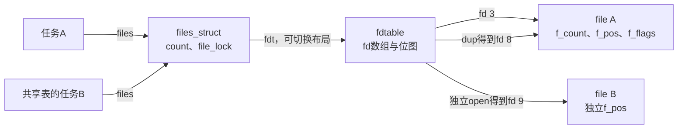
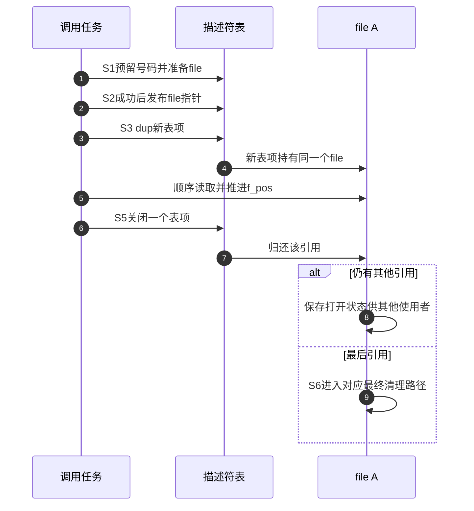

# 第1章\_描述符表与打开对象的状态归属

第一章实验的三个fd只有两组读取位置。要解释这个结果，先把表项和打开对象的状态分别找到，不能从fd数字猜测对象身份。本页是字段声明的唯一阅读说明，调用阶段由 [对象模块导读](../navigation/P02_同一次打开怎样跨越对象状态.md#2.1_先确认观察的是哪一条状态轴) 串联，版本身份见 [VFS总索引](../navigation/P01_Linux_6.12_VFS源码阅读索引.md#1.1_先固定源码身份与运行证据)。

固定NXP提交为 `dfaf2136deb2af2e60b994421281ba42f1c087e0`，Linux 6.12.20。原件include/linux/fdtable.h的blob为 `b1c5722f2b3ce4ba82e89716d5e27f85c67a8afd`，include/linux/fs.h为 `b98f128c9afa78f02ea273a7f98b12c7761e7ae5`。下面的file片段明确裁剪；它用于认识状态位置，不能复制为另一份内核结构定义，也不能据此硬编码字段偏移。

## 1.1\_表项状态与打开状态的边界

files_struct是可被任务共享的容器，fdtable是它当前使用的表布局。fdtable.fd指向一个file指针数组，fd数字只用来选择数组中的位置。file则保存一次打开的状态。扩容时可以替换表布局，而已经存在的file无需因此全部重建。



这说明为什么要同时管理容器引用、表项公开和file引用。关闭fd 3改变的是一个表项；fd 8仍可引用file A。更换fdtable也不是关闭所有文件，它需要把表项关系迁移并按读侧协议发布新布局。

## 1.2\_fdtable把指针数组与分配状态放在一起

```c
/** @brief 仓库补充阅读说明：以下保留固定版本声明，含义由相邻正文解释。 */
struct fdtable {
	unsigned int max_fds; /* 当前布局容量，不是已安装file数 */
	struct file __rcu **fd; /* 当前file指针数组；号码用作下标 */
	unsigned long *close_on_exec; /* 每个fd独立的exec关闭位 */
	unsigned long *open_fds; /* 号码预留或占用位；可先于file发布 */
	unsigned long *full_fds_bits; /* open_fds的满字汇总，辅助查找空位 */
	struct rcu_head rcu; /* 旧动态布局的延后回收节点 */
};
```

| 字段 | 类型含义与职责 | 修改和读取边界 |
| --- | --- | --- |
| max_fds | 指针数组可索引范围 | 读侧必须验证边界，不能把容量当当前已打开数量 |
| fd | RCU发布的file指针数组 | S2安装、S5移除；读侧按合法取得协议获取file |
| open_fds | 已占用或预留号码位图 | S1可先预留号码，因此有位不等于完整file已公开 |
| close_on_exec | 每描述符的执行时关闭位图 | 属于fd，不与file.f_flags合并 |
| full_fds_bits | 加速寻找空位的汇总位图 | 不另保存文件对象，不可脱离open_fds更新规则修改 |
| rcu | 表布局延后回收的登记节点 | 服务旧布局读者退出，不自动保活任意file裸指针 |

位图和指针数组回答不同问题。分配端可以先保证号码不被另一个分配者拿走，再完成file准备；失败归还号码，成功才发布指针。读者不能因为某位已置位就假设数组内容已经可用。

## 1.3\_files\_struct同时承载共享与扩容协调

```c
/** @brief 仓库补充阅读说明：以下保留固定版本声明，含义由相邻正文解释。 */
#define NR_OPEN_DEFAULT BITS_PER_LONG

struct files_struct {
  /*
   * read mostly part
   */
	atomic_t count; /* 容器的共享持有数，不是file引用数 */
	bool resize_in_progress; /* 扩容协议状态；与安装及等待路径协调 */
	wait_queue_head_t resize_wait; /* 等待扩容交接的队列 */

	struct fdtable __rcu *fdt; /* 经发布协议切换的当前布局指针 */
	struct fdtable fdtab; /* 容器内嵌的初始布局 */
  /*
   * written part on a separate cache line in SMP
   */
	spinlock_t file_lock ____cacheline_aligned_in_smp; /* 保护表的分配、替换等修改，不保护文件内容 */
	unsigned int next_fd; /* 空闲号码搜索起点提示 */
	unsigned long close_on_exec_init[1]; /* 初始close_on_exec位图存储 */
	unsigned long open_fds_init[1]; /* 初始open_fds位图存储 */
	unsigned long full_fds_bits_init[1]; /* 初始汇总位图存储 */
	struct file __rcu * fd_array[NR_OPEN_DEFAULT]; /* 初始file指针数组存储 */
};
```

NR_OPEN_DEFAULT使用BITS_PER_LONG作为初始槽数，与本构建的long位宽有关，不是固定所有平台都为32或64的用户ABI。位图按unsigned long组织，初始数组至少能容纳相应粒度。SMP布局注解只影响布局和缓存行安排，不改变每个字段的对象语义。

| 字段组 | 谁使用及其作用 | 不能由此推出什么 |
| --- | --- | --- |
| count | 共享该容器的持有者配对取得归还 | 不等于某个file的引用数 |
| resize_in_progress、resize_wait | 扩容者协调其他扩容/安装参与者 | 不能用私有布尔变量代替等待与发布协议 |
| fdt | 读侧取得当前布局入口 | 不能跨可能切换布局的边界一直保存裸指针 |
| fdtab | 容器内嵌初始布局 | 后续扩容不保证fdt永远指向这里 |
| file_lock | 串行化相应表项分配和修改路径 | 不是文件内容锁，也不是全部VFS大锁 |
| next_fd | 寻找可用号码的起点提示 | 不代表永久单调递增，关闭后可复用 |
| 三组*_init位图与fd_array | 初始内嵌存储 | 不限制该任务终生只能有初始数量的fd |

引用和RCU必须分别看待。RCU使特定观察期间的布局回收可协调，file引用使取得的打开对象可以在需要的范围内继续使用。读者还必须按实现检查表项及对象身份，不能把“进入RCU临界区”翻译成“表里所有file都归我永久使用”。具体取得、扩容和关闭分别见 [引用后的身份验证](P28_描述符查询的引用验证与轻量借用.md#28.1_取得引用之后还要验证槽位与表版本)、[扩容交接](P27_描述符预留扩容与发布协议.md#27.3_扩容先让安装者改道再复制当前布局) 与 [槽位撤销](P30_描述符脱离与最后file引用的释放.md#30.1_先从表中撤销并接收那份已有引用)。

## 1.4\_struct\_file保存一次打开的共享状态

以下保留到f_pos的连续声明，省略后部安全、通知、延迟错误、任务工作及存储复用字段。管道与普通文件的位置相关成员共享union，但含义不同；看到union不能在一种对象上随意按另一种解释读取。

```c
/** @brief 仓库补充阅读说明：以下保留固定版本声明，含义由相邻正文解释。 */
struct file {
	atomic_long_t			f_count; /* 本次打开对象的持有引用 */
	spinlock_t			f_lock; /* 保护标志及特定关联，不能替代位置锁 */
	fmode_t				f_mode; /* 内核模式与能力位 */
	const struct file_operations	*f_op; /* 本次打开实际使用的方法表 */
	struct address_space		*f_mapping; /* 指向文件数据的address_space */
	void				*private_data; /* 具体方法实现约定的每打开上下文 */
	struct inode			*f_inode; /* 关联的文件本体 */
	unsigned int			f_flags; /* 打开状态标志，不含每fd的CLOEXEC */
	unsigned int			f_iocb_flags; /* 供I/O请求使用的派生标志 */
	const struct cred		*f_cred; /* 分配file时取得的凭据引用 */
	/* 上游布局说明中的缓存行边界；不构成用户ABI承诺。 */
	struct path			f_path; /* 本file持有的挂载与名称组合 */
	union {
		/* 普通文件（FMODE_ATOMIC_POS）与目录使用位置锁。 */
		struct mutex		f_pos_lock; /* 需原子位置语义时使用的互斥锁 */
		/* 管道使用另一种解释。 */
		u64			f_pipe; /* 管道使用同一联合体空间，不能当位置锁读取 */
	};
	loff_t				f_pos; /* 顺序I/O的位置；dup共享同一个字段 */
	/* 仓库裁剪：省略安全、通知、错误跟踪与释放存储字段及布局属性。 */
};
```

| 字段或字段组 | 当前需要的含义 | 保护与调用边界 |
| --- | --- | --- |
| f_count | file的持有引用 | 最后一份归还才进入最终清理，不等于fd数 |
| f_lock | 原件约定保护f_flags和epoll关联f_ep的自旋锁 | 不从IRQ上下文获取；不替代f_pos_lock，也不保护后端所有数据 |
| f_mode | 内核解释的模式与能力位 | 与open状态标志f_flags是不同集合 |
| f_flags、f_iocb_flags | 打开状态标志及派生的I/O标志 | 不包括每fd独立的close_on_exec位 |
| f_op | 已为该打开选定的操作表 | 特殊文件打开路径可以改变实际分派，不按文件名直接决定 |
| f_mapping、f_inode | 数据映射和文件本体关联 | 字段存在不表示每条边另取一份独立引用 |
| private_data | 具体文件操作的私有上下文 | 由该实现定义初始化、失败清理和release责任 |
| f_cred | 打开时取得的凭据关联 | 不代表所有后续权限检查都只看它 |
| f_path | 内嵌的挂载与名称组合 | 通过相应path存续协议保持关联 |
| f_pos_lock、f_pipe | 普通文件位置串行化或管道状态的不同用途 | 是否取位置锁取决于模式及实际访问路径 |
| f_pos | 本次打开的顺序位置 | dup共享；显式偏移I/O不应被一概解释成推进该位置 |



最终清理的具体时机不能只从计数声明推断。本版本close路径与通用fput的区别在 [最后归还方式](P30_描述符脱离与最后file引用的释放.md#30.2_用户关闭与内部关闭选择不同的最后归还方式) 展开，最终的操作表、path、凭据等归还见 [依赖清理](P30_描述符脱离与最后file引用的释放.md#30.4_最终清理归还file自己的依赖)；本页不重复函数体。

修改影响也要按层判断：调整FD_CLOEXEC应走描述符标志接口，不能修改file.f_flags；控制一个驱动打开实例的私有数据，应证明private_data生命周期，不能把files_struct.count当业务计数；提高fd容量要遵守布局发布和旧表退出，不能直接realloc一个仍被并发观察的数组。这些字段说明用于识别责任，不能替代相应内核API。


## 1.5\_沿初始化和写入者验证字段关系

初始表并不是先分配一个任意数组，再把地址填到fdt。固定版本 [fs/file.c](../../linux/fs/file.c) 的静态init_files把fdt指向自身fdtab，fdtab再指向内嵌数组与三组位图；静态存储中未显式指定的成员初值为零。新建独立任务表则由dup_fd分配容器，初始化锁、等待队列、count和内嵌布局，再在旧表保护下复制有效关系。共享任务表时不会重新初始化这些状态。二者的执行分支见 [copy_files与dup_fd](P29_描述符复制与表共享的两层引用.md#29.1_任务创建先决定共享容器还是复制槽位)。

因此，修改结构声明之前应先找到真正的写入路径。下表沿前图S1～S6把声明与实现接合，不能把“存在该字段”当成“调用者可任意赋值”。

| 状态与阶段 | 初始化或后续写入者 | 读取者与交接责任 |
| --- | --- | --- |
| files_struct.count、内嵌fdtab | init_files建立初始表；dup_fd建立独立表；copy_files共享分支增加count | 任务退出由put_files_struct归还；最后容器持有退出才逐项关闭。见 [容器退出](P30_描述符脱离与最后file引用的释放.md#30.5_共享容器最后退出才关闭其中全部关系) |
| S1的open_fds、close_on_exec、next_fd | alloc_fd在file_lock下预留；失败由put_unused_fd归还号码 | 预留期间fd槽位可为空；dup_fd不会把这个半成品当成已打开文件。见 [预留](P27_描述符预留扩容与发布协议.md#27.1_分配号码只改变占用状态) |
| fdt、resize_in_progress与resize_wait | 扩容路径分配并复制布局，按安装协调协议切换fdt | 安装者在必要时改走持锁路径；旧动态表按RCU协议回收。内嵌fdtab不能像独立分配表一样释放 |
| S2的fd槽位 | fd_install接收调用者已有file持有并发布 | 槽位不是一份额外的“自动引用”；S5撤销后把槽位原有持有交给关闭者。见 [安装](P27_描述符预留扩容与发布协议.md#27.4_安装把已经初始化的持有交给槽位) |
| file的f_count、f_cred、锁 | alloc_empty_file等分配路径先建立初始持有、凭据及锁 | 此时尚未完成后端打开；后续失败要按完成到哪一步清理。见 [file初始状态](P26_file初始化与打开后失败清理.md#26.1_分配成功只建立最初的凭据锁与引用) |
| f_path、f_inode、f_mapping、f_op、f_mode | 普通打开由do_dentry_open建立关联和能力；特殊文件可选用别的构造入口 | I/O沿实际方法表读取，最终清理配对已取得资源；不能从普通打开推断所有伪file均调用open回调。见 [普通打开](P26_file初始化与打开后失败清理.md#26.3_具体打开前取得自己的持有与操作表) |
| S3以后的f_pos | 顺序I/O按文件类型及位置协议访问；复制fd仍指同一file | fdget_pos等路径在需要时增加位置锁责任，与取得file引用分开。见 [位置保护](P28_描述符查询的引用验证与轻量借用.md#28.3_位置保护在引用之外增加另一份退出责任) |

`__rcu`标注帮助静态检查识别指针访问协议，本身不会在运行时自动取得引用；缓存行布局注解也不是锁。file分配器允许对象存储按相应RCU规则复用，因而一次旧地址观察之后仅增加计数仍不足以证明身份，必须遵守上表的槽位重查路径。声明页没有BUG、WARN等执行检查可替调用者兜底；检查动作是否改变控制流应到对应实现中确认。

本页完整保留fdtable和files_struct声明，仅保留file到f_pos的连续前部；后部字段及布局属性的省略不是它们“不重要”。要修改容量策略，最小相关范围是分配、扩容、发布与回收，而不是改变max_fds一个数；要修改共享位置规则，需同时复核能力位、取得位置锁、I/O返回和释放路径。验证时至少覆盖预留后失败、扩容与安装并发、共享表关闭后号码复用，以及dup共享位置与独立open位置分离。本页源码字段和调用关系已核对，这些并发场景不是本次已执行的内核压力测试。
