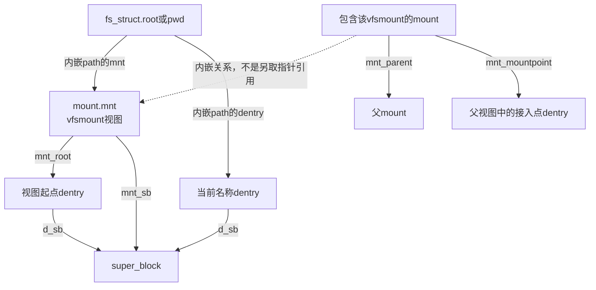
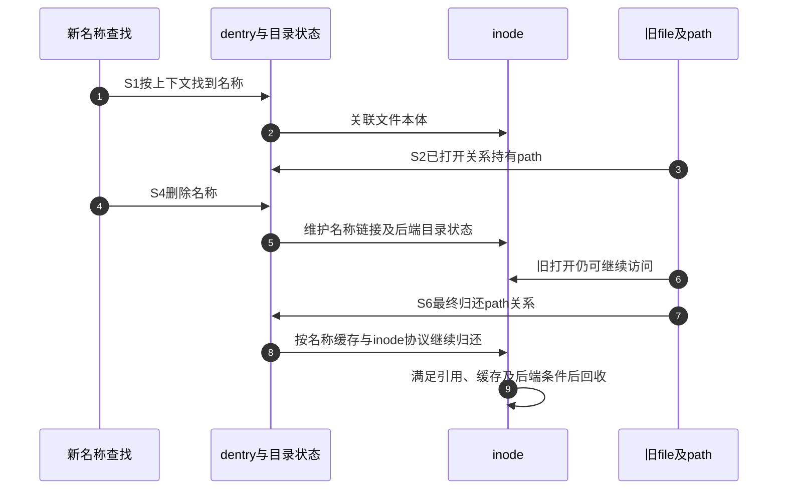
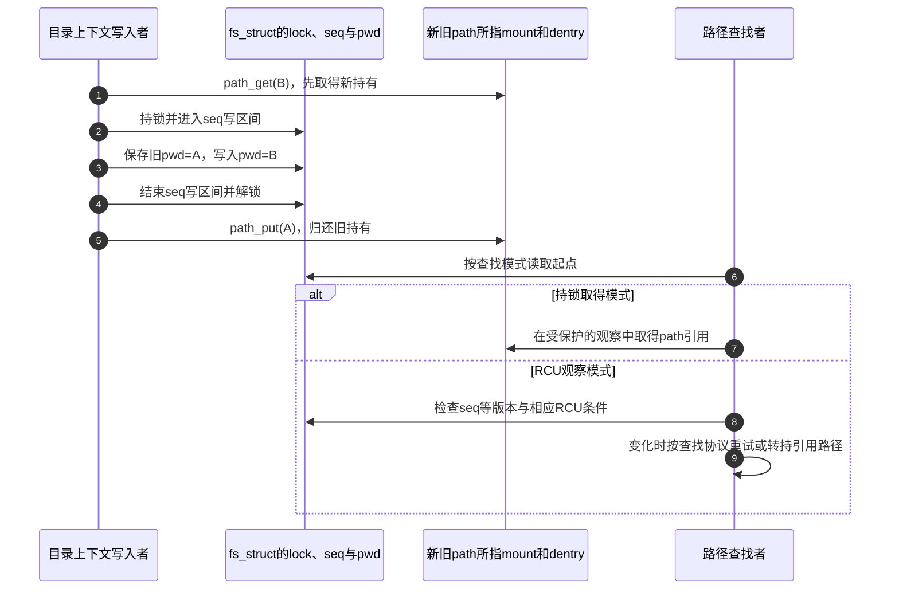

# 第2章\_路径名称与实例的字段关系

通过fd取得file之后，仍要知道它关联哪个名称和挂载；开始一次新查找时，则要从任务的根、当前目录和挂载上下文出发。这两条路径最终相交，却不是同一套起点。本页按这种区别解释字段，阶段关系见 [对象模块导读](../navigation/P02_同一次打开怎样跨越对象状态.md#2.1_先确认观察的是哪一条状态轴)，版本身份见 [VFS总索引](../navigation/P01_Linux_6.12_VFS源码阅读索引.md)。

全部声明取自NXP Linux 6.12.20固定提交 `dfaf2136deb2af2e60b994421281ba42f1c087e0`。原件为include/linux/sched.h、nsproxy.h、fs_struct.h、path.h、mount.h、dcache.h、fs.h及fs/mount.h；保留上游相对位置，关键新原件摘要见 [源码基线](../../linux/SOURCE_BASELINE.md)。裁剪块不表示完整结构，也不用于编译或硬编码偏移。

## 2.1\_任务的查找上下文不是描述符表

以下task字段分别指向目录上下文、描述符容器和命名空间集合。它们可以按不同clone/unshare规则共享；看到某一指针相同，不能自动推断另外两项也相同。

```c
/** @brief 仓库补充阅读说明：声明保持固定版本，裁剪处显式标出。 */
struct task_struct {
	/* 仓库裁剪：仅保留当前关系字段，省略其余成员和布局属性。 */
	struct fs_struct		*fs; /* 任务的根、当前目录等上下文 */
	struct files_struct		*files; /* 任务的描述符容器 */
	struct nsproxy			*nsproxy; /* 任务的命名空间关联集合 */
};
```

```c
/** @brief 仓库补充阅读说明：声明保持固定版本，裁剪处显式标出。 */
struct nsproxy {
	/* 仓库裁剪：仅保留当前关系字段，省略其余成员和布局属性。 */
	refcount_t count; /* nsproxy关联容器引用，不是挂载个数 */
	struct mnt_namespace *mnt_ns; /* 所关联的挂载命名空间，不是根path */
};
```

nsproxy.count管理这个命名空间关联容器的引用，mnt_ns是其中的挂载命名空间关联。其他命名空间字段在本页省略；nsproxy不是挂载树本身，文件系统根和当前目录也不保存在它的mnt_ns字段里。

```c
/** @brief 仓库补充阅读说明：声明保持固定版本，裁剪处显式标出。 */
struct fs_struct {
	int users; /* 共享fs_struct的使用者数 */
	spinlock_t lock; /* 串行化目录上下文的相应修改 */
	seqcount_spinlock_t seq; /* 验证root/pwd观察期间是否变化 */
	int umask; /* 创建权限的掩码上下文 */
	int in_exec; /* 与exec检查协调，不能作为路径可达标志 */
	struct path root, pwd; /* 根与当前目录，各保存一份path持有 */
} __randomize_layout;
```

| fs_struct字段 | 含义与使用者 | 关键区别 |
| --- | --- | --- |
| users | 共享目录上下文的使用计数 | 不统计fd或file引用 |
| lock、seq | 目录上下文写入与相应一致性观察 | 不是后端目录的全部操作锁 |
| umask | 创建时的权限掩码上下文 | 不是已有文件的最终权限位 |
| in_exec | 与执行新程序相关的上下文协调状态 | 不是“目录是否可查”的开关 |
| root、pwd | 两个struct path值 | root是查找根，pwd是当前目录，不是字符串 |

改变当前目录时要更新pwd的path关系，而不是修改进程中某个长期路径字符串。读取这对字段也有锁/序列与path引用协议；只复制指针值不能凭空延长对象寿命。路径获取与变化检测见 [起点建立](P13_路径起点与结果持有的交接.md#13.2_建立起点时同时确立观察或持有协议)；本页最后把root/pwd的写入和持有责任接回这一读取路径。

## 2.2\_path把挂载视图和名称组合起来

```c
/** @brief 仓库补充阅读说明：声明保持固定版本，裁剪处显式标出。 */
struct path {
	struct vfsmount *mnt; /* 挂载视图指针 */
	struct dentry *dentry; /* 该视图中的名称对象指针 */
} __randomize_layout;
```

这个结构只有两个成员，但两者缺一不可。dentry描述某个实例内的名称关系；mnt描述到达它所用的挂载视图。path_equal同时比较两个指针的原件也反映了这一点，本页不据此把裸指针比较当作完整路径查找或安全检查。

```c
/** @brief 仓库补充阅读说明：声明保持固定版本，裁剪处显式标出。 */
struct vfsmount {
	struct dentry *mnt_root; /* 进入该挂载后看到的起点，可为实例子树 */
	struct super_block *mnt_sb; /* 共享的文件系统实例 */
	int mnt_flags; /* 该挂载视图的策略标志 */
	struct mnt_idmap *mnt_idmap; /* 该视图的ID映射关联 */
} __randomize_layout;
```

vfsmount的mnt_root是该视图起点，mnt_sb指向实例，mnt_flags表达挂载视图标志，mnt_idmap是该视图的ID映射关联。后两项可能影响访问解释，不能因为inode相同就认为经所有挂载访问的策略完全相同。

```c
/** @brief 仓库补充阅读说明：声明保持固定版本，裁剪处显式标出。 */
struct mount {
	/* 仓库裁剪：仅保留当前关系字段，省略其余成员和布局属性。 */
	struct mount *mnt_parent; /* 挂载拓扑中的父mount */
	struct dentry *mnt_mountpoint; /* 父视图中的接入点，与本视图mnt_root不同 */
	struct vfsmount mnt; /* 内嵌的公共挂载视图，不是另一个mount对象 */
	struct mnt_namespace *mnt_ns; /* 所关联的挂载命名空间，不是根path */
};
```

内部mount把vfsmount内嵌为mnt，并保存父mount、接入点dentry和所属命名空间。mnt_mountpoint是它接入外部树的位置，mnt.mnt_root是进入挂载后看到的根，两者不应画成同一对象。内部或已脱离的挂载不能简单按“总有普通可见namespace”解引用mnt_ns。



bind挂载子目录时，mnt_root可以指向实例树中的子目录，super_block.s_root仍指向实例根。更改一个视图不等于复制或更换整份实例。若要保存路径供以后使用，必须遵守path取得归还协议，不能只复制这两个地址后等待原持有者释放。

## 2.3\_dentry的名称关联和存续分开维护

```c
/** @brief 仓库补充阅读说明：声明保持固定版本，裁剪处显式标出。 */
struct dentry {
	/* 仓库裁剪：仅保留当前关系字段，省略其余成员和布局属性。 */
	unsigned int d_flags; /* 名称对象状态标志，不是引用数 */
	seqcount_spinlock_t d_seq; /* 关系变化的序列验证状态 */
	struct hlist_bl_node d_hash; /* 正常名称索引的链节点 */
	struct dentry *d_parent; /* 本地名称的父dentry */
	struct qstr d_name; /* 本地名称及长度、哈希描述 */
	struct inode *d_inode; /* 当前关联inode，负结果时为空 */
	struct super_block *d_sb; /* 所属实例 */
	struct lockref d_lockref; /* 锁与引用状态的组合 */
};
```

| 字段 | 在名称缓存中表达什么 | 常见误读 |
| --- | --- | --- |
| d_parent、d_name | 父名称对象及本地名称qstr | d_name不是一整条绝对路径；qstr携带名称及长度/哈希信息 |
| d_inode | 当前所关联inode；负dentry为空 | NULL不表示内存dentry对象本身不存在 |
| d_sb | 所属文件系统实例 | 不能推出唯一的挂载位置 |
| d_hash | 用于名称查找的哈希连接 | 脱链不等于d_inode一定为空 |
| d_flags、d_seq | 状态标志与变化验证 | 不是打开计数；读者须遵守相应观察协议 |
| d_lockref | dentry锁与引用计数的组合 | 保活不能禁止所有rename或后端变化 |

S4删除名称可能让旧打开仍持有一个正dentry，而这个dentry不再作为原名称查找的索引结果；另一种处理可更新关联。不要把“正/负”“是否在名称索引中”“是否仍被引用”合并成单个枚举。对后端的重新验证也不是只检查d_inode是否非空，具体规则由文件系统与查找路径共同决定。

## 2.4\_inode与superblock承载不同共享范围

```c
/** @brief 仓库补充阅读说明：声明保持固定版本，裁剪处显式标出。 */
struct inode {
	/* 仓库裁剪：仅保留当前关系字段，省略其余成员和布局属性。 */
	umode_t			i_mode; /* 文件类型与权限 */
	struct super_block	*i_sb; /* 文件本体所属实例 */
	struct address_space	*i_mapping; /* 数据映射关联 */
	unsigned long		i_ino; /* 实例内对象编号 */
	loff_t			i_size; /* 逻辑大小，访问仍须遵守并发协议 */
	atomic_t		i_count; /* inode内存持有数，与名称链接数不同 */
};
```

这里省略了inode的锁、时间、操作表、缓存集合等成员。i_mode给出类型和权限信息，i_ino是实例中的对象编号，i_size是大小，i_sb关联实例，i_mapping关联文件数据映射，i_count是内存对象引用。大小的并发读写还需要架构和接口规定的访问方式，不应从loff_t类型推论任意裸读都安全。

名称链接数i_nlink与i_count是两套状态。固定定义把只读视角i_nlink与内部__i_nlink放在同一union中，写侧通过相应链接数辅助接口维护，不能把i_count减到零当作“文件没有名称”，也不能因为i_nlink为零立即释放仍被打开持有的inode。完整定义见原件，具体链接数与回收路径由名称修改、对象回收章节承担。

```c
/** @brief 仓库补充阅读说明：声明保持固定版本，裁剪处显式标出。 */
struct super_block {
	/* 仓库裁剪：仅保留当前关系字段，省略其余成员和布局属性。 */
	struct file_system_type	*s_type; /* 实例所属的实现类型 */
	const struct super_operations	*s_op; /* 实例生命周期等操作表 */
	struct dentry		*s_root; /* 实例的根名称对象 */
	struct rw_semaphore	s_umount; /* 实例构造、使用与退出协调的读写信号量 */
	int			s_count; /* 临时结构持有，与活动引用分别配对 */
	atomic_t		s_active; /* 活动持有，最后归还会进入关闭协议 */
};
```

s_type关联实现类型，s_op提供实例相关操作，s_root是实例根；s_umount参与实例挂载/退出等协调，s_count与s_active属于不同引用协议，不能任取一个字段当“活跃文件数”。一个实例可以由多个挂载视图引用，它们的mnt_root也不要求都是s_root。



图表示责任交接，不要求每一次dput都立即导致inode释放。缓存可以保留对象，其他持有者可以继续使用，文件系统也可能有自己的回收条件。若调整名称缓存或挂载引用，必须验证S1并发观察、S4入口撤销与S6最终归还，不能只让单线程路径查找成功就宣称生命周期正确。


## 2.5\_从任务起点更新追踪到路径读取

设任务要把当前目录从A切到B。新路径B必须先获得持有，才能替换fs_struct.pwd；旧路径A则必须在替换后归还。只在锁内复制两个地址，既不能防止新路径原持有者退出，也会漏掉旧路径的释放责任。固定版本 [fs/fs_struct.c](../../linux/fs/fs_struct.c) 的set_fs_pwd按“path_get新路径 → fs.lock与seq写区间内替换 → 解锁 → path_put旧路径”执行；set_fs_root对root采用同样的交接原则。



图把写入步骤固定下来，读者与写入者的实际执行可以交错；序列验证的意义正在于发现这种变化。复制fs_struct时，copy_fs_struct初始化新锁、seq、users和in_exec，并在旧fs.lock下复制root/pwd且分别path_get；退出的free_fs_struct对两份path各自归还。因此两个成员即便恰好指向相同对象，也不能把两份持有合并成一次path_put。任务创建的copy_fs在CLONE_FS分支共享容器并增加users，还要拒绝与in_exec冲突的情形；它与CLONE_FILES不是同一开关。任务创建边界见 [kernel/fork.c](../../linux/kernel/fork.c)。

| 状态声明与范围 | 建立及修改入口 | 读取与退出归属 |
| --- | --- | --- |
| task.fs与fs_struct（fs_struct.h完整声明） | copy_fs决定共享或复制；set_fs_root、set_fs_pwd替换起点；exit_fs撤销任务关联 | path_init按查找模式读取；最后users归还后释放上下文及两份path |
| task.nsproxy与mnt_ns（只截取关联字段） | 命名空间创建或切换管理关联；挂载命名空间复制可重接新fs中的起点 | 命名空间描述可见挂载集合，fs.root/pwd是查找起点，不能互相代替。见 [复制命名空间](P08_挂载视图复制与目录接入.md#8.3_复制命名空间时重新连接任务的路径) |
| path完整声明、vfsmount完整声明、mount部分字段 | 克隆挂载取得后端持有；目录接入修改父连接、接入点和集合 | 查找跨挂载读取这些关系，拓扑脱离与最后释放分开。见 [复制视图](P08_挂载视图复制与目录接入.md#8.2_复制视图时取得共享后端的持有) 与 [提交拓扑](P08_挂载视图复制与目录接入.md#8.5_提交同时更新父连接查找入口和集合) |
| dentry的名称、关联与引用字段（裁剪） | __d_alloc初始化候选；关联inode、发布索引和变更名称是不同动作 | 查找取得或验证候选，dput再判断缓存或销毁。见 [候选初始化](P11_名称候选的建立发布与持有.md#11.1_分配候选只建立内存身份) 与 [归还后重查](P12_名称失效与最后使用者退出.md#12.4_快速归还遇到不确定性时持锁重查) |
| inode与super_block部分关系、计数字段（裁剪） | inode由具体文件系统构造并接入实例；superblock由公共分配及具体填充共同建立 | inode持有不是名称数；s_count与s_active分别沿自己的退出协议归还。见 [实例初始化](P06_实例匹配与构造完成的交接.md#6.1_候选先建立锁和基础持有) 与 [实例关闭](P07_实例关闭通知与最终内存回收.md#7.1_最后活动引用把流程交给关闭回调) |

这些声明中的`__randomize_layout`属于内核结构布局机制，实际效果取决于构建支持与配置；它不承诺固定偏移，也不改变root/pwd的持有关系。并发读取i_size等字段仍需对应辅助接口，不能因本次目标为单核ARM就删掉接口协议，再把代码外推到所有架构。本文未展开命名空间全部种类、dentry回收成员及具体文件系统私有inode，不把裁剪声明当作完整类型手册。

如果调整目录上下文的更新方式，必须保留“新持有先建立、受保护地替换、旧持有后归还”的不变量，并同时检查共享fs任务、独立复制和退出。若调整dentry或mount关系，影响面则扩展到跨挂载、rename、惰性卸载和查找重试，不能用一次成功open证明并发关系正确。检查日志或断言也不能替代持有；是否拒绝操作、重试或终止执行，要看实际返回与跳转。本页给出的是固定源码核对结果，未声称已完成上述内核并发实测。
