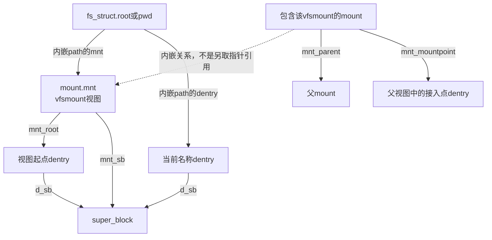
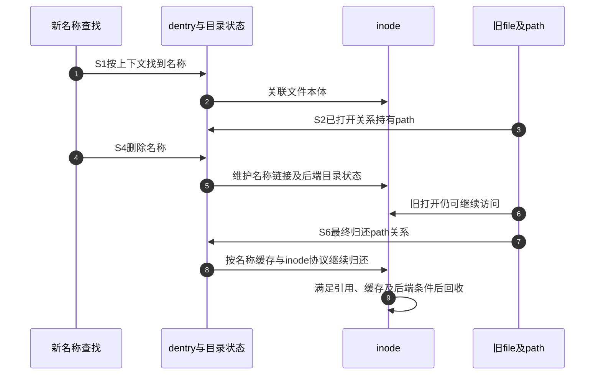

# 第2章\_路径名称与实例的字段关系

通过fd取得file之后，仍要知道它关联哪个名称和挂载；开始一次新查找时，则要从任务的根、当前目录和挂载上下文出发。这两条路径最终相交，却不是同一套起点。本页按这种区别解释字段，阶段关系见 [对象模块导读](../navigation/P02_同一次打开怎样跨越对象状态.md#2.1_先确认观察的是哪一条状态轴)，版本身份见 [VFS总索引](../navigation/P01_Linux_6.12_VFS源码阅读索引.md)。

全部声明取自NXP Linux 6.12.20固定提交 `dfaf2136deb2af2e60b994421281ba42f1c087e0`。原件为include/linux/sched.h、nsproxy.h、fs_struct.h、path.h、mount.h、dcache.h、fs.h及fs/mount.h；保留上游相对位置，关键新原件摘要见 [源码基线](../../linux/SOURCE_BASELINE.md)。裁剪块不表示完整结构，也不用于编译或硬编码偏移。

## 2.1\_任务的查找上下文不是描述符表

以下task字段分别指向目录上下文、描述符容器和命名空间集合。它们可以按不同clone/unshare规则共享；看到某一指针相同，不能自动推断另外两项也相同。

```c
/** @brief 仓库补充阅读说明：声明保持固定版本，裁剪处显式标出。 */
struct task_struct {
	/* 仓库裁剪：仅保留当前关系字段，省略其余成员和布局属性。 */
	struct fs_struct		*fs;
	struct files_struct		*files;
	struct nsproxy			*nsproxy;
};
```

```c
/** @brief 仓库补充阅读说明：声明保持固定版本，裁剪处显式标出。 */
struct nsproxy {
	/* 仓库裁剪：仅保留当前关系字段，省略其余成员和布局属性。 */
	refcount_t count;
	struct mnt_namespace *mnt_ns;
};
```

nsproxy.count管理这个命名空间关联容器的引用，mnt_ns是其中的挂载命名空间关联。其他命名空间字段在本页省略；nsproxy不是挂载树本身，文件系统根和当前目录也不保存在它的mnt_ns字段里。

```c
/** @brief 仓库补充阅读说明：声明保持固定版本，裁剪处显式标出。 */
struct fs_struct {
	int users;
	spinlock_t lock;
	seqcount_spinlock_t seq;
	int umask;
	int in_exec;
	struct path root, pwd;
} __randomize_layout;
```

| fs_struct字段 | 含义与使用者 | 关键区别 |
| --- | --- | --- |
| users | 共享目录上下文的使用计数 | 不统计fd或file引用 |
| lock、seq | 目录上下文写入与相应一致性观察 | 不是后端目录的全部操作锁 |
| umask | 创建时的权限掩码上下文 | 不是已有文件的最终权限位 |
| in_exec | 与执行新程序相关的上下文协调状态 | 不是“目录是否可查”的开关 |
| root、pwd | 两个struct path值 | root是查找根，pwd是当前目录，不是字符串 |

改变当前目录时要更新pwd的path关系，而不是修改进程中某个长期路径字符串。读取这对字段也有锁/序列与path引用协议；只复制指针值不能凭空延长对象寿命。本页解释状态归属，路径获取与变化检测由查找章节继续展开。

## 2.2\_path把挂载视图和名称组合起来

```c
/** @brief 仓库补充阅读说明：声明保持固定版本，裁剪处显式标出。 */
struct path {
	struct vfsmount *mnt;
	struct dentry *dentry;
} __randomize_layout;
```

这个结构只有两个成员，但两者缺一不可。dentry描述某个实例内的名称关系；mnt描述到达它所用的挂载视图。path_equal同时比较两个指针的原件也反映了这一点，本页不据此把裸指针比较当作完整路径查找或安全检查。

```c
/** @brief 仓库补充阅读说明：声明保持固定版本，裁剪处显式标出。 */
struct vfsmount {
	struct dentry *mnt_root;	/* root of the mounted tree */
	struct super_block *mnt_sb;	/* pointer to superblock */
	int mnt_flags;
	struct mnt_idmap *mnt_idmap;
} __randomize_layout;
```

vfsmount的mnt_root是该视图起点，mnt_sb指向实例，mnt_flags表达挂载视图标志，mnt_idmap是该视图的ID映射关联。后两项可能影响访问解释，不能因为inode相同就认为经所有挂载访问的策略完全相同。

```c
/** @brief 仓库补充阅读说明：声明保持固定版本，裁剪处显式标出。 */
struct mount {
	/* 仓库裁剪：仅保留当前关系字段，省略其余成员和布局属性。 */
	struct mount *mnt_parent;
	struct dentry *mnt_mountpoint;
	struct vfsmount mnt;
	struct mnt_namespace *mnt_ns;
};
```

内部mount把vfsmount内嵌为mnt，并保存父mount、接入点dentry和所属命名空间。mnt_mountpoint是它接入外部树的位置，mnt.mnt_root是进入挂载后看到的根，两者不应画成同一对象。内部或已脱离的挂载不能简单按“总有普通可见namespace”解引用mnt_ns。



bind挂载子目录时，mnt_root可以指向实例树中的子目录，super_block.s_root仍指向实例根。更改一个视图不等于复制或更换整份实例。若要保存路径供以后使用，必须遵守path取得归还协议，不能只复制这两个地址后等待原持有者释放。

## 2.3\_dentry的名称关联和存续分开维护

```c
/** @brief 仓库补充阅读说明：声明保持固定版本，裁剪处显式标出。 */
struct dentry {
	/* 仓库裁剪：仅保留当前关系字段，省略其余成员和布局属性。 */
	unsigned int d_flags;
	seqcount_spinlock_t d_seq;
	struct hlist_bl_node d_hash;
	struct dentry *d_parent;
	struct qstr d_name;
	struct inode *d_inode;
	struct super_block *d_sb;
	struct lockref d_lockref;
};
```

| 字段 | 在名称缓存中表达什么 | 常见误读 |
| --- | --- | --- |
| d_parent、d_name | 父名称对象及本地名称qstr | d_name不是一整条绝对路径；qstr携带名称及长度/哈希信息 |
| d_inode | 当前所关联inode；负dentry为空 | NULL不表示内存dentry对象本身不存在 |
| d_sb | 所属文件系统实例 | 不能推出唯一的挂载位置 |
| d_hash | 用于名称查找的哈希连接 | 脱链不等于d_inode一定为空 |
| d_flags、d_seq | 状态标志与变化验证 | 不是打开计数；读者须遵守相应观察协议 |
| d_lockref | dentry锁与引用计数的组合 | 保活不能禁止所有rename或后端变化 |

S4删除名称可能让旧打开仍持有一个正dentry，而这个dentry不再作为原名称查找的索引结果；另一种处理可更新关联。不要把“正/负”“是否在名称索引中”“是否仍被引用”合并成单个枚举。对后端的重新验证也不是只检查d_inode是否非空，具体规则由文件系统与查找路径共同决定。

## 2.4\_inode与superblock承载不同共享范围

```c
/** @brief 仓库补充阅读说明：声明保持固定版本，裁剪处显式标出。 */
struct inode {
	/* 仓库裁剪：仅保留当前关系字段，省略其余成员和布局属性。 */
	umode_t			i_mode;
	struct super_block	*i_sb;
	struct address_space	*i_mapping;
	unsigned long		i_ino;
	loff_t			i_size;
	atomic_t		i_count;
};
```

这里省略了inode的锁、时间、操作表、缓存集合等成员。i_mode给出类型和权限信息，i_ino是实例中的对象编号，i_size是大小，i_sb关联实例，i_mapping关联文件数据映射，i_count是内存对象引用。大小的并发读写还需要架构和接口规定的访问方式，不应从loff_t类型推论任意裸读都安全。

名称链接数i_nlink与i_count是两套状态。固定定义把只读视角i_nlink与内部__i_nlink放在同一union中，写侧通过相应链接数辅助接口维护，不能把i_count减到零当作“文件没有名称”，也不能因为i_nlink为零立即释放仍被打开持有的inode。完整定义见原件，具体链接数与回收路径由名称修改、对象回收章节承担。

```c
/** @brief 仓库补充阅读说明：声明保持固定版本，裁剪处显式标出。 */
struct super_block {
	/* 仓库裁剪：仅保留当前关系字段，省略其余成员和布局属性。 */
	struct file_system_type	*s_type;
	const struct super_operations	*s_op;
	struct dentry		*s_root;
	struct rw_semaphore	s_umount;
	int			s_count;
	atomic_t		s_active;
};
```

s_type关联实现类型，s_op提供实例相关操作，s_root是实例根；s_umount参与实例挂载/退出等协调，s_count与s_active属于不同引用协议，不能任取一个字段当“活跃文件数”。一个实例可以由多个挂载视图引用，它们的mnt_root也不要求都是s_root。



图表示责任交接，不要求每一次dput都立即导致inode释放。缓存可以保留对象，其他持有者可以继续使用，文件系统也可能有自己的回收条件。若调整名称缓存或挂载引用，必须验证S1并发观察、S4入口撤销与S6最终归还，不能只让单线程路径查找成功就宣称生命周期正确。
