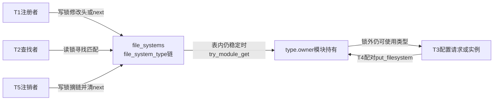
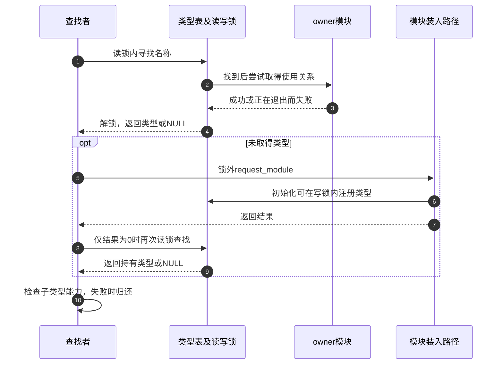

# 第3章\_文件系统类型表的发布与持有

本页解释类型发现入口的实际实现，不把类型表与superblock集合合并。先通过 [类型交接导读](../navigation/P03_类型描述怎样交给配置请求.md#3.1_先分开类型表与实例集合) 确认T0～T5阶段，版本身份见 [VFS总索引](../navigation/P01_Linux_6.12_VFS源码阅读索引.md)。

NXP Linux 6.12.20固定提交 `dfaf2136deb2af2e60b994421281ba42f1c087e0` 的fs/filesystems.c blob为 `58b9067b2391ce814e580709b518b405e0f9cb8a`。参数描述检查另取同提交fs/fs_parser.c和include/linux/fs_parser.h，模块条件取module.h和kmod.h；这些接口边界不表示本页实现了模块装入器或完整挂载参数解析器。

## 3.1\_类型表在锁内怎样找到插入位置

file_systems保存全局单链表头，file_systems_lock是读写自旋锁。登记者在T1持写锁，查找者在T2持读锁；类型描述的next被链表管理，不能同时接入另一条私有链。

```c
/* 仓库补充：两个全局对象的声明保持原件。 */
static struct file_system_type *file_systems;
static DEFINE_RWLOCK(file_systems_lock);
```



```c
/** @brief 仓库补充阅读说明：在调用者的类型表保护下，返回匹配项所在指针或链尾插入位置。 */
static struct file_system_type **find_filesystem(const char *name, unsigned len)
{
	struct file_system_type **p;
	for (p = &file_systems; *p; p = &(*p)->next)
		if (strncmp((*p)->name, name, len) == 0 &&
		    !(*p)->name[len])
			break;
	return p;
}
```

返回值是“保存某项指针的位置”，因此找到时可经*p读取类型，没找到时也能用这个位置插入。strncmp只比较len字节还不够，接下来的name[len]检查保证完整名称长度匹配。函数自身不加锁，调用者必须提供保护；它不是返回持有引用的公共查找接口。

```c
/** @brief 仓库补充阅读说明：先检查描述条件，再在写锁内拒绝同名并发布类型。 */
int register_filesystem(struct file_system_type * fs)
{
	int res = 0;
	struct file_system_type ** p;

	if (fs->parameters &&
	    !fs_validate_description(fs->name, fs->parameters))
		return -EINVAL;

	BUG_ON(strchr(fs->name, '.'));
	if (fs->next)
		return -EBUSY;
	write_lock(&file_systems_lock);
	p = find_filesystem(fs->name, strlen(fs->name));
	if (*p)
		res = -EBUSY;
	else
		*p = fs;
	write_unlock(&file_systems_lock);
	return res;
}
```

T0必须保证fs、name和描述存续，name内不允许点号。parameters存在时调用描述检查，失败返回EINVAL；next非空或同名返回EBUSY。BUG_ON是编程不变量失败，不能描述成普通用户参数校验返回。

真正的发布是写锁内的*p=fs。函数不分配superblock、不校验每个业务回调都能正确工作，也不为描述拷贝一份长期副本。锁只使并发登记与查找看到一致链表，不能代替调用者对描述内存与代码生命周期的责任。

## 3.2\_参数描述检查受配置与形式约束

parameters指向以name为空结束的fs_parameter_spec数组。name是参数名，type是取值解析函数指针；type为空表示标志形式。其他opt、flags、data用于真正参数解析，本节不把这些字段的存在当作本次值已被验证。

```c
/** @brief 仓库补充阅读说明：参数描述的type为空表示不取值的标志形式。 */
static inline bool is_flag(const struct fs_parameter_spec *p)
{
	return p->type == NULL;
}
```

CONFIG_VALIDATE_FS_PARSER开启时，下面函数比较每项与之前各项：同名且同属标志或取值形式才报重复；同名但一项为标志、另一项为取值形式可以并存。

```c
/** @brief 仓库补充阅读说明：仅在相应配置开启时检查同形式重复参数名。 */
bool fs_validate_description(const char *name,
	const struct fs_parameter_spec *desc)
{
	const struct fs_parameter_spec *param, *p2;
	bool good = true;

	for (param = desc; param->name; param++) {
		/* Check for duplicate parameter names */
		for (p2 = desc; p2 < param; p2++) {
			if (strcmp(param->name, p2->name) == 0) {
				if (is_flag(param) != is_flag(p2))
					continue;
				pr_err("VALIDATE %s: PARAM[%s]: Duplicate\n",
				       name, param->name);
				good = false;
			}
		}
	}
	return good;
}
```

关闭该配置时，头文件提供以下替代体。它是此配置的实际代码，不是“验证已经通过全部语义”的证据。

```c
/* 仓库补充：CONFIG_VALIDATE_FS_PARSER关闭时的原件替代体。 */
static inline bool fs_validate_description(const char *name,
					   const struct fs_parameter_spec *desc)
{ return true; }
```

pr_err只报告描述问题，good记录是否发现重复，调用者据此拒绝注册。这里没有读取用户挂载参数、打开后端或调用每一种值转换函数；这些属于配置事务和参数解析阶段。

## 3.3\_查找如何从锁内观察转为锁外使用

```c
/** @brief 仓库补充阅读说明：在表受读锁保护时查找并尝试持有所属模块。 */
static struct file_system_type *__get_fs_type(const char *name, int len)
{
	struct file_system_type *fs;

	read_lock(&file_systems_lock);
	fs = *(find_filesystem(name, len));
	if (fs && !try_module_get(fs->owner))
		fs = NULL;
	read_unlock(&file_systems_lock);
	return fs;
}
```

查找和try_module_get都在读锁内。找到地址后若模块不能被持有，就返回NULL；否则返回的类型关联一份应配对归还的模块使用关系。内建实现的owner可以为空，不能把所有成功都解释成可卸载模块计数加一。

```c
/** @brief 仓库补充阅读说明：查找失败后可在锁外请求模块，再处理子类型能力限制。 */
struct file_system_type *get_fs_type(const char *name)
{
	struct file_system_type *fs;
	const char *dot = strchr(name, '.');
	int len = dot ? dot - name : strlen(name);

	fs = __get_fs_type(name, len);
	if (!fs && (request_module("fs-%.*s", len, name) == 0)) {
		fs = __get_fs_type(name, len);
		if (!fs)
			pr_warn_once("request_module fs-%.*s succeeded, but still no fs?\n",
				     len, name);
	}

	if (dot && fs && !(fs->fs_flags & FS_HAS_SUBTYPE)) {
		put_filesystem(fs);
		fs = NULL;
	}
	return fs;
}
```

dot把类型名与子类型形式分开，len限定实际类型名。第一次没有取得类型才请求`fs-类型名`；request_module在__get_fs_type已经解锁后执行。只有它返回0才再次查找，因此“发出装入请求”不等于“必定重查或必定找到”。第二次仍没有类型只警告一次并返回NULL。

若有点号而类型没有FS_HAS_SUBTYPE，先put刚取得的使用关系，再返回NULL。这个函数只检查类型能力，不验证点号后内容的全部业务含义。request_module在CONFIG_MODULES关闭时返回ENOSYS；启用时仍可能因环境、策略或装入失败而不能提供类型。



## 3.4\_已有使用关系怎样传递和归还

```c
/** @brief 仓库补充阅读说明：调用者已有合法持有关系时增加模块持有，不能用于挽救裸指针。 */
struct file_system_type *get_filesystem(struct file_system_type *fs)
{
	__module_get(fs->owner);
	return fs;
}
```

```c
/** @brief 仓库补充阅读说明：配对归还类型的模块持有，不从类型表摘链。 */
void put_filesystem(struct file_system_type *fs)
{
	module_put(fs->owner);
}
```

get_filesystem使用__module_get，要求调用者已经拥有足以保证类型与模块有效的关系；不能用它给一根失效裸指针“补救”。配置上下文分配时会为自己的fs_type取得持有，销毁时归还；实例也有相应配对。请求者先取得一份、消费者再取得自己需要的一份，才允许请求者在交接后归还原份。

put_filesystem仅调用module_put，不修改file_systems，也不执行kill_sb。MODULES和MODULE_UNLOAD配置会改变底层计数/检查实现；本页依赖的是相应模块接口的契约，不声称每种构建都执行同一条原子指令。

修改这个位置必须区分“最初发现”与“在已有保护下复制持有”。把__get_fs_type中的try替换成无条件get，会丢掉退出状态检查；把配置持有当成请求者临时持有而提前归还，则可能让之后的回调落到退出代码。具体配置对象的持有配对由下一章继续追踪。

## 3.5\_摘链与查询分别能证明什么

```c
/** @brief 仓库补充阅读说明：在写锁内按对象身份摘链，再锁外等待宽限期。 */
int unregister_filesystem(struct file_system_type * fs)
{
	struct file_system_type ** tmp;

	write_lock(&file_systems_lock);
	tmp = &file_systems;
	while (*tmp) {
		if (fs == *tmp) {
			*tmp = fs->next;
			fs->next = NULL;
			write_unlock(&file_systems_lock);
			synchronize_rcu();
			return 0;
		}
		tmp = &(*tmp)->next;
	}
	write_unlock(&file_systems_lock);

	return -EINVAL;
}
```

注销按对象地址找项，不按名称删除任意同名对象。命中后先摘链、清next、解锁，再synchronize_rcu；没有找到返回EINVAL。宽限期是实际步骤，但不把本文件的锁保护链表改写成RCU无锁表，也不等待所有mount或所有file归还。

类型提供者仍须遵守实例和代码使用期约束。单看unregister返回成功不能证明某个动态描述可忽略其他合法使用者立即释放；函数不会替调用者遍历并强制关闭所有实例。正常模块卸载的引用约束与此登记表协议共同成立。

```c
/** @brief 仓库补充阅读说明：在读锁下输出当前登记类型及是否要求设备的标志。 */
static int filesystems_proc_show(struct seq_file *m, void *v)
{
	struct file_system_type * tmp;

	read_lock(&file_systems_lock);
	tmp = file_systems;
	while (tmp) {
		seq_printf(m, "%s\t%s\n",
			(tmp->fs_flags & FS_REQUIRES_DEV) ? "" : "nodev",
			tmp->name);
		tmp = tmp->next;
	}
	read_unlock(&file_systems_lock);
	return 0;
}
```

该查询体在CONFIG_PROC_FS下编译，读锁内遍历当前登记类型。nodev只对应FS_REQUIRES_DEV未设置；输出没有每个实例的挂载点，也不列尚未装入注册的模块。seq_printf是向seq_file输出记录的接口，这里不自行维护另一套用户缓冲队列；proc入口建立代码和旧sysfs系统调用查询分支不影响本页的类型交接结论，未在此重复展开。

验证修改时应分别检查同名拒绝、完整名匹配、模块退出时查找失败、装入成功但仍未登记、子类型不支持时配对归还，以及未登记对象注销返回值。观察到/proc/filesystems一行，只能证明查询时登记可见；不能替代后端配置或实例清理验证。
