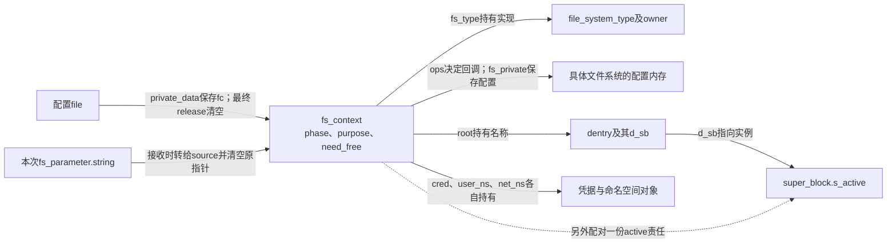
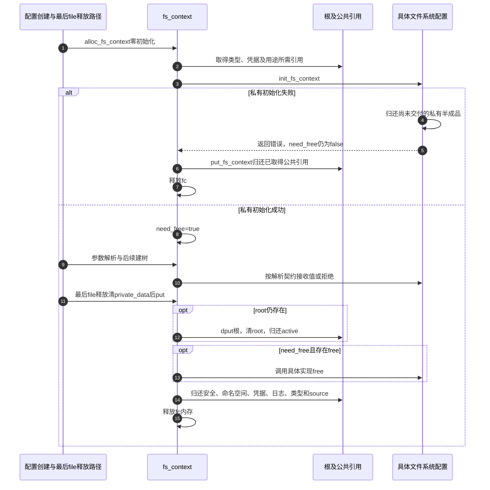

# 第4章\_配置上下文的资源取得与释放

本页对应 [配置事务中的资源责任](../../../../knowledge/kernel_subsystems/vfs/P05_fs_context挂载事务.md#5.2_上下文保存什么以及谁可以推进它)。从 [配置状态导读](../navigation/P04_配置状态怎样变成可挂载的根.md#4.1_先确认四个不同的交付物) 进入本页，沿C0、C1和C5检查所有权。版本固定为NXP Linux 6.12.20提交 `dfaf2136deb2af2e60b994421281ba42f1c087e0`，身份入口见 [VFS总索引](../navigation/P01_Linux_6.12_VFS源码阅读索引.md)。本页完整保留被展开的声明与函数，中文阅读说明是仓库补充。

主要原件为include/linux/fs_context.h（blob `4b4bfef6f053a49557118c3592ef64fc7ce1ab39`）、fs/fs_context.c（`98589aae52085c82d4e8951ca63be928cb33cec8`）及fs/fsopen.c（`6cef3deccdedfa10c95a3bdffac049194747ebe7`）。本页不展开superblock建立与全局挂载锁，它们是下游协议，不能用上下文资源表替代。

## 4.1\_字段怎样区分配置和已取得的根

fc并不是一个单值状态机。phase记录用户命令阶段，purpose记录用途，root和各引用体现实际持有，私有参数又有独立语义。只看phase或只看root都不足以决定下一步操作。

```c
/** @brief 仓库补充阅读说明：完整上下文声明；配置、持有与用户阶段分别有自己的字段。 */
struct fs_context {
	const struct fs_context_operations *ops; /* 具体配置方法表，由初始化选定 */
	struct mutex		uapi_mutex; /* 同一上下文用户API的访问锁 */
	struct file_system_type	*fs_type; /* 该上下文持有的实现类型 */
	void			*fs_private; /* 具体文件系统的临时配置存储 */
	void			*sget_key; /* 具体实例匹配所用键，语义由实现约定 */
	struct dentry		*root; /* 本上下文的根dentry；同时配对实例active持有 */
	struct user_namespace	*user_ns; /* 本次用途选定的用户命名空间持有 */
	struct net		*net_ns; /* 网络命名空间持有 */
	const struct cred	*cred; /* 创建上下文时的凭据持有 */
	struct p_log		log; /* 前缀及可共享的诊断缓冲关联 */
	const char		*source; /* 由接收者持有并负责释放的来源字符串 */
	void			*security; /* 安全选项存储，按安全框架协议释放 */
	void			*s_fs_info; /* 拟交给实例的私有数据，不能与临时配置混用 */
	unsigned int		sb_flags; /* 拟设置的实例标志 */
	unsigned int		sb_flags_mask; /* 本次明确修改哪些实例标志 */
	unsigned int		s_iflags; /* 拟加入实例的内部标志 */
	enum fs_context_purpose	purpose:8; /* 新挂载、子挂载或重配置用途 */
	enum fs_context_phase	phase:8; /* 用户命令阶段，与实际资源持有正交 */
	bool			need_free:1; /* 初始化成功后建立私有free责任 */
	bool			global:1; /* 实例构造使用初始用户命名空间的控制位 */
	bool			oldapi:1; /* 标识旧mount系统调用入口 */
	bool			exclusive:1; /* 要求新实例，拒绝复用已有实例 */
};
```

| 字段组 | 解释及所有者 |
| --- | --- |
| ops、fs_type | 配置操作表与持有的实现类型；前者由初始化设置，后者由公共分配取得 |
| fs_private、s_fs_info、sget_key | 文件系统的配置、拟交付实例的私有数据及实例匹配键，具体实现必须规定转移和清理 |
| root | 根dentry关联实例，同时要求相应active持有；非空不等于已接入目标树 |
| user_ns、net_ns、cred | 用途相关背景与凭据引用，不是挂载拓扑连接 |
| log、source、security | 诊断前缀/缓冲、来源名称、安全选项，分别有生命周期 |
| sb_flags、sb_flags_mask、s_iflags | 拟采用的实例标志、修改掩码及内部标志，不等于mount属性 |
| purpose、phase、uapi_mutex | 用途、用户阶段及同一上下文的用户访问序列化 |
| need_free | 初始化成功后才要求正常私有清理；不是公共引用是否存在的总开关 |
| global、oldapi、exclusive | 选择全局用户命名空间、标记旧mount入口、要求新实例而不复用的控制信息；由各消费者解释 |

```c
/** @brief 仓库补充阅读说明：完整单项参数声明；值的类型决定联合体成员和清理方式。 */
struct fs_parameter {
	const char		*key; /* 参数名，不能为空 */
	enum fs_value_type	type:8; /* 决定参数联合体当前解释的值类型 */
	union {
		char		*string; /* 可转移所有权的字符串 */
		void		*blob; /* 二进制参数数据 */
		struct filename	*name; /* 路径形式对应的filename对象 */
		struct file	*file; /* 文件形式对应的file持有 */
	};
	size_t	size; /* 当前值的数据长度 */
	int	dirfd; /* 路径或文件参数的定位信息 */
};
```

key指向参数名，type决定联合体当前成员，size记录相应数据长度，dirfd为路径/文件形式补充定位信息。联合体不是同时拥有四个对象，清理必须按实际参数类型与是否已转移判断。

```c
/** @brief 仓库补充阅读说明：完整操作表；这里只在相应问题中展开所需回调。 */
struct fs_context_operations {
	void (*free)(struct fs_context *fc);
	int (*dup)(struct fs_context *fc, struct fs_context *src_fc);
	int (*parse_param)(struct fs_context *fc, struct fs_parameter *param);
	int (*parse_monolithic)(struct fs_context *fc, void *data);
	int (*get_tree)(struct fs_context *fc);
	int (*reconfigure)(struct fs_context *fc);
};
```

free回收私有配置；dup负责复制配置而不是复制fd号；parse_param与parse_monolithic处理单项或历史整块参数；get_tree交付根；reconfigure处理已有实例。它们不是所有步骤都自动执行的固定流水线，具体入口按用途和阶段选择。



## 4.2\_先取得公共引用再初始化私有状态

```c
/** @brief 仓库补充阅读说明：取得公共引用后初始化私有配置，成功后才设置need_free。 */
static struct fs_context *alloc_fs_context(struct file_system_type *fs_type,
				      struct dentry *reference,
				      unsigned int sb_flags,
				      unsigned int sb_flags_mask,
				      enum fs_context_purpose purpose)
{
	int (*init_fs_context)(struct fs_context *);
	struct fs_context *fc;
	int ret = -ENOMEM;

	/* 仓库补充：零初始化，使尚未取得的可选资源保持空值。 */
	fc = kzalloc(sizeof(struct fs_context), GFP_KERNEL_ACCOUNT);
	if (!fc)
		return ERR_PTR(-ENOMEM);

	fc->purpose	= purpose;
	fc->sb_flags	= sb_flags;
	fc->sb_flags_mask = sb_flags_mask;
	/* 仓库补充：上下文取得自己的类型持有；调用者原有持有仍须另行归还。 */
	fc->fs_type	= get_filesystem(fs_type);
	/* 仓库补充：保存创建时凭据，而不是以后每次调用临时读取current凭据。 */
	fc->cred	= get_current_cred();
	fc->net_ns	= get_net(current->nsproxy->net_ns);
	fc->log.prefix	= fs_type->name;

	mutex_init(&fc->uapi_mutex);

	switch (purpose) {
	case FS_CONTEXT_FOR_MOUNT:
		fc->user_ns = get_user_ns(fc->cred->user_ns);
		break;
	case FS_CONTEXT_FOR_SUBMOUNT:
		fc->user_ns = get_user_ns(reference->d_sb->s_user_ns);
		break;
	/* 仓库补充：重配置从已有根开始，需新增实例和dentry两份关系。 */
	case FS_CONTEXT_FOR_RECONFIGURE:
		atomic_inc(&reference->d_sb->s_active);
		fc->user_ns = get_user_ns(reference->d_sb->s_user_ns);
		fc->root = dget(reference);
		break;
	}

	/* 无新式初始化回调时使用本版本旧挂载适配。 */
	init_fs_context = fc->fs_type->init_fs_context;
	if (!init_fs_context)
		init_fs_context = legacy_init_fs_context;

	/* 仓库补充：初始化失败必须清理尚未交付的私有半成品。 */
	ret = init_fs_context(fc);
	if (ret < 0)
		goto err_fc;
	/* 仓库补充：仅成功后启用正常私有free责任。 */
	fc->need_free = true;
	return fc;

err_fc:
	put_fs_context(fc);
	return ERR_PTR(ret);
}
```

分配失败没有fc可清理；分配成功后，类型、凭据、网络命名空间先各取一份引用。MOUNT使用调用者凭据的user_ns，SUBMOUNT沿参考实例取user_ns，RECONFIGURE还先增加既有实例active并持有参考dentry。三种用途不是全部从空root开始。

init_fs_context不存在时使用legacy_init_fs_context；回调失败跳到公共销毁。**need_free是在回调成功之后设置的**，因此失败初始化必须自行处理尚未交付的私有资源，不能指望普通ops.free一定补做。公共引用已经建立，仍由put_fs_context归还。成功后由具体实现提供有效ops，并遵守自己的私有数据清理责任。

```c
/** @brief 仓库补充阅读说明：选择新挂载用途并委托公共分配路径。 */
struct fs_context *fs_context_for_mount(struct file_system_type *fs_type,
					unsigned int sb_flags)
{
	return alloc_fs_context(fs_type, NULL, sb_flags, 0,
					FS_CONTEXT_FOR_MOUNT);
}
```

这个入口只选择MOUNT用途、NULL参考和初始标志掩码，再调用分配器。它不建树、不建立挂载，也不替调用者归还此前的类型查找持有；调用者与新fc分别拥有自己的配对。

## 4.3\_解析链怎样交出参数值

```c
/** @brief 仓库补充阅读说明：只有本层返回ENOPARAM才继续尝试下一层。 */
int vfs_parse_fs_param(struct fs_context *fc, struct fs_parameter *param)
{
	int ret;

	if (!param->key)
		return invalf(fc, "Unnamed parameter\n");

	/* 仓库补充：先处理公共实例标志；非ENOPARAM立即结束分派。 */
	ret = vfs_parse_sb_flag(fc, param->key);
	if (ret != -ENOPARAM)
		return ret;

	/* 仓库补充：安全层可接收或拒绝；不必继续落到文件系统。 */
	ret = security_fs_context_parse_param(fc, param);
	if (ret != -ENOPARAM)
		/* 安全层已接收或拒绝，不再交给文件系统。 */
		return ret;

	if (fc->ops->parse_param) {
		ret = fc->ops->parse_param(fc, param);
		if (ret != -ENOPARAM)
			return ret;
	}

	/* 文件系统未处理后，尝试公共source规则。 */
	ret = vfs_parse_fs_param_source(fc, param);
	if (ret != -ENOPARAM)
		return ret;

	return invalf(fc, "%s: Unknown parameter '%s'",
		      fc->fs_type->name, param->key);
}
```

vfs_parse_sb_flag处理公共实例标志；security_fs_context_parse_param属于安全模块入口。任何一层返回非ENOPARAM就停止，既可能成功也可能拒绝。具体文件系统未处理后才尝试默认source，再形成最终未知参数错误。函数没有修改phase，也没有在失败时复原任意私有字段，不能推断成自动回滚事务。

```c
/** @brief 仓库补充阅读说明：接收source字符串并清空参数包装中的指针，转移释放责任。 */
int vfs_parse_fs_param_source(struct fs_context *fc, struct fs_parameter *param)
{
	if (strcmp(param->key, "source") != 0)
		return -ENOPARAM;

	if (param->type != fs_value_is_string)
		return invalf(fc, "Non-string source");

	if (fc->source)
		return invalf(fc, "Multiple sources");

	/* 仓库补充：接收字符串原地址，同时接收其释放责任。 */
	fc->source = param->string;
	/* 仓库补充：告诉外层清理者该值已被转走。 */
	param->string = NULL;
	return 0;
}
```

这里先比较名字，再验证字符串类型及未重复设置。只有全部成立才转移指针并将param.string置空；失败时不取得这块字符串。清空不是丢失数据，而是向外层清理者表示“释放责任已经移走”。

```c
/** @brief 仓库补充阅读说明：构造字符串参数并释放未被接收的字符串。 */
int vfs_parse_fs_string(struct fs_context *fc, const char *key,
			const char *value, size_t v_size)
{
	int ret;

	struct fs_parameter param = {
		.key	= key,
		.type	= fs_value_is_flag,
		.size	= v_size,
	};

	if (value) {
		param.string = kmemdup_nul(value, v_size, GFP_KERNEL);
		if (!param.string)
			return -ENOMEM;
		/* 仓库补充：只有成功复制了值，联合体才按字符串解释。 */
		param.type = fs_value_is_string;
	}

	ret = vfs_parse_fs_param(fc, &param);
	/* 仓库补充：只释放仍留在包装中的值；转移后的NULL不重复释放。 */
	kfree(param.string);
	return ret;
}
```

没有value时构造flag；有value时复制并补NUL，分派后统一kfree剩余param.string。若source或其他合法接收方已经转移并清空它，kfree(NULL)不重复释放。用户fsconfig外层还处理blob、filename和file值，按类型归还未接收对象；不能直接把此字符串辅助体用于所有参数形式。

## 4.4\_归还根与私有资源有不同前提

```c
/** @brief 仓库补充阅读说明：归还仍由上下文持有的根、公共引用和配置资源。 */
void put_fs_context(struct fs_context *fc)
{
	struct super_block *sb;

	if (fc->root) {
		/* 仓库补充：先保存实例地址，之后才能归还根并清字段。 */
		sb = fc->root->d_sb;
		dput(fc->root);
		fc->root = NULL;
		/* 仓库补充：配对上下文持有的实例active；不是只释放dentry。 */
		deactivate_super(sb);
	}

	/* 仓库补充：私有清理的条件不控制下方公共引用的归还。 */
	if (fc->need_free && fc->ops && fc->ops->free)
		fc->ops->free(fc);

	security_free_mnt_opts(&fc->security);
	put_net(fc->net_ns);
	put_user_ns(fc->user_ns);
	put_cred(fc->cred);
	put_fc_log(fc);
	put_filesystem(fc->fs_type);
	kfree(fc->source);
	kfree(fc);
}
```

root存在时，先保存实例地址、dput根并清字段，再deactivate_super归还实例active。之后按need_free与操作表条件调用私有free，接着归还安全选项、命名空间、凭据、日志、类型、source和fc内存。公共引用清理不受need_free控制。put_fc_log按日志共享关系处理缓冲，不能把它理解成直接释放所有其他使用者的日志。

```c
/** @brief 仓库补充阅读说明：调用者遵守实例写锁协议时，清空根并归还锁内实例持有。 */
void fc_drop_locked(struct fs_context *fc)
{
	struct super_block *sb = fc->root->d_sb;
	dput(fc->root);
	fc->root = NULL;
	/* 仓库补充：调用者已持有实例写锁，不能任意替换成无锁前提入口。 */
	deactivate_locked_super(sb);
}
```

这个辅助体要求root有效且调用者处于对应实例写锁协议中，使用deactivate_locked_super归还；它只清root及实例关系，不销毁整个fc。不能在没有这个锁前提时为了“少调用一次函数”把普通销毁替换成它。

```c
/** @brief 仓库补充阅读说明：匿名配置file最终释放时清除private_data并销毁上下文。 */
static int fscontext_release(struct inode *inode, struct file *file)
{
	struct fs_context *fc = file->private_data;

	if (fc) {
		/* 仓库补充：撤销该file到配置对象的关联，再执行最终清理。 */
		file->private_data = NULL;
		put_fs_context(fc);
	}
	return 0;
}
```

配置fd对应匿名file的最终release取private_data并置空，再put上下文。关闭某一个dup出来的fd不保证此刻就是最终release；这里继承第三章的file共享规则，不引入每个fd独占一份fc的错误模型。



修改时应针对初始化失败、参数拒绝、字符串转移、已有root退出和共享配置fd分别核对。本文静态核对不证明每个具体文件系统free已通过故障注入，尤其不替代私有状态的初始化失败测试。


## 4.5\_用持有变化检查解析和清理的局部改动

上下文并不拥有它遇到的每一个指针。例如log.prefix借用类型名称，类型持有使这段关联能够继续使用；root则对应真实dentry持有和实例active责任。source是否归上下文释放，取决于解析过程中是否已经完成指针转移。修改清理函数时，应追问哪条初始化路径建立了这项责任，而不是看到指针就一律kfree。

| 实现或辅助接口 | 声明、定义与本页职责 | 修改时必须同时检查的消费者 |
| --- | --- | --- |
| fs_context、fs_parameter、fs_context_operations | fs_context.h中的完整声明；本页逐组解释状态与方法 | 新字段须说明零初始化是否有效、何时拥有资源、失败及vfs_clean_context是否要清理；不能只在最终put处增加一次free |
| alloc_fs_context、fs_context_for_mount | fs_context.c的私有分配器与公共包装；头文件声明公共接口 | 三种purpose、初始化回调失败与need_free设置顺序；legacy_init_fs_context是同文件内的旧入口适配，具体旧式参数拼接不在本页展开 |
| vfs_parse_sb_flag | fs_context.c私有辅助，查询公共置位/清位表，修改sb_flags和sb_flags_mask | ro/rw等已被本层处理，不再交给后续回调；返回ENOPARAM才继续。本页解释其分派契约，不重复常量表与查询算法 |
| security_fs_context_parse_param | security.h声明或配置替代；具体安全模块负责选项 | SECURITY关闭时替代体返回ENOPARAM，SECURITY开启时可能成功或拒绝；不能把所有配置画成固定旁观路径 |
| invalf与errorf | fs_context.h宏；前者在记录诊断后产生-EINVAL表达式值 | return invalf会终止当前分派；只保留日志而删去错误值会改变功能结果。logfc管理诊断记录，输出本身不回滚私有字段 |
| vfs_parse_fs_param_source、vfs_parse_fs_string | fs_context.c定义，fs_context.h声明；一个接收，一个包装与清理 | source转移后清原指针，与外层kfree成对；失败保持原值归包装负责 |
| put_fs_context、fc_drop_locked、fscontext_release | 公共资源析构、持锁根归还、匿名配置file回调分属不同入口 | 前两者锁前提不同；最后file才触发release，不能按fd数量调用私有析构 |
| put_fc_log与引用辅助接口 | fs_context.c私有put_fc_log归还fc_log.usage，最后持有才释放需释放的缓冲项及日志对象；其他get/put归各框架 | 保留共享日志及命名空间、凭据的独立引用协议；不把一次fc销毁解释成所有共享资源立即消失 |

安全选项的释放由security_free_mnt_opts承担；SECURITY关闭时相关安全存储和钩子按头文件退化。本次目标配置未开启SECURITY，开启USER_NS与网络支持；这说明哪些分支属于本次构建，不证明开启其他安全模块后所有选项组合都成功。kzalloc/kfree负责分配归还，ERR_PTR/PTR_ERR把负错误与指针返回接口衔接；它们不替代本页的对象持有和清理次序。

参数解析和销毁的关键不变量是“一项动态值只能有一个当前释放责任方”。最小验证集合应包含无值flag、字符串分配失败、source类型错误与重复source、接收后的外层退出、初始化回调半途失败，以及共享配置file的最后归还。对root相关改动还须覆盖普通put与持锁fc_drop_locked，观察dentry与active是否各归还一次。这里给出待验证的影响范围，本次并未执行这些故障注入。
