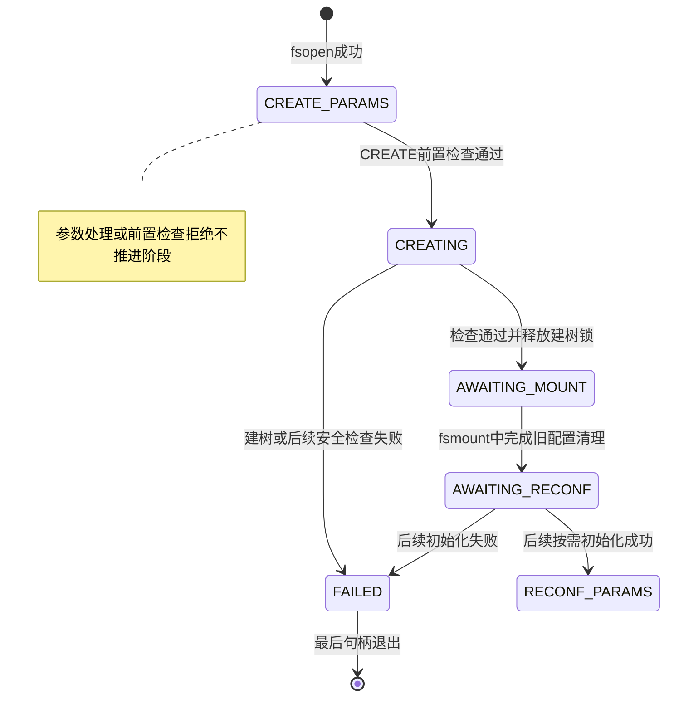
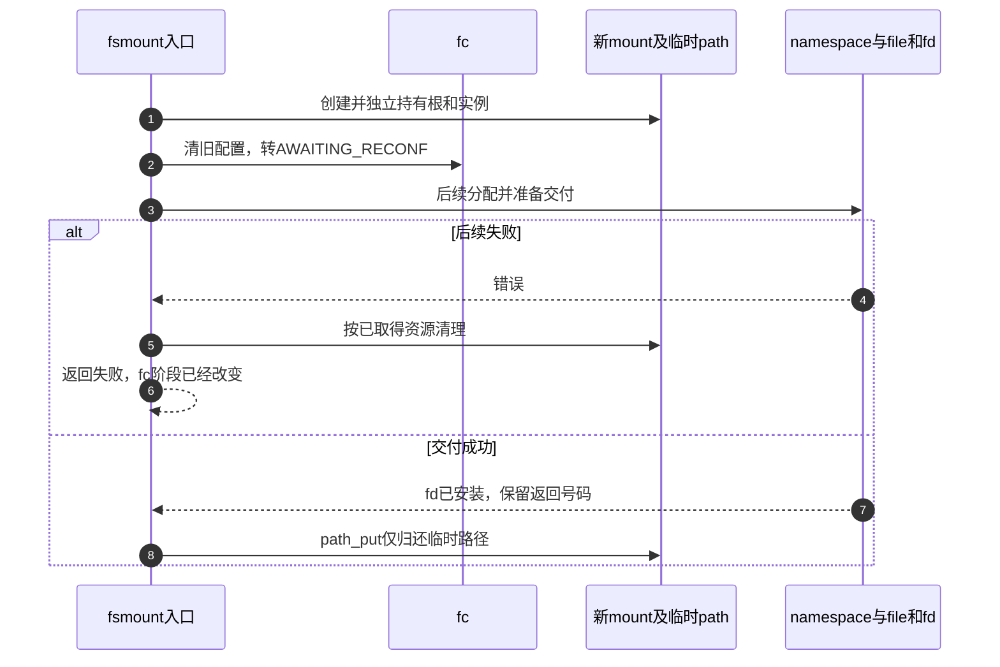

# 第5章\_建树与分离挂载的阶段交接

本页沿 [配置事务导读](../navigation/P04_配置状态怎样变成可挂载的根.md#4.1_先确认四个不同的交付物) 的C1～C3检查用户阶段、root与mount交接。公共资源释放在 [上下文资源说明](P04_配置上下文的资源取得与释放.md#4.4_归还根与私有资源有不同前提) 单独展开，不复制它的函数体。

固定证据为NXP Linux 6.12.20提交 `dfaf2136deb2af2e60b994421281ba42f1c087e0`，来源和配置见 [VFS总索引](../navigation/P01_Linux_6.12_VFS源码阅读索引.md)。本页取fs/fsopen.c、fs/fs_context.c、fs/super.c和fs/namespace.c；后两者blob分别为 `c9c7223bc2a2e9cb5391a1b3a291f724416289c2`、`73da51ac5a0349f2cebb300aeb979574e6cc37cf`。

## 5.1\_命令检查先于状态推进

用户fsconfig入口验证参数形式、取得对应file并检查fscontext_fops，构造内核参数，然后在fc.uapi_mutex内进入下面函数。下列代码依赖这些前置步骤，不能作为不加锁的任意内核调用入口。

```c
/** @brief 仓库补充阅读说明：用户入口持有uapi_mutex后按阶段分派命令或参数。 */
static int vfs_fsconfig_locked(struct fs_context *fc, int cmd,
			       struct fs_parameter *param)
{
	int ret;

	ret = finish_clean_context(fc);
	if (ret)
		return ret;
	switch (cmd) {
	case FSCONFIG_CMD_CREATE:
		return vfs_cmd_create(fc, false);
	case FSCONFIG_CMD_CREATE_EXCL:
		return vfs_cmd_create(fc, true);
	case FSCONFIG_CMD_RECONFIGURE:
		return vfs_cmd_reconfigure(fc);
	default:
		if (fc->phase != FS_CONTEXT_CREATE_PARAMS &&
		    fc->phase != FS_CONTEXT_RECONF_PARAMS)
			return -EBUSY;

		return vfs_parse_fs_param(fc, param);
	}
}
```

先完成可能延后的重配置初始化，再分派CREATE、CREATE_EXCL或RECONFIGURE。普通参数仅允许CREATE_PARAMS或RECONF_PARAMS；其他阶段返回EBUSY。默认分支返回解析结果，没有把普通参数错误改写成FAILED。

```c
/** @brief 仓库补充阅读说明：通过前置检查后进入建树，失败与成功写入不同phase。 */
static int vfs_cmd_create(struct fs_context *fc, bool exclusive)
{
	struct super_block *sb;
	int ret;

	if (fc->phase != FS_CONTEXT_CREATE_PARAMS)
		return -EBUSY;

	if (!mount_capable(fc))
		return -EPERM;

	fc->phase = FS_CONTEXT_CREATING;
	fc->exclusive = exclusive;

	ret = vfs_get_tree(fc);
	if (ret) {
		fc->phase = FS_CONTEXT_FAILED;
		return ret;
	}

	sb = fc->root->d_sb;
	ret = security_sb_kern_mount(sb);
	if (unlikely(ret)) {
		fc_drop_locked(fc);
		fc->phase = FS_CONTEXT_FAILED;
		return ret;
	}

	/* vfs_get_tree() callchains will have grabbed @s_umount */
	up_write(&sb->s_umount);
	fc->phase = FS_CONTEXT_AWAITING_MOUNT;
	return 0;
}
```

阶段错误和权限错误在改phase之前返回；通过检查才进入CREATING并保存exclusive。vfs_get_tree失败或随后安全检查失败会进入FAILED；后一种需要fc_drop_locked归还持锁状态下取得的根和实例。成功才释放s_umount写锁并转AWAITING_MOUNT。这个顺序说明“CREATE失败”仍须区分失败发生在进入CREATING之前还是之后。



图未把fd交付当成phase字段值：AWAITING_RECONF的设置发生在fsmount返回fd之前。任何阶段都可能因句柄最终释放而销毁上下文；这里只突出失败终点，不表示其他阶段不能关闭。

## 5.2\_取得根还没有接到目录树

```c
/** @brief 仓库补充阅读说明：取得或建立可挂载根，核对root契约并应用安全选项。 */
int vfs_get_tree(struct fs_context *fc)
{
	struct super_block *sb;
	int error;

	if (fc->root)
		return -EBUSY;

	/* Get the mountable root in fc->root, with a ref on the root and a ref
	 * on the superblock.
	 */
	error = fc->ops->get_tree(fc);
	if (error < 0)
		return error;

	if (!fc->root) {
		pr_err("Filesystem %s get_tree() didn't set fc->root, returned %i\n",
		       fc->fs_type->name, error);
		/* We don't know what the locking state of the superblock is -
		 * if there is a superblock.
		 */
		BUG();
	}

	sb = fc->root->d_sb;
	WARN_ON(!sb->s_bdi);

	/*
	 * super_wake() contains a memory barrier which also care of
	 * ordering for super_cache_count(). We place it before setting
	 * SB_BORN as the data dependency between the two functions is
	 * the superblock structure contents that we just set up, not
	 * the SB_BORN flag.
	 */
	super_wake(sb, SB_BORN);

	error = security_sb_set_mnt_opts(sb, fc->security, 0, NULL);
	if (unlikely(error)) {
		fc_drop_locked(fc);
		return error;
	}

	/*
	 * filesystems should never set s_maxbytes larger than MAX_LFS_FILESIZE
	 * but s_maxbytes was an unsigned long long for many releases. Throw
	 * this warning for a little while to try and catch filesystems that
	 * violate this rule.
	 */
	WARN((sb->s_maxbytes < 0), "%s set sb->s_maxbytes to "
		"negative value (%lld)\n", fc->fs_type->name, sb->s_maxbytes);

	return 0;
}
```

已有root时拒绝再次建树。具体get_tree应返回根dentry及实例持有，成功时还遵守建树锁协议；返回成功但不设root触发BUG。super_wake发布SB_BORN并为实例观察者提供所需顺序，这属于实例初始化协议，不能当成目录树已经接入。

安全选项设置失败调用fc_drop_locked，归还根和持锁实例关系。成功返回仍由上层按路径完成安全检查并解锁，例如前节的vfs_cmd_create。更详细的实例共享、SB_BORN与s_umount关系在superblock模块解释；本页只明确调用者必须接住的前提和结果。

## 5.3\_新挂载取得自己的实例持有

```c
/** @brief 仓库补充阅读说明：新mount独立取得实例与根持有，但不接入目标树。 */
struct vfsmount *vfs_create_mount(struct fs_context *fc)
{
	struct mount *mnt;

	if (!fc->root)
		return ERR_PTR(-EINVAL);

	mnt = alloc_vfsmnt(fc->source ?: "none");
	if (!mnt)
		return ERR_PTR(-ENOMEM);

	if (fc->sb_flags & SB_KERNMOUNT)
		mnt->mnt.mnt_flags = MNT_INTERNAL;

	atomic_inc(&fc->root->d_sb->s_active);
	mnt->mnt.mnt_sb		= fc->root->d_sb;
	mnt->mnt.mnt_root	= dget(fc->root);
	mnt->mnt_mountpoint	= mnt->mnt.mnt_root;
	mnt->mnt_parent		= mnt;

	lock_mount_hash();
	list_add_tail(&mnt->mnt_instance, &mnt->mnt.mnt_sb->s_mounts);
	unlock_mount_hash();
	return &mnt->mnt;
}
```

root为空返回EINVAL，分配mount失败返回ENOMEM。成功时增加实例s_active，dget根，并初始化新mount的实例、根、父和挂载点关系；此时父指向自己。把mnt_instance加入实例的s_mounts需要mount hash锁，但没有因此接到请求者的目标目录树。

由此能推出两份持有：fc保留自己的root和实例关系，新mount又有自己的关系。销毁fc不会撤销mount的持有；反之，mount分配失败也不能把fc当成已经无root。SB_KERNMOUNT设置内部挂载属性是另一条件分支，不把用户fsmount全部归为内核内部挂载。

## 5.4\_清理旧配置与交出fd分属两个时点

下面保留完整系统调用体，以免省略错误标签后把资源交接顺序讲反。入口先检查权限和属性，再经配置file找到fc，在uapi_mutex内验证root与phase。

```c
/** @brief 仓库补充阅读说明：在配置清理之后继续分配匿名命名空间、file和fd，错误可能发生在阶段已改变之后。 */
SYSCALL_DEFINE3(fsmount, int, fs_fd, unsigned int, flags,
		unsigned int, attr_flags)
{
	struct mnt_namespace *ns;
	struct fs_context *fc;
	struct file *file;
	struct path newmount;
	struct mount *mnt;
	struct fd f;
	unsigned int mnt_flags = 0;
	long ret;

	if (!may_mount())
		return -EPERM;

	if ((flags & ~(FSMOUNT_CLOEXEC)) != 0)
		return -EINVAL;

	if (attr_flags & ~FSMOUNT_VALID_FLAGS)
		return -EINVAL;

	mnt_flags = attr_flags_to_mnt_flags(attr_flags);

	switch (attr_flags & MOUNT_ATTR__ATIME) {
	case MOUNT_ATTR_STRICTATIME:
		break;
	case MOUNT_ATTR_NOATIME:
		mnt_flags |= MNT_NOATIME;
		break;
	case MOUNT_ATTR_RELATIME:
		mnt_flags |= MNT_RELATIME;
		break;
	default:
		return -EINVAL;
	}

	f = fdget(fs_fd);
	if (!fd_file(f))
		return -EBADF;

	ret = -EINVAL;
	if (fd_file(f)->f_op != &fscontext_fops)
		goto err_fsfd;

	fc = fd_file(f)->private_data;

	ret = mutex_lock_interruptible(&fc->uapi_mutex);
	if (ret < 0)
		goto err_fsfd;

	/* There must be a valid superblock or we can't mount it */
	ret = -EINVAL;
	if (!fc->root)
		goto err_unlock;

	ret = -EPERM;
	if (mount_too_revealing(fc->root->d_sb, &mnt_flags)) {
		pr_warn("VFS: Mount too revealing\n");
		goto err_unlock;
	}

	ret = -EBUSY;
	if (fc->phase != FS_CONTEXT_AWAITING_MOUNT)
		goto err_unlock;

	if (fc->sb_flags & SB_MANDLOCK)
		warn_mandlock();

	newmount.mnt = vfs_create_mount(fc);
	if (IS_ERR(newmount.mnt)) {
		ret = PTR_ERR(newmount.mnt);
		goto err_unlock;
	}
	newmount.dentry = dget(fc->root);
	newmount.mnt->mnt_flags = mnt_flags;

	/* We've done the mount bit - now move the file context into more or
	 * less the same state as if we'd done an fspick().  We don't want to
	 * do any memory allocation or anything like that at this point as we
	 * don't want to have to handle any errors incurred.
	 */
	vfs_clean_context(fc);

	ns = alloc_mnt_ns(current->nsproxy->mnt_ns->user_ns, true);
	if (IS_ERR(ns)) {
		ret = PTR_ERR(ns);
		goto err_path;
	}
	mnt = real_mount(newmount.mnt);
	ns->root = mnt;
	ns->nr_mounts = 1;
	mnt_add_to_ns(ns, mnt);
	mntget(newmount.mnt);

	/* Attach to an apparent O_PATH fd with a note that we need to unmount
	 * it, not just simply put it.
	 */
	file = dentry_open(&newmount, O_PATH, fc->cred);
	if (IS_ERR(file)) {
		dissolve_on_fput(newmount.mnt);
		ret = PTR_ERR(file);
		goto err_path;
	}
	file->f_mode |= FMODE_NEED_UNMOUNT;

	ret = get_unused_fd_flags((flags & FSMOUNT_CLOEXEC) ? O_CLOEXEC : 0);
	if (ret >= 0)
		fd_install(ret, file);
	else
		fput(file);

err_path:
	path_put(&newmount);
err_unlock:
	mutex_unlock(&fc->uapi_mutex);
err_fsfd:
	fdput(f);
	return ret;
}
```

| 时点 | 已发生什么 | 失败后的主要边界 |
| --- | --- | --- |
| vfs_create_mount以前 | 还没有本次新mount | 早期错误通常尚未清理旧配置 |
| 新mount及newmount.dentry取得后 | 本次路径持有已经成立 | 后续错误须path_put，不可直接跳出 |
| vfs_clean_context之后 | 私有旧配置已清，phase为AWAITING_RECONF | 后续即使返回错误，也不能假定仍可重试fsmount |
| 匿名namespace建立后 | 新mount进入内部匿名拓扑 | dentry_open失败要dissolve_on_fput并归还本次路径 |
| file建立后 | O_PATH file持有路径并标记NEED_UNMOUNT | fd分配失败用fput清理file；成功才fd_install交付 |

这里有两个不同的file：f指向配置file，局部file代表将要交给用户的挂载句柄。err_fsfd的fdput归还本次系统调用取得的配置访问关系，不是主动关闭用户原fd。err_path的path_put归还临时newmount路径，成功时返回的file已有自己的持有，因此也走该清理标签。

匿名namespace用于管理分离挂载的退出；没有目标目录参数，显然不能在这里完成move_mount的目标连接。FMODE_NEED_UNMOUNT告诉后续file释放路径按分离挂载协议处理，不能概括成单纯free mount内存。具体挂载拓扑退出在后续章节展开。

## 5.5\_重配置初始化为何延后

fsmount已经取得新mount时，如果再立即初始化一整套私有重配置状态，内存分配失败会使已经成功的动作与返回值难以对应。因此先只清理旧配置，下一次真正配置时再做可失败的初始化。

```c
/** @brief 仓库补充阅读说明：只执行不可失败的旧配置清理，把重配置初始化留到下一次操作。 */
void vfs_clean_context(struct fs_context *fc)
{
	if (fc->need_free && fc->ops && fc->ops->free)
		fc->ops->free(fc);
	fc->need_free = false;
	fc->fs_private = NULL;
	fc->s_fs_info = NULL;
	fc->sb_flags = 0;
	security_free_mnt_opts(&fc->security);
	kfree(fc->source);
	fc->source = NULL;
	fc->exclusive = false;

	fc->purpose = FS_CONTEXT_FOR_RECONFIGURE;
	fc->phase = FS_CONTEXT_AWAITING_RECONF;
}
```

清理私有配置、安全选项和source，复位部分标志后，设置用途与phase。这里保留root、类型及公共背景持有，不是put整个上下文，也不是又回到最初CREATE_PARAMS。

```c
/** @brief 仓库补充阅读说明：按需初始化重配置私有状态，失败进入FAILED。 */
int finish_clean_context(struct fs_context *fc)
{
	int error;

	if (fc->phase != FS_CONTEXT_AWAITING_RECONF)
		return 0;

	if (fc->fs_type->init_fs_context)
		error = fc->fs_type->init_fs_context(fc);
	else
		error = legacy_init_fs_context(fc);
	if (unlikely(error)) {
		fc->phase = FS_CONTEXT_FAILED;
		return error;
	}
	fc->need_free = true;
	fc->phase = FS_CONTEXT_RECONF_PARAMS;
	return 0;
}
```

只有AWAITING_RECONF才执行初始化；失败转FAILED，成功设置need_free并转RECONF_PARAMS。前节较晚的fd分配仍能失败，因此“延后初始化”仅避免此处新增一种失败，不保证fsmount余下步骤不可能失败。



修改时应分别覆盖CREATE前置拒绝、建树失败、建树后安全拒绝、fsmount早期失败和清理旧配置后的失败。本文完成源码与图示核对，没有目标故障注入，不能据此宣称所有文件系统与安全模块组合已通过运行测试。
