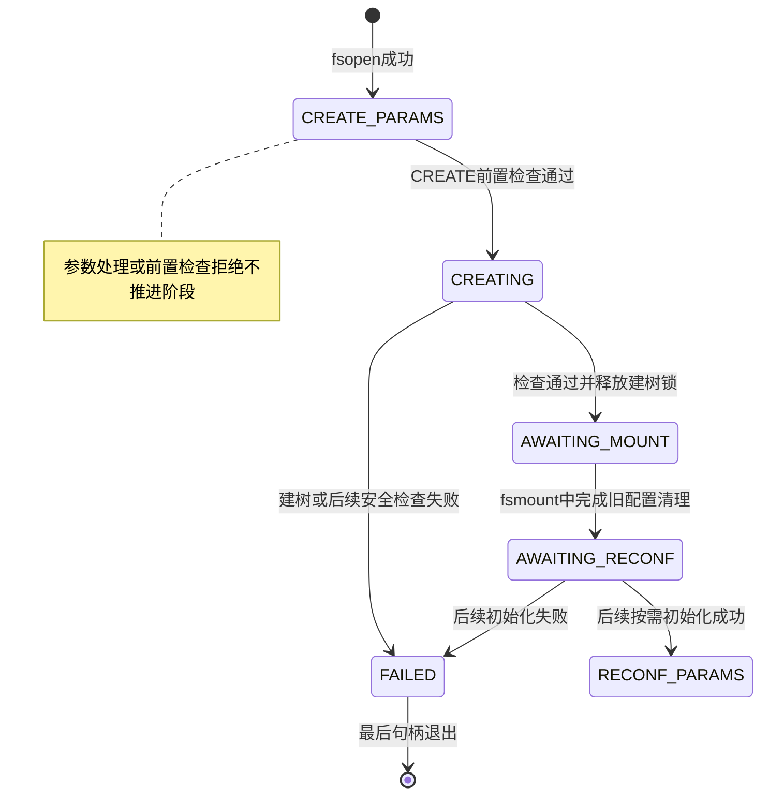
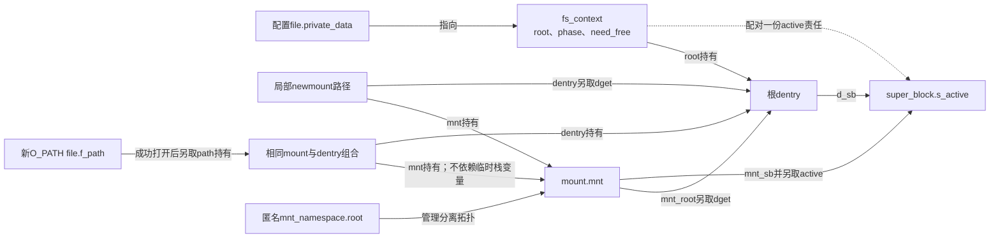
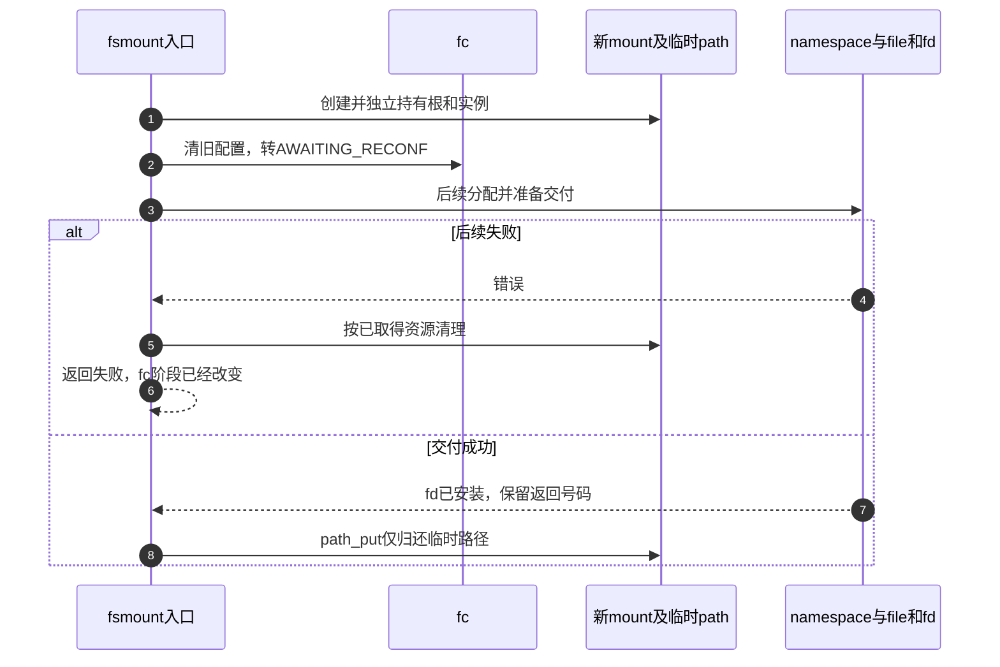

# 第5章\_建树与分离挂载的阶段交接

知识场景见 [建树与分离挂载](../../../../knowledge/kernel_subsystems/vfs/P05_fs_context挂载事务.md#5.4_建树完成后为什么还没有目标挂载点)。本页沿 [配置事务导读](../navigation/P04_配置状态怎样变成可挂载的根.md#4.1_先确认四个不同的交付物) 的C1～C3检查用户阶段、root与mount交接。公共资源释放在 [上下文资源说明](P04_配置上下文的资源取得与释放.md#4.4_归还根与私有资源有不同前提) 单独展开，不复制它的函数体。

固定证据为NXP Linux 6.12.20提交 `dfaf2136deb2af2e60b994421281ba42f1c087e0`，来源和配置见 [VFS总索引](../navigation/P01_Linux_6.12_VFS源码阅读索引.md)。本页取fs/fsopen.c、fs/fs_context.c、fs/super.c和fs/namespace.c；后两者blob分别为 `c9c7223bc2a2e9cb5391a1b3a291f724416289c2`、`73da51ac5a0349f2cebb300aeb979574e6cc37cf`。

## 5.1\_命令检查先于状态推进

用户fsconfig入口验证参数形式、取得对应file并检查fscontext_fops，构造内核参数，然后在fc.uapi_mutex内进入下面函数。下列代码依赖这些前置步骤，不能作为不加锁的任意内核调用入口。

```c
/** @brief 仓库补充阅读说明：用户入口持有uapi_mutex后按阶段分派命令或参数。 */
static int vfs_fsconfig_locked(struct fs_context *fc, int cmd,
			       struct fs_parameter *param)
{
	int ret;

	/* 仓库补充：若上次已经清理旧配置，此时才执行可失败的重配置初始化。 */
	ret = finish_clean_context(fc);
	if (ret)
		return ret;
	switch (cmd) {
	case FSCONFIG_CMD_CREATE:
		return vfs_cmd_create(fc, false);
	case FSCONFIG_CMD_CREATE_EXCL:
		return vfs_cmd_create(fc, true);
	case FSCONFIG_CMD_RECONFIGURE:
		return vfs_cmd_reconfigure(fc);
	default:
		if (fc->phase != FS_CONTEXT_CREATE_PARAMS &&
		    fc->phase != FS_CONTEXT_RECONF_PARAMS)
			return -EBUSY;

		return vfs_parse_fs_param(fc, param);
	}
}
```

先完成可能延后的重配置初始化，再分派CREATE、CREATE_EXCL或RECONFIGURE。普通参数仅允许CREATE_PARAMS或RECONF_PARAMS；其他阶段返回EBUSY。默认分支返回解析结果，没有把普通参数错误改写成FAILED。

```c
/** @brief 仓库补充阅读说明：通过前置检查后进入建树，失败与成功写入不同phase。 */
static int vfs_cmd_create(struct fs_context *fc, bool exclusive)
{
	struct super_block *sb;
	int ret;

	/* 仓库补充：前置阶段拒绝不把上下文推进CREATING。 */
	if (fc->phase != FS_CONTEXT_CREATE_PARAMS)
		return -EBUSY;

	/* 仓库补充：权限拒绝发生在写phase之前。 */
	if (!mount_capable(fc))
		return -EPERM;

	/* 仓库补充：从这里开始失败会写入FAILED。 */
	fc->phase = FS_CONTEXT_CREATING;
	fc->exclusive = exclusive;

	ret = vfs_get_tree(fc);
	if (ret) {
		fc->phase = FS_CONTEXT_FAILED;
		return ret;
	}

	sb = fc->root->d_sb;
	/* 仓库补充：建树成功后的另一次安全检查；拒绝需归还持锁根关系。 */
	ret = security_sb_kern_mount(sb);
	if (unlikely(ret)) {
		/* 仓库补充：根与实例仍按建树写锁协议持有，走对应清理。 */
		fc_drop_locked(fc);
		fc->phase = FS_CONTEXT_FAILED;
		return ret;
	}

	/* vfs_get_tree调用链已取得实例s_umount写锁。 */
	/* 仓库补充：成功交接前结束建树的实例写锁保护。 */
	up_write(&sb->s_umount);
	fc->phase = FS_CONTEXT_AWAITING_MOUNT;
	return 0;
}
```

阶段错误和权限错误在改phase之前返回；通过检查才进入CREATING并保存exclusive。vfs_get_tree失败或随后安全检查失败会进入FAILED；后一种需要fc_drop_locked归还持锁状态下取得的根和实例。成功才释放s_umount写锁并转AWAITING_MOUNT。这个顺序说明“CREATE失败”仍须区分失败发生在进入CREATING之前还是之后。



图未把fd交付当成phase字段值：AWAITING_RECONF的设置发生在fsmount返回fd之前。任何阶段都可能因句柄最终释放而销毁上下文；这里只突出失败终点，不表示其他阶段不能关闭。

## 5.2\_取得根还没有接到目录树

```c
/** @brief 仓库补充阅读说明：取得或建立可挂载根，核对root契约并应用安全选项。 */
int vfs_get_tree(struct fs_context *fc)
{
	struct super_block *sb;
	int error;

	/* 仓库补充：本入口要求尚无root，不能覆盖已有持有。 */
	if (fc->root)
		return -EBUSY;

	/* 取得可挂载根，同时持有根和superblock。 */
	/* 仓库补充：具体实现交付根及实例持有，并遵守s_umount锁协议。 */
	error = fc->ops->get_tree(fc);
	if (error < 0)
		return error;

	if (!fc->root) {
		pr_err("Filesystem %s get_tree() didn't set fc->root, returned %i\n",
		       fc->fs_type->name, error);
		/* 根缺失时，连实例是否存在及锁状态都无法可靠判断。 */
		/* 仓库补充：成功却无root违反内核实现契约，不能按普通错误返回。 */
		BUG();
	}

	sb = fc->root->d_sb;
	/* 仓库补充：检查后备设备信息；本调用点没有据此进入普通错误分支。 */
	WARN_ON(!sb->s_bdi);

	/* super_wake包含屏障，发布已初始化内容并协调缓存计数观察。 */
	/* 仓库补充：发布实例构造完成状态并提供所需观察顺序。 */
	super_wake(sb, SB_BORN);

	/* 仓库补充：安全选项设置可拒绝，失败必须撤销本上下文取得的根关系。 */
	error = security_sb_set_mnt_opts(sb, fc->security, 0, NULL);
	if (unlikely(error)) {
		/* 仓库补充：根与实例仍按建树写锁协议持有，走对应清理。 */
		fc_drop_locked(fc);
		return error;
	}

	/* s_maxbytes不应为负；这里检查历史类型转换可能掩盖的错误。 */
	WARN((sb->s_maxbytes < 0), "%s set sb->s_maxbytes to "
		"negative value (%lld)\n", fc->fs_type->name, sb->s_maxbytes);

	return 0;
}
```

已有root时拒绝再次建树。具体get_tree应返回根dentry及实例持有，成功时还遵守建树锁协议；返回成功但不设root触发BUG。super_wake发布SB_BORN并为实例观察者提供所需顺序，这属于实例初始化协议，不能当成目录树已经接入。

安全选项设置失败调用fc_drop_locked，归还根和持锁实例关系。成功返回仍由上层按路径完成安全检查并解锁，例如前节的vfs_cmd_create。更详细的实例共享、SB_BORN与s_umount关系在superblock模块解释；本页只明确调用者必须接住的前提和结果。

## 5.3\_新挂载取得自己的实例持有

```c
/** @brief 仓库补充阅读说明：新mount独立取得实例与根持有，但不接入目标树。 */
struct vfsmount *vfs_create_mount(struct fs_context *fc)
{
	struct mount *mnt;

	if (!fc->root)
		return ERR_PTR(-EINVAL);

	/* 仓库补充：只分配挂载对象；还没有目标目录连接。 */
	mnt = alloc_vfsmnt(fc->source ?: "none");
	if (!mnt)
		return ERR_PTR(-ENOMEM);

	if (fc->sb_flags & SB_KERNMOUNT)
		mnt->mnt.mnt_flags = MNT_INTERNAL;

	/* 仓库补充：新mount取得独立于fc的实例活动持有。 */
	atomic_inc(&fc->root->d_sb->s_active);
	mnt->mnt.mnt_sb		= fc->root->d_sb;
	/* 仓库补充：新mount另取自己的根dentry持有。 */
	mnt->mnt.mnt_root	= dget(fc->root);
	mnt->mnt_mountpoint	= mnt->mnt.mnt_root;
	/* 仓库补充：分离的初始父关系指向自身。 */
	mnt->mnt_parent		= mnt;

	lock_mount_hash();
	/* 仓库补充：加入实例的挂载集合，不等于接入目标挂载树。 */
	list_add_tail(&mnt->mnt_instance, &mnt->mnt.mnt_sb->s_mounts);
	unlock_mount_hash();
	return &mnt->mnt;
}
```

root为空返回EINVAL，分配mount失败返回ENOMEM。成功时增加实例s_active，dget根，并初始化新mount的实例、根、父和挂载点关系；此时父指向自己。把mnt_instance加入实例的s_mounts需要mount hash锁，但没有因此接到请求者的目标目录树。



图把持有责任与指针分开标注：fc、mount内部根、临时newmount.dentry与新file的path不是同一份引用；函数返回前可归还临时path，前提是已经给新file建立自己的持有。匿名namespace承载拓扑，不是用户指定的目标目录。

由此能推出两份持有：fc保留自己的root和实例关系，新mount又有自己的关系。销毁fc不会撤销mount的持有；反之，mount分配失败也不能把fc当成已经无root。SB_KERNMOUNT设置内部挂载属性是另一条件分支，不把用户fsmount全部归为内核内部挂载。

## 5.4\_清理旧配置与交出fd分属两个时点

下面保留完整系统调用体，以免省略错误标签后把资源交接顺序讲反。入口先检查权限和属性，再经配置file找到fc，在uapi_mutex内验证root与phase。

```c
/** @brief 仓库补充阅读说明：在配置清理之后继续分配匿名命名空间、file和fd，错误可能发生在阶段已改变之后。 */
SYSCALL_DEFINE3(fsmount, int, fs_fd, unsigned int, flags,
		unsigned int, attr_flags)
{
	struct mnt_namespace *ns;
	struct fs_context *fc;
	struct file *file;
	struct path newmount;
	struct mount *mnt;
	struct fd f;
	unsigned int mnt_flags = 0;
	long ret;

	if (!may_mount())
		return -EPERM;

	if ((flags & ~(FSMOUNT_CLOEXEC)) != 0)
		return -EINVAL;

	if (attr_flags & ~FSMOUNT_VALID_FLAGS)
		return -EINVAL;

	mnt_flags = attr_flags_to_mnt_flags(attr_flags);

	switch (attr_flags & MOUNT_ATTR__ATIME) {
	case MOUNT_ATTR_STRICTATIME:
		break;
	case MOUNT_ATTR_NOATIME:
		mnt_flags |= MNT_NOATIME;
		break;
	case MOUNT_ATTR_RELATIME:
		mnt_flags |= MNT_RELATIME;
		break;
	default:
		return -EINVAL;
	}

	/* 仓库补充：取得配置file访问关系，退出需fdput。 */
	f = fdget(fs_fd);
	if (!fd_file(f))
		return -EBADF;

	ret = -EINVAL;
	/* 仓库补充：必须是配置句柄，不能把任意file的private_data当成fc。 */
	if (fd_file(f)->f_op != &fscontext_fops)
		goto err_fsfd;

	fc = fd_file(f)->private_data;

	/* 仓库补充：只串行化当前配置对象的用户操作。 */
	ret = mutex_lock_interruptible(&fc->uapi_mutex);
	if (ret < 0)
		goto err_fsfd;

	/* 必须已取得有效实例和根。 */
	ret = -EINVAL;
	if (!fc->root)
		goto err_unlock;

	ret = -EPERM;
	if (mount_too_revealing(fc->root->d_sb, &mnt_flags)) {
		pr_warn("VFS: Mount too revealing\n");
		goto err_unlock;
	}

	ret = -EBUSY;
	if (fc->phase != FS_CONTEXT_AWAITING_MOUNT)
		goto err_unlock;

	if (fc->sb_flags & SB_MANDLOCK)
		warn_mandlock();

	newmount.mnt = vfs_create_mount(fc);
	if (IS_ERR(newmount.mnt)) {
		ret = PTR_ERR(newmount.mnt);
		goto err_unlock;
	}
	/* 仓库补充：临时path另取根持有，与mount内部根持有分别归还。 */
	newmount.dentry = dget(fc->root);
	newmount.mnt->mnt_flags = mnt_flags;

	/* 先清旧配置并转为待重配置；把私有初始化延到后续操作。 */
	/* 仓库补充：这时旧私有配置已清且phase改变；后面仍有可失败分配。 */
	vfs_clean_context(fc);

	/* 仓库补充：建立内部匿名命名空间来承载分离挂载的存续。 */
	ns = alloc_mnt_ns(current->nsproxy->mnt_ns->user_ns, true);
	if (IS_ERR(ns)) {
		ret = PTR_ERR(ns);
		goto err_path;
	}
	mnt = real_mount(newmount.mnt);
	ns->root = mnt;
	ns->nr_mounts = 1;
	mnt_add_to_ns(ns, mnt);
	/* 仓库补充：为后续分离挂载关系取得额外挂载持有。 */
	mntget(newmount.mnt);

	/* 建立O_PATH句柄，并标记最后释放时需要处理分离挂载。 */
	/* 仓库补充：新file取得自己的path；并非复用配置file。 */
	file = dentry_open(&newmount, O_PATH, fc->cred);
	if (IS_ERR(file)) {
		/* 仓库补充：file建立失败时先处理匿名拓扑，再归还临时path。 */
		dissolve_on_fput(newmount.mnt);
		ret = PTR_ERR(file);
		goto err_path;
	}
	/* 仓库补充：最后file退出还要履行分离挂载清理责任。 */
	file->f_mode |= FMODE_NEED_UNMOUNT;

	ret = get_unused_fd_flags((flags & FSMOUNT_CLOEXEC) ? O_CLOEXEC : 0);
	if (ret >= 0)
		/* 仓库补充：成功把已有file持有交给新槽位。 */
		fd_install(ret, file);
	else
		/* 仓库补充：号码分配失败，归还尚未交给槽位的file。 */
		fput(file);

err_path:
	/* 仓库补充：成功和后期失败都归还本地临时path。 */
	path_put(&newmount);
err_unlock:
	mutex_unlock(&fc->uapi_mutex);
err_fsfd:
	/* 仓库补充：归还本次取得的配置访问关系，不关闭用户原fd。 */
	fdput(f);
	return ret;
}
```

| 时点 | 已发生什么 | 失败后的主要边界 |
| --- | --- | --- |
| vfs_create_mount以前 | 还没有本次新mount | 早期错误通常尚未清理旧配置 |
| 新mount及newmount.dentry取得后 | 本次路径持有已经成立 | 后续错误须path_put，不可直接跳出 |
| vfs_clean_context之后 | 私有旧配置已清，phase为AWAITING_RECONF | 后续即使返回错误，也不能假定仍可重试fsmount |
| 匿名namespace建立后 | 新mount进入内部匿名拓扑 | dentry_open失败要dissolve_on_fput并归还本次路径 |
| file建立后 | O_PATH file持有路径并标记NEED_UNMOUNT | fd分配失败用fput清理file；成功才fd_install交付 |

这里有两个不同的file：f指向配置file，局部file代表将要交给用户的挂载句柄。err_fsfd的fdput归还本次系统调用取得的配置访问关系，不是主动关闭用户原fd。err_path的path_put归还临时newmount路径，成功时返回的file已有自己的持有，因此也走该清理标签。

匿名namespace用于管理分离挂载的退出；没有目标目录参数，显然不能在这里完成move_mount的目标连接。FMODE_NEED_UNMOUNT告诉后续file释放路径按分离挂载协议处理，不能概括成单纯free mount内存。具体挂载拓扑退出在后续章节展开。

## 5.5\_重配置初始化为何延后

fsmount已经取得新mount时，如果再立即初始化一整套私有重配置状态，内存分配失败会使已经成功的动作与返回值难以对应。因此先只清理旧配置，下一次真正配置时再做可失败的初始化。

```c
/** @brief 仓库补充阅读说明：只执行不可失败的旧配置清理，把重配置初始化留到下一次操作。 */
void vfs_clean_context(struct fs_context *fc)
{
	if (fc->need_free && fc->ops && fc->ops->free)
		fc->ops->free(fc);
	/* 仓库补充：旧私有free已处理，后续初始化成功前不再次正常free。 */
	fc->need_free = false;
	fc->fs_private = NULL;
	fc->s_fs_info = NULL;
	fc->sb_flags = 0;
	security_free_mnt_opts(&fc->security);
	kfree(fc->source);
	fc->source = NULL;
	fc->exclusive = false;

	/* 仓库补充：保留根与公共引用，转为已有实例的配置用途。 */
	fc->purpose = FS_CONTEXT_FOR_RECONFIGURE;
	fc->phase = FS_CONTEXT_AWAITING_RECONF;
}
```

清理私有配置、安全选项和source，复位部分标志后，设置用途与phase。这里保留root、类型及公共背景持有，不是put整个上下文，也不是又回到最初CREATE_PARAMS。

```c
/** @brief 仓库补充阅读说明：按需初始化重配置私有状态，失败进入FAILED。 */
int finish_clean_context(struct fs_context *fc)
{
	int error;

	/* 仓库补充：只有待重配置阶段才执行此初始化。 */
	if (fc->phase != FS_CONTEXT_AWAITING_RECONF)
		return 0;

	if (fc->fs_type->init_fs_context)
		error = fc->fs_type->init_fs_context(fc);
	else
		error = legacy_init_fs_context(fc);
	if (unlikely(error)) {
		fc->phase = FS_CONTEXT_FAILED;
		return error;
	}
	fc->need_free = true;
	/* 仓库补充：初始化成功后才允许新的参数配置。 */
	fc->phase = FS_CONTEXT_RECONF_PARAMS;
	return 0;
}
```

只有AWAITING_RECONF才执行初始化；失败转FAILED，成功设置need_free并转RECONF_PARAMS。前节较晚的fd分配仍能失败，因此“延后初始化”仅避免此处新增一种失败，不保证fsmount余下步骤不可能失败。



修改时应分别覆盖CREATE前置拒绝、建树失败、建树后安全拒绝、fsmount早期失败和清理旧配置后的失败。本文完成源码与图示核对，没有目标故障注入，不能据此宣称所有文件系统与安全模块组合已通过运行测试。


## 5.6\_检查动作与资源交接必须一起保留

到C3已经不能用“成功有对象，失败无对象”概括结果。局部错误标签回收的是本次已取得的资源，fc.phase则记录用户命令还能做什么；两者可能在不同语句改变。把vfs_clean_context移动到更早或更晚，改变的不只是清理效率，还会改变后续失败时调用者可否继续原事务。

| 实现簇或辅助接口 | 本页使用的精确边界 | 修改需要同步检查 |
| --- | --- | --- |
| fsopen.c私有vfs_fsconfig_locked、vfs_cmd_create | 外层已验证配置file、构造参数并持uapi_mutex；本页保留完整分派和CREATE函数 | finish_clean_context先于命令分派；早期EBUSY/EPERM与进入CREATING后的失败不能合并 |
| fs_context.h声明、super.c定义的vfs_get_tree | 消费ops.get_tree，验证root，发布SB_BORN，再应用安全选项 | 成功仍持s_umount写锁；安全拒绝走fc_drop_locked，不能只清phase。实例细节见 [构造完成交接](P06_实例匹配与构造完成的交接.md#6.4_等待条件与实例锁完成两次确认) |
| mount.h声明、namespace.c定义的vfs_create_mount | alloc_vfsmnt初始化挂载容器；本函数再取得根与实例持有，登记s_mounts | real_mount只从内嵌vfsmount定位外层mount，不取得引用；mount hash锁保护集合，不能代替目标目录接入协议 |
| fsmount系统调用及namespace.c辅助 | may_mount、属性转换和mount_too_revealing先检查权限与暴露边界；alloc_mnt_ns及mnt_add_to_ns建立匿名拓扑 | 属性位集合不等于sb_flags；匿名关系、mntget和FMODE_NEED_UNMOUNT必须与dissolve_on_fput及最终file清理一起核对 |
| dentry_open、get_unused_fd_flags、fd_install、fput | 建立O_PATH file、预留号码、发布或归还 | 精确实现见 [打开构造](P26_file初始化与打开后失败清理.md#26.3_具体打开前取得自己的持有与操作表)、[预留](P27_描述符预留扩容与发布协议.md#27.1_分配号码只改变占用状态)、[安装](P27_描述符预留扩容与发布协议.md#27.4_安装把已经初始化的持有交给槽位)、[最后清理](P30_描述符脱离与最后file引用的释放.md#30.4_最终清理归还file自己的依赖) |
| fs_context.c的vfs_clean_context与finish_clean_context | 前者清旧私有配置，保留root和公共引用；后者按需重新初始化 | 初始化失败不设置need_free，初始化器仍负责半成品；成功才进入RECONF_PARAMS |

vfs_cmd_reconfigure在分派表中只是另一条命令入口；它处理已有实例的重新配置，本页不把其完整协议混进新挂载路径。move_mount的目标接入也不在fsmount函数体中；公共目标拓扑提交关系见 [目录接入](P08_挂载视图复制与目录接入.md#8.5_提交同时更新父连接查找入口和集合)，该节不代替move_mount所有权限与参数分支。这里的裁剪边界是系统操作种类，不是省略本页函数内部的错误标签。

还要区别三类检查。权限、安全钩子或普通条件的负返回会选择错误路径；BUG表示内核实现契约遭破坏；WARN_ON与WARN在本调用点没有自动转为-EINVAL或替调用者释放root。后者也不等于永远可继续执行：固定版本 [kernel/panic.c](../../linux/kernel/panic.c) 的check_panic_on_warn会根据panic_on_warn及告警次数限制进入panic。因此不能在重构时把检查统称为“只打印日志”后删去，也不能把告警后可能继续执行写成成功保证。

本次目标SECURITY关闭，security_sb_kern_mount及security_sb_set_mnt_opts走返回0的配置替代，BUG开启；开启安全模块时拒绝分支仍必须正确配对资源。可修改性验证至少分开：CREATE前置拒绝、get_tree失败、成功但root缺失的实现错误、建树后安全拒绝，以及fsmount在清理旧配置前后分别分配失败。每个结果同时记录phase、root、锁与持有，不以单一系统调用返回值推断全部状态。本次未执行这些故障注入或panic场景。
