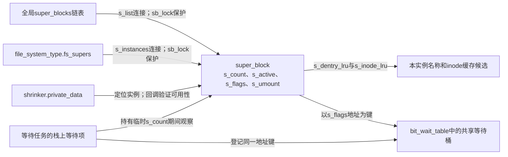
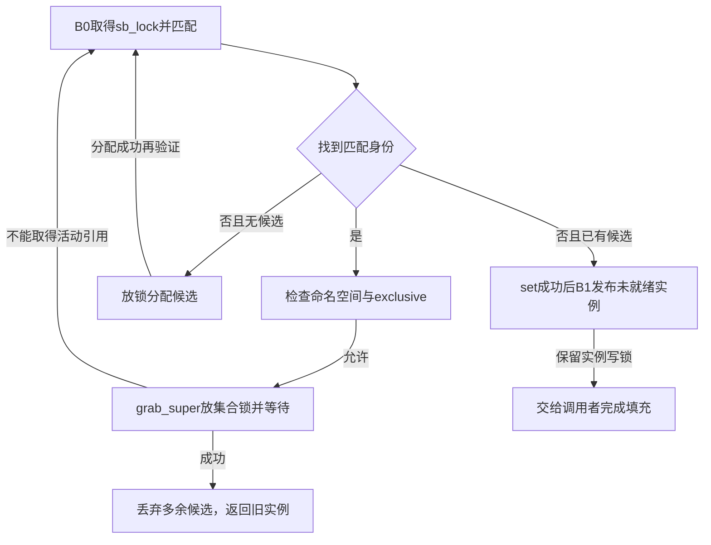
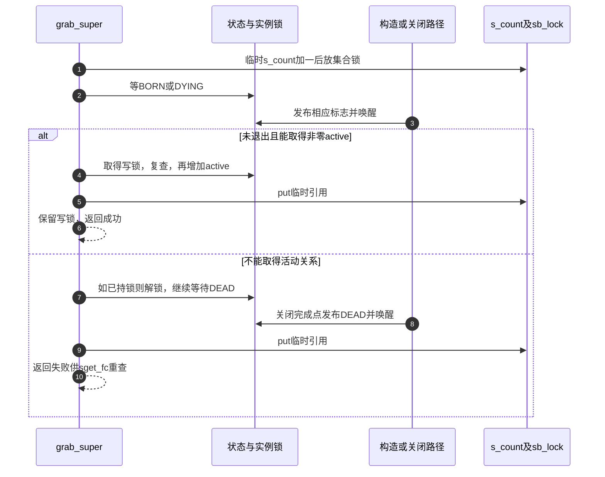

# 第6章\_实例匹配与构造完成的交接

知识场景见 [候选公开与就绪](../../../../knowledge/kernel_subsystems/vfs/P06_superblock实例状态与生命周期.md#6.3_先公开候选再等待就绪解决了什么)。本页按 [实例交接导读](../navigation/P05_实例怎样在构造与关闭之间交接.md#5.1_把阶段落到两种引用和三个标志) 的B0～B3阅读候选、集合、等待与活动持有。版本身份见 [VFS总索引](../navigation/P01_Linux_6.12_VFS源码阅读索引.md)，所有展开函数取NXP Linux 6.12.20固定提交 `dfaf2136deb2af2e60b994421281ba42f1c087e0` 的fs/super.c，blob `c9c7223bc2a2e9cb5391a1b3a291f724416289c2`。

## 6.1\_候选先建立锁和基础持有

新实例还不能直接进入可用状态：后续填充可能失败，并发请求也可能抢先建好同身份实例。因此先分配一个未公开候选，建立公共锁、引用与清理所需状态；只有再次确认需要它，才把它接入发现集合。alloc_super负责这个可被放弃的起点。

```c
/** @brief 仓库补充阅读说明：分配未公开候选，初始化实例写锁、基础计数和公共资源。 */
static struct super_block *alloc_super(struct file_system_type *type, int flags,
				       struct user_namespace *user_ns)
{
	struct super_block *s = kzalloc(sizeof(struct super_block), GFP_KERNEL);
	/* 仓库补充：静态零初始化的默认操作表；不意味着已有后端方法。 */
	static const struct super_operations default_op;
	int i;

	if (!s)
		return NULL;

	INIT_LIST_HEAD(&s->s_mounts);
	s->s_user_ns = get_user_ns(user_ns);
	init_rwsem(&s->s_umount);
	/* 仓库补充：设置检查器的类型类标识，不取得功能锁。 */
	lockdep_set_class(&s->s_umount, &type->s_umount_key);
	/* 未公开候选与重查得到的旧实例是不同锁，使用嵌套子类表达这一关系。 */
	/* 仓库补充：实际取得候选写锁，并告知检查器这是嵌套子类。 */
	down_write_nested(&s->s_umount, SINGLE_DEPTH_NESTING);

	/* 仓库补充：安全分配失败时也要走未公开候选清理。 */
	if (security_sb_alloc(s))
		goto fail;

	for (i = 0; i < SB_FREEZE_LEVELS; i++) {
		if (__percpu_init_rwsem(&s->s_writers.rw_sem[i],
					sb_writers_name[i],
					&type->s_writers_key[i]))
			goto fail;
	}
	s->s_bdi = &noop_backing_dev_info;
	s->s_flags = flags;
	if (s->s_user_ns != &init_user_ns)
		s->s_iflags |= SB_I_NODEV;
	INIT_HLIST_NODE(&s->s_instances);
	INIT_HLIST_BL_HEAD(&s->s_roots);
	mutex_init(&s->s_sync_lock);
	INIT_LIST_HEAD(&s->s_inodes);
	spin_lock_init(&s->s_inode_list_lock);
	INIT_LIST_HEAD(&s->s_inodes_wb);
	spin_lock_init(&s->s_inode_wblist_lock);

	/* 仓库补充：基础结构持有，后续发现者可另取临时持有。 */
	s->s_count = 1;
	/* 仓库补充：构造者接手的活动持有，不能与s_count互换。 */
	atomic_set(&s->s_active, 1);
	mutex_init(&s->s_vfs_rename_mutex);
	lockdep_set_class(&s->s_vfs_rename_mutex, &type->s_vfs_rename_key);
	init_rwsem(&s->s_dquot.dqio_sem);
	s->s_maxbytes = MAX_NON_LFS;
	s->s_op = &default_op;
	s->s_time_gran = 1000000000;
	s->s_time_min = TIME64_MIN;
	s->s_time_max = TIME64_MAX;

	s->s_shrink = shrinker_alloc(SHRINKER_NUMA_AWARE | SHRINKER_MEMCG_AWARE,
				     "sb-%s", type->name);
	if (!s->s_shrink)
		goto fail;

	s->s_shrink->scan_objects = super_cache_scan;
	s->s_shrink->count_objects = super_cache_count;
	s->s_shrink->batch = 1024;
	/* 仓库补充：回收回调通过私有指针重新定位这个实例。 */
	s->s_shrink->private_data = s;

	if (list_lru_init_memcg(&s->s_dentry_lru, s->s_shrink))
		goto fail;
	if (list_lru_init_memcg(&s->s_inode_lru, s->s_shrink))
		goto fail;
	return s;

fail:
	/* 仓库补充：只适用于本次尚未公开的候选，包括空指针。 */
	destroy_unused_super(s);
	return NULL;
}
```

分配器建立尚未公开的对象，并在返回前持有s_umount写锁。它初始化各集合、锁、缓存回收资源和默认操作，令s_count与s_active初值都为1。两者同为1不表示此后它们等价：一个参与临时观察及结构存续，另一个参与活动实例关闭。

| 初始化组 | 当前作用 |
| --- | --- |
| s_mounts、s_instances、s_roots、s_inodes及写回集合 | 建立空连接容器；此时没有凭空创建根inode或mount |
| s_user_ns与s_iflags | 取得实例所属用户命名空间，按其身份设置内部限制 |
| s_umount、重命名锁、inode集合锁 | 为后续各自协议准备，不能合成一把保护所有I/O的锁 |
| s_writers、s_dquot、s_sync_lock | 为冻结、配额和同步相关路径准备，具体协议不在分配函数中完成 |
| s_bdi、s_op、大小及时间默认值 | 提供基础状态，具体文件系统还要填充自己的实现 |
| s_shrink、dentry/inode LRU | 关联缓存计数和回收入口，初始化不等于开始关闭实例 |

失败走destroy_unused_super；它只适用于尚未被发现者看到的候选。其清理与已经公开实例的RCU退出区别见 [最终释放](P07_实例关闭通知与最终内存回收.md#7.3_最后临时引用与实际释放仍然分开)。新候选尚无s_root，fill_super不是这个分配器的职责。

尚未公开时，s_list与s_instances不会把候选交给外部发现者。发布以后，同一实例出现在两种集合中；回收登记又通过private_data指回它。先把这些状态地址放在一起，后面的等待才有明确的承载对象。



## 6.2\_发布前重查避免重复候选

```c
/** @brief 仓库补充阅读说明：锁内选择、锁外分配后重查，再发布未就绪身份或取得已有实例。 */
struct super_block *sget_fc(struct fs_context *fc,
			    int (*test)(struct super_block *, struct fs_context *),
			    int (*set)(struct super_block *, struct fs_context *))
{
	struct super_block *s = NULL;
	struct super_block *old;
	/* 仓库补充：global选择身份背景，不是无条件复用任意现有实例。 */
	struct user_namespace *user_ns = fc->global ? &init_user_ns : fc->user_ns;
	int err;

	/* 类型未声明支持时，禁止把实例放进非初始用户命名空间。 */
	if (user_ns != &init_user_ns && !(fc->fs_type->fs_flags & FS_USERNS_MOUNT)) {
		errorfc(fc, "VFS: Mounting from non-initial user namespace is not allowed");
		return ERR_PTR(-EPERM);
	}

retry:
	/* 仓库补充：保护实例集合、匹配及相关临时计数。 */
	spin_lock(&sb_lock);
	/* 仓库补充：没有匹配回调就不搜索旧实例。 */
	if (test) {
		hlist_for_each_entry(old, &fc->fs_type->fs_supers, s_instances) {
			if (test(old, fc))
				goto share_extant_sb;
		}
	}
	if (!s) {
		spin_unlock(&sb_lock);
		/* 仓库补充：锁外可睡眠分配；完成后必须重查集合。 */
		s = alloc_super(fc->fs_type, fc->sb_flags, user_ns);
		if (!s)
			return ERR_PTR(-ENOMEM);
		goto retry;
	}

	/* 仓库补充：暂供set使用，成功之前fc仍承担原私有数据责任。 */
	s->s_fs_info = fc->s_fs_info;
	/* 仓库补充：仍在sb_lock内，回调不能任意睡眠。 */
	err = set(s, fc);
	if (err) {
		s->s_fs_info = NULL;
		spin_unlock(&sb_lock);
		/* 仓库补充：只适用于本次尚未公开的候选，包括空指针。 */
		destroy_unused_super(s);
		return ERR_PTR(err);
	}
	/* 仓库补充：set成功后才把私有实例数据所有权移出fc。 */
	fc->s_fs_info = NULL;
	s->s_type = fc->fs_type;
	s->s_iflags |= fc->s_iflags;
	strscpy(s->s_id, s->s_type->name, sizeof(s->s_id));
	/* 此处仅公开未就绪身份；发现者必须等待BORN或DYING。 */
	/* 仓库补充：公开到全局实例集合，尚未保证SB_BORN。 */
	list_add_tail(&s->s_list, &super_blocks);
	/* 仓库补充：同时公开到类型的实例集合供身份匹配。 */
	hlist_add_head(&s->s_instances, &s->s_type->fs_supers);
	spin_unlock(&sb_lock);
	/* 仓库补充：实例取得自己的代码使用关系。 */
	get_filesystem(s->s_type);
	/* 仓库补充：向回收框架登记；回调还须验证实例可用性。 */
	shrinker_register(s->s_shrink);
	return s;

share_extant_sb:
	if (user_ns != old->s_user_ns || fc->exclusive) {
		spin_unlock(&sb_lock);
		/* 仓库补充：只适用于本次尚未公开的候选，包括空指针。 */
		destroy_unused_super(s);
		if (fc->exclusive)
			warnfc(fc, "reusing existing filesystem not allowed");
		else
			warnfc(fc, "reusing existing filesystem in another namespace not allowed");
		return ERR_PTR(-EBUSY);
	}
	/* 仓库补充：该辅助会放开sb_lock；失败后重新选择，不能复活旧实例。 */
	if (!grab_super(old))
		goto retry;
	/* 仓库补充：只适用于本次尚未公开的候选，包括空指针。 */
	destroy_unused_super(s);
	return old;
}
```

首先选择实例user_ns，并拒绝类型不允许的非初始用户命名空间。retry内持sb_lock遍历fs_supers；test为空时不搜索复用。没有候选则放锁分配并回到retry，因此内存分配期间其他请求发布的实例仍能被发现。

新候选暂借fc.s_fs_info供set使用，set失败把候选的s_fs_info清空后销毁，fc仍保留原所有权；set成功才清fc.s_fs_info并发布实例。set在sb_lock内执行，不能在这里添加任意睡眠工作。随后接入两个集合，放锁，取得类型持有并登记缓存回收接口。

匹配旧实例后，user_ns不同或exclusive要求会返回EBUSY。否则grab_super在释放sb_lock后等待并尝试活动持有；成功后销毁自己可能已分配的多余候选，返回旧实例。失败回retry，不在原对象上强行恢复活动计数。返回成功时，无论旧实例还是新实例，调用者都接手相应实例写锁协议。



图省略了分配、set和约束拒绝的错误返回，它们在完整函数中保留；重点是锁外分配后的重查和grab失败后的重查不是同一种失败恢复。

## 6.3\_匹配规则与根填充各有职责

```c
/** @brief 仓库补充阅读说明：对遇到的实例返回匹配，不代表其他约束被忽略。 */
static int test_single_super(struct super_block *s, struct fs_context *fc)
{
	return 1;
}
```

```c
/** @brief 仓库补充阅读说明：比较私有数据指针身份，不比较其内容。 */
static int test_keyed_super(struct super_block *sb, struct fs_context *fc)
{
	/* 仓库补充：只比较指针身份，不比较配置内容。 */
	return sb->s_fs_info == fc->s_fs_info;
}
```

前者只给出匹配结果，后者比较s_fs_info指针身份。它们都不解析整个fc参数集，不能把test返回真理解成所有参数语义自动兼容。

```c
/** @brief 仓库补充阅读说明：按匹配策略取得实例，仅在无根时调用fill_super。 */
static int vfs_get_super(struct fs_context *fc,
		int (*test)(struct super_block *, struct fs_context *),
		int (*fill_super)(struct super_block *sb,
				  struct fs_context *fc))
{
	struct super_block *sb;
	int err;

	sb = sget_fc(fc, test, set_anon_super_fc);
	if (IS_ERR(sb))
		return PTR_ERR(sb);

	/* 仓库补充：只有未建根的实例需要本次fill_super。 */
	if (!sb->s_root) {
		err = fill_super(sb, fc);
		if (err)
			goto error;

		/* 仓库补充：建树成功的功能状态位，不是增加s_active计数。 */
		sb->s_flags |= SB_ACTIVE;
	}

	/* 仓库补充：交付上下文自己的根持有，实例写锁仍待上层交接。 */
	fc->root = dget(sb->s_root);
	return 0;

error:
	/* 仓库补充：填充失败，按已持写锁的实例退出协议归还。 */
	deactivate_locked_super(sb);
	return err;
}
```

sget_fc失败直接返回错误。没有根才调用fill_super，失败用deactivate_locked_super退出；成功设置SB_ACTIVE。已有根则复用，最后dget根交给fc。set_anon_super_fc为这组无块设备实例安排匿名设备身份，不负责生成inode树。

```c
/** @brief 仓库补充阅读说明：不给匹配回调，因此此路径不搜索复用实例。 */
int get_tree_nodev(struct fs_context *fc,
		  int (*fill_super)(struct super_block *sb,
				    struct fs_context *fc))
{
	return vfs_get_super(fc, NULL, fill_super);
}
```

```c
/** @brief 仓库补充阅读说明：用恒匹配回调选择实例，仍受sget_fc其他约束。 */
int get_tree_single(struct fs_context *fc,
		  int (*fill_super)(struct super_block *sb,
				    struct fs_context *fc))
{
	return vfs_get_super(fc, test_single_super, fill_super);
}
```

```c
/** @brief 仓库补充阅读说明：把指针键交给实例选择路径。 */
int get_tree_keyed(struct fs_context *fc,
		  int (*fill_super)(struct super_block *sb,
				    struct fs_context *fc),
		void *key)
{
	/* 仓库补充：keyed策略把调用者键放进共同匹配字段。 */
	fc->s_fs_info = key;
	return vfs_get_super(fc, test_keyed_super, fill_super);
}
```

三个入口分别提供NULL、恒匹配和指针匹配策略；keyed先把key放进fc.s_fs_info，再走共同路径。tmpfs的shmem_get_tree与ramfs相应入口选择nodev；这个事实只描述它们的新建路径，不限制bind或其他已有视图复制如何使用实例。

## 6.4\_等待条件与实例锁完成两次确认

```c
/** @brief 仓库补充阅读说明：以acquire方式读取与发布配对的状态位。 */
static bool super_flags(const struct super_block *sb, unsigned int flags)
{
	/* 与super_wake的release发布配对，确保观察到相应初始化内容。 */
	return smp_load_acquire(&sb->s_flags) & flags;
}
```

```c
/** @brief 仓库补充阅读说明：等待构造或关闭信号，随后加实例锁并再次检查退出状态。 */
static __must_check bool super_lock(struct super_block *sb, bool excl)
{
	/* 仓库补充：检查当前任务的持锁记录；不执行解锁或取得锁。 */
	lockdep_assert_not_held(&sb->s_umount);

	/* 等待构造完成或开始退出。 */
	wait_var_event(&sb->s_flags, super_flags(sb, SB_BORN | SB_DYING));

	/* 已退出就无须再竞争实例锁。 */
	if (super_flags(sb, SB_DYING))
		return false;

	/* 仓库补充：等待条件成立后，仍需实际取得读侧或写侧锁。 */
	__super_lock(sb, excl);

	/* 等待锁期间可能已关闭；取得锁后必须再次排除DYING。 */
	/* 仓库补充：锁前检查之后可能发生退出，因此锁内再确认。 */
	if (sb->s_flags & SB_DYING) {
		super_unlock(sb, excl);
		return false;
	}

	WARN_ON_ONCE(!(sb->s_flags & SB_BORN));
	return true;
}
```

调用者必须先取得临时s_count。wait_var_event等待BORN或DYING；若已经DYING，直接放弃而不取锁。否则调用__super_lock取得s_umount的读侧或写侧，随后再次检查DYING。成功返回持锁，失败返回不持锁；super_lock_excl只是选择写侧的薄入口。

```c
/** @brief 仓库补充阅读说明：发布一个进度位，再按状态地址唤醒等待者。 */
static void super_wake(struct super_block *sb, unsigned int flag)
{
	WARN_ON_ONCE((flag & ~SUPER_WAKE_FLAGS));
	WARN_ON_ONCE(hweight32(flag & SUPER_WAKE_FLAGS) > 1);

	/* 与读取侧acquire配对，发布标志前的初始化内容。 */
	/* 仓库补充：发布已有内容与进度位，保留其他状态位。 */
	smp_store_release(&sb->s_flags, sb->s_flags | flag);
	/* 与等待登记后的条件复查配对，防止状态已改却遗漏唤醒。 */
	smp_mb();
	/* 仓库补充：按状态地址找到等待者；唤醒后仍要复查条件。 */
	wake_up_var(&sb->s_flags);
}
```

SUPER_WAKE_FLAGS由BORN、DYING、DEAD组成，每次发布一个允许的进度位，使用按位或保留已有标志。release写与super_flags的acquire读配对，随后完整屏障与等待登记/唤醒配对。这里不能把普通赋值加“睡一会儿”当成等价替换。

等待承载在include/linux/wait_bit.h与kernel/sched/wait_bit.c：__var_waitqueue按状态地址哈希到bit_wait_table，栈上等待项记录地址键；prepare_to_wait_event后复查条件，必要时schedule，唤醒函数核对同一地址并促使任务重新检查。哈希桶可能共享，地址键使唤醒对象不依赖桶独占。该接口说明不复制等待队列通用函数实现，也不声称superblock内嵌了专属等待线程。

## 6.5\_取得活动引用失败就等待旧实例退出

```c
/** @brief 仓库补充阅读说明：持临时引用等待，尝试取得非零active，失败等DEAD后让调用者重查。 */
static bool grab_super(struct super_block *sb)
{
	bool locked;

	/* 仓库补充：入口已有sb_lock，先保护对象内存再释放集合锁。 */
	sb->s_count++;
	spin_unlock(&sb_lock);
	locked = super_lock_excl(sb);
	if (locked) {
		/* 仓库补充：只接管仍活跃实例，禁止从零复活。 */
		if (atomic_inc_not_zero(&sb->s_active)) {
			put_super(sb);
			return true;
		}
		super_unlock_excl(sb);
	}
	/* 仓库补充：失败后等旧身份真正退出，再允许上层重新匹配。 */
	wait_var_event(&sb->s_flags, super_flags(sb, SB_DEAD));
	put_super(sb);
	return false;
}
```

入口在sb_lock内，先增加s_count再释放集合锁。super_lock_excl成功后仍要atomic_inc_not_zero，防止复活已无活动使用者的实例；成功归还临时引用并保留s_umount写锁给上层。若活动增加失败，先解实例锁；若super_lock已拒绝，它本来就不持锁。两种失败都等DEAD，归还临时引用，再由sget_fc重新选择。



检查修改时必须同时保留临时引用、等待与唤醒、锁后复查以及非零增加。只把某一次lookup变成“线程安全”不足以覆盖构造失败与最后active退出的交错。本次逐函数核对不代替目标并发挂载或低内存验证。


## 6.6\_把功能状态和检查器身份分别追到底

候选尚未公开，却可能在持有自己的s_umount时重查并取得旧实例的s_umount。这是两把锁，不能因为属于同一文件系统类型就把它们误判为递归取得同一实例锁。alloc_super用类型中的key设置检查器类，再以SINGLE_DEPTH_NESTING标注候选锁的嵌套子类；实际互斥仍由down_write_nested完成。删掉检查注解不会替代功能锁，保留注解也不会使错误锁序自动正确。

| 初始化对象或实现簇 | 存储、初值与消费路径 | 修改必须保持的关系 |
| --- | --- | --- |
| super_blocks、sb_lock | super.c静态链表头和自旋锁；sget_fc发布，put_super最后归还时摘全局链 | 类型集合与全局集合不同步结束；不能提前回收仍有s_count的实例 |
| default_op、s_bdi与时间/大小默认值 | default_op是静态零表，s_bdi先指noop_backing_dev_info；具体fill_super继续填充 | 默认表不提供具体后端操作；s_maxbytes等须在对外使用前满足文件系统契约 |
| s_umount_key、s_vfs_rename_key、s_writers_key | key来自file_system_type；每个实例的相应锁使用这些类型身份 | key服务检查器分类，不是所有实例共享同一把功能锁；类初始化见 [Lockdep身份实现](../../lockdep/source_explanations/kernel/locking/lockdep.c.md#1.3_lockdep_init_map_type与关闭配置分支) |
| sb_writers_name与s_writers.rw_sem | super.c静态名称为sb_writers、sb_pagefaults、sb_internal，逐级初始化冻结门 | 名称用于识别各级锁，真实准入由对应rw_sem承担；见 [冻结写侧与读侧](P66_冻结写入的分级准入.md#66.1_修改者在冻结门上取得读侧) |
| s_shrink及两组LRU | alloc_super设置scan_objects、count_objects、batch和private_data，随后sget_fc登记 | 回收者不能把已登记等同已就绪；具体回调见 [实例缓存扫描](P65_空闲inode扫描与卸载驱逐.md#65.1_压力扫描先估计预算再取得实例访问资格) |
| sget_fc与get_tree系列 | fs.h、fs_context.h声明公共入口，super.c定义；私有匹配和vfs_get_super在同文件内 | test/set在集合锁内运行；set失败保留fc私有数据责任，fill失败转实例关闭；策略比较不替代权限和active检查 |
| set_anon_super_fc | super.c辅助，为无块设备实例分配s_dev匿名身份；不是填根回调 | 匿名编号分配可能失败，set错误必须回到未公开候选清理；归还在kill_anon_super路径 |
| __super_lock、super_unlock及excl包装 | super.c私有薄包装，excl选择down/up_write或down/up_read | super_lock还包含等待与状态重查，不能用不等待的__super_lock直接替代其协议 |
| super_flags、super_wake、grab_super | s_flags的release/acquire通信、地址等待和两种计数交接 | SUPER_WAKE_FLAGS只允许BORN、DYING、DEAD；唤醒不是活动持有，非零增加与锁后复查均不可省略 |

检查器的通用入口从 [Lockdep源码导读](../../lockdep/navigation/P01_Linux_6.12_Lockdep源码导读.md)进入。`lockdep_assert_not_held`检查当前任务的持锁记录，不解锁、不取得资源；展开见 [持锁断言](../../lockdep/source_explanations/P04_Linux_6.12_Lockdep查询注解与配置源码实现.md#4.3_lockdep_assert系列断言展开)。本次目标PROVE_LOCKING、DEBUG_LOCK_ALLOC、LOCKDEP开启，但检查器仍须保持有效且相关路径实际执行才能形成检查证据，不能把没有日志当成无竞态证明。

本次是非SMP、TINY_RCU构建，不能据此把源代码中的发布、等待或引用协议删掉；屏障宏在不同架构和配置下的机器实现不同，正文只据此解释架构无关的源码配对，不伪称已检查所有指令展开。MEMCG开启，SECURITY关闭；安全分配钩子的关闭配置返回0，完整安全实现仍可失败。SHRINKER_NUMA_AWARE与SHRINKER_MEMCG_AWARE告诉回收框架按节点、内存控制组组织相应扫描，batch设置本实例的扫描批量参数；它们不是实例已经就绪的证明。内存分配、链表初始化、LRU和shrinker的通用算法不在这里复制，本页负责其参数、回调身份、成功登记和失败清理关系。

改匹配策略时至少同时检查test为空、同键不同用户命名空间、exclusive拒绝和锁外分配后重查；改初始化时检查所有失败点是否仍可由destroy_unused_super接住；改BORN发布时必须同时核对锁外缓存计数观察者和等待者，不能只验证get_tree的直接调用者。构造失败与并发重用也要覆盖到DEAD等待和最后临时归还。上述是修改影响范围，本次只有固定源码与静态讲解核对，没有内核压力测试。
