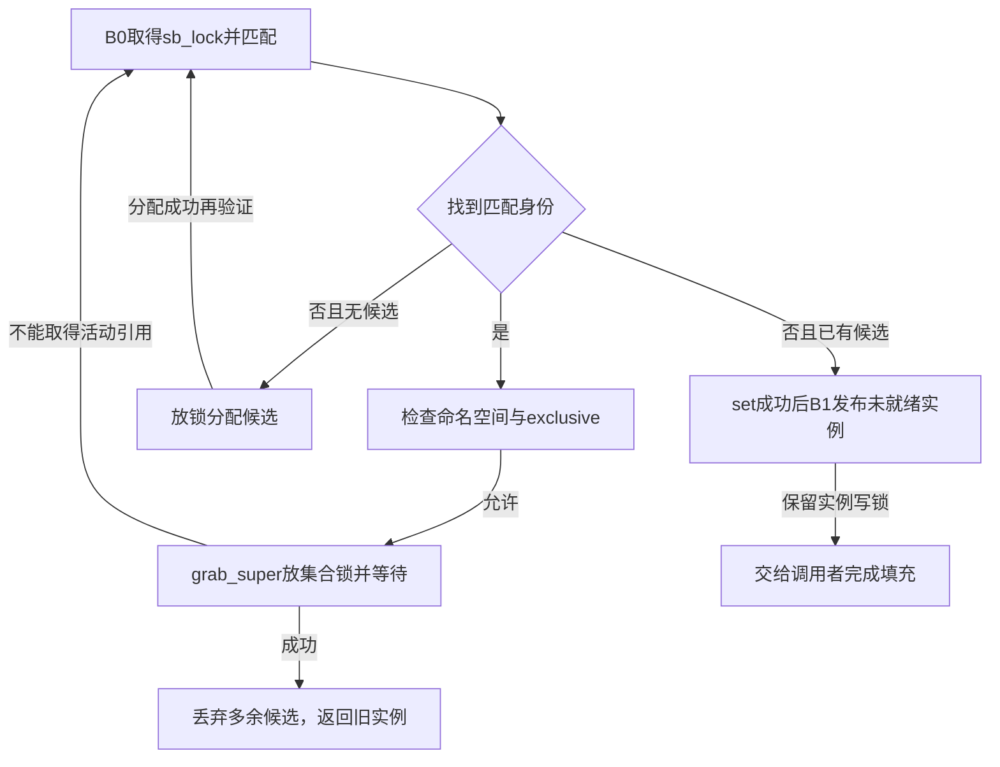
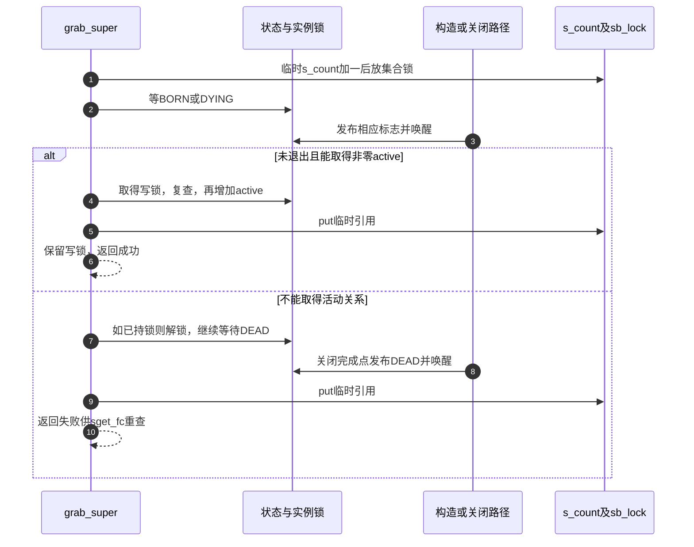

# 第6章\_实例匹配与构造完成的交接

本页按 [实例交接导读](../navigation/P05_实例怎样在构造与关闭之间交接.md#5.1_把阶段落到两种引用和三个标志) 的B0～B3阅读候选、集合、等待与活动持有。版本身份见 [VFS总索引](../navigation/P01_Linux_6.12_VFS源码阅读索引.md)，所有展开函数取NXP Linux 6.12.20固定提交 `dfaf2136deb2af2e60b994421281ba42f1c087e0` 的fs/super.c，blob `c9c7223bc2a2e9cb5391a1b3a291f724416289c2`。

## 6.1\_候选先建立锁和基础持有

```c
/** @brief 仓库补充阅读说明：分配未公开候选，初始化实例写锁、基础计数和公共资源。 */
static struct super_block *alloc_super(struct file_system_type *type, int flags,
				       struct user_namespace *user_ns)
{
	struct super_block *s = kzalloc(sizeof(struct super_block), GFP_KERNEL);
	static const struct super_operations default_op;
	int i;

	if (!s)
		return NULL;

	INIT_LIST_HEAD(&s->s_mounts);
	s->s_user_ns = get_user_ns(user_ns);
	init_rwsem(&s->s_umount);
	lockdep_set_class(&s->s_umount, &type->s_umount_key);
	/*
	 * sget() can have s_umount recursion.
	 *
	 * When it cannot find a suitable sb, it allocates a new
	 * one (this one), and tries again to find a suitable old
	 * one.
	 *
	 * In case that succeeds, it will acquire the s_umount
	 * lock of the old one. Since these are clearly distrinct
	 * locks, and this object isn't exposed yet, there's no
	 * risk of deadlocks.
	 *
	 * Annotate this by putting this lock in a different
	 * subclass.
	 */
	down_write_nested(&s->s_umount, SINGLE_DEPTH_NESTING);

	if (security_sb_alloc(s))
		goto fail;

	for (i = 0; i < SB_FREEZE_LEVELS; i++) {
		if (__percpu_init_rwsem(&s->s_writers.rw_sem[i],
					sb_writers_name[i],
					&type->s_writers_key[i]))
			goto fail;
	}
	s->s_bdi = &noop_backing_dev_info;
	s->s_flags = flags;
	if (s->s_user_ns != &init_user_ns)
		s->s_iflags |= SB_I_NODEV;
	INIT_HLIST_NODE(&s->s_instances);
	INIT_HLIST_BL_HEAD(&s->s_roots);
	mutex_init(&s->s_sync_lock);
	INIT_LIST_HEAD(&s->s_inodes);
	spin_lock_init(&s->s_inode_list_lock);
	INIT_LIST_HEAD(&s->s_inodes_wb);
	spin_lock_init(&s->s_inode_wblist_lock);

	s->s_count = 1;
	atomic_set(&s->s_active, 1);
	mutex_init(&s->s_vfs_rename_mutex);
	lockdep_set_class(&s->s_vfs_rename_mutex, &type->s_vfs_rename_key);
	init_rwsem(&s->s_dquot.dqio_sem);
	s->s_maxbytes = MAX_NON_LFS;
	s->s_op = &default_op;
	s->s_time_gran = 1000000000;
	s->s_time_min = TIME64_MIN;
	s->s_time_max = TIME64_MAX;

	s->s_shrink = shrinker_alloc(SHRINKER_NUMA_AWARE | SHRINKER_MEMCG_AWARE,
				     "sb-%s", type->name);
	if (!s->s_shrink)
		goto fail;

	s->s_shrink->scan_objects = super_cache_scan;
	s->s_shrink->count_objects = super_cache_count;
	s->s_shrink->batch = 1024;
	s->s_shrink->private_data = s;

	if (list_lru_init_memcg(&s->s_dentry_lru, s->s_shrink))
		goto fail;
	if (list_lru_init_memcg(&s->s_inode_lru, s->s_shrink))
		goto fail;
	return s;

fail:
	destroy_unused_super(s);
	return NULL;
}
```

分配器建立尚未公开的对象，并在返回前持有s_umount写锁。它初始化各集合、锁、缓存回收资源和默认操作，令s_count与s_active初值都为1。两者同为1不表示此后它们等价：一个参与临时观察及结构存续，另一个参与活动实例关闭。

| 初始化组 | 当前作用 |
| --- | --- |
| s_mounts、s_instances、s_roots、s_inodes及写回集合 | 建立空连接容器；此时没有凭空创建根inode或mount |
| s_user_ns与s_iflags | 取得实例所属用户命名空间，按其身份设置内部限制 |
| s_umount、重命名锁、inode集合锁 | 为后续各自协议准备，不能合成一把保护所有I/O的锁 |
| s_writers、s_dquot、s_sync_lock | 为冻结、配额和同步相关路径准备，具体协议不在分配函数中完成 |
| s_bdi、s_op、大小及时间默认值 | 提供基础状态，具体文件系统还要填充自己的实现 |
| s_shrink、dentry/inode LRU | 关联缓存计数和回收入口，初始化不等于开始关闭实例 |

失败走destroy_unused_super；它只适用于尚未被发现者看到的候选。其清理与已经公开实例的RCU退出区别见 [最终释放](P07_实例关闭通知与最终内存回收.md#7.3_最后临时引用与实际释放仍然分开)。新候选尚无s_root，fill_super不是这个分配器的职责。

## 6.2\_发布前重查避免重复候选

```c
/** @brief 仓库补充阅读说明：锁内选择、锁外分配后重查，再发布未就绪身份或取得已有实例。 */
struct super_block *sget_fc(struct fs_context *fc,
			    int (*test)(struct super_block *, struct fs_context *),
			    int (*set)(struct super_block *, struct fs_context *))
{
	struct super_block *s = NULL;
	struct super_block *old;
	struct user_namespace *user_ns = fc->global ? &init_user_ns : fc->user_ns;
	int err;

	/*
	 * Never allow s_user_ns != &init_user_ns when FS_USERNS_MOUNT is
	 * not set, as the filesystem is likely unprepared to handle it.
	 * This can happen when fsconfig() is called from init_user_ns with
	 * an fs_fd opened in another user namespace.
	 */
	if (user_ns != &init_user_ns && !(fc->fs_type->fs_flags & FS_USERNS_MOUNT)) {
		errorfc(fc, "VFS: Mounting from non-initial user namespace is not allowed");
		return ERR_PTR(-EPERM);
	}

retry:
	spin_lock(&sb_lock);
	if (test) {
		hlist_for_each_entry(old, &fc->fs_type->fs_supers, s_instances) {
			if (test(old, fc))
				goto share_extant_sb;
		}
	}
	if (!s) {
		spin_unlock(&sb_lock);
		s = alloc_super(fc->fs_type, fc->sb_flags, user_ns);
		if (!s)
			return ERR_PTR(-ENOMEM);
		goto retry;
	}

	s->s_fs_info = fc->s_fs_info;
	err = set(s, fc);
	if (err) {
		s->s_fs_info = NULL;
		spin_unlock(&sb_lock);
		destroy_unused_super(s);
		return ERR_PTR(err);
	}
	fc->s_fs_info = NULL;
	s->s_type = fc->fs_type;
	s->s_iflags |= fc->s_iflags;
	strscpy(s->s_id, s->s_type->name, sizeof(s->s_id));
	/*
	 * Make the superblock visible on @super_blocks and @fs_supers.
	 * It's in a nascent state and users should wait on SB_BORN or
	 * SB_DYING to be set.
	 */
	list_add_tail(&s->s_list, &super_blocks);
	hlist_add_head(&s->s_instances, &s->s_type->fs_supers);
	spin_unlock(&sb_lock);
	get_filesystem(s->s_type);
	shrinker_register(s->s_shrink);
	return s;

share_extant_sb:
	if (user_ns != old->s_user_ns || fc->exclusive) {
		spin_unlock(&sb_lock);
		destroy_unused_super(s);
		if (fc->exclusive)
			warnfc(fc, "reusing existing filesystem not allowed");
		else
			warnfc(fc, "reusing existing filesystem in another namespace not allowed");
		return ERR_PTR(-EBUSY);
	}
	if (!grab_super(old))
		goto retry;
	destroy_unused_super(s);
	return old;
}
```

首先选择实例user_ns，并拒绝类型不允许的非初始用户命名空间。retry内持sb_lock遍历fs_supers；test为空时不搜索复用。没有候选则放锁分配并回到retry，因此内存分配期间其他请求发布的实例仍能被发现。

新候选暂借fc.s_fs_info供set使用，set失败把候选的s_fs_info清空后销毁，fc仍保留原所有权；set成功才清fc.s_fs_info并发布实例。set在sb_lock内执行，不能在这里添加任意睡眠工作。随后接入两个集合，放锁，取得类型持有并登记缓存回收接口。

匹配旧实例后，user_ns不同或exclusive要求会返回EBUSY。否则grab_super在释放sb_lock后等待并尝试活动持有；成功后销毁自己可能已分配的多余候选，返回旧实例。失败回retry，不在原对象上强行恢复活动计数。返回成功时，无论旧实例还是新实例，调用者都接手相应实例写锁协议。



图省略了分配、set和约束拒绝的错误返回，它们在完整函数中保留；重点是锁外分配后的重查和grab失败后的重查不是同一种失败恢复。

## 6.3\_匹配规则与根填充各有职责

```c
/** @brief 仓库补充阅读说明：对遇到的实例返回匹配，不代表其他约束被忽略。 */
static int test_single_super(struct super_block *s, struct fs_context *fc)
{
	return 1;
}
```

```c
/** @brief 仓库补充阅读说明：比较私有数据指针身份，不比较其内容。 */
static int test_keyed_super(struct super_block *sb, struct fs_context *fc)
{
	return sb->s_fs_info == fc->s_fs_info;
}
```

前者只给出匹配结果，后者比较s_fs_info指针身份。它们都不解析整个fc参数集，不能把test返回真理解成所有参数语义自动兼容。

```c
/** @brief 仓库补充阅读说明：按匹配策略取得实例，仅在无根时调用fill_super。 */
static int vfs_get_super(struct fs_context *fc,
		int (*test)(struct super_block *, struct fs_context *),
		int (*fill_super)(struct super_block *sb,
				  struct fs_context *fc))
{
	struct super_block *sb;
	int err;

	sb = sget_fc(fc, test, set_anon_super_fc);
	if (IS_ERR(sb))
		return PTR_ERR(sb);

	if (!sb->s_root) {
		err = fill_super(sb, fc);
		if (err)
			goto error;

		sb->s_flags |= SB_ACTIVE;
	}

	fc->root = dget(sb->s_root);
	return 0;

error:
	deactivate_locked_super(sb);
	return err;
}
```

sget_fc失败直接返回错误。没有根才调用fill_super，失败用deactivate_locked_super退出；成功设置SB_ACTIVE。已有根则复用，最后dget根交给fc。set_anon_super_fc为这组无块设备实例安排匿名设备身份，不负责生成inode树。

```c
/** @brief 仓库补充阅读说明：不给匹配回调，因此此路径不搜索复用实例。 */
int get_tree_nodev(struct fs_context *fc,
		  int (*fill_super)(struct super_block *sb,
				    struct fs_context *fc))
{
	return vfs_get_super(fc, NULL, fill_super);
}
```

```c
/** @brief 仓库补充阅读说明：用恒匹配回调选择实例，仍受sget_fc其他约束。 */
int get_tree_single(struct fs_context *fc,
		  int (*fill_super)(struct super_block *sb,
				    struct fs_context *fc))
{
	return vfs_get_super(fc, test_single_super, fill_super);
}
```

```c
/** @brief 仓库补充阅读说明：把指针键交给实例选择路径。 */
int get_tree_keyed(struct fs_context *fc,
		  int (*fill_super)(struct super_block *sb,
				    struct fs_context *fc),
		void *key)
{
	fc->s_fs_info = key;
	return vfs_get_super(fc, test_keyed_super, fill_super);
}
```

三个入口分别提供NULL、恒匹配和指针匹配策略；keyed先把key放进fc.s_fs_info，再走共同路径。tmpfs的shmem_get_tree与ramfs相应入口选择nodev；这个事实只描述它们的新建路径，不限制bind或其他已有视图复制如何使用实例。

## 6.4\_等待条件与实例锁完成两次确认

```c
/** @brief 仓库补充阅读说明：以acquire方式读取与发布配对的状态位。 */
static bool super_flags(const struct super_block *sb, unsigned int flags)
{
	/*
	 * Pairs with smp_store_release() in super_wake() and ensures
	 * that we see @flags after we're woken.
	 */
	return smp_load_acquire(&sb->s_flags) & flags;
}
```

```c
/** @brief 仓库补充阅读说明：等待构造或关闭信号，随后加实例锁并再次检查退出状态。 */
static __must_check bool super_lock(struct super_block *sb, bool excl)
{
	lockdep_assert_not_held(&sb->s_umount);

	/* wait until the superblock is ready or dying */
	wait_var_event(&sb->s_flags, super_flags(sb, SB_BORN | SB_DYING));

	/* Don't pointlessly acquire s_umount. */
	if (super_flags(sb, SB_DYING))
		return false;

	__super_lock(sb, excl);

	/*
	 * Has gone through generic_shutdown_super() in the meantime.
	 * @sb->s_root is NULL and @sb->s_active is 0. No one needs to
	 * grab a reference to this. Tell them so.
	 */
	if (sb->s_flags & SB_DYING) {
		super_unlock(sb, excl);
		return false;
	}

	WARN_ON_ONCE(!(sb->s_flags & SB_BORN));
	return true;
}
```

调用者必须先取得临时s_count。wait_var_event等待BORN或DYING；若已经DYING，直接放弃而不取锁。否则调用__super_lock取得s_umount的读侧或写侧，随后再次检查DYING。成功返回持锁，失败返回不持锁；super_lock_excl只是选择写侧的薄入口。

```c
/** @brief 仓库补充阅读说明：发布一个进度位，再按状态地址唤醒等待者。 */
static void super_wake(struct super_block *sb, unsigned int flag)
{
	WARN_ON_ONCE((flag & ~SUPER_WAKE_FLAGS));
	WARN_ON_ONCE(hweight32(flag & SUPER_WAKE_FLAGS) > 1);

	/*
	 * Pairs with smp_load_acquire() in super_lock() to make sure
	 * all initializations in the superblock are seen by the user
	 * seeing SB_BORN sent.
	 */
	smp_store_release(&sb->s_flags, sb->s_flags | flag);
	/*
	 * Pairs with the barrier in prepare_to_wait_event() to make sure
	 * ___wait_var_event() either sees SB_BORN set or
	 * waitqueue_active() check in wake_up_var() sees the waiter.
	 */
	smp_mb();
	wake_up_var(&sb->s_flags);
}
```

SUPER_WAKE_FLAGS由BORN、DYING、DEAD组成，每次发布一个允许的进度位，使用按位或保留已有标志。release写与super_flags的acquire读配对，随后完整屏障与等待登记/唤醒配对。这里不能把普通赋值加“睡一会儿”当成等价替换。

等待承载在include/linux/wait_bit.h与kernel/sched/wait_bit.c：__var_waitqueue按状态地址哈希到bit_wait_table，栈上等待项记录地址键；prepare_to_wait_event后复查条件，必要时schedule，唤醒函数核对同一地址并促使任务重新检查。哈希桶可能共享，地址键使唤醒对象不依赖桶独占。该接口说明不复制等待队列通用函数实现，也不声称superblock内嵌了专属等待线程。

## 6.5\_取得活动引用失败就等待旧实例退出

```c
/** @brief 仓库补充阅读说明：持临时引用等待，尝试取得非零active，失败等DEAD后让调用者重查。 */
static bool grab_super(struct super_block *sb)
{
	bool locked;

	sb->s_count++;
	spin_unlock(&sb_lock);
	locked = super_lock_excl(sb);
	if (locked) {
		if (atomic_inc_not_zero(&sb->s_active)) {
			put_super(sb);
			return true;
		}
		super_unlock_excl(sb);
	}
	wait_var_event(&sb->s_flags, super_flags(sb, SB_DEAD));
	put_super(sb);
	return false;
}
```

入口在sb_lock内，先增加s_count再释放集合锁。super_lock_excl成功后仍要atomic_inc_not_zero，防止复活已无活动使用者的实例；成功归还临时引用并保留s_umount写锁给上层。若活动增加失败，先解实例锁；若super_lock已拒绝，它本来就不持锁。两种失败都等DEAD，归还临时引用，再由sget_fc重新选择。



检查修改时必须同时保留临时引用、等待与唤醒、锁后复查以及非零增加。只把某一次lookup变成“线程安全”不足以覆盖构造失败与最后active退出的交错。本次逐函数核对不代替目标并发挂载或低内存验证。
