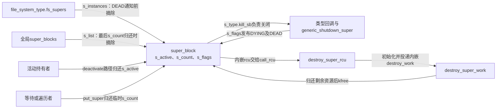
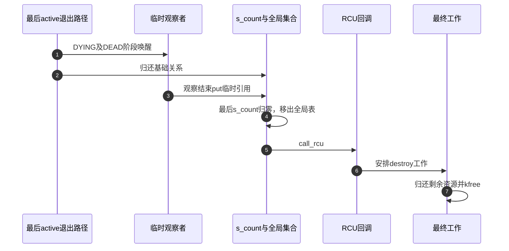

# 第7章\_实例关闭通知与最终内存回收

知识场景见 [关闭与内存释放的时间差](../../../../knowledge/kernel_subsystems/vfs/P06_superblock实例状态与生命周期.md#6.5_最后活动引用结束后为何还不能立即free)。本页承接 [实例交接导读](../navigation/P05_实例怎样在构造与关闭之间交接.md#5.1_把阶段落到两种引用和三个标志) 的B4/B5。固定NXP Linux 6.12.20提交 `dfaf2136deb2af2e60b994421281ba42f1c087e0`，全部展开函数来自fs/super.c（blob `c9c7223bc2a2e9cb5391a1b3a291f724416289c2`），身份见 [VFS总索引](../navigation/P01_Linux_6.12_VFS源码阅读索引.md)。

## 7.1\_最后活动引用把流程交给关闭回调

大多数归还只是少一个使用者，只有最后一份才改变整个实例的生命阶段。这个转折必须与实例写锁协调；否则发现者可能在关闭和取得活动使用之间看到不完整状态。下面先看不持锁的归还入口如何把可能的最后一份交给持锁路径。

```c
/** @brief 仓库补充阅读说明：非最后active可直接归还，可能最后一份时先取得实例写锁。 */
void deactivate_super(struct super_block *s)
{
	/* 仓库补充：非最后一份直接减；等于1时先保留它，进入加锁路径。 */
	if (!atomic_add_unless(&s->s_active, -1, 1)) {
		/* 仓库补充：这里实际取得写锁，不走等待BORN的发现者协议。 */
		__super_lock_excl(s);
		deactivate_locked_super(s);
	}
}
```

非最后一份可直接减active；计数可能为1时先取得实例写锁，再由持锁版本再次归还和判断。不能在不持锁时把最后active减成零，再指望其他代码自行串行化关闭。

```c
/** @brief 仓库补充阅读说明：持锁归还active，最后一份驱动类型关闭与公共退出。 */
void deactivate_locked_super(struct super_block *s)
{
	struct file_system_type *fs = s->s_type;
	/* 仓库补充：在已持写锁的前提下再次归还并判断最后活动持有。 */
	if (atomic_dec_and_test(&s->s_active)) {
		/* 仓库补充：停止该实例的缓存回收入口，随后才进入类型关闭。 */
		shrinker_free(s->s_shrink);
		/* 仓库补充：类型回调负责后端与公共关闭协议，不能和s_op.put_super混同。 */
		fs->kill_sb(s);

		/* 仓库补充：回调可能已通知；该辅助自身处理重复通知。 */
		kill_super_notify(s);

		/* LRU销毁可能睡眠，不能放到持sb_lock的put_super中。 */
		list_lru_destroy(&s->s_dentry_lru);
		list_lru_destroy(&s->s_inode_lru);

		/* 仓库补充：归还实例独立持有的类型代码关系。 */
		put_filesystem(fs);
		/* 仓库补充：归还实例的基础结构持有，其他临时观察者可能仍在。 */
		put_super(s);
	} else {
		super_unlock_excl(s);
	}
}
```

计数仍非零只解锁返回；归零则先停止并清理实例的shrinker入口，再调用类型kill_sb。该回调必须遵守实例关闭与解锁协议，随后通知退出、销毁LRU、归还类型持有和基础临时关系。函数本身没有遍历所有用户fd强行关闭它们；合法活动使用者必须此前已按协议退出。



图中kill_sb可以通过不同文件系统辅助路径组织公共部分与后端清理；不能把它等同于s_op.put_super，更不能与公共put_super引用函数混名。

## 7.2\_先结束公共使用再通知旧实例已退出

```c
/** @brief 仓库补充阅读说明：执行公共关闭、发布DYING并释放实例锁，后端关闭仍由类型路径负责。 */
void generic_shutdown_super(struct super_block *sb)
{
	const struct super_operations *sop = sb->s_op;

	if (sb->s_root) {
		/* 仓库补充：处理实例名称树并结束根关系，不是逐个关闭用户fd。 */
		shrink_dcache_for_umount(sb);
		/* 仓库补充：此void关闭路径不把同步返回值作为中止卸载的条件。 */
		sync_filesystem(sb);
		/* 仓库补充：撤销活动运行标志，和引用计数s_active是不同状态。 */
		sb->s_flags &= ~SB_ACTIVE;

		cgroup_writeback_umount(sb);

		/* 驱逐没有引用的inode，不强制清零其他持有。 */
		evict_inodes(sb);

		/* 清理通知或安全策略维持的inode持有。 */
		/* 仓库补充：拆除通知关联对对象的持有，最终通知存储另在free阶段归还。 */
		fsnotify_sb_delete(sb);
		security_sb_delete(sb);

		if (sb->s_dio_done_wq) {
			/* 仓库补充：排空并销毁该实例的直接I/O完成工作队列。 */
			destroy_workqueue(sb->s_dio_done_wq);
			sb->s_dio_done_wq = NULL;
		}

		if (sop->put_super)
			/* 仓库补充：文件系统自己的关闭回调，与公共临时计数put_super不同。 */
			sop->put_super(sb);

		/* 相应加密inode驱逐后，才销毁文件系统加密密钥环。 */
		fscrypt_destroy_keyring(sb);

		if (CHECK_DATA_CORRUPTION(!list_empty(&sb->s_inodes),
				"VFS: Busy inodes after unmount of %s (%s)",
				sb->s_id, sb->s_type->name)) {
			/* 此处难以完整回退，设置毒值让违规后续访问更明确地失败。 */
			struct inode *inode;

			/* 仓库补充：在实例inode集合保护下给仍残留的对象设置毒值。 */
			spin_lock(&sb->s_inode_list_lock);
			list_for_each_entry(inode, &sb->s_inodes, i_sb_list) {
				/* 仓库补充：故意令违规后续使用暴露问题，不是恢复为可用对象。 */
				inode->i_op = VFS_PTR_POISON;
				inode->i_sb = VFS_PTR_POISON;
				inode->i_mapping = VFS_PTR_POISON;
			}
			spin_unlock(&sb->s_inode_list_lock);
		}
	}
	/* 通知临时观察者正在退出；类型匹配入口保留到kill协议的通知点。 */
	/* 仓库补充：先通知停止使用，类型实例集合入口暂时保留。 */
	super_wake(sb, SB_DYING);
	/* 仓库补充：公共关闭结束实例写锁保护，后面仍有资源清理。 */
	super_unlock_excl(sb);
	if (sb->s_bdi != &noop_backing_dev_info) {
		if (sb->s_iflags & SB_I_PERSB_BDI)
			bdi_unregister(sb->s_bdi);
		/* 仓库补充：归还后备设备信息持有，恢复为公共noop默认指针。 */
		bdi_put(sb->s_bdi);
		sb->s_bdi = &noop_backing_dev_info;
	}
}
```

有根时先处理dentry和同步，再清SB_ACTIVE、处理写回关联及inode、通知和安全引用，随后调用可选s_op.put_super并清理加密状态。这里的s_op.put_super是文件系统回调，不是本页后节的临时引用函数。若还有busy inode，错误检测分支会将关键指针设为毒值以暴露违规，不是保证能优雅挽救任意生命周期破坏。

之后发布DYING并解s_umount，后续仍有backing-device关联清理以及具体kill路径的工作。此时故意保留类型实例集合入口，让相同身份的竞争挂载仍能找到旧实例并等待其DEAD，避免在后端关闭未完成时创建冲突的新实例。

```c
/** @brief 仓库补充阅读说明：摘除类型实例入口，发布DEAD并唤醒等待旧实例退出的请求。 */
static void kill_super_notify(struct super_block *sb)
{
	/* 仓库补充：检查通知调用点的锁前提，不实际解锁。 */
	lockdep_assert_not_held(&sb->s_umount);

	/* 具体类型关闭路径可能已经完成通知。 */
	/* 仓库补充：避免类型回调已通知时再次摘链和通知。 */
	if (sb->s_flags & SB_DEAD)
		return;

	/* 先撤销新匹配入口；已有临时持有者仍可等待DEAD。 */
	spin_lock(&sb_lock);
	/* 仓库补充：摘除类型匹配入口；全局s_list仍由临时计数保护。 */
	hlist_del_init(&sb->s_instances);
	spin_unlock(&sb_lock);

	/* 已有DYING约束，无须再持s_umount即可发布最终退出进展。 */
	/* 仓库补充：竞争挂载可结束对旧身份的等待，结构内存还未必可释放。 */
	super_wake(sb, SB_DEAD);
}
```

这个阶段要求不持实例写锁。已通知过则直接返回；否则在sb_lock内摘除s_instances，然后发布DEAD唤醒竞争者。它不把s_count直接清零，不意味着所有已取得临时引用的观察者消失。

```c
/** @brief 仓库补充阅读说明：公共关闭后通知退出并归还匿名设备号。 */
void kill_anon_super(struct super_block *sb)
{
	dev_t dev = sb->s_dev;
	generic_shutdown_super(sb);
	kill_super_notify(sb);
	/* 仓库补充：匿名设备号归还在此辅助的DEAD通知之后。 */
	free_anon_bdev(dev);
}
```

```c
/** @brief 仓库补充阅读说明：按此辅助路径清理树后进入匿名实例关闭。 */
void kill_litter_super(struct super_block *sb)
{
	if (sb->s_root)
		d_genocide(sb->s_root);
	kill_anon_super(sb);
}
```

无块设备辅助路径体现具体顺序：公共关闭后通知DEAD，再归还匿名设备号；litter辅助路径先处理相应树，再进入匿名关闭。因此“DEAD等于整个kill_sb函数已返回”并不适用于所有辅助体。这里需要的契约是竞争请求可以结束对旧实例的等待，结构内存仍由临时计数保护。

## 7.3\_最后临时引用与实际释放仍然分开

```c
/** @brief 仓库补充阅读说明：在sb_lock下归还临时计数，最后一份移出全局表并安排RCU回调。 */
static void __put_super(struct super_block *s)
{
	/* 仓库补充：调用者已持sb_lock，最后临时关系才撤销全局入口。 */
	if (!--s->s_count) {
		/* 仓库补充：撤销全局super_blocks连接。 */
		list_del_init(&s->s_list);
		WARN_ON(s->s_dentry_lru.node);
		WARN_ON(s->s_inode_lru.node);
		WARN_ON(!list_empty(&s->s_mounts));
		/* 仓库补充：延后到相应RCU观察者退出，不指定固定等待时长。 */
		call_rcu(&s->rcu, destroy_super_rcu);
	}
}
```

```c
/** @brief 仓库补充阅读说明：给临时计数归还加集合锁，不是文件系统的同名操作回调。 */
void put_super(struct super_block *sb)
{
	spin_lock(&sb_lock);
	__put_super(sb);
	spin_unlock(&sb_lock);
}
```

sb_lock保护s_count递减与全局super_blocks移除。归零后检查缓存和挂载集合条件，再call_rcu；此时类型集合可能早已在DEAD通知前摘除。把两个集合混成一个，会误读“实例已不可新匹配”与“已没有临时观察者”的时间差。

```c
/** @brief 仓库补充阅读说明：RCU回调安排后续工作，不直接执行全部可延后清理。 */
static void destroy_super_rcu(struct rcu_head *head)
{
	struct super_block *s = container_of(head, struct super_block, rcu);
	/* 仓库补充：把本实例内嵌工作项绑定最终清理函数。 */
	INIT_WORK(&s->destroy_work, destroy_super_work);
	/* 仓库补充：只投递工作，不表示清理已在当前回调内完成。 */
	schedule_work(&s->destroy_work);
}
```

```c
/** @brief 仓库补充阅读说明：清理通知、安全、命名空间和其他资源，最后释放结构体。 */
static void destroy_super_work(struct work_struct *work)
{
	struct super_block *s = container_of(work, struct super_block,
							destroy_work);
	fsnotify_sb_free(s);
	security_sb_free(s);
	put_user_ns(s->s_user_ns);
	kfree(s->s_subtype);
	for (int i = 0; i < SB_FREEZE_LEVELS; i++)
		/* 仓库补充：最终归还逐级冻结门的分配资源。 */
		percpu_free_rwsem(&s->s_writers.rw_sem[i]);
	kfree(s);
}
```

RCU回调只安排工作，最终工作函数再归还通知、安全、用户命名空间、子类型与冻结写者资源，释放结构体。RCU保护与工作队列是两个连续步骤，不是一个固定毫秒延迟。冻结写者资源在这里只做最终销毁，其运行协议留在冻结章节。

```c
/** @brief 仓库补充阅读说明：尚未公开的候选不需要等待外部观察者，直接完成相应清理。 */
static void destroy_unused_super(struct super_block *s)
{
	if (!s)
		return;
	super_unlock_excl(s);
	list_lru_destroy(&s->s_dentry_lru);
	list_lru_destroy(&s->s_inode_lru);
	/* 仓库补充：停止该实例的缓存回收入口，随后才进入类型关闭。 */
	shrinker_free(s->s_shrink);
	/* 未向外公开，无须等待外部观察者。 */
	/* 仓库补充：未公开候选可直接调用清理体；这里没有投递工作。 */
	destroy_super_work(&s->destroy_work);
}
```

从未公开的多余候选没有外部观察者，直接解锁、清理LRU及shrinker，再调用同一最终工作函数完成资源清理，无须走RCU等待。这也要求调用者确知对象未公开，不能为加快退出将已链接实例传入此接口。



基础关系与各临时观察者归还可以以不同顺序发生，只有最后一份触发该回收链。修改时应覆盖根尚未建立的失败、已有根的关闭、等待者持有临时引用以及未公开候选销毁，不能用一次正常umount替代全部边界。本文没有目标压力或故障注入结果。

清除SB_ACTIVE以后，evict_inodes如何遍历实例集合、跳过仍有引用的对象并转交驱逐，见 [卸载inode集合](P65_空闲inode扫描与卸载驱逐.md#65.4_卸载清理扫描的是实例集合)。它不会强行清零未归还的使用计数。

关闭路径中的sync_filesystem与冻结协调复用同一同步入口，其启动和等待步骤见 [实例同步](P67_冻结阶段推进与失败回退.md#67.2_同步协调的是多个后端完成步骤)。同步本身不建立持续阻止新修改的冻结区间。


## 7.4\_按关闭责任检查告警分支与最终释放

关闭的困难不是只找到最后一个free，而是让新发现者停止接入、已有观察者结束等待，并在这些关系都退出后归还内存。s_active决定何时开始关闭，s_count决定结构是否仍被临时观察，RCU和工作队列又分别承担观察期与执行上下文的要求。把其中任一步提前都可能越过仍存活的使用者。

| 实现簇及位置 | 当前改变的状态 | 修改时需配对的入口 |
| --- | --- | --- |
| deactivate_super、deactivate_locked_super（fs.h声明，super.c定义） | 持写锁完成最后active归还，进入kill_sb；非最后分支解锁 | 与构造、上下文及mount取得的active配对；不能在裸计数归零后才补锁 |
| generic_shutdown_super与类型kill_sb | 清理名称树、同步、inode及后端关联，发布DYING并解锁 | kill_sb负责接上公共关闭及具体后端清理；s_op.put_super只是其中的可选文件系统回调 |
| kill_super_notify（super.c私有） | 在sb_lock下摘s_instances，再发布DEAD；重复通知无动作 | 所有等待DEAD的grab_super分支必须仍能退出；不能提前释放仍有s_count的对象 |
| kill_anon_super、kill_litter_super | 匿名实例通知及设备号归还；litter先处理其名称树 | set_anon_super_fc的匿名编号取得与free_anon_bdev配对；DEAD不是所有尾部清理均已执行 |
| put_super、__put_super | fs/internal.h声明公共临时引用接口，私有体在sb_lock下减s_count并摘s_list | 普通观察者归还与基础持有归还可以交错；不能混用文件系统的同名put_super回调 |
| destroy_super_rcu、destroy_super_work | 由内嵌rcu定位实例，初始化内嵌工作项，再由工作项定位实例并释放 | container_of只恢复外层地址、不新取引用；对象必须由未完成清理链持续保活 |
| destroy_unused_super | 未公开候选解锁，销毁LRU、shrinker后直接调用清理体 | 不走call_rcu/schedule_work；只有从未公开的候选可用，不是公开实例的优化出口 |

调用中的通用子系统继续沿自己的协议工作。shrink_dcache_for_umount负责实例名称缓存的退出，sync_filesystem协调同步却不在此void关闭体内建立错误回退；evict_inodes不强制清零持有。fsnotify_sb_delete/security_sb_delete先结束关联，fsnotify_sb_free/security_sb_free在最终内存阶段清理剩余存储，两组调用不是可任意互换的重复释放。直接I/O完成队列的destroy_workqueue要排空工作；后备设备信息在需要时先bdi_unregister再bdi_put。这里说明关闭时的调用边界，不复制通知、安全、写回、工作队列及内存分配器的内部算法。

`CHECK_DATA_CORRUPTION`尤其不能只按名称当作报告宏。[include/linux/bug.h](../../linux/include/linux/bug.h) 中的宏先计算并保存条件：开启BUG_ON_DATA_CORRUPTION时报告并BUG，否则WARN；若诊断路径返回，宏结果仍是损坏条件，调用者据此进入残留inode的毒值分支。`VFS_PTR_POISON`由 [poison.h](../../linux/include/linux/poison.h) 提供，用于使错误后续访问暴露出来，不是一份有效inode操作表、实例或mapping。WARN也可能受panic策略影响而不返回，相关边界见 [配置交接的检查说明](P05_建树与分离挂载的阶段交接.md#5.6_检查动作与资源交接必须一起保留)。因此“关闭时检测到忙inode仍可正常继续”不是该代码的保证。

本次目标未开启BUG_ON_DATA_CORRUPTION、SECURITY和FS_ENCRYPTION，开启FSNOTIFY、LOCKDEP与BUG；数据损坏检查走WARN分支，安全及加密清理按其头文件退化，不能据此删掉启用配置所需的生命周期调用。锁断言只是检查前提，实际解锁仍由super_unlock_excl执行。RCU和工作队列的通用实现不在本页展开；当前只解释本实例的rcu与destroy_work在何时登记和消费。

若要修改关闭顺序，至少覆盖无根的构造失败、有根的正常退出、回调已提前通知DEAD、等待者仍持临时引用、最后临时引用由不同参与者归还，以及未公开候选的部分初始化失败。观察应同时检查类型集合、全局集合、两种计数和延后工作，不能只看umount返回。故障分支中的毒值与panic也不能拿正常卸载实验替代；本次未执行这些危险故障场景。
