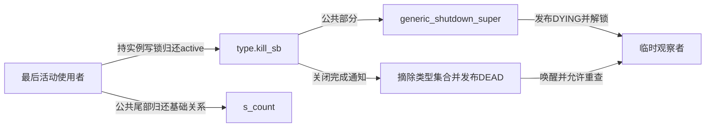
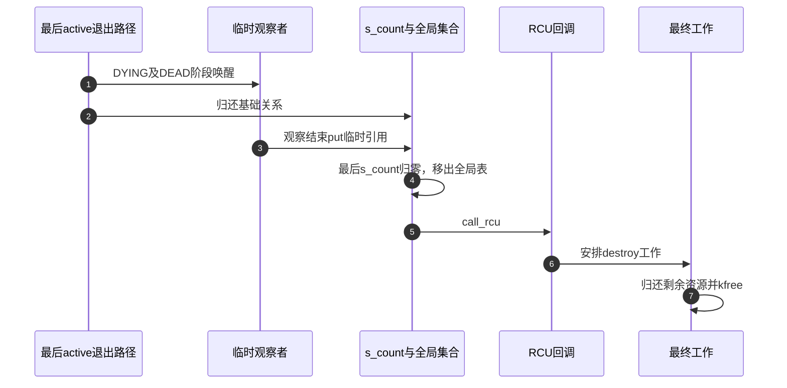

# 第7章\_实例关闭通知与最终内存回收

本页承接 [实例交接导读](../navigation/P05_实例怎样在构造与关闭之间交接.md#5.1_把阶段落到两种引用和三个标志) 的B4/B5。固定NXP Linux 6.12.20提交 `dfaf2136deb2af2e60b994421281ba42f1c087e0`，全部展开函数来自fs/super.c（blob `c9c7223bc2a2e9cb5391a1b3a291f724416289c2`），身份见 [VFS总索引](../navigation/P01_Linux_6.12_VFS源码阅读索引.md)。

## 7.1\_最后活动引用把流程交给关闭回调

```c
/** @brief 仓库补充阅读说明：非最后active可直接归还，可能最后一份时先取得实例写锁。 */
void deactivate_super(struct super_block *s)
{
	if (!atomic_add_unless(&s->s_active, -1, 1)) {
		__super_lock_excl(s);
		deactivate_locked_super(s);
	}
}
```

非最后一份可直接减active；计数可能为1时先取得实例写锁，再由持锁版本再次归还和判断。不能在不持锁时把最后active减成零，再指望其他代码自行串行化关闭。

```c
/** @brief 仓库补充阅读说明：持锁归还active，最后一份驱动类型关闭与公共退出。 */
void deactivate_locked_super(struct super_block *s)
{
	struct file_system_type *fs = s->s_type;
	if (atomic_dec_and_test(&s->s_active)) {
		shrinker_free(s->s_shrink);
		fs->kill_sb(s);

		kill_super_notify(s);

		/*
		 * Since list_lru_destroy() may sleep, we cannot call it from
		 * put_super(), where we hold the sb_lock. Therefore we destroy
		 * the lru lists right now.
		 */
		list_lru_destroy(&s->s_dentry_lru);
		list_lru_destroy(&s->s_inode_lru);

		put_filesystem(fs);
		put_super(s);
	} else {
		super_unlock_excl(s);
	}
}
```

计数仍非零只解锁返回；归零则先停止并清理实例的shrinker入口，再调用类型kill_sb。该回调必须遵守实例关闭与解锁协议，随后通知退出、销毁LRU、归还类型持有和基础临时关系。函数本身没有遍历所有用户fd强行关闭它们；合法活动使用者必须此前已按协议退出。



图中kill_sb可以通过不同文件系统辅助路径组织公共部分与后端清理；不能把它等同于s_op.put_super，更不能与公共put_super引用函数混名。

## 7.2\_先结束公共使用再通知旧实例已退出

```c
/** @brief 仓库补充阅读说明：执行公共关闭、发布DYING并释放实例锁，后端关闭仍由类型路径负责。 */
void generic_shutdown_super(struct super_block *sb)
{
	const struct super_operations *sop = sb->s_op;

	if (sb->s_root) {
		shrink_dcache_for_umount(sb);
		sync_filesystem(sb);
		sb->s_flags &= ~SB_ACTIVE;

		cgroup_writeback_umount(sb);

		/* Evict all inodes with zero refcount. */
		evict_inodes(sb);

		/*
		 * Clean up and evict any inodes that still have references due
		 * to fsnotify or the security policy.
		 */
		fsnotify_sb_delete(sb);
		security_sb_delete(sb);

		if (sb->s_dio_done_wq) {
			destroy_workqueue(sb->s_dio_done_wq);
			sb->s_dio_done_wq = NULL;
		}

		if (sop->put_super)
			sop->put_super(sb);

		/*
		 * Now that all potentially-encrypted inodes have been evicted,
		 * the fscrypt keyring can be destroyed.
		 */
		fscrypt_destroy_keyring(sb);

		if (CHECK_DATA_CORRUPTION(!list_empty(&sb->s_inodes),
				"VFS: Busy inodes after unmount of %s (%s)",
				sb->s_id, sb->s_type->name)) {
			/*
			 * Adding a proper bailout path here would be hard, but
			 * we can at least make it more likely that a later
			 * iput_final() or such crashes cleanly.
			 */
			struct inode *inode;

			spin_lock(&sb->s_inode_list_lock);
			list_for_each_entry(inode, &sb->s_inodes, i_sb_list) {
				inode->i_op = VFS_PTR_POISON;
				inode->i_sb = VFS_PTR_POISON;
				inode->i_mapping = VFS_PTR_POISON;
			}
			spin_unlock(&sb->s_inode_list_lock);
		}
	}
	/*
	 * Broadcast to everyone that grabbed a temporary reference to this
	 * superblock before we removed it from @fs_supers that the superblock
	 * is dying. Every walker of @fs_supers outside of sget{_fc}() will now
	 * discard this superblock and treat it as dead.
	 *
	 * We leave the superblock on @fs_supers so it can be found by
	 * sget{_fc}() until we passed sb->kill_sb().
	 */
	super_wake(sb, SB_DYING);
	super_unlock_excl(sb);
	if (sb->s_bdi != &noop_backing_dev_info) {
		if (sb->s_iflags & SB_I_PERSB_BDI)
			bdi_unregister(sb->s_bdi);
		bdi_put(sb->s_bdi);
		sb->s_bdi = &noop_backing_dev_info;
	}
}
```

有根时先处理dentry和同步，再清SB_ACTIVE、处理写回关联及inode、通知和安全引用，随后调用可选s_op.put_super并清理加密状态。这里的s_op.put_super是文件系统回调，不是本页后节的临时引用函数。若还有busy inode，错误检测分支会将关键指针设为毒值以暴露违规，不是保证能优雅挽救任意生命周期破坏。

之后发布DYING并解s_umount，后续仍有backing-device关联清理以及具体kill路径的工作。此时故意保留类型实例集合入口，让相同身份的竞争挂载仍能找到旧实例并等待其DEAD，避免在后端关闭未完成时创建冲突的新实例。

```c
/** @brief 仓库补充阅读说明：摘除类型实例入口，发布DEAD并唤醒等待旧实例退出的请求。 */
static void kill_super_notify(struct super_block *sb)
{
	lockdep_assert_not_held(&sb->s_umount);

	/* already notified earlier */
	if (sb->s_flags & SB_DEAD)
		return;

	/*
	 * Remove it from @fs_supers so it isn't found by new
	 * sget{_fc}() walkers anymore. Any concurrent mounter still
	 * managing to grab a temporary reference is guaranteed to
	 * already see SB_DYING and will wait until we notify them about
	 * SB_DEAD.
	 */
	spin_lock(&sb_lock);
	hlist_del_init(&sb->s_instances);
	spin_unlock(&sb_lock);

	/*
	 * Let concurrent mounts know that this thing is really dead.
	 * We don't need @sb->s_umount here as every concurrent caller
	 * will see SB_DYING and either discard the superblock or wait
	 * for SB_DEAD.
	 */
	super_wake(sb, SB_DEAD);
}
```

这个阶段要求不持实例写锁。已通知过则直接返回；否则在sb_lock内摘除s_instances，然后发布DEAD唤醒竞争者。它不把s_count直接清零，不意味着所有已取得临时引用的观察者消失。

```c
/** @brief 仓库补充阅读说明：公共关闭后通知退出并归还匿名设备号。 */
void kill_anon_super(struct super_block *sb)
{
	dev_t dev = sb->s_dev;
	generic_shutdown_super(sb);
	kill_super_notify(sb);
	free_anon_bdev(dev);
}
```

```c
/** @brief 仓库补充阅读说明：按此辅助路径清理树后进入匿名实例关闭。 */
void kill_litter_super(struct super_block *sb)
{
	if (sb->s_root)
		d_genocide(sb->s_root);
	kill_anon_super(sb);
}
```

无块设备辅助路径体现具体顺序：公共关闭后通知DEAD，再归还匿名设备号；litter辅助路径先处理相应树，再进入匿名关闭。因此“DEAD等于整个kill_sb函数已返回”并不适用于所有辅助体。这里需要的契约是竞争请求可以结束对旧实例的等待，结构内存仍由临时计数保护。

## 7.3\_最后临时引用与实际释放仍然分开

```c
/** @brief 仓库补充阅读说明：在sb_lock下归还临时计数，最后一份移出全局表并安排RCU回调。 */
static void __put_super(struct super_block *s)
{
	if (!--s->s_count) {
		list_del_init(&s->s_list);
		WARN_ON(s->s_dentry_lru.node);
		WARN_ON(s->s_inode_lru.node);
		WARN_ON(!list_empty(&s->s_mounts));
		call_rcu(&s->rcu, destroy_super_rcu);
	}
}
```

```c
/** @brief 仓库补充阅读说明：给临时计数归还加集合锁，不是文件系统的同名操作回调。 */
void put_super(struct super_block *sb)
{
	spin_lock(&sb_lock);
	__put_super(sb);
	spin_unlock(&sb_lock);
}
```

sb_lock保护s_count递减与全局super_blocks移除。归零后检查缓存和挂载集合条件，再call_rcu；此时类型集合可能早已在DEAD通知前摘除。把两个集合混成一个，会误读“实例已不可新匹配”与“已没有临时观察者”的时间差。

```c
/** @brief 仓库补充阅读说明：RCU回调安排后续工作，不直接执行全部可延后清理。 */
static void destroy_super_rcu(struct rcu_head *head)
{
	struct super_block *s = container_of(head, struct super_block, rcu);
	INIT_WORK(&s->destroy_work, destroy_super_work);
	schedule_work(&s->destroy_work);
}
```

```c
/** @brief 仓库补充阅读说明：清理通知、安全、命名空间和其他资源，最后释放结构体。 */
static void destroy_super_work(struct work_struct *work)
{
	struct super_block *s = container_of(work, struct super_block,
							destroy_work);
	fsnotify_sb_free(s);
	security_sb_free(s);
	put_user_ns(s->s_user_ns);
	kfree(s->s_subtype);
	for (int i = 0; i < SB_FREEZE_LEVELS; i++)
		percpu_free_rwsem(&s->s_writers.rw_sem[i]);
	kfree(s);
}
```

RCU回调只安排工作，最终工作函数再归还通知、安全、用户命名空间、子类型与冻结写者资源，释放结构体。RCU保护与工作队列是两个连续步骤，不是一个固定毫秒延迟。冻结写者资源在这里只做最终销毁，其运行协议留在冻结章节。

```c
/** @brief 仓库补充阅读说明：尚未公开的候选不需要等待外部观察者，直接完成相应清理。 */
static void destroy_unused_super(struct super_block *s)
{
	if (!s)
		return;
	super_unlock_excl(s);
	list_lru_destroy(&s->s_dentry_lru);
	list_lru_destroy(&s->s_inode_lru);
	shrinker_free(s->s_shrink);
	/* no delays needed */
	destroy_super_work(&s->destroy_work);
}
```

从未公开的多余候选没有外部观察者，直接解锁、清理LRU及shrinker，再调用同一最终工作函数完成资源清理，无须走RCU等待。这也要求调用者确知对象未公开，不能为加快退出将已链接实例传入此接口。



基础关系与各临时观察者归还可以以不同顺序发生，只有最后一份触发该回收链。修改时应覆盖根尚未建立的失败、已有根的关闭、等待者持有临时引用以及未公开候选销毁，不能用一次正常umount替代全部边界。本文没有目标压力或故障注入结果。
