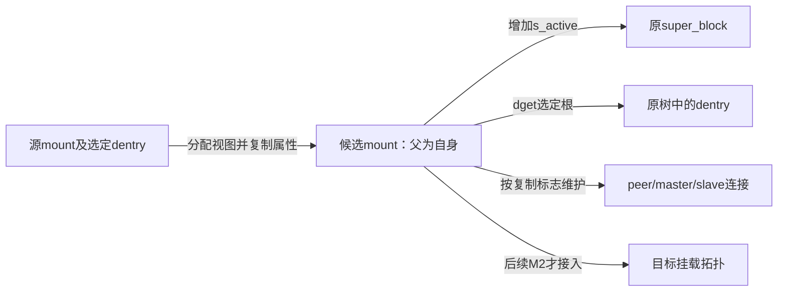
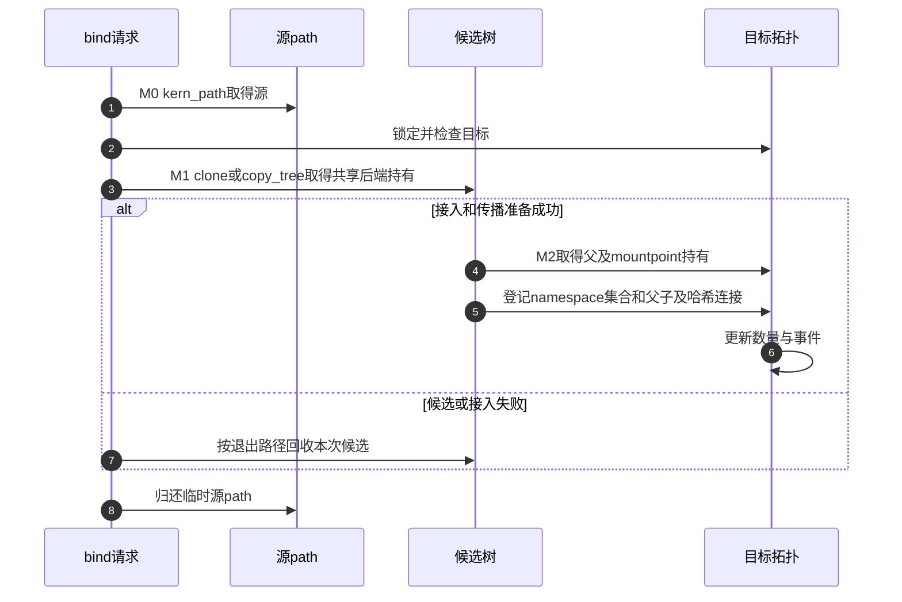
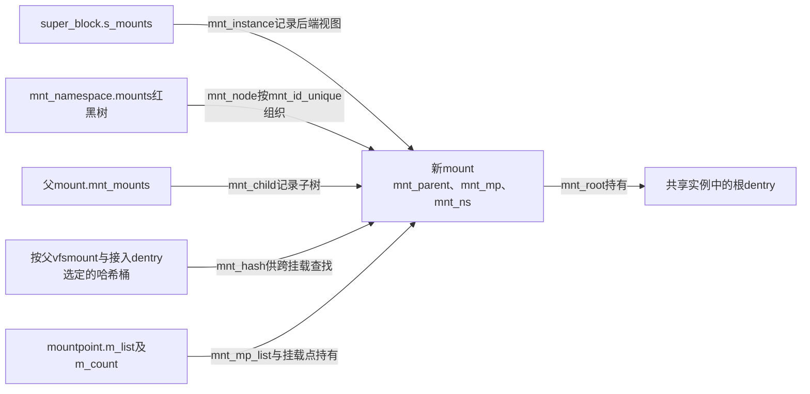

# 第8章\_挂载视图复制与目录接入

知识场景见 [独立视图与共享后端](../../../../knowledge/kernel_subsystems/vfs/P07_mount与mount_namespace.md)。本页兑现 [挂载视图导读](../navigation/P06_挂载视图怎样接入传播与退出.md#6.1_先区分视图对象和传播连接) 的 M0～M2。固定 NXP Linux 6.12.20 提交 `dfaf2136deb2af2e60b994421281ba42f1c087e0`，身份与总阅读顺序见 [VFS 总索引](../navigation/P01_Linux_6.12_VFS源码阅读索引.md)。下列声明来自 fs/mount.h，函数来自 fs/namespace.c；代码前的中文说明为仓库补充，函数体保留上游语义。

## 8.1\_先区分命名空间集合与任务的起点

新命名空间必须有一处保存自己的拓扑身份，否则复制出的 mount 无法作为一个整体被任务持有。mnt_namespace 的 root 选择根视图，mounts 组织集合；它不替代任务 fs_struct 的 root/pwd，也不保存文件内容副本。

```c
/** @brief 仓库补充阅读说明：保存拓扑集合、权限归属、配额和观察者事件状态。 */
struct mnt_namespace {
	struct ns_common	ns; /* 公共命名空间身份与引用接口 */
	struct mount *	root; /* 命名空间拓扑根，不是任务的fs.root */
	struct rb_root		mounts; /* namespace_sem保护的挂载红黑树 */
	struct user_namespace	*user_ns; /* 权限归属的用户命名空间持有 */
	struct ucounts		*ucounts; /* 命名空间数量配额关联 */
	u64			seq; /* 防止命名空间文件绑定循环的身份顺序 */
	wait_queue_head_t poll; /* 等待挂载记录变化的队列 */
	u64 event; /* 最近观察到的变化标记，不是完整事件日志 */
	unsigned int		nr_mounts; /* 已经提交的挂载数量 */
	unsigned int		pending_mounts; /* 准备接入但尚未提交的数量 */
	struct rb_node		mnt_ns_tree_node; /* 全局命名空间管理树中的节点 */
	refcount_t		passive; /* 不固定整棵挂载树的被动持有数 */
} __randomize_layout;
```

| 字段 | 本模块中的用途 | 不能据此推出什么 |
| --- | --- | --- |
| ns、user_ns、ucounts | 公共命名空间身份、权限所属及计数管理 | 新 mount namespace 自动拥有宿主管理权限 |
| root、mounts | 根视图和 namespace_sem 保护的挂载集合 | 每个任务都从 namespace.root 开始解释绝对路径 |
| seq | 防止命名空间文件相关的循环关系 | 这是每次挂载变化的通知计数 |
| poll、event | 记录观察者的等待队列与变化标记 | 一个 event 值对应可恢复的全部操作日志 |
| nr_mounts、pending_mounts | 已接入数量与待提交配额 | 准备的副本已经公开 |
| passive | 不固定 mounts 的被动持有计数 | 每种 namespace 引用都保证整棵树存续 |

mount 的各连接字段已在 [路径与挂载对象](P02_路径名称与实例的字段关系.md#2.2_path把挂载视图和名称组合起来) 展开，本页不再复制同一声明。下面只追踪这些字段在何时被写入。

## 8.2\_复制视图时取得共享后端的持有

M0 的关键不是复制整个文件系统，而是分配新 mount，再取得旧实例和选定根的持有。于是同一实例可有不同 mnt_root，传播关系也能按本次复制目的调整。

```c
/** @brief 仓库补充阅读说明：创建独立视图并持有共享后端，按标志调整传播连接。 */
static struct mount *clone_mnt(struct mount *old, struct dentry *root,
					int flag)
{
	struct super_block *sb = old->mnt.mnt_sb;
	struct mount *mnt;
	int err;

	/* 仓库补充：分配新的视图容器，后端实例尚未复制。 */
	mnt = alloc_vfsmnt(old->mnt_devname);
	if (!mnt)
		return ERR_PTR(-ENOMEM);

	if (flag & (CL_SLAVE | CL_PRIVATE | CL_SHARED_TO_SLAVE))
		mnt->mnt_group_id = 0; /* 不属于原peer组 */
	else
		mnt->mnt_group_id = old->mnt_group_id;

	if ((flag & CL_MAKE_SHARED) && !mnt->mnt_group_id) {
		err = mnt_alloc_group_id(mnt);
		if (err)
			goto out_free;
	}

	mnt->mnt.mnt_flags = old->mnt.mnt_flags;
	/* 仓库补充：不把源视图的临时状态和内部挂载身份直接继承。 */
	mnt->mnt.mnt_flags &= ~(MNT_WRITE_HOLD|MNT_MARKED|MNT_INTERNAL);

	/* 仓库补充：新视图独立持有原实例。 */
	atomic_inc(&sb->s_active);
	/* 仓库补充：ID映射关联也按引用协议取得。 */
	mnt->mnt.mnt_idmap = mnt_idmap_get(mnt_idmap(&old->mnt));

	mnt->mnt.mnt_sb = sb;
	/* 仓库补充：根可以是原实例的子目录，另取名称持有。 */
	mnt->mnt.mnt_root = dget(root);
	mnt->mnt_mountpoint = mnt->mnt.mnt_root;
	/* 仓库补充：尚未连接外部父视图。 */
	mnt->mnt_parent = mnt;
	lock_mount_hash();
	list_add_tail(&mnt->mnt_instance, &sb->s_mounts);
	unlock_mount_hash();

	if ((flag & CL_SLAVE) ||
	    ((flag & CL_SHARED_TO_SLAVE) && IS_MNT_SHARED(old))) {
		list_add(&mnt->mnt_slave, &old->mnt_slave_list);
		/* 仓库补充：建立单向接收的下游关系，不能当成peer共享。 */
		mnt->mnt_master = old;
		CLEAR_MNT_SHARED(mnt);
	} else if (!(flag & CL_PRIVATE)) {
		if ((flag & CL_MAKE_SHARED) || IS_MNT_SHARED(old))
			list_add(&mnt->mnt_share, &old->mnt_share);
		if (IS_MNT_SLAVE(old))
			list_add(&mnt->mnt_slave, &old->mnt_slave);
		mnt->mnt_master = old->mnt_master;
	} else {
		CLEAR_MNT_SHARED(mnt);
	}
	if (flag & CL_MAKE_SHARED)
		set_mnt_shared(mnt);

	/* 仅在要求时复制原有过期链关联。 */
	if (flag & CL_EXPIRE) {
		if (!list_empty(&old->mnt_expire))
			list_add(&mnt->mnt_expire, &old->mnt_expire);
	}

	return mnt;

 out_free:
	mnt_free_id(mnt);
	free_vfsmnt(mnt);
	return ERR_PTR(err);
}
```

实例 s_active 增加，根通过 dget 持有，idmap 也取得相应持有；新对象先把父指针指向自己，尚未接到外部目标。mnt_instance 加入实例的视图集合，并不等于加入目标命名空间的挂载树。CL_SLAVE、CL_SHARED_TO_SLAVE、CL_PRIVATE 等分支决定复制后的传播连接；它们不是数据拷贝选项。



递归复制还要决定哪些后代在所选根之下。copy_tree 遍历原挂载树，仅复制覆盖范围内的子挂载；unbindable、锁定子树和 namespace 文件会改变剪除或拒绝结果。具体函数在 [fs/namespace.c 原件](../../linux/fs/namespace.c)；本页把完整实现展开限定于命名空间复制和单视图持有，不把每个辅助遍历再复制一遍。

## 8.3\_复制命名空间时重新连接任务的路径

CLONE_NEWNS 请求一组新 mount 对象；没有该标志时只取得旧 namespace 的持有。跨 user namespace 时复制标志和树的锁定策略还会改变，说明“新树”与“完全自由管理所有原挂载”不是同义词。

```c
/** @brief 仓库补充阅读说明：复制命名空间树并按需重接新fs_struct的路径持有。 */
struct mnt_namespace *copy_mnt_ns(unsigned long flags, struct mnt_namespace *ns,
		struct user_namespace *user_ns, struct fs_struct *new_fs)
{
	struct mnt_namespace *new_ns;
	struct vfsmount *rootmnt = NULL, *pwdmnt = NULL;
	struct mount *p, *q;
	struct mount *old;
	struct mount *new;
	int copy_flags;

	/* 仓库补充：调用契约要求有效原命名空间，不是用户输入错误返回。 */
	BUG_ON(!ns);

	if (likely(!(flags & CLONE_NEWNS))) {
		/* 仓库补充：没有CLONE_NEWNS时共享旧namespace并增持有。 */
		get_mnt_ns(ns);
		return ns; /* 公共命名空间身份与引用接口 */
	}

	old = ns->root;

	new_ns = alloc_mnt_ns(user_ns, false);
	if (IS_ERR(new_ns))
		return new_ns;

	namespace_lock();
	/* 第一遍复制拓扑，保留共享后端。 */
	copy_flags = CL_COPY_UNBINDABLE | CL_EXPIRE;
	if (user_ns != ns->user_ns)
		/* 仓库补充：跨用户命名空间时，限制复制树向原共享域反向传播。 */
		copy_flags |= CL_SHARED_TO_SLAVE;
	new = copy_tree(old, old->mnt.mnt_root, copy_flags);
	if (IS_ERR(new)) {
		namespace_unlock();
		ns_free_inum(&new_ns->ns);
		dec_mnt_namespaces(new_ns->ucounts);
		mnt_ns_release(new_ns);
		return ERR_CAST(new);
	}
	if (user_ns != ns->user_ns) {
		lock_mount_hash();
		lock_mnt_tree(new);
		unlock_mount_hash();
	}
	/* 仓库补充：树复制成功后设置新拓扑根。 */
	new_ns->root = new;

	/* 第二遍登记新归属并重接任务起点；new_fs已是私有副本，无需再锁共享fs。 */
	p = old;
	q = new;
	while (p) {
		mnt_add_to_ns(new_ns, q);
		new_ns->nr_mounts++;
		if (new_fs) {
			if (&p->mnt == new_fs->root.mnt) {
				/* 仓库补充：替换新fs的根视图，dentry继续指向共享后端。 */
				new_fs->root.mnt = mntget(&q->mnt);
				rootmnt = &p->mnt;
			}
			if (&p->mnt == new_fs->pwd.mnt) {
				/* 仓库补充：当前目录另有一份视图持有，必须独立配对。 */
				new_fs->pwd.mnt = mntget(&q->mnt);
				pwdmnt = &p->mnt;
			}
		}
		p = next_mnt(p, old);
		q = next_mnt(q, new);
		if (!q)
			break;
		/* 对齐遍历：旧树中可能有被跳过的命名空间文件挂载。 */
		while (p->mnt.mnt_root != q->mnt.mnt_root)
			p = next_mnt(skip_mnt_tree(p), old);
	}
	/* 仓库补充：登记完整新命名空间，而非复制文件内容。 */
	mnt_ns_tree_add(new_ns);
	namespace_unlock();

	if (rootmnt)
		/* 仓库补充：新视图已取得持有，再归还旧根视图。 */
		mntput(rootmnt);
	if (pwdmnt)
		/* 仓库补充：旧pwd视图单独归还，即使与root相同。 */
		mntput(pwdmnt);

	return new_ns;
}
```

先分配新 namespace，再在 namespace_lock 保护下复制树。第二遍同步遍历旧、新 mount，将新对象加入新集合；若要更新新 fs_struct，就把它的 root/pwd 中的 mount 换成对应新对象，随后归还旧 mount 持有。dentry 仍可共享，所以这一步不是重建目录数据。

copy_tree 失败时尚未形成可交付的新 namespace，必须释放候选；成功后挂载树被注册到命名空间管理结构中。读者应跟踪“哪个对象的引用被转移”，不能把所有 mntget/mntput 合并成无关的计数噪声。

## 8.4\_绑定请求先验证源与目标再接入

bind 已有源路径，仍需检查它能否被复制、目标是否允许接入，以及非递归复制会不会隐藏受保护的子挂载。入口分为源视图准备和目标接入两段。

```c
/** @brief 仓库补充阅读说明：验证源视图限制后选择单视图或递归复制。 */
static struct mount *__do_loopback(struct path *old_path, int recurse)
{
	struct mount *mnt = ERR_PTR(-EINVAL), *old = real_mount(old_path->mnt);

	/* 仓库补充：禁止以不可绑定源构造此bind候选。 */
	if (IS_MNT_UNBINDABLE(old))
		return mnt;

	if (!check_mnt(old) && old_path->dentry->d_op != &ns_dentry_operations)
		return mnt;

	/* 仓库补充：非递归复制不能借隐藏子挂载绕过锁定约束。 */
	if (!recurse && has_locked_children(old, old_path->dentry))
		return mnt;

	if (recurse)
		mnt = copy_tree(old, old_path->dentry, CL_COPY_MNT_NS_FILE);
	else
		mnt = clone_mnt(old, old_path->dentry, 0);

	if (!IS_ERR(mnt))
		/* 仓库补充：只清新候选的顶层锁定位，不改源对象。 */
		mnt->mnt.mnt_flags &= ~MNT_LOCKED;

	return mnt;
}
```

```c
/** @brief 仓库补充阅读说明：配对源path与目标锁定，失败清理候选。 */
static int do_loopback(struct path *path, const char *old_name,
				int recurse)
{
	struct path old_path;
	struct mount *mnt = NULL, *parent;
	struct mountpoint *mp;
	int err;
	if (!old_name || !*old_name)
		return -EINVAL;
	err = kern_path(old_name, LOOKUP_FOLLOW|LOOKUP_AUTOMOUNT, &old_path);
	if (err)
		return err;

	err = -EINVAL;
	if (mnt_ns_loop(old_path.dentry))
		goto out;

	/* 仓库补充：锁定目标相关状态，失败仍须归还已取得的源path。 */
	mp = lock_mount(path);
	if (IS_ERR(mp)) {
		err = PTR_ERR(mp);
		goto out;
	}

	parent = real_mount(path->mnt);
	if (!check_mnt(parent))
		goto out2;

	mnt = __do_loopback(&old_path, recurse);
	if (IS_ERR(mnt)) {
		err = PTR_ERR(mnt);
		goto out2;
	}

	/* 仓库补充：准备好的候选仍需目标类型和传播接入检查。 */
	err = graft_tree(mnt, parent, mp);
	if (err) {
		lock_mount_hash();
		/* 仓库补充：接入失败按候选树退出协议回收，不能裸free。 */
		umount_tree(mnt, UMOUNT_SYNC);
		unlock_mount_hash();
	}
out2:
	unlock_mount(mp);
out:
	/* 仓库补充：所有取得源成功的出口都归还临时源路径。 */
	path_put(&old_path);
	return err;
}
```

先 kern_path 取得源，再 lock_mount 取得目标相关保护；检查目标属于当前命名空间后才准备复制。graft_tree 失败则将候选树按退出协议清理，而源 path 始终在出口归还。这里的错误不能通过“把源 mount 指针直接塞到目标”绕过，否则同一对象的父连接和所有权会被破坏。

```c
/** @brief 仓库补充阅读说明：核对根与接入点属性后进入传播接入。 */
static int graft_tree(struct mount *mnt, struct mount *p, struct mountpoint *mp)
{
	if (mnt->mnt.mnt_sb->s_flags & SB_NOUSER)
		return -EINVAL;

	if (d_is_dir(mp->m_dentry) !=
	      d_is_dir(mnt->mnt.mnt_root))
		return -ENOTDIR;

	return attach_recursive_mnt(mnt, p, mp, 0);
}
```

该检查要求根与挂载点在目录属性上匹配，并拒绝 SB_NOUSER 实例。最终进入 attach_recursive_mnt；它要处理传播副本与提交，见 [传播准备和提交](P09_传播关系与挂载记录.md#9.1_先准备传播副本再提交拓扑)。

## 8.5\_提交同时更新父连接查找入口和集合

只有 mnt_parent 不足以支持后续路径查找与枚举。挂载点对象需要引用，父 mount 需要持有，查找哈希、父子链和 namespace 集合也必须按同一拓扑协议维护。

```c
/** @brief 仓库补充阅读说明：取得父及挂载点持有并设置接入关系。 */
void mnt_set_mountpoint(struct mount *mnt,
			struct mountpoint *mp,
			struct mount *child_mnt)
{
	/* 仓库补充：接入关系持有挂载点对象。 */
	mp->m_count++;
	mnt_add_count(mnt, 1);	/* 等效于增加父mount持有 */
	child_mnt->mnt_mountpoint = mp->m_dentry;
	/* 仓库补充：父视图持有已经在上一句增加。 */
	child_mnt->mnt_parent = mnt;
	child_mnt->mnt_mp = mp;
	/* 仓库补充：挂载点维护覆盖它的子mount集合。 */
	hlist_add_head(&child_mnt->mnt_mp_list, &mp->m_list);
}
```

```c
/** @brief 仓库补充阅读说明：建立按父视图和dentry查找的哈希及父子链。 */
static void __attach_mnt(struct mount *mnt, struct mount *parent)
{
	hlist_add_head_rcu(&mnt->mnt_hash,
			   m_hash(&parent->mnt, mnt->mnt_mountpoint));
	list_add_tail(&mnt->mnt_child, &parent->mnt_mounts);
}
```

```c
/** @brief 仓库补充阅读说明：将视图登记到命名空间的有序集合。 */
static void mnt_add_to_ns(struct mnt_namespace *ns, struct mount *mnt)
{
	struct rb_node **link = &ns->mounts.rb_node;
	struct rb_node *parent = NULL;

	/* 仓库补充：重复归属检查不替调用者完成脱离。 */
	WARN_ON(mnt_ns_attached(mnt));
	/* 仓库补充：先设置归属，再接入该namespace的有序集合。 */
	mnt->mnt_ns = ns;
	while (*link) {
		parent = *link;
		if (mnt->mnt_id_unique < node_to_mount(parent)->mnt_id_unique)
			link = &parent->rb_left;
		else
			link = &parent->rb_right;
	}
	rb_link_node(&mnt->mnt_node, parent, link);
	rb_insert_color(&mnt->mnt_node, &ns->mounts);
}
```

```c
/** @brief 仓库补充阅读说明：提交整棵候选树、配额和根连接并通知变化。 */
static void commit_tree(struct mount *mnt)
{
	struct mount *parent = mnt->mnt_parent;
	struct mount *m;
	LIST_HEAD(head);
	struct mnt_namespace *n = parent->mnt_ns;

	/* 仓库补充：提交要求已经建立外部父关系。 */
	BUG_ON(parent == mnt);

	list_add_tail(&head, &mnt->mnt_list);
	while (!list_empty(&head)) {
		m = list_first_entry(&head, typeof(*m), mnt_list);
		list_del(&m->mnt_list);

		mnt_add_to_ns(n, m);
	}
	/* 仓库补充：准备阶段累计的配额在提交时转为已接入数量。 */
	n->nr_mounts += n->pending_mounts;
	/* 仓库补充：提交后清空本批待接入数量。 */
	n->pending_mounts = 0;

	__attach_mnt(mnt, parent);
	/* 仓库补充：拓扑连接完成后标记记录变化并通知观察者。 */
	touch_mnt_namespace(n);
}
```

commit_tree 的前提是候选已有合法父连接及待提交数量；它把子树逐个登记到 namespace 的红黑树，提交 pending_mounts，再接入根的哈希/父子链并更新事件。不能从函数内部未见 namespace_lock 就推断调用者无需持锁，锁的前提来自上层接入路径。



本页证明复制与接入各写哪些状态，不证明任何测试机器已执行这些分支。原件 blob：fs/mount.h 为 `179f690a0c7223f04b57be181b7f0412ce6a7946`，fs/namespace.c 为 `73da51ac5a0349f2cebb300aeb979574e6cc37cf`。返回 [模块导读](../navigation/P06_挂载视图怎样接入传播与退出.md#6.2_沿同一周期选择实现入口) 后继续传播和退出。


## 8.6\_沿复制与接入区分三套索引

一个新mount先进入实例的s_mounts，表示它持有这个后端；随后才可能通过mnt_ns进入某个命名空间的有序集合，并通过父视图与dentry组成的查找键接入路径解析。三套索引的目的不同。如果只更新mnt_parent，目录枚举、跨挂载查找和最终归还就可能各自看到不同结果。



| 声明或实现簇 | 身份、初始化及消费者 | 局部修改边界 |
| --- | --- | --- |
| mnt_namespace（fs/mount.h完整声明） | namespace.c的alloc_mnt_ns先零分配，初始化ns.count、passive、空mounts、poll、user_ns和配额；非匿名对象另取命名空间编号与seq | root在树准备后赋值；seq用于防循环，event用于记录变化，不可混用；被动引用不能冒充树持有 |
| clone_mnt、alloc_vfsmnt | 同文件私有构造路径；新mount有自己的编号、连接节点与计数，再取得实例、根和idmap | 组ID分配失败发生在取得后端持有之前；不能把后期资源清理不加判断地搬到这个早期出口 |
| copy_mnt_ns | 公共命名空间复制入口；CLONE_NEWNS决定新树或共享旧对象 | new_fs若非空必须是本次私有上下文；在共享fs上直接赋root/pwd而不遵守写保护会破坏其他任务 |
| __do_loopback、do_loopback、graft_tree | namespace.c内部bind路径；源路径持有、目标锁定、候选复制、传播接入依次成立 | 不可绑定、跨namespace源、受锁子挂载、目录属性及SB_NOUSER分别控制准入；失败按已取得资源逐层归还 |
| mnt_set_mountpoint、__attach_mnt、mnt_add_to_ns、commit_tree | 具体写入mountpoint持有、父持有、哈希、父子链与命名空间红黑树 | 上层namespace与mount锁前提必须保持；红黑树按mnt_id_unique排序，不是传统mountinfo的可复用mnt_id |
| copy_tree、next_mnt及跳过子树辅助 | fs/namespace.c的挂载拓扑复制与遍历，声明见fs/pnode.h中的公共辅助 | 本页保留选择标志和裁剪语义，未逐句展开通用遍历；不能把CL_COPY_UNBINDABLE与用户请求“允许bind不可绑定源”混为一谈 |

`namespace_lock`取得namespace_sem写侧，`lock_mount_hash`参与mount_lock保护；两者承担不同范围，不能把一个替代另一个。mnt_add_count在SMP构建更新每CPU计数，在本次非SMP构建更新受抢占约束的直接计数；mntget/mntput仍按同一持有契约配对。rb_link_node/rb_insert_color维护索引，list/hlist操作维护对应连接，本页不重复红黑树平衡算法，但每个节点的所属集合和退出责任都不能省略。

修改复制策略应同时核对同一根与子目录根、同一与不同user_ns、递归与非递归、两个起点碰巧相同以及树复制中途失败。修改提交顺序还要核对pending_mounts、传统与唯一ID、挂载点引用及退出路径，不能只靠一次bind后能读到文件判定全部连接正确。BUG_ON和WARN_ON检查不自动补齐缺失关系；本次静态核对没有代替这些并发与失败实验。
